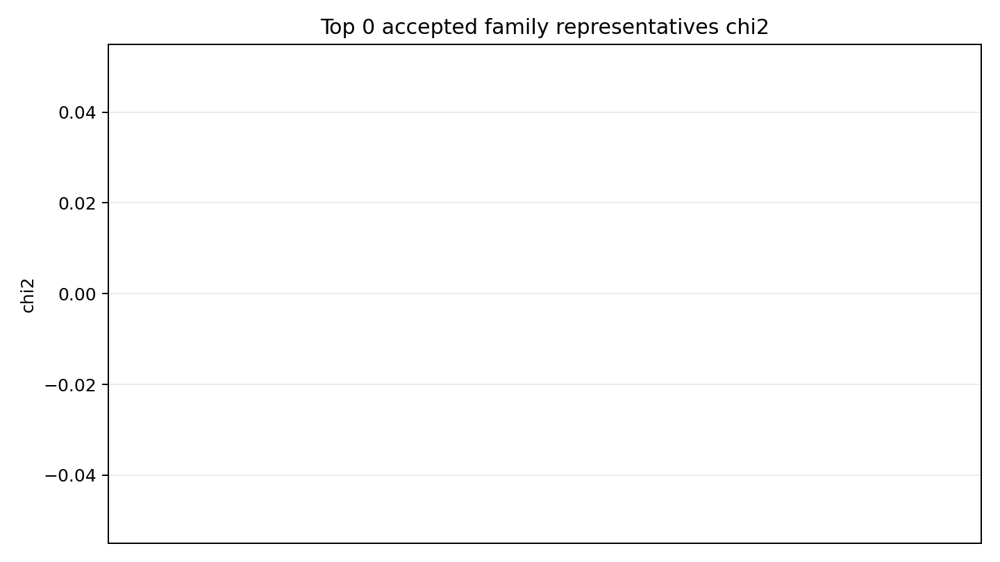
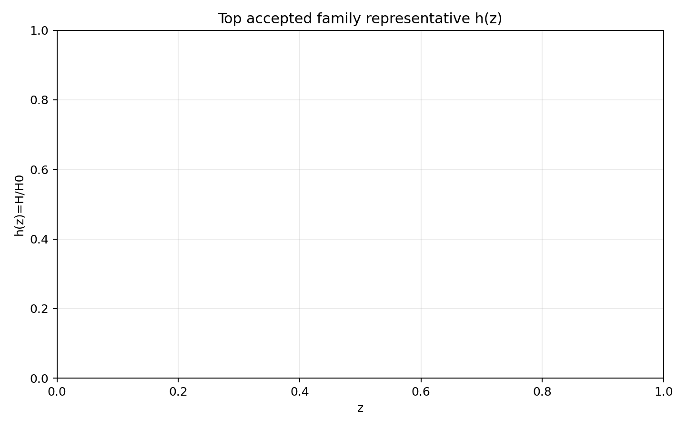
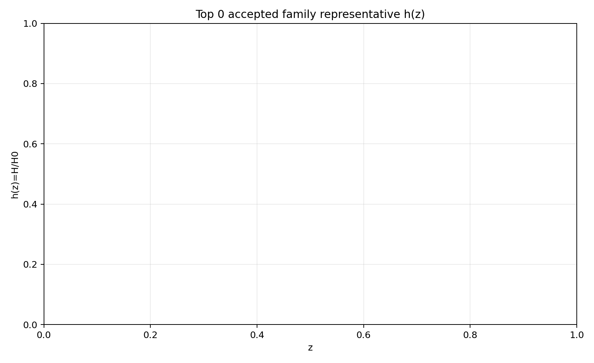
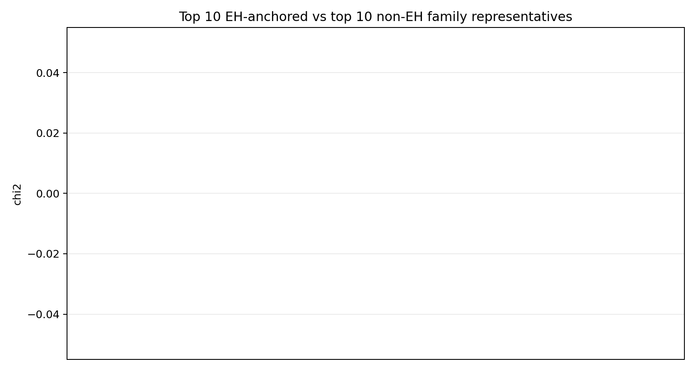
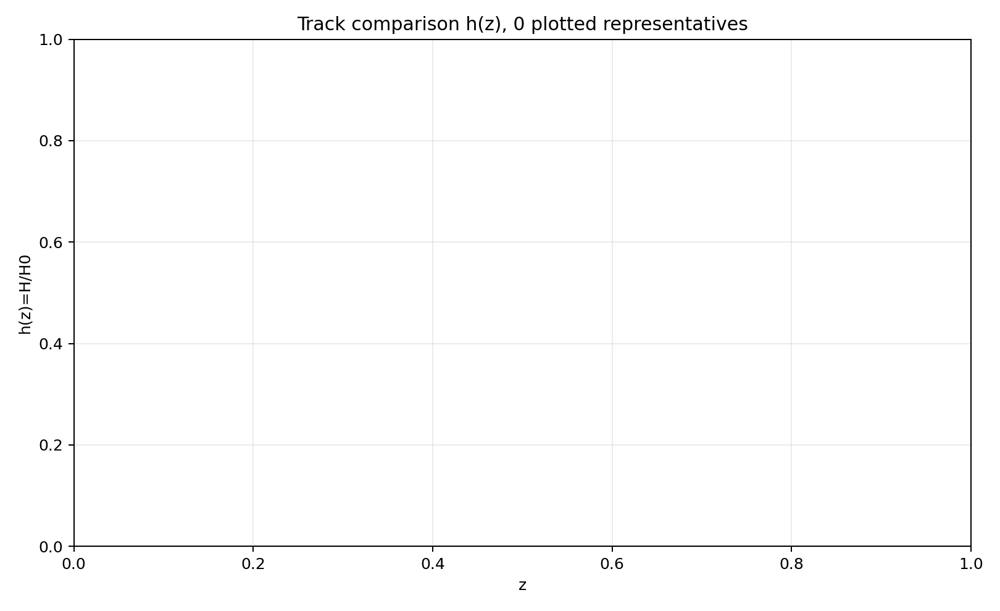
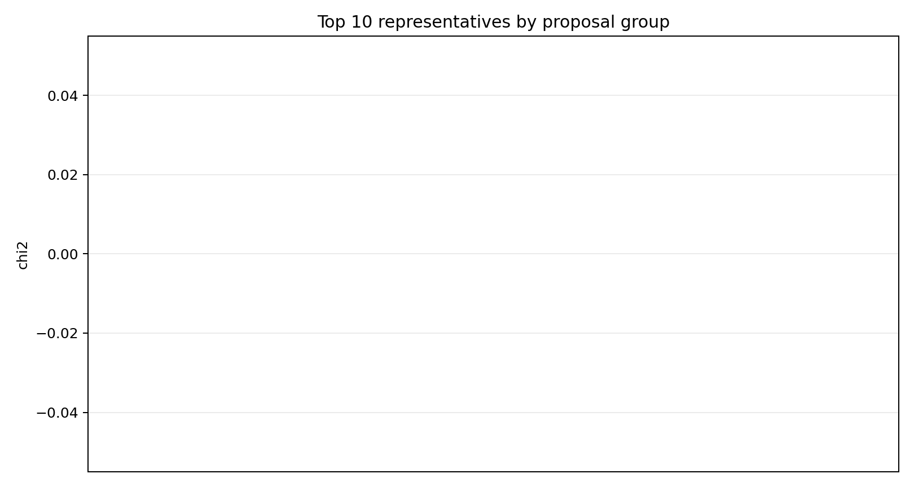
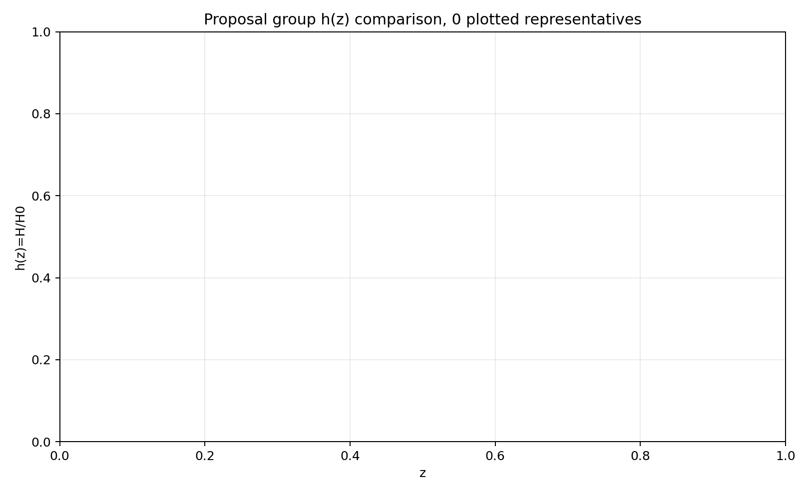

# LangGraph Agent Result Summary: async_lanes_smoke_real_after_review

This report is generated from current-loop memory and the isolated Solver outputs for accepted attempts.
Human-facing tables and plots use one best representative per theory family; full accepted attempts remain in `accepted_summary.json`.

## Quick Result

| Metric | Value |
|---|---:|
| Total attempts | 3 |
| Accepted attempts | 0 |
| Accepted theory families shown | 0 |
| Best chi2 |  |
| q_not_determined | 0 |
| constraint_drift | 0 |
| q_initial_root_failure | 0 |

## Output Files

- [accepted_lagrangians_and_parameters.md](accepted_lagrangians_and_parameters.md)
- [accepted_lagrangians_full.md](accepted_lagrangians_full.md)
- [accepted_lagrangians_and_parameters.csv](accepted_lagrangians_and_parameters.csv)
- [accepted_summary.json](accepted_summary.json)

## Plots

## Proposal Group Comparison

- [Top open-search representatives](top_open_search.md)
- [Top non-EH representatives](top_non_eh.md)

## Track Comparison

- [Top EH-anchored representatives](top_eh_anchored.md)
- [Top non-EH representatives](top_non_eh.md)

## Top Accepted Family Representatives

| Rank | Group | Track | Family | Loop | chi2 | Status | Max rel. effect | Dominant correction | Sample | H0 | Omega_m0 | lambda_H | Scalar | Potential | Operators |
|---:|---|---|---|---|---:|---|---:|---|---:|---:|---:|---:|---|---|---|

## Top Family Representative Parameter Choices

| Rank | Loop | varphi1_0 | q1_0 | mu1 | fbar1 | varphi2_0 | q2_0 | mu2 | fbar2 | Free coefficients |
|---:|---|---:|---:|---:|---:|---:|---:|---:|---:|---|

## Main Failure Tags

| Tag | Count |
|---|---:|
| symbolic_timeout | 3 |
