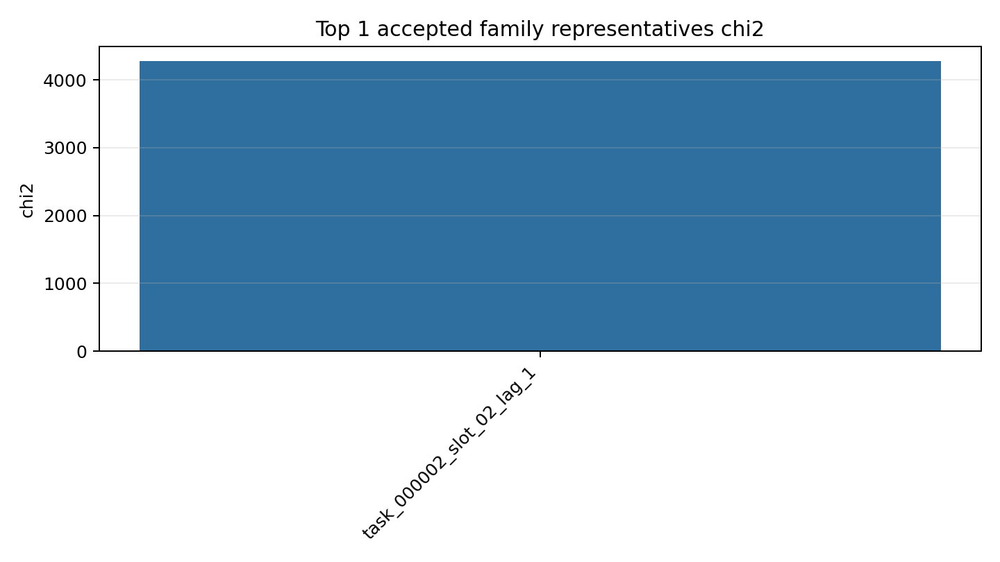
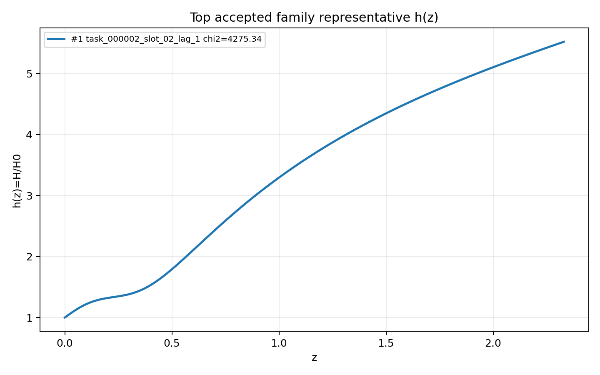
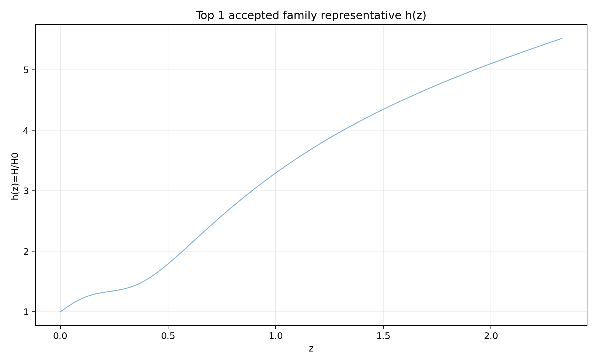
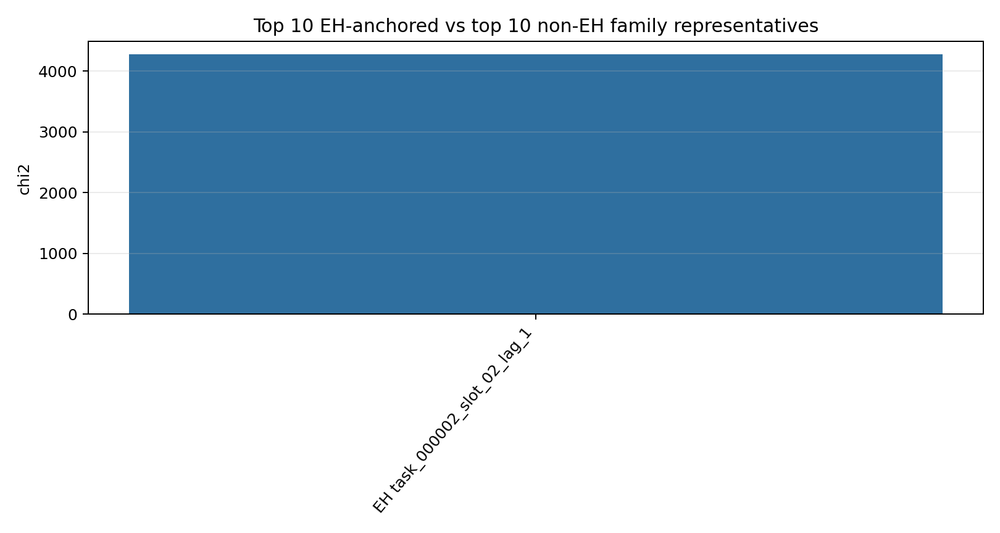
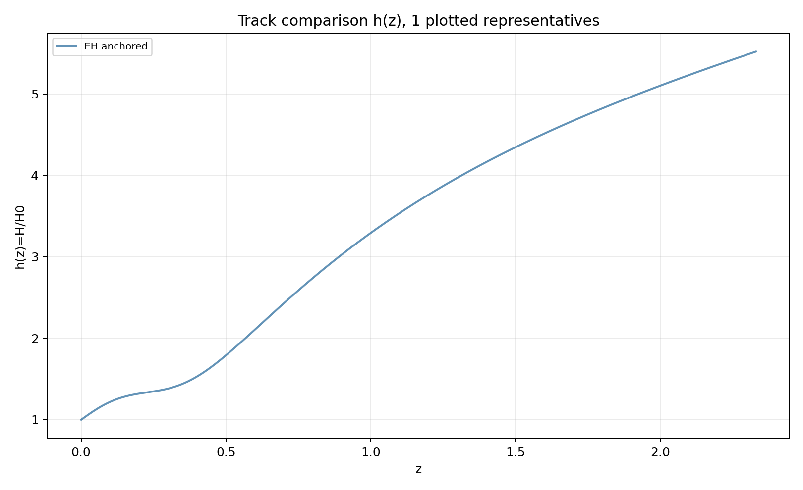
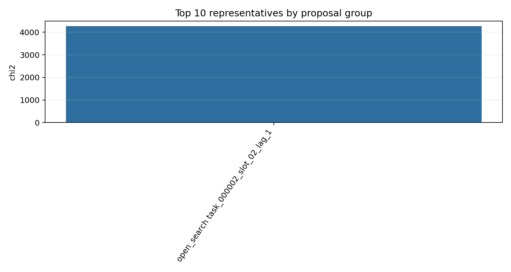
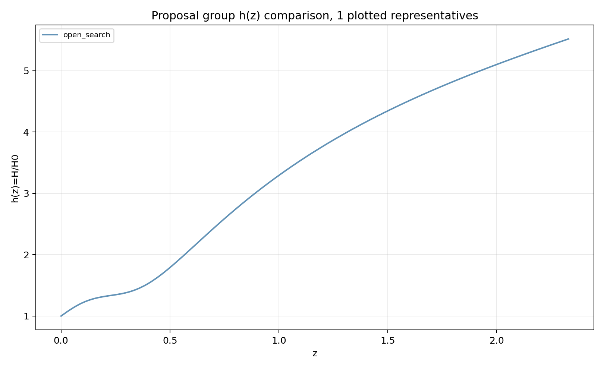
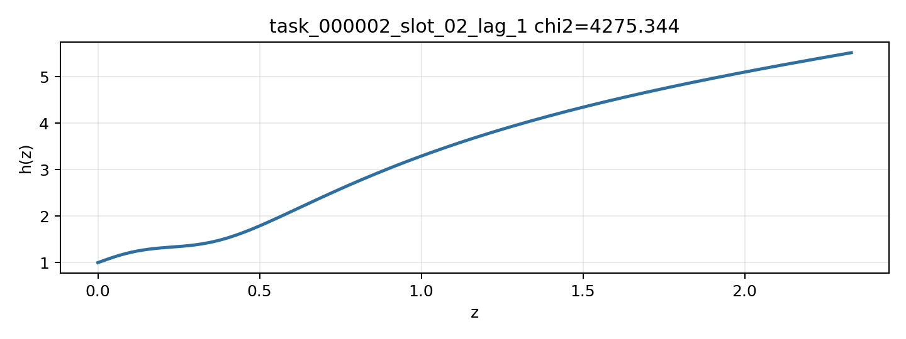

# LangGraph Agent Result Summary: async_slots_smoke_20260616_003452

This report is generated from current-loop memory and the isolated Solver outputs for accepted attempts.
Human-facing tables and plots use one best representative per theory family; full accepted attempts remain in `accepted_summary.json`.

## Quick Result

| Metric | Value |
|---|---:|
| Total attempts | 2 |
| Accepted attempts | 1 |
| Accepted theory families shown | 1 |
| Best chi2 | 4275.344491 |
| q_not_determined | 0 |
| constraint_drift | 0 |
| q_initial_root_failure | 1 |

## Output Files

- [accepted_lagrangians_and_parameters.md](accepted_lagrangians_and_parameters.md)
- [accepted_lagrangians_full.md](accepted_lagrangians_full.md)
- [accepted_lagrangians_and_parameters.csv](accepted_lagrangians_and_parameters.csv)
- [accepted_summary.json](accepted_summary.json)

## Plots

## Proposal Group Comparison

- [Top open-search representatives](top_open_search.md)
- [Top non-EH representatives](top_non_eh.md)

## Track Comparison

- [Top EH-anchored representatives](top_eh_anchored.md)
- [Top non-EH representatives](top_non_eh.md)

## Top Accepted Family Representatives

| Rank | Group | Track | Family | Loop | chi2 | Status | Max rel. effect | Dominant correction | Sample | H0 | Omega_m0 | lambda_H | Scalar | Potential | Operators |
|---:|---|---|---|---|---:|---|---:|---|---:|---:|---:|---:|---|---|---|
| 1 | open_search | eh_anchored | scalar=both|phi1_potential=quadratic|phi2_potential=axion|operator_bucket=R_anchor+derivative+high_curvature+scalar_curvature | task_000002_slot_02_lag_1 | 4275.344491 | active | 17.993 | φ1 · ∇^{a}φ1 · ∇_{a}R | 3 | 59.332 | 0.3062 | 966.44 | both | {"phi1": "quadratic", "phi2": "axion"} | R; φ1 · ∇^{a}φ1 · ∇_{a}R; φ1 · ∇^{a}∇_{a}φ1 · R; ∇^{a}φ1 · ∇^{b}φ1 · R_{ab}; φ2 · φ2 · ∇^{a}φ2 · ∇_{a}φ2 |

## Top Family Representative Parameter Choices

| Rank | Loop | varphi1_0 | q1_0 | mu1 | fbar1 | varphi2_0 | q2_0 | mu2 | fbar2 | Free coefficients |
|---:|---|---:|---:|---:|---:|---:|---:|---:|---:|---|
| 1 | task_000002_slot_02_lag_1 | 0.0162 | -2.0341 | 9.7912 | 94.7687 | -1.8334e-05 | -8.2124e-04 | 183.1631 | 30.4068 | \alpha=0.5, \beta=-2.9937e+16, \gamma=3.1282e+13, \delta=4.7853e+14, \epsilon=-9.5489e-04 |

## Main Failure Tags

| Tag | Count |
|---|---:|
| no_accepted_samples | 1 |
| q_initial_root_failure | 1 |
| integration_failure | 1 |
