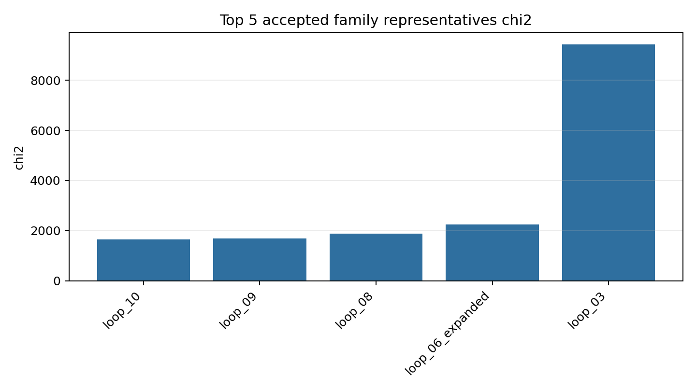
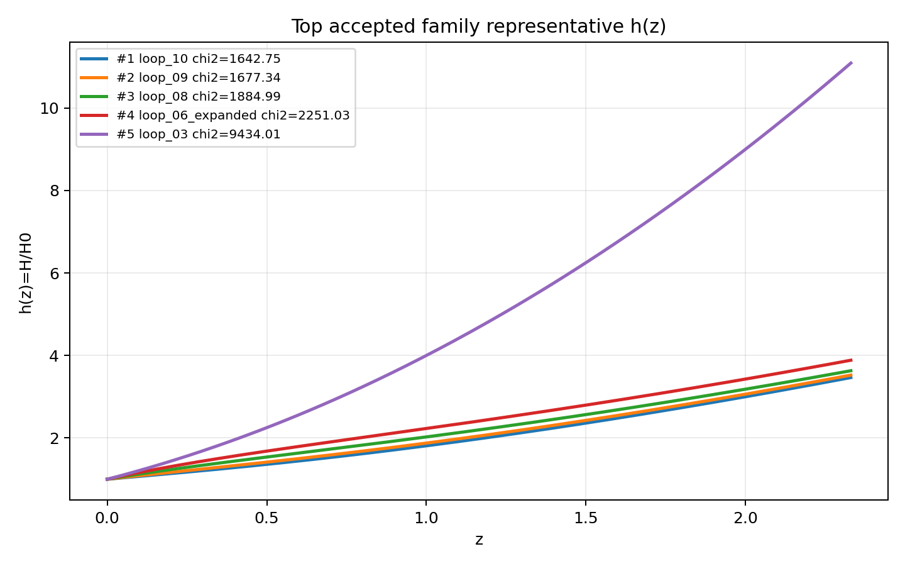
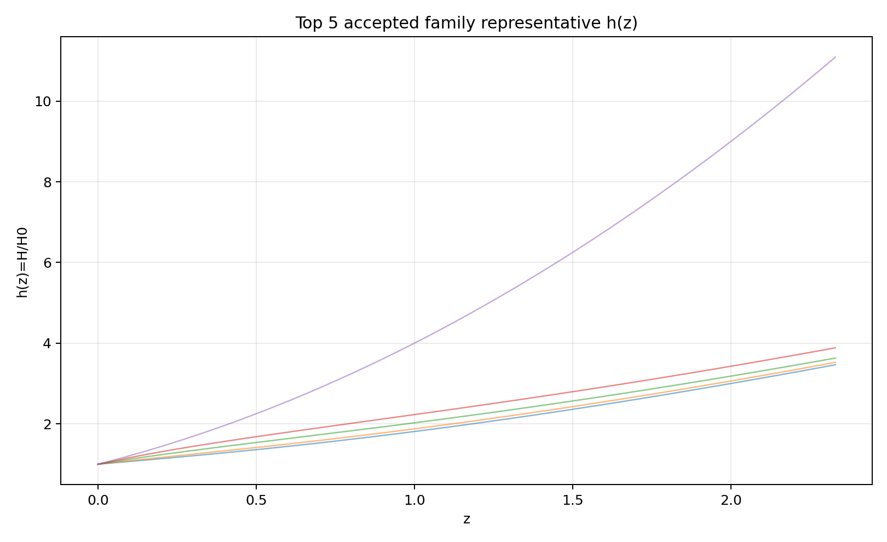
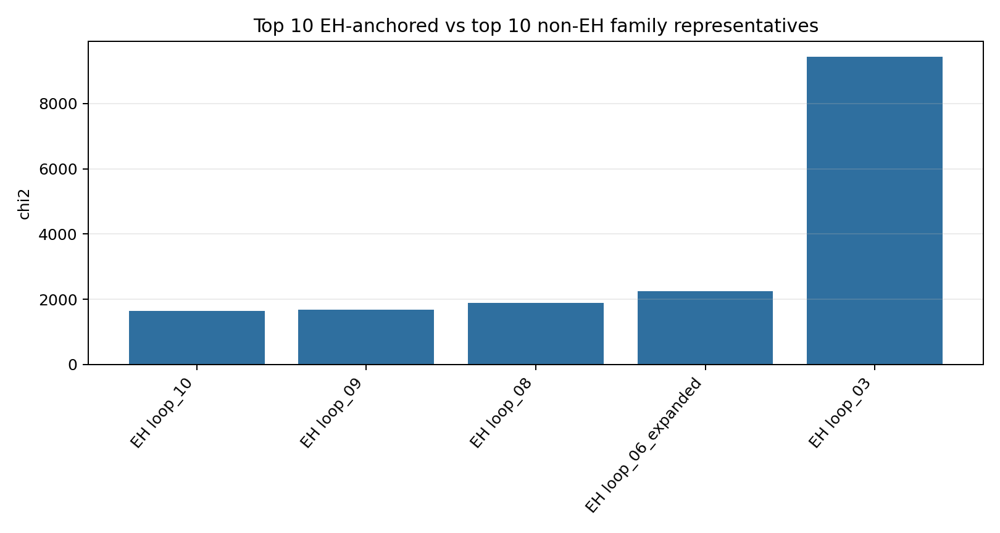
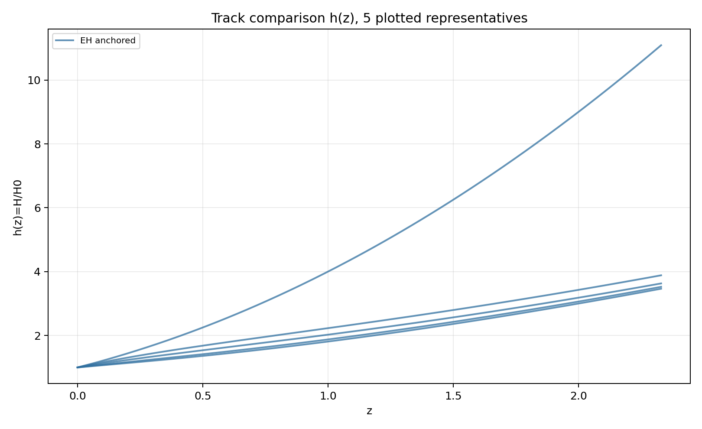
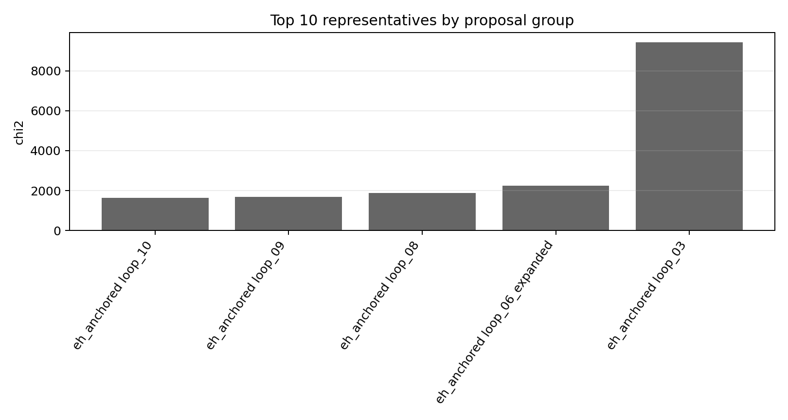
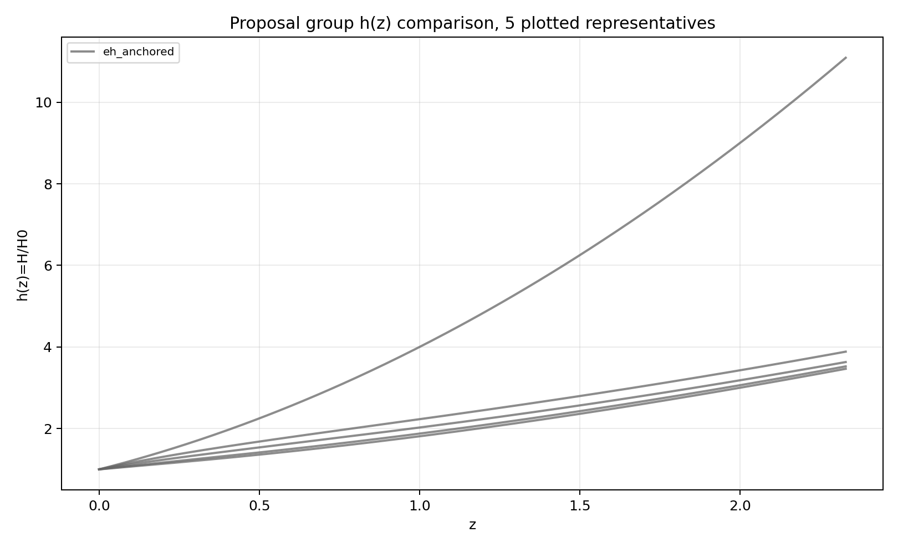
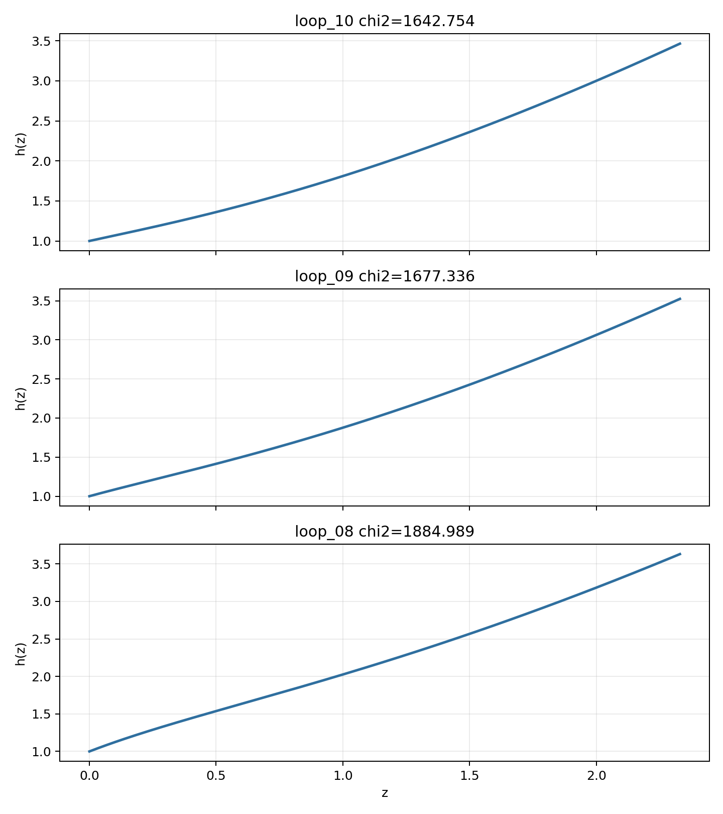

# LangGraph Agent Result Summary: codex_joint_prior_10loop_20260614

This report is generated from current-loop memory and the isolated Solver outputs for accepted attempts.
Human-facing tables and plots use one best representative per theory family; full accepted attempts remain in `accepted_summary.json`.

## Quick Result

| Metric | Value |
|---|---:|
| Total attempts | 12 |
| Accepted attempts | 7 |
| Accepted theory families shown | 5 |
| Best chi2 | 1642.753957 |
| q_not_determined | 0 |
| constraint_drift | 5 |
| q_initial_root_failure | 10 |

## Output Files

- [accepted_lagrangians_and_parameters.md](accepted_lagrangians_and_parameters.md)
- [accepted_lagrangians_full.md](accepted_lagrangians_full.md)
- [accepted_lagrangians_and_parameters.csv](accepted_lagrangians_and_parameters.csv)
- [accepted_summary.json](accepted_summary.json)

## Plots

## Proposal Group Comparison

- [Top open-search representatives](top_open_search.md)
- [Top EH + phi2-only representatives](top_eh_phi2_only.md)
- [Top non-EH representatives](top_non_eh.md)

## Track Comparison

- [Top EH-anchored representatives](top_eh_anchored.md)
- [Top non-EH representatives](top_non_eh.md)

## Top Accepted Family Representatives

| Rank | Group | Track | Family | Loop | chi2 | Status | Max rel. effect | Dominant correction | Sample | H0 | Omega_m0 | lambda_H | Scalar | Potential | Operators |
|---:|---|---|---|---|---:|---|---:|---|---:|---:|---:|---:|---|---|---|
| 1 | eh_anchored | eh_anchored | scalar=phi1_only|phi1_potential=quadratic|phi2_potential=None|operator_bucket=R_anchor+derivative+high_curvature+scalar_curvature | loop_10 | 1642.753957 | active | 2.320e+04 | R^{bcd}_{a} · R^{a}_{bcd} | 898 | 62.838 | 0.3007 | 9775.327 | phi1_only | {"phi1": "quadratic", "phi2": null} | R; R · R; R^{bcd}_{a} · R^{a}_{bcd}; R^{cd}_{ab} · R^{afh}_{c} · R^{b}_{fdh}; φ1 · R^{bcd}_{a} · R^{a}_{bcd}; ∇^{a}φ1 · ∇_{a}φ1 · R |
| 2 | eh_anchored | eh_anchored | scalar=phi1_only|phi1_potential=axion|phi2_potential=None|operator_bucket=R_anchor | loop_09 | 1677.336053 | eh_only | 0 |  | 608 | 63.106 | 0.2955 | 1.257e+04 | phi1_only | {"phi1": "axion", "phi2": null} | R |
| 3 | eh_anchored | eh_anchored | scalar=phi1_only|phi1_potential=quadratic|phi2_potential=None|operator_bucket=R_anchor | loop_08 | 1884.988589 | eh_only | 0 |  | 972 | 63.46 | 0.2976 | 7559.495 | phi1_only | {"phi1": "quadratic", "phi2": null} | R |
| 4 | eh_anchored | eh_anchored | scalar=phi1_only|phi1_potential=quadratic|phi2_potential=None|operator_bucket=R_anchor+high_curvature+scalar_curvature | loop_06_expanded | 2251.030211 | weak | 1.367e-05 | R^{bd}_{ac} · R^{agh}_{b} · R^{c}_{dgh} | 2082 | 63.846 | 0.3131 | 1691.46 | phi1_only | {"phi1": "quadratic", "phi2": null} | R; R^{bd}_{ac} · R^{agh}_{b} · R^{c}_{dgh}; φ1 · φ1 · R · R |
| 5 | eh_anchored | eh_anchored | scalar=phi2_only|phi1_potential=None|phi2_potential=axion|operator_bucket=R_anchor+scalar_curvature | loop_03 | 9434.007682 | eh_dominated | 5.519e-14 | φ2 · φ2 · φ2 · φ2 · R | 266 | 68.4 | 0.31 | 1379.73 | phi2_only | {"phi1": null, "phi2": "axion"} | R; φ2 · φ2 · φ2 · φ2 · R |

## Top Family Representative Parameter Choices

| Rank | Loop | varphi1_0 | q1_0 | mu1 | fbar1 | varphi2_0 | q2_0 | mu2 | fbar2 | Free coefficients |
|---:|---|---:|---:|---:|---:|---:|---:|---:|---:|---|
| 1 | loop_10 | 1.5065 | -0.6835 | 1.2817 | 0.8811 | 0 | 0 | 0 | 1 | \alpha=0.5, \beta=-5.1821e-06, \gamma=1.1084e+12, \delta=-3.3435e+13, \epsilon=-0.3607, \zeta=8.0923e+10 |
| 2 | loop_09 | 0.9906 | -0.9397 | 1.8984 | 1.2123 | 0 | 0 | 0 | 1 | \alpha=0.5 |
| 3 | loop_08 | 0.6494 | -1.3095 | 2.4344 | 0.7081 | 0 | 0 | 0 | 1 | \alpha=0.5 |
| 4 | loop_06_expanded | 0.4129 | -1.5805 | 3.0861 | 0.0553 | 0 | 0 | 0 | 1 | \alpha=0.5, \beta=-5.5949e+07, \gamma=2.2579e+08 |
| 5 | loop_03 | 0 | 0 | 0 | 1 | 0.0316 | -0.0352 | 1 | 0.001 | \alpha=0.5, \beta=1.0000e+05 |

## Main Failure Tags

| Tag | Count |
|---|---:|
| q_initial_root_failure | 10 |
| constraint_drift | 5 |
| missing_ranking | 5 |
| no_accepted_samples | 5 |
| h_absurdly_large | 5 |
| integration_failure | 1 |
| no_scalar_constraint | 1 |
