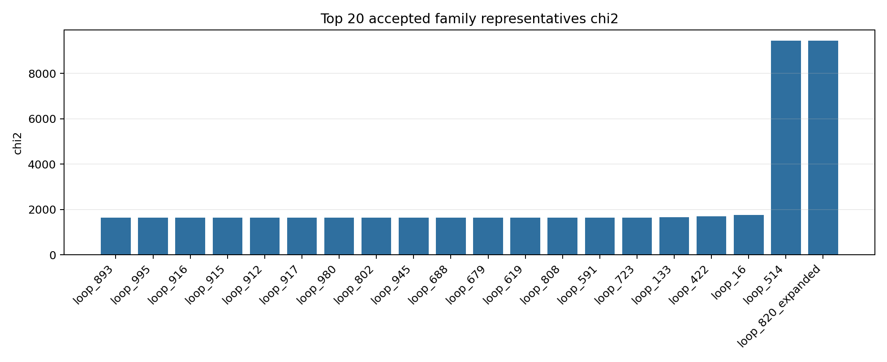
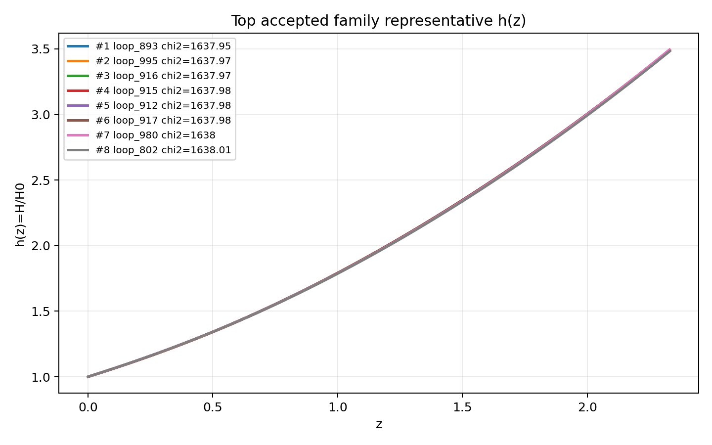
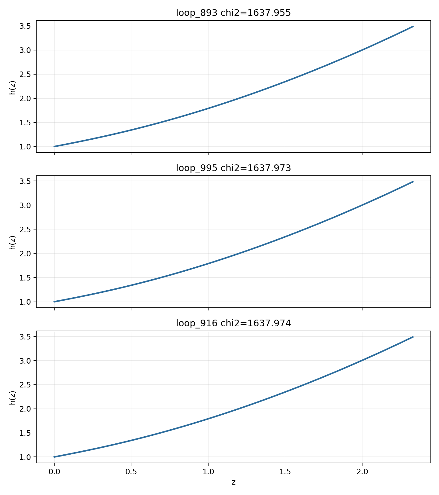

# LangGraph Agent Result Summary: graph_agent_1000_timeoutfix_20260604

This report is generated from current-loop memory and the isolated Solver outputs for accepted attempts.
Human-facing tables and plots use one best representative per theory family; full accepted attempts remain in `accepted_summary.json`.

## Quick Result

| Metric | Value |
|---|---:|
| Total attempts | 1009 |
| Accepted attempts | 133 |
| Accepted theory families shown | 24 |
| Best chi2 | 1637.954831 |
| q_not_determined | 183 |
| constraint_drift | 155 |
| q_initial_root_failure | 283 |

## Output Files

- [accepted_lagrangians_and_parameters.md](accepted_lagrangians_and_parameters.md)
- [accepted_lagrangians_full.md](accepted_lagrangians_full.md)
- [accepted_lagrangians_and_parameters.csv](accepted_lagrangians_and_parameters.csv)
- [accepted_summary.json](accepted_summary.json)

## Plots

## Top Accepted Family Representatives

| Rank | Family | Loop | chi2 | Sample | H0 | Omega_m0 | lambda_H | Scalar | Potential | Operators |
|---:|---|---|---:|---:|---:|---:|---:|---|---|---|
| 1 | scalar=phi1_only|phi1_potential=axion|phi2_potential=None|operator_bucket=R_anchor+derivative+high_curvature | loop_893 | 1637.954831 | 864 | 65.746 | 0.2737 | 1.116e+04 | phi1_only | {"phi1": "axion", "phi2": null} | R_{ab} · R^{adef} · R^{b}_{def}; R; ∇^{c}R^{ab} · ∇_{c}R_{ab}; R^{bd}_{ac} · R^{agh}_{b} · R^{c}_{dgh} |
| 2 | scalar=phi1_only|phi1_potential=axion|phi2_potential=None|operator_bucket=R_anchor+derivative+high_curvature+scalar_curvature | loop_995 | 1637.973211 | 910 | 63.56 | 0.2768 | 1.239e+04 | phi1_only | {"phi1": "axion", "phi2": null} | R; φ1 · R^{bcd}_{a} · R^{a}_{bcd}; R · R · R; ∇^{a}∇_{a}R · R^{c}_{c} |
| 3 | scalar=phi1_only|phi1_potential=quadratic|phi2_potential=None|operator_bucket=R_anchor | loop_916 | 1637.974485 | 744 | 71.826 | 0.2753 | 1.179e+04 | phi1_only | {"phi1": "quadratic", "phi2": null} | R^{b}_{a} · R^{cd} · R^{a}_{cbd}; R |
| 4 | scalar=phi1_only|phi1_potential=axion|phi2_potential=None|operator_bucket=R_anchor+high_curvature+scalar_curvature | loop_915 | 1637.977639 | 199 | 68.333 | 0.2777 | 1.223e+04 | phi1_only | {"phi1": "axion", "phi2": null} | R_{ab} · R^{adef} · R^{b}_{def}; R; φ1 · R^{bcd}_{a} · R^{a}_{bcd} |
| 5 | scalar=phi1_only|phi1_potential=quadratic|phi2_potential=None|operator_bucket=R_anchor+derivative+high_curvature | loop_912 | 1637.981946 | 47 | 67.962 | 0.2725 | 1.178e+04 | phi1_only | {"phi1": "quadratic", "phi2": null} | R^{cd}_{ab} · R^{afh}_{c} · R^{b}_{fdh}; R; ∇^{c}R^{ab} · ∇_{c}R_{ab} |
| 6 | scalar=phi1_only|phi1_potential=quadratic|phi2_potential=None|operator_bucket=R_anchor+high_curvature+scalar_curvature | loop_917 | 1637.984408 | 719 | 73.36 | 0.2739 | 1.085e+04 | phi1_only | {"phi1": "quadratic", "phi2": null} | R; φ1 · φ1 · R^{ab} · R_{ab} |
| 7 | scalar=both|phi1_potential=quadratic|phi2_potential=quadratic|operator_bucket=R_anchor+high_curvature | loop_980 | 1637.9966 | 544 | 72.002 | 0.2676 | 1.334e+04 | both | {"phi1": "quadratic", "phi2": "quadratic"} | R; R^{ab} · R^{d}_{a} · R_{bd} |
| 8 | scalar=both|phi1_potential=quadratic|phi2_potential=quadratic|operator_bucket=R_anchor | loop_802 | 1638.005758 | 407 | 66.815 | 0.2674 | 1.376e+04 | both | {"phi1": "quadratic", "phi2": "quadratic"} | R |
| 9 | scalar=phi1_only|phi1_potential=axion|phi2_potential=None|operator_bucket=R_anchor+high_curvature | loop_945 | 1638.019975 | 664 | 59.97 | 0.2803 | 1.263e+04 | phi1_only | {"phi1": "axion", "phi2": null} | R · R^{bcd}_{a} · R^{a}_{bcd}; R |
| 10 | scalar=phi1_only|phi1_potential=axion|phi2_potential=None|operator_bucket=R_anchor | loop_688 | 1638.02232 | 313 | 62.477 | 0.2695 | 9350.64 | phi1_only | {"phi1": "axion", "phi2": null} | R |
| 11 | scalar=phi1_only|phi1_potential=quadratic|phi2_potential=None|operator_bucket=R_anchor+derivative+high_curvature+scalar_curvature | loop_679 | 1638.038511 | 362 | 62.227 | 0.2702 | 1.703e+04 | phi1_only | {"phi1": "quadratic", "phi2": null} | R; φ1 · R · R; ∇^{a}∇_{a}R |
| 12 | scalar=phi1_only|phi1_potential=quadratic|phi2_potential=None|operator_bucket=R_anchor+high_curvature | loop_619 | 1638.046905 | 538 | 57.61 | 0.272 | 1.054e+04 | phi1_only | {"phi1": "quadratic", "phi2": null} | R_{ab} · R^{adef} · R^{b}_{def}; R |
| 13 | scalar=phi1_only|phi1_potential=axion|phi2_potential=None|operator_bucket=R_anchor+derivative | loop_808 | 1638.105953 | 597 | 74.444 | 0.2838 | 1.554e+04 | phi1_only | {"phi1": "axion", "phi2": null} | ∇^{e}R^{bcd}_{a} · ∇_{e}R^{a}_{bcd}; R |
| 14 | scalar=phi1_only|phi1_potential=quadratic|phi2_potential=None|operator_bucket=R_anchor+derivative+scalar_curvature | loop_591 | 1638.648407 | 971 | 64.49 | 0.2821 | 8599.732 | phi1_only | {"phi1": "quadratic", "phi2": null} | R; φ1 · φ1 · ∇^{a}∇_{a}R |
| 15 | scalar=phi1_only|phi1_potential=quadratic|phi2_potential=None|operator_bucket=R_anchor+derivative | loop_723 | 1638.894692 | 381 | 59.87 | 0.2637 | 9677.144 | phi1_only | {"phi1": "quadratic", "phi2": null} | R; ∇^{e}R^{bcd}_{a} · ∇_{e}R^{a}_{bcd} |
| 16 | scalar=phi1_only|phi1_potential=axion|phi2_potential=None|operator_bucket=R_anchor+derivative+scalar_curvature | loop_133 | 1658.592046 | 612 | 62.346 | 0.2942 | 6.563e+04 | phi1_only | {"phi1": "axion", "phi2": null} | R; φ1 · ∇^{a}φ1 · ∇_{a}R |
| 17 | scalar=phi1_only|phi1_potential=axion|phi2_potential=None|operator_bucket=R_anchor+scalar_curvature | loop_422 | 1700.129406 | 283 | 59.961 | 0.3575 | 3.645e+04 | phi1_only | {"phi1": "axion", "phi2": null} | R; φ1 · φ1 · R^{bcd}_{a} · R^{a}_{bcd} |
| 18 | scalar=both|phi1_potential=quadratic|phi2_potential=axion|operator_bucket=R_anchor | loop_16 | 1756.864092 | 490 | 64.621 | 0.3522 | 6313.884 | both | {"phi1": "quadratic", "phi2": "axion"} | R |
| 19 | scalar=phi2_only|phi1_potential=None|phi2_potential=axion|operator_bucket=R_anchor+scalar_curvature | loop_514 | 9434.00272 | 316 | 61.588 | 0.3677 | 3.740e+04 | phi2_only | {"phi1": null, "phi2": "axion"} | φ2 · R; R |
| 20 | scalar=phi2_only|phi1_potential=None|phi2_potential=quadratic|operator_bucket=R_anchor+scalar_curvature | loop_820_expanded | 9434.002754 | 1859 | 70.514 | 0.3259 | 1.300e+04 | phi2_only | {"phi1": null, "phi2": "quadratic"} | φ2 · R; R |

## Top Family Representative Parameter Choices

| Rank | Loop | varphi1_0 | q1_0 | mu1 | fbar1 | varphi2_0 | q2_0 | mu2 | fbar2 | Free coefficients |
|---:|---|---:|---:|---:|---:|---:|---:|---:|---:|---|
| 1 | loop_893 | 1.9022 | -0.6277 | 1.0627 | 3.1455 | 0 | 0 | 0 | 1 | \alpha=0.3674, \beta=0.5, \gamma=0.0032, \delta=0.0857 |
| 2 | loop_995 | 1.9856 | -0.6041 | 1.0166 | 3.6354 | 0 | 0 | 0 | 1 | \alpha=0.5, \beta=0.1736, \gamma=0.0537, \delta=-0.2434 |
| 3 | loop_916 | 1.9983 | -0.6199 | 0.9964 | 3.6218 | 0 | 0 | 0 | 1 | \alpha=0.0446, \beta=0.5 |
| 4 | loop_915 | 1.9752 | -0.6046 | 1.0216 | 3.5582 | 0 | 0 | 0 | 1 | \alpha=0.4303, \beta=0.5, \gamma=0.1428 |
| 5 | loop_912 | 1.9681 | -0.6309 | 1.012 | 3.58 | 0 | 0 | 0 | 1 | \alpha=0.3767, \beta=0.5, \gamma=0.0605 |
| 6 | loop_917 | 1.9803 | -0.6275 | 1.0053 | 2.9177 | 0 | 0 | 0 | 1 | \alpha=0.5, \beta=0.0219 |
| 7 | loop_980 | 1.9511 | -0.6463 | 1.0221 | 3.6136 | 8.5160e-05 | -7.3588e-04 | 0.2001 | 0.9999 | \alpha=0.5, \beta=0.2673 |
| 8 | loop_802 | 1.9473 | -0.6455 | 1.0244 | 3.8429 | -2.2977e-04 | 3.1354e-04 | 4.5874e-04 | 1.0001 | \alpha=0.5 |
| 9 | loop_945 | 1.9434 | -0.6006 | 1.0423 | 2.9588 | 0 | 0 | 0 | 1 | \alpha=0.1073, \beta=0.5 |
| 10 | loop_688 | 1.9046 | -0.635 | 1.0618 | 3.3336 | 0 | 0 | 0 | 1 | \alpha=0.5 |
| 11 | loop_679 | 2.0392 | -0.6168 | 0.9805 | 2.2922 | 0 | 0 | 0 | 1 | \alpha=0.5, \beta=6.8515e-05, \gamma=1.9924e-04 |
| 12 | loop_619 | 2.0004 | -0.6222 | 0.9974 | 1.9335 | 0 | 0 | 0 | 1 | \alpha=6.7740e-05, \beta=0.5 |
| 13 | loop_808 | 2.085 | -0.5674 | 0.9683 | 3.8206 | 0 | 0 | 0 | 1 | \alpha=0.1272, \beta=0.5 |
| 14 | loop_591 | 1.9441 | -0.6144 | 1.0197 | 2.1206 | 0 | 0 | 0 | 1 | \alpha=0.5, \beta=1.0259e-06 |
| 15 | loop_723 | 2.0997 | -0.6103 | 0.9579 | 2.0798 | 0 | 0 | 0 | 1 | \alpha=0.5, \beta=0.0033 |
| 16 | loop_133 | 1.0252 | -0.9193 | 1.796 | 17.9073 | 0 | 0 | 0 | 1 | \alpha=0.5, \beta=-2.5870e-10 |
| 17 | loop_422 | 1.6215 | -0.6053 | 1.1681 | 2.8054 | 0 | 0 | 0 | 1 | \alpha=0.5, \beta=7.7347e-09 |
| 18 | loop_16 | 2.461 | -0.4863 | 0.7763 | 0.1325 | 0.3686 | 0.6777 | 2.5590e-04 | 0.8118 | \alpha=0.5 |
| 19 | loop_514 | 0 | 0 | 0 | 1 | 5.2185e-04 | -8.7236 | 0.1766 | 1.0006 | \alpha=0.0362, \beta=0.5 |
| 20 | loop_820_expanded | 0 | 0 | 0 | 1 | -3.8652e-04 | -8.5537 | 0.0016 | 1.0018 | \alpha=0.0394, \beta=0.5 |

## Main Failure Tags

| Tag | Count |
|---|---:|
| missing_ranking | 872 |
| no_accepted_samples | 872 |
| no_scalar_constraint | 404 |
| q_initial_root_failure | 283 |
| q_not_determined | 183 |
| constraint_drift | 155 |
| h_absurdly_large | 100 |
| integration_failure | 26 |
| symbolic_timeout | 20 |
| pre_sampling_timeout | 3 |
