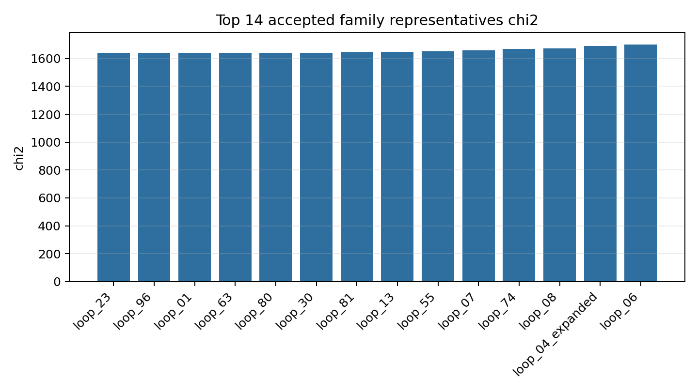
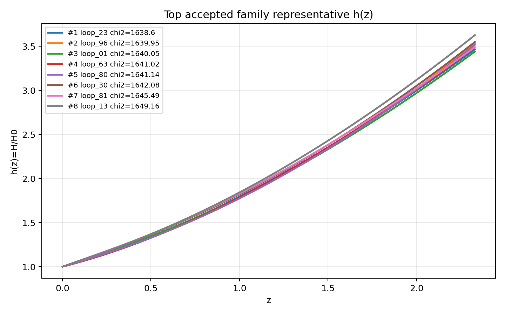
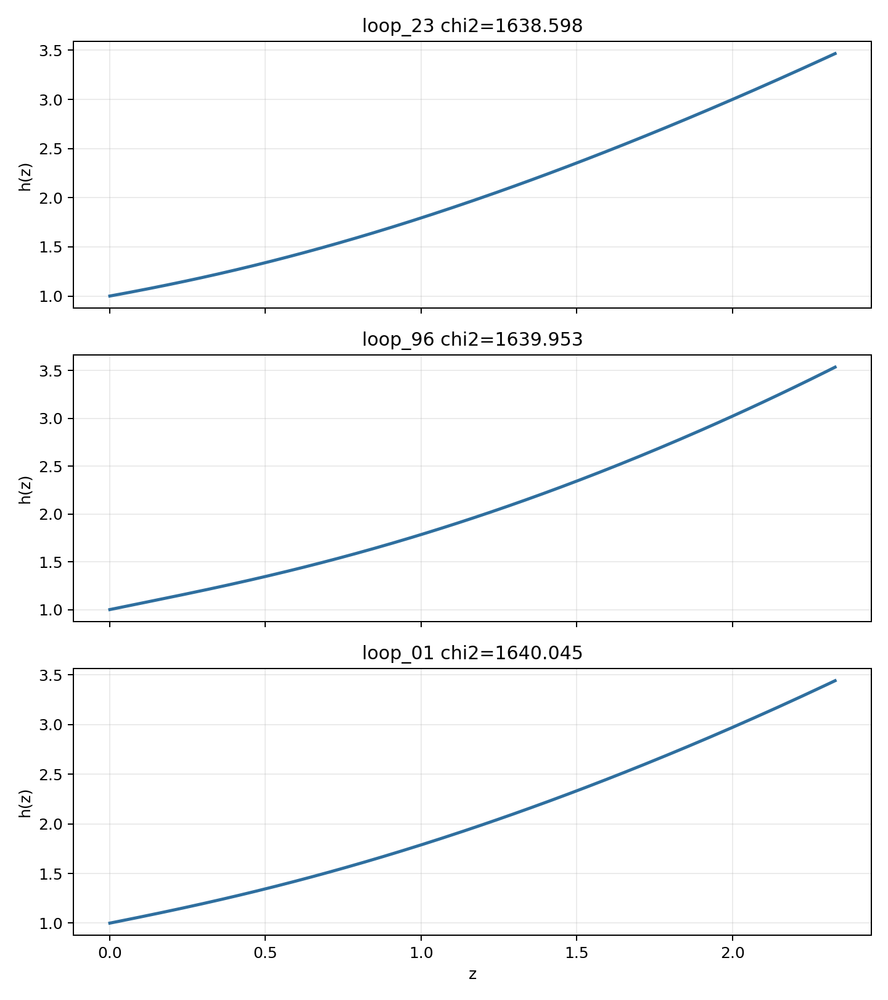

# LangGraph Agent Result Summary: graph_agent_100_direct_construct_20260606

This report is generated from current-loop memory and the isolated Solver outputs for accepted attempts.
Human-facing tables and plots use one best representative per theory family; full accepted attempts remain in `accepted_summary.json`.

## Quick Result

| Metric | Value |
|---|---:|
| Total attempts | 101 |
| Accepted attempts | 89 |
| Accepted theory families shown | 14 |
| Best chi2 | 1638.598412 |
| q_not_determined | 0 |
| constraint_drift | 51 |
| q_initial_root_failure | 91 |

## Output Files

- [accepted_lagrangians_and_parameters.md](accepted_lagrangians_and_parameters.md)
- [accepted_lagrangians_full.md](accepted_lagrangians_full.md)
- [accepted_lagrangians_and_parameters.csv](accepted_lagrangians_and_parameters.csv)
- [accepted_summary.json](accepted_summary.json)

## Plots

## Top Accepted Family Representatives

| Rank | Family | Loop | chi2 | Status | Max rel. effect | Dominant correction | Sample | H0 | Omega_m0 | lambda_H | Scalar | Potential | Operators |
|---:|---|---|---:|---|---:|---|---:|---:|---:|---:|---|---|---|
| 1 | scalar=phi1_only|phi1_potential=quadratic|phi2_potential=None|operator_bucket=R_anchor+derivative | loop_23 | 1638.598412 | eh_dominated | 4.066e-13 | ∇^{a}∇_{a}R | 896 | 57.169 | 0.3038 | 8742.788 | phi1_only | {"phi1": "quadratic", "phi2": null} | R; ∇^{a}∇_{a}R; R^{b}_{a} · R^{cd} · R^{a}_{cbd} |
| 2 | scalar=phi1_only|phi1_potential=axion|phi2_potential=None|operator_bucket=R_anchor | loop_96 | 1639.952934 | eh_dominated | 2.174e-17 | R^{bcd}_{a} · R^{a}_{bcd} | 963 | 58.535 | 0.2953 | 6312.189 | phi1_only | {"phi1": "axion", "phi2": null} | R; R^{bcd}_{a} · R^{a}_{bcd}; R^{cd}_{ab} · R^{afh}_{c} · R^{b}_{fdh} |
| 3 | scalar=phi1_only|phi1_potential=quadratic|phi2_potential=None|operator_bucket=R_anchor | loop_01 | 1640.045401 | eh_only | 0 |  | 58 | 66.662 | 0.2725 | 1.238e+04 | phi1_only | {"phi1": "quadratic", "phi2": null} | R |
| 4 | scalar=phi1_only|phi1_potential=axion|phi2_potential=None|operator_bucket=R_anchor+derivative | loop_63 | 1641.015645 | eh_dominated | 7.229e-13 | R^{bcd}_{a} · R^{a}_{bcd} | 386 | 64.906 | 0.3009 | 1.286e+04 | phi1_only | {"phi1": "axion", "phi2": null} | R; R^{bcd}_{a} · R^{a}_{bcd}; ∇^{a}∇_{a}R |
| 5 | scalar=phi1_only|phi1_potential=quadratic|phi2_potential=None|operator_bucket=R_anchor+high_curvature | loop_80 | 1641.144276 | eh_dominated | 1.187e-16 | R^{bcd}_{a} · R^{a}_{bcd} | 248 | 66.721 | 0.2977 | 3357.266 | phi1_only | {"phi1": "quadratic", "phi2": null} | R; R^{bcd}_{a} · R^{a}_{bcd}; R_{ab} · R^{adef} · R^{b}_{def} |
| 6 | scalar=phi1_only|phi1_potential=quadratic|phi2_potential=None|operator_bucket=R_anchor+derivative+high_curvature | loop_30 | 1642.079229 | eh_dominated | 9.965e-19 | ∇^{a}∇_{a}R | 294 | 59.378 | 0.3078 | 3.351e+04 | phi1_only | {"phi1": "quadratic", "phi2": null} | R; ∇^{a}∇_{a}R; ∇^{a}∇_{a}R · R^{c}_{c} |
| 7 | scalar=phi1_only|phi1_potential=axion|phi2_potential=None|operator_bucket=R_anchor+high_curvature | loop_81 | 1645.488927 | eh_dominated | 2.492e-16 | R^{bcd}_{a} · R^{a}_{bcd} | 104 | 71.575 | 0.305 | 2.336e+04 | phi1_only | {"phi1": "axion", "phi2": null} | R; R^{bcd}_{a} · R^{a}_{bcd}; R_{ab} · R^{adef} · R^{b}_{def} |
| 8 | scalar=phi1_only|phi1_potential=axion|phi2_potential=None|operator_bucket=R_anchor+scalar_curvature | loop_13 | 1649.162372 | eh_dominated | 6.490e-16 | φ1 · R^{bcd}_{a} · R^{a}_{bcd} | 986 | 63.26 | 0.3264 | 4413.517 | phi1_only | {"phi1": "axion", "phi2": null} | R; φ1 · R^{bcd}_{a} · R^{a}_{bcd} |
| 9 | scalar=phi1_only|phi1_potential=axion|phi2_potential=None|operator_bucket=R_anchor+derivative+high_curvature | loop_55 | 1651.159287 | eh_dominated | 1.909e-16 | ∇^{a}∇_{a}R | 895 | 57.616 | 0.2951 | 1.016e+04 | phi1_only | {"phi1": "axion", "phi2": null} | R; ∇^{a}∇_{a}R; R_{ab} · R^{adef} · R^{b}_{def} |
| 10 | scalar=phi1_only|phi1_potential=axion|phi2_potential=None|operator_bucket=R_anchor+high_curvature+scalar_curvature | loop_07 | 1657.023856 | eh_dominated | 8.885e-23 | φ1 · φ1 · R · R | 485 | 57.093 | 0.2726 | 4132.752 | phi1_only | {"phi1": "axion", "phi2": null} | R; φ1 · φ1 · R · R |
| 11 | scalar=both|phi1_potential=quadratic|phi2_potential=axion|operator_bucket=R_anchor+derivative | loop_74 | 1667.751076 | eh_dominated | 1.611e-13 | R^{bcd}_{a} · R^{a}_{bcd} | 737 | 72.666 | 0.2742 | 8240.625 | both | {"phi1": "quadratic", "phi2": "axion"} | R; R^{bcd}_{a} · R^{a}_{bcd}; ∇^{a}∇_{a}R |
| 12 | scalar=phi1_only|phi1_potential=quadratic|phi2_potential=None|operator_bucket=R_anchor+scalar_curvature | loop_08 | 1674.136138 | eh_dominated | 4.618e-25 | φ1 · φ1 · R^{bcd}_{a} · R^{a}_{bcd} | 800 | 60.382 | 0.2978 | 2.011e+04 | phi1_only | {"phi1": "quadratic", "phi2": null} | R; φ1 · φ1 · R^{bcd}_{a} · R^{a}_{bcd} |
| 13 | scalar=both|phi1_potential=axion|phi2_potential=axion|operator_bucket=R_anchor+derivative+high_curvature | loop_04_expanded | 1688.147231 | eh_dominated | 2.376e-22 | ∇^{c}R^{ab} · ∇_{c}R_{ab} | 449 | 66.843 | 0.2402 | 1.156e+04 | both | {"phi1": "axion", "phi2": "axion"} | R; ∇^{c}R^{ab} · ∇_{c}R_{ab} |
| 14 | scalar=phi1_only|phi1_potential=quadratic|phi2_potential=None|operator_bucket=R_anchor+high_curvature+scalar_curvature | loop_06 | 1701.282902 | eh_dominated | 1.257e-22 | φ1 · φ1 · R · R | 260 | 65.659 | 0.2478 | 3.732e+04 | phi1_only | {"phi1": "quadratic", "phi2": null} | R; φ1 · φ1 · R · R |

## Top Family Representative Parameter Choices

| Rank | Loop | varphi1_0 | q1_0 | mu1 | fbar1 | varphi2_0 | q2_0 | mu2 | fbar2 | Free coefficients |
|---:|---|---:|---:|---:|---:|---:|---:|---:|---:|---|
| 1 | loop_23 | 2.1396 | -0.4994 | 0.9263 | 0.7713 | 0 | 0 | 0 | 1 | \alpha=0.5, \beta=-1.5539e-05, \gamma=-9.9717e-06 |
| 2 | loop_96 | 1.4127 | -0.6751 | 1.3839 | 3.5646 | 0 | 0 | 0 | 1 | \alpha=0.5, \beta=4.3309e-10, \gamma=2.6125e-08 |
| 3 | loop_01 | 1.8376 | -0.6581 | 1.0791 | 3.87 | 0 | 0 | 0 | 1 | \alpha=0.5 |
| 4 | loop_63 | 3.1732 | -0.3656 | 0.6471 | 4.7409 | 0 | 0 | 0 | 1 | \alpha=0.5, \beta=-5.9814e-05, \gamma=-1.2084e-10 |
| 5 | loop_80 | 1.906 | -0.5137 | 1.0427 | 6.0768 | 0 | 0 | 0 | 1 | \alpha=0.5, \beta=-6.6919e-10, \gamma=2.0791e-05 |
| 6 | loop_30 | 1.3356 | -0.7225 | 1.4268 | 28.4154 | 0 | 0 | 0 | 1 | \alpha=0.5, \beta=5.5951e-10, \gamma=8.2259e-07 |
| 7 | loop_81 | 1.4591 | -0.7082 | 1.3137 | 11.0692 | 0 | 0 | 0 | 1 | \alpha=0.5, \beta=6.8024e-08, \gamma=4.6173e-07 |
| 8 | loop_13 | 4.0832 | 0.6498 | 1.7935 | 0.8329 | 0 | 0 | 0 | 1 | \alpha=0.5, \beta=6.8322e-06 |
| 9 | loop_55 | 3.9735 | -0.3409 | 0.5153 | 8.3391 | 0 | 0 | 0 | 1 | \alpha=0.5, \beta=9.8419e-09, \gamma=2.6023e-05 |
| 10 | loop_07 | 2.3924 | -0.4541 | 0.8536 | 12.6463 | 0 | 0 | 0 | 1 | \alpha=0.5, \beta=-2.2643e-09 |
| 11 | loop_74 | 1.1999 | -0.9331 | 1.5556 | 8.2063 | 2.4643 | 0.7591 | 1.1856e-04 | 0.0857 | \alpha=0.5, \beta=-5.4688e-06, \gamma=-1.5165e-09 |
| 12 | loop_08 | 4.0824 | -0.1916 | 0.5006 | 4.4309 | 0 | 0 | 0 | 1 | \alpha=0.5, \beta=-2.2656e-09 |
| 13 | loop_04_expanded | 1.7323 | -0.5851 | 1.1857 | 22.6 | 0.4569 | 1.5304 | 1.5046e-04 | 1.6198 | \alpha=0.5, \beta=2.1221e-06 |
| 14 | loop_06 | 1.7747 | -0.6626 | 1.1373 | 7.5628 | 0 | 0 | 0 | 1 | \alpha=0.5, \beta=3.8717e-05 |

## Main Failure Tags

| Tag | Count |
|---|---:|
| q_initial_root_failure | 91 |
| h_absurdly_large | 89 |
| constraint_drift | 51 |
| missing_ranking | 12 |
| no_accepted_samples | 12 |
| no_scalar_constraint | 4 |
