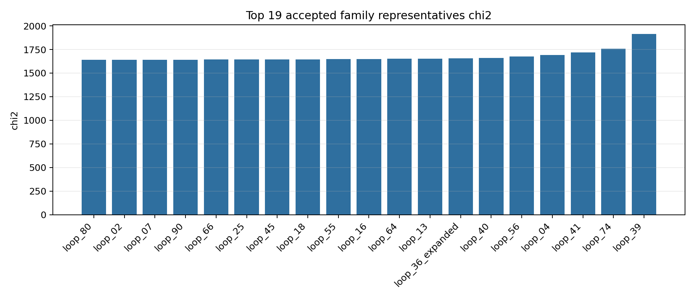
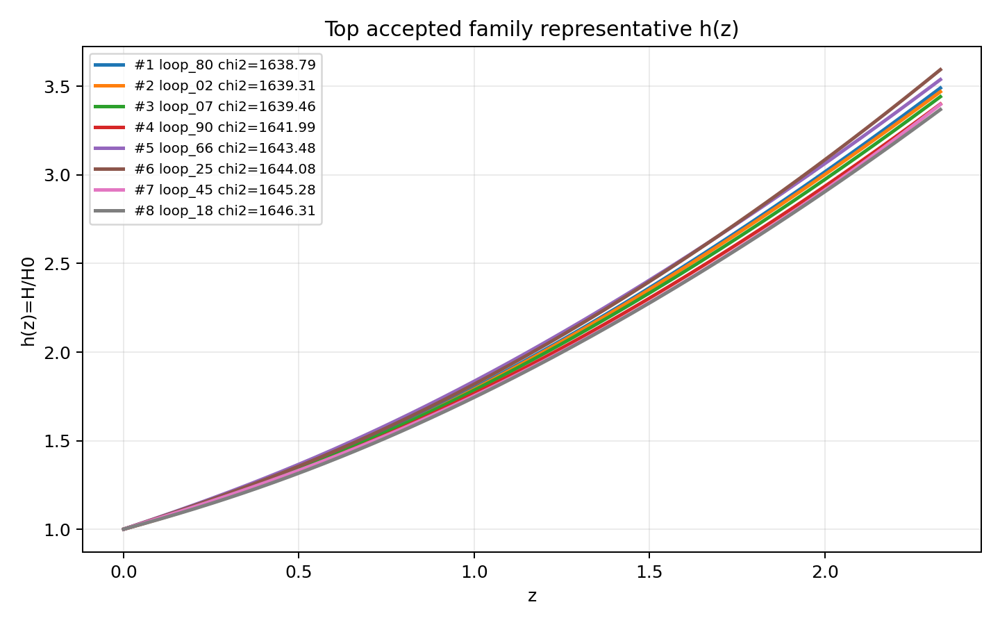
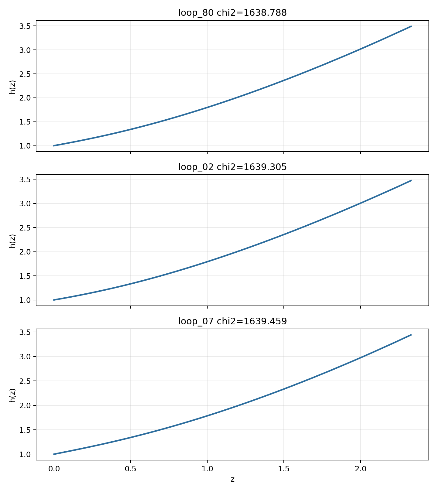

# LangGraph Agent Result Summary: graph_agent_100_no_chi2_stop_planned_effect_20260606

This report is generated from current-loop memory and the isolated Solver outputs for accepted attempts.
Human-facing tables and plots use one best representative per theory family; full accepted attempts remain in `accepted_summary.json`.

## Quick Result

| Metric | Value |
|---|---:|
| Total attempts | 103 |
| Accepted attempts | 89 |
| Accepted theory families shown | 19 |
| Best chi2 | 1638.7878 |
| q_not_determined | 0 |
| constraint_drift | 63 |
| q_initial_root_failure | 91 |

## Output Files

- [accepted_lagrangians_and_parameters.md](accepted_lagrangians_and_parameters.md)
- [accepted_lagrangians_full.md](accepted_lagrangians_full.md)
- [accepted_lagrangians_and_parameters.csv](accepted_lagrangians_and_parameters.csv)
- [accepted_summary.json](accepted_summary.json)

## Plots

## Top Accepted Family Representatives

| Rank | Family | Loop | chi2 | Status | Max rel. effect | Dominant correction | Sample | H0 | Omega_m0 | lambda_H | Scalar | Potential | Operators |
|---:|---|---|---:|---|---:|---|---:|---:|---:|---:|---|---|---|
| 1 | scalar=phi1_only|phi1_potential=quadratic|phi2_potential=None|operator_bucket=R_anchor | loop_80 | 1638.7878 | weak | 3.288e-05 | R^{bcd}_{a} · R^{a}_{bcd} | 102 | 68.118 | 0.3082 | 3.081e+04 | phi1_only | {"phi1": "quadratic", "phi2": null} | R; R^{bcd}_{a} · R^{a}_{bcd}; R^{cd}_{ab} · R^{afh}_{c} · R^{b}_{fdh} |
| 2 | scalar=phi1_only|phi1_potential=axion|phi2_potential=None|operator_bucket=R_anchor+derivative+high_curvature | loop_02 | 1639.305454 | eh_dominated | 2.137e-23 | ∇^{c}R^{ab} · ∇_{c}R_{ab} | 721 | 59.161 | 0.3048 | 5.058e+04 | phi1_only | {"phi1": "axion", "phi2": null} | R; ∇^{c}R^{ab} · ∇_{c}R_{ab} |
| 3 | scalar=phi1_only|phi1_potential=axion|phi2_potential=None|operator_bucket=R_anchor+derivative+scalar_curvature | loop_07 | 1639.458758 | weak | 7.179e-06 | φ1 · ∇^{a}∇_{a}R | 776 | 67.462 | 0.296 | 7804.635 | phi1_only | {"phi1": "axion", "phi2": null} | R; φ1 · ∇^{a}∇_{a}R |
| 4 | scalar=phi1_only|phi1_potential=quadratic|phi2_potential=None|operator_bucket=R_anchor+derivative+high_curvature | loop_90 | 1641.985407 | eh_dominated | 6.646e-10 | ∇^{a}∇^{b}R · R_{ab} | 548 | 67.715 | 0.2693 | 7406.701 | phi1_only | {"phi1": "quadratic", "phi2": null} | R; ∇^{a}∇^{b}R · R_{ab}; ∇^{a}∇_{a}R · R^{c}_{c} |
| 5 | scalar=phi1_only|phi1_potential=quadratic|phi2_potential=None|operator_bucket=R_anchor+high_curvature | loop_66 | 1643.479273 | moderate | 0.005 | R^{ab} · R_{ab} | 68 | 65.654 | 0.316 | 1.404e+04 | phi1_only | {"phi1": "quadratic", "phi2": null} | R; R^{ab} · R_{ab}; R^{bcd}_{a} · R^{a}_{bcd} |
| 6 | scalar=phi1_only|phi1_potential=quadratic|phi2_potential=None|operator_bucket=R_anchor+scalar_curvature | loop_25 | 1644.08275 | eh_dominated | 1.727e-08 | φ1 · φ1 · R^{bcd}_{a} · R^{a}_{bcd} | 702 | 67.931 | 0.3164 | 4159.863 | phi1_only | {"phi1": "quadratic", "phi2": null} | R; φ1 · φ1 · R^{bcd}_{a} · R^{a}_{bcd} |
| 7 | scalar=phi1_only|phi1_potential=axion|phi2_potential=None|operator_bucket=R_anchor+high_curvature+scalar_curvature | loop_45 | 1645.281052 | eh_dominated | 8.200e-09 | φ1 · R · R | 32 | 73.008 | 0.2356 | 7.614e+04 | phi1_only | {"phi1": "axion", "phi2": null} | R; φ1 · R · R |
| 8 | scalar=phi1_only|phi1_potential=quadratic|phi2_potential=None|operator_bucket=R_anchor+derivative+scalar_curvature | loop_18 | 1646.307752 | eh_dominated | 5.474e-08 | ∇^{a}∇_{a}φ1 · R | 369 | 70.102 | 0.2618 | 4.435e+04 | phi1_only | {"phi1": "quadratic", "phi2": null} | R; ∇^{a}∇_{a}φ1 · R |
| 9 | scalar=phi1_only|phi1_potential=quadratic|phi2_potential=None|operator_bucket=R_anchor+derivative | loop_55 | 1647.30998 | eh_dominated | 7.919e-07 | R^{bcd}_{a} · R^{a}_{bcd} | 133 | 71.4 | 0.298 | 2538.124 | phi1_only | {"phi1": "quadratic", "phi2": null} | R; R^{bcd}_{a} · R^{a}_{bcd}; ∇^{a}R · ∇_{a}R |
| 10 | scalar=both|phi1_potential=quadratic|phi2_potential=axion|operator_bucket=R_anchor+scalar_curvature | loop_16 | 1648.854806 | eh_dominated | 9.371e-08 | φ1 · R^{bcd}_{a} · R^{a}_{bcd} | 799 | 66.951 | 0.3237 | 3.652e+04 | both | {"phi1": "quadratic", "phi2": "axion"} | R; φ1 · R^{bcd}_{a} · R^{a}_{bcd} |
| 11 | scalar=phi1_only|phi1_potential=axion|phi2_potential=None|operator_bucket=R_anchor+high_curvature | loop_64 | 1651.843411 | moderate | 0.002 | R^{bcd}_{a} · R^{a}_{bcd} | 437 | 68.236 | 0.3065 | 3.099e+04 | phi1_only | {"phi1": "axion", "phi2": null} | R; R^{bcd}_{a} · R^{a}_{bcd}; R^{ab} · R^{d}_{a} · R_{bd} |
| 12 | scalar=phi1_only|phi1_potential=axion|phi2_potential=None|operator_bucket=R_anchor+scalar_curvature | loop_13 | 1653.827708 | eh_dominated | 9.959e-09 | φ1 · R^{bcd}_{a} · R^{a}_{bcd} | 23 | 60.449 | 0.3074 | 7.921e+04 | phi1_only | {"phi1": "axion", "phi2": null} | R; φ1 · R^{bcd}_{a} · R^{a}_{bcd} |
| 13 | scalar=phi1_only|phi1_potential=axion|phi2_potential=None|operator_bucket=R_anchor+derivative | loop_36_expanded | 1657.9374 | weak | 3.808e-05 | R^{bcd}_{a} · R^{a}_{bcd} | 744 | 66.814 | 0.2676 | 5.398e+04 | phi1_only | {"phi1": "axion", "phi2": null} | R; R^{bcd}_{a} · R^{a}_{bcd}; ∇^{a}R · ∇_{a}R |
| 14 | scalar=phi1_only|phi1_potential=quadratic|phi2_potential=None|operator_bucket=R_anchor+high_curvature+scalar_curvature | loop_40 | 1659.244347 | eh_dominated | 2.369e-09 | φ1 · φ1 · R · R | 635 | 72.268 | 0.2312 | 7765.106 | phi1_only | {"phi1": "quadratic", "phi2": null} | R; φ1 · φ1 · R · R |
| 15 | scalar=phi1_only|phi1_potential=axion|phi2_potential=None|operator_bucket=R_anchor | loop_56 | 1677.270591 | active | 0.012 | R^{bcd}_{a} · R^{a}_{bcd} | 1000 | 58.622 | 0.3274 | 1.284e+04 | phi1_only | {"phi1": "axion", "phi2": null} | R; R^{bcd}_{a} · R^{a}_{bcd} |
| 16 | scalar=both|phi1_potential=axion|phi2_potential=axion|operator_bucket=R_anchor+derivative+high_curvature | loop_04 | 1689.602217 | eh_dominated | 7.845e-14 | ∇^{c}R^{ab} · ∇_{c}R_{ab} | 712 | 69.761 | 0.3407 | 7.106e+04 | both | {"phi1": "axion", "phi2": "axion"} | R; ∇^{c}R^{ab} · ∇_{c}R_{ab} |
| 17 | scalar=phi1_only|phi1_potential=axion|phi2_potential=None|operator_bucket=R_anchor+derivative+high_curvature+scalar_curvature | loop_41 | 1717.081682 | weak | 1.445e-05 | ∇^{a}∇^{b}φ1 · R_{ab} | 287 | 73.25 | 0.3506 | 4842.537 | phi1_only | {"phi1": "axion", "phi2": null} | R; ∇^{a}∇^{b}φ1 · R_{ab} |
| 18 | scalar=both|phi1_potential=axion|phi2_potential=quadratic|operator_bucket=R_anchor+derivative+high_curvature | loop_74 | 1757.416151 | weak | 3.615e-05 | R^{bcd}_{a} · R^{a}_{bcd} | 232 | 62.463 | 0.2303 | 2347.408 | both | {"phi1": "axion", "phi2": "quadratic"} | R; R^{bcd}_{a} · R^{a}_{bcd}; ∇^{a}∇_{a}R · R^{c}_{c} |
| 19 | scalar=phi1_only|phi1_potential=quadratic|phi2_potential=None|operator_bucket=R_anchor+derivative+high_curvature+scalar_curvature | loop_39 | 1915.596487 | eh_dominated | 2.356e-08 | ∇^{a}∇^{b}φ1 · R_{ab} | 908 | 63.456 | 0.3493 | 5.997e+04 | phi1_only | {"phi1": "quadratic", "phi2": null} | R; ∇^{a}∇^{b}φ1 · R_{ab} |

## Top Family Representative Parameter Choices

| Rank | Loop | varphi1_0 | q1_0 | mu1 | fbar1 | varphi2_0 | q2_0 | mu2 | fbar2 | Free coefficients |
|---:|---|---:|---:|---:|---:|---:|---:|---:|---:|---|
| 1 | loop_80 | 2.1647 | -0.4789 | 0.9148 | 11.9882 | 0 | 0 | 0 | 1 | \alpha=0.5, \beta=-1.5602e+04, \gamma=1.0000e+06 |
| 2 | loop_02 | 2.6218 | -0.4192 | 0.7626 | 29.7497 | 0 | 0 | 0 | 1 | \alpha=0.5, \beta=6.9963e-05 |
| 3 | loop_07 | 1.7065 | -0.5956 | 1.1612 | 4.0708 | 0 | 0 | 0 | 1 | \alpha=0.5, \beta=1.0000e+06 |
| 4 | loop_90 | 2.1039 | -0.5881 | 0.9552 | 0.4791 | 0 | 0 | 0 | 1 | \alpha=0.5, \beta=-1.0000e+06, \gamma=-1.0000e+06 |
| 5 | loop_66 | 1.6662 | -0.6205 | 1.1574 | 0.0762 | 0 | 0 | 0 | 1 | \alpha=0.5, \beta=-5.3547e+05, \gamma=2.6338e+04 |
| 6 | loop_25 | 1.6081 | -0.5946 | 1.2039 | 0.441 | 0 | 0 | 0 | 1 | \alpha=0.5, \beta=1.0000e+06 |
| 7 | loop_45 | 1.8094 | -0.7261 | 1.1137 | 26.5308 | 0 | 0 | 0 | 1 | \alpha=0.5, \beta=-1.0000e+06 |
| 8 | loop_18 | 2.3883 | -0.5383 | 0.8519 | 0.5904 | 0 | 0 | 0 | 1 | \alpha=0.5, \beta=-1.0000e+06 |
| 9 | loop_55 | 2.3011 | -0.5355 | 0.861 | 22.7058 | 0 | 0 | 0 | 1 | \alpha=0.5, \beta=-2.5506, \gamma=-1.0000e+06 |
| 10 | loop_16 | 2.283 | -0.4807 | 0.8568 | 17.7876 | 1.7544 | 1.3175 | 4.8941e-04 | 10.7146 | \alpha=0.5, \beta=-1.0000e+06 |
| 11 | loop_64 | 1.3626 | -0.7621 | 1.3888 | 28.8083 | 0 | 0 | 0 | 1 | \alpha=0.5, \beta=-1.0000e+06, \gamma=1.0000e+06 |
| 12 | loop_13 | 2.4748 | -0.3724 | 0.8109 | 13.7081 | 0 | 0 | 0 | 1 | \alpha=0.5, \beta=-1.0000e+06 |
| 13 | loop_36_expanded | 1.0098 | -0.9347 | 1.8583 | 16.88 | 0 | 0 | 0 | 1 | \alpha=0.5, \beta=5.5478e+04, \gamma=1.0000e+06 |
| 14 | loop_40 | 2.0753 | -0.6498 | 0.9864 | 26.2979 | 0 | 0 | 0 | 1 | \alpha=0.5, \beta=1.0000e+06 |
| 15 | loop_56 | 2.5415 | -0.4396 | 0.8002 | 2.7123 | 0 | 0 | 0 | 1 | \alpha=0.5, \beta=-1.0000e+06 |
| 16 | loop_04 | 1.0184 | -0.8885 | 1.7478 | 10.711 | 2.5591 | -1.5754 | 1.0476e-04 | 1.1392 | \alpha=0.5, \beta=1.0000e+06 |
| 17 | loop_41 | 0.8207 | -0.9886 | 2.0842 | 4.949 | 0 | 0 | 0 | 1 | \alpha=0.5, \beta=-1.0000e+06 |
| 18 | loop_74 | 0.6351 | -1.3237 | 2.6799 | 1.777 | 1.2192 | 0.6777 | 0.0119 | 1.1812 | \alpha=0.5, \beta=99.6046, \gamma=-1.0000e+06 |
| 19 | loop_39 | 2.5408 | -0.522 | 0.75 | 0.1915 | 0 | 0 | 0 | 1 | \alpha=0.5, \beta=1.0000e+06 |

## Main Failure Tags

| Tag | Count |
|---|---:|
| q_initial_root_failure | 91 |
| h_absurdly_large | 89 |
| constraint_drift | 63 |
| missing_ranking | 14 |
| no_accepted_samples | 14 |
| no_scalar_constraint | 4 |
