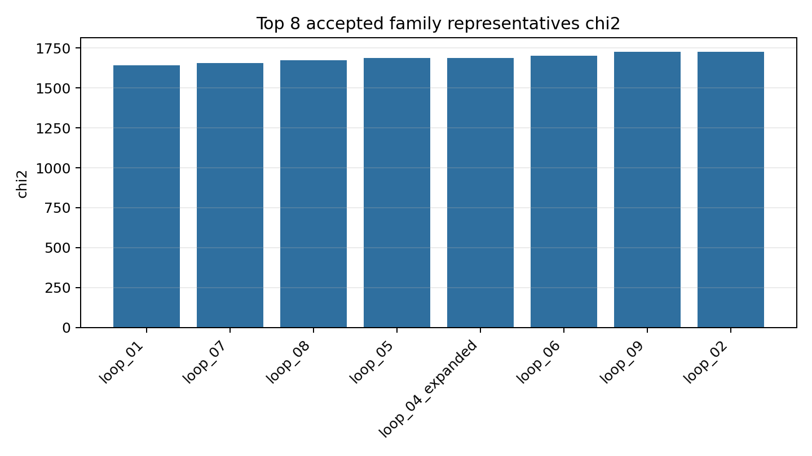
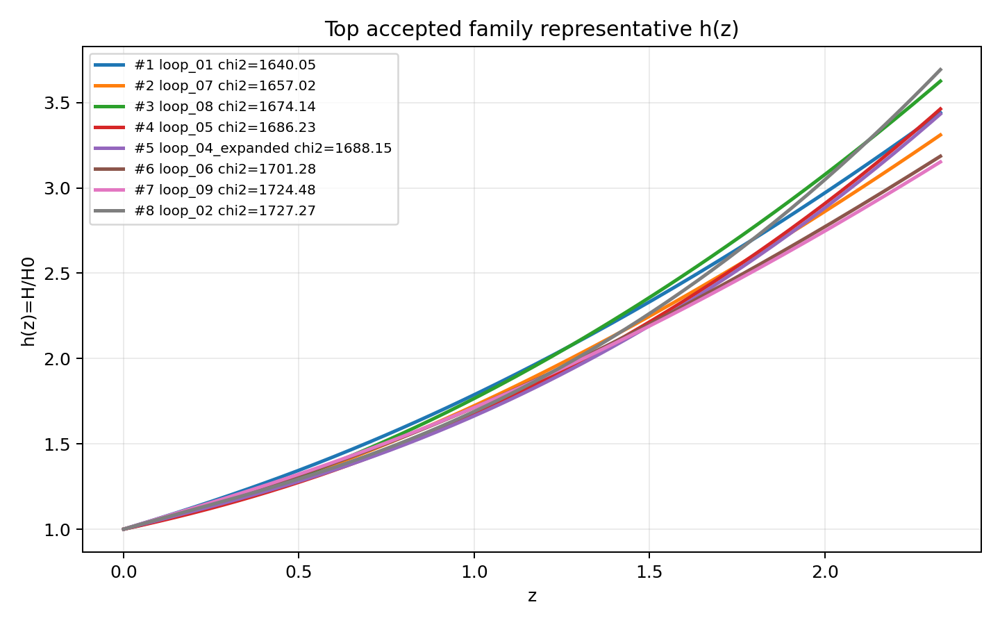
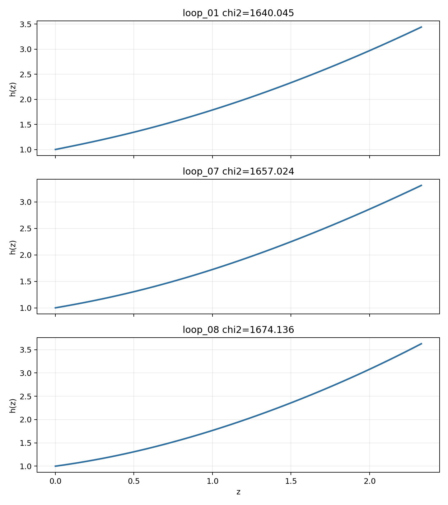

# LangGraph Agent Result Summary: graph_agent_10_direct_construct_20260606

This report is generated from current-loop memory and the isolated Solver outputs for accepted attempts.
Human-facing tables and plots use one best representative per theory family; full accepted attempts remain in `accepted_summary.json`.

## Quick Result

| Metric | Value |
|---|---:|
| Total attempts | 11 |
| Accepted attempts | 9 |
| Accepted theory families shown | 8 |
| Best chi2 | 1640.045401 |
| q_not_determined | 0 |
| constraint_drift | 3 |
| q_initial_root_failure | 10 |

## Output Files

- [accepted_lagrangians_and_parameters.md](accepted_lagrangians_and_parameters.md)
- [accepted_lagrangians_full.md](accepted_lagrangians_full.md)
- [accepted_lagrangians_and_parameters.csv](accepted_lagrangians_and_parameters.csv)
- [accepted_summary.json](accepted_summary.json)

## Plots

## Top Accepted Family Representatives

| Rank | Family | Loop | chi2 | Status | Max rel. effect | Dominant correction | Sample | H0 | Omega_m0 | lambda_H | Scalar | Potential | Operators |
|---:|---|---|---:|---|---:|---|---:|---:|---:|---:|---|---|---|
| 1 | scalar=phi1_only|phi1_potential=quadratic|phi2_potential=None|operator_bucket=R_anchor | loop_01 | 1640.045401 | eh_only | 0 |  | 58 | 66.662 | 0.2725 | 1.238e+04 | phi1_only | {"phi1": "quadratic", "phi2": null} | R |
| 2 | scalar=phi1_only|phi1_potential=axion|phi2_potential=None|operator_bucket=R_anchor+high_curvature+scalar_curvature | loop_07 | 1657.023856 | eh_dominated | 8.885e-23 | φ1 · φ1 · R · R | 485 | 57.093 | 0.2726 | 4132.752 | phi1_only | {"phi1": "axion", "phi2": null} | R; φ1 · φ1 · R · R |
| 3 | scalar=phi1_only|phi1_potential=quadratic|phi2_potential=None|operator_bucket=R_anchor+scalar_curvature | loop_08 | 1674.136138 | eh_dominated | 4.618e-25 | φ1 · φ1 · R^{bcd}_{a} · R^{a}_{bcd} | 800 | 60.382 | 0.2978 | 2.011e+04 | phi1_only | {"phi1": "quadratic", "phi2": null} | R; φ1 · φ1 · R^{bcd}_{a} · R^{a}_{bcd} |
| 4 | scalar=phi1_only|phi1_potential=quadratic|phi2_potential=None|operator_bucket=R_anchor+derivative+high_curvature | loop_05 | 1686.231827 | eh_dominated | 9.051e-24 | ∇^{c}R^{ab} · ∇_{c}R_{ab} | 36 | 71.691 | 0.2073 | 9233.174 | phi1_only | {"phi1": "quadratic", "phi2": null} | R; ∇^{c}R^{ab} · ∇_{c}R_{ab} |
| 5 | scalar=both|phi1_potential=axion|phi2_potential=axion|operator_bucket=R_anchor+derivative+high_curvature | loop_04_expanded | 1688.147231 | eh_dominated | 2.376e-22 | ∇^{c}R^{ab} · ∇_{c}R_{ab} | 449 | 66.843 | 0.2402 | 1.156e+04 | both | {"phi1": "axion", "phi2": "axion"} | R; ∇^{c}R^{ab} · ∇_{c}R_{ab} |
| 6 | scalar=phi1_only|phi1_potential=quadratic|phi2_potential=None|operator_bucket=R_anchor+high_curvature+scalar_curvature | loop_06 | 1701.282902 | eh_dominated | 1.257e-22 | φ1 · φ1 · R · R | 260 | 65.659 | 0.2478 | 3.732e+04 | phi1_only | {"phi1": "quadratic", "phi2": null} | R; φ1 · φ1 · R · R |
| 7 | scalar=phi1_only|phi1_potential=axion|phi2_potential=None|operator_bucket=R_anchor+scalar_curvature | loop_09 | 1724.480145 | eh_dominated | 7.853e-27 | φ1 · φ1 · R^{bcd}_{a} · R^{a}_{bcd} | 119 | 71.989 | 0.2352 | 2.020e+04 | phi1_only | {"phi1": "axion", "phi2": null} | R; φ1 · φ1 · R^{bcd}_{a} · R^{a}_{bcd} |
| 8 | scalar=phi1_only|phi1_potential=axion|phi2_potential=None|operator_bucket=R_anchor+derivative+high_curvature | loop_02 | 1727.274391 | eh_dominated | 5.527e-20 | ∇^{c}R^{ab} · ∇_{c}R_{ab} | 486 | 63.093 | 0.2471 | 6741.698 | phi1_only | {"phi1": "axion", "phi2": null} | R; ∇^{c}R^{ab} · ∇_{c}R_{ab} |

## Top Family Representative Parameter Choices

| Rank | Loop | varphi1_0 | q1_0 | mu1 | fbar1 | varphi2_0 | q2_0 | mu2 | fbar2 | Free coefficients |
|---:|---|---:|---:|---:|---:|---:|---:|---:|---:|---|
| 1 | loop_01 | 1.8376 | -0.6581 | 1.0791 | 3.87 | 0 | 0 | 0 | 1 | \alpha=0.5 |
| 2 | loop_07 | 2.3924 | -0.4541 | 0.8536 | 12.6463 | 0 | 0 | 0 | 1 | \alpha=0.5, \beta=-2.2643e-09 |
| 3 | loop_08 | 4.0824 | -0.1916 | 0.5006 | 4.4309 | 0 | 0 | 0 | 1 | \alpha=0.5, \beta=-2.2656e-09 |
| 4 | loop_05 | 3.2403 | -0.5096 | 0.6544 | 0.2729 | 0 | 0 | 0 | 1 | \alpha=0.5, \beta=3.2891e-08 |
| 5 | loop_04_expanded | 1.7323 | -0.5851 | 1.1857 | 22.6 | 0.4569 | 1.5304 | 1.5046e-04 | 1.6198 | \alpha=0.5, \beta=2.1221e-06 |
| 6 | loop_06 | 1.7747 | -0.6626 | 1.1373 | 7.5628 | 0 | 0 | 0 | 1 | \alpha=0.5, \beta=3.8717e-05 |
| 7 | loop_09 | 1.6163 | -0.7426 | 1.2458 | 7.2263 | 0 | 0 | 0 | 1 | \alpha=0.5, \beta=-2.5015e-10 |
| 8 | loop_02 | 1.2886 | -0.6812 | 1.6198 | 1.3901 | 0 | 0 | 0 | 1 | \alpha=0.5, \beta=-5.7086e-05 |

## Main Failure Tags

| Tag | Count |
|---|---:|
| q_initial_root_failure | 10 |
| h_absurdly_large | 9 |
| constraint_drift | 3 |
| missing_ranking | 2 |
| no_accepted_samples | 2 |
