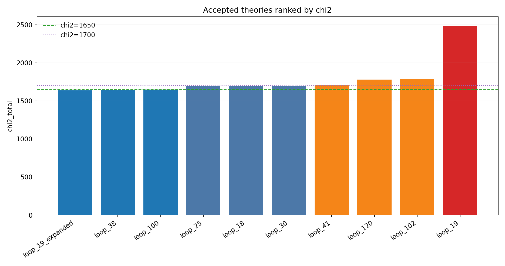
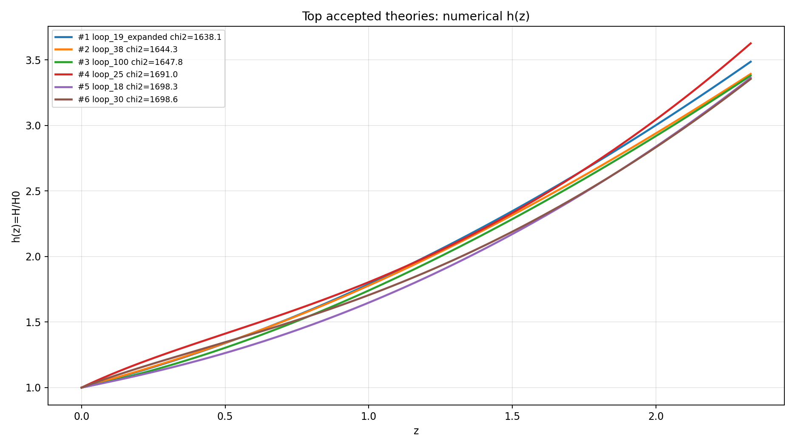
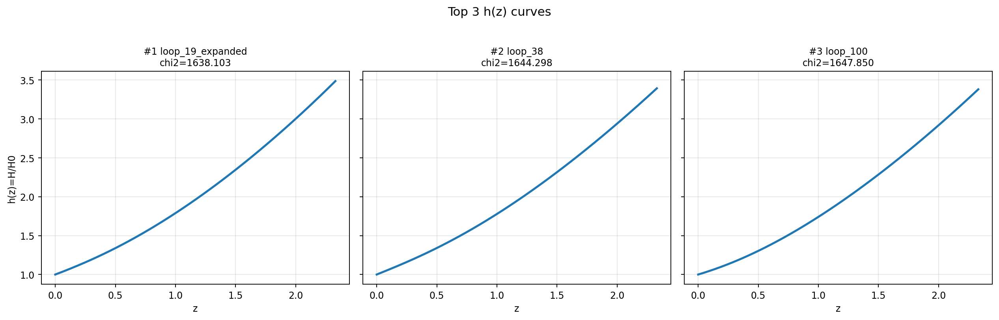

# LangGraph Agent 120-Loop Result Summary

Run:

```text
graph_agent_120_policy2_20260603
```

This run used the cold-start LangGraph proposal loop with token-level Grammar Masker generation, isolated agent harness validation, explicit agent parameter samples, and real EOM -> Builder -> Solver scoring.

## Quick Result

| Metric | Value |
|---|---:|
| Loops | 120 |
| Total harness attempts | 123 |
| Expanded attempts | 3 |
| Accepted attempts | 10 |
| Expanded accepted | 1 |
| Best chi2 | 1638.103 |

## Chi2 Ranking



Full dimension-balanced Lagrangians, numerical best-fit Lagrangians, initial conditions, and best-fit parameter samples are listed in:

- [accepted_lagrangians_and_parameters.md](accepted_lagrangians_and_parameters.md)
- [accepted_lagrangians_full.md](accepted_lagrangians_full.md)
- [accepted_lagrangians_and_parameters.csv](accepted_lagrangians_and_parameters.csv)

| Rank | Loop | chi2 | chi2 SN | chi2 BAO | Scalar | Potential | H0 | Omega_m0 | lambda_H |
|---:|---|---:|---:|---:|---|---|---:|---:|---:|
| 1 | loop_19_expanded | 1638.103 | 1629.912 | 8.192 | phi1_only | axion | 69.344 | 0.281 | 10819.083 |
| 2 | loop_38 | 1644.298 | 1629.849 | 14.449 | phi1_only | quadratic | 74.081 | 0.288 | 2414.784 |
| 3 | loop_100 | 1647.850 | 1636.620 | 11.229 | phi1_only | axion | 75.661 | 0.281 | 17576.100 |
| 4 | loop_25 | 1691.036 | 1667.969 | 23.067 | phi1_only | quadratic | 59.756 | 0.266 | 18866.152 |
| 5 | loop_18 | 1698.271 | 1660.246 | 38.025 | phi1_only | quadratic | 70.760 | 0.238 | 12065.685 |
| 6 | loop_30 | 1698.556 | 1635.072 | 63.484 | phi1_only | axion | 59.369 | 0.233 | 22559.160 |
| 7 | loop_41 | 1711.025 | 1684.988 | 26.037 | phi1_only | quadratic | 63.560 | 0.313 | 9072.856 |
| 8 | loop_120 | 1778.011 | 1655.420 | 122.591 | phi1_only | axion | 68.749 | 0.224 | 13847.466 |
| 9 | loop_102 | 1786.002 | 1779.103 | 6.899 | phi1_only | axion | 63.925 | 0.328 | 5297.001 |
| 10 | loop_19 | 2482.385 | 1641.404 | 840.981 | phi1_only | axion | 63.573 | 0.269 | 18229.030 |

## h(z) Plots

Top 6 overlay:



Top 3 separately:



## Top Theory Structures

### 1. loop_19_expanded, chi2 = 1638.103

```text
scalar_config: phi1_only
potential: phi1=axion
operators:
  R^{ab} · R_{ab}
  R · R^{ab} · R_{ab}
  R
parameter sample index: 333
sample budget: 3000
```

This was the only expanded attempt that became accepted, and it produced the best chi2 in the run.

### 2. loop_38, chi2 = 1644.298

```text
scalar_config: phi1_only
potential: phi1=quadratic
operators:
  R
  ∇^{a}∇_{a}R · R^{c}_{c}
  ∇^{a}φ1 · ∇_{a}φ1 · R
  ∇^{e}R^{bcd}_{a} · ∇_{e}R^{a}_{bcd}
parameter sample index: 545
sample budget: 1000
```

### 3. loop_100, chi2 = 1647.850

```text
scalar_config: phi1_only
potential: phi1=axion
operators:
  R
parameter sample index: 422
sample budget: 1000
```

## What Looks Good

- The run found three excellent models with `chi2 <= 1650`.
- Expanded sampling was rare, but still useful: the best model came from `loop_19_expanded`.
- Low-chi2 accepted models consistently share `phi1_only` and an `R` anchor.
- High-chi2 accepted models are now quality-tiered and should not strongly reinforce the proposal policy.

## Main Problems To Fix Next

The dominant failure mode is still:

```text
q_not_determined: 79
```

This means the agent often proposes legal Grammar Masker structures that survive proposal-time grammar checks but later cannot produce a usable scalar RHS in the EOM/Builder/Solver chain.

Repeated risky patterns include scalar-curvature and derivative-curvature mixes such as:

```text
φ1 · ∇φ1 · ∇R
φ1 · □R
∇φ1∇φ1 · R_ab
φ1 · R_ab · R^ab
multiple high-curvature derivative operators in one proposal
```

There is also one concrete interface bug:

```text
agent parameter sample missing: q2_0_dvarphi2_dln_a or q2_0
```

This occurred for a two-scalar proposal. The parameter generator should always provide `q2_0_dvarphi2_dln_a` for two-scalar theories, otherwise the both-scalar branch gets false failures.

## Output Files

```text
accepted_chi2_bar.png
top6_h_overlay.png
top3_h_panels.png
accepted_summary.json
accepted_lagrangians_and_parameters.md
accepted_lagrangians_full.md
accepted_lagrangians_and_parameters.csv
```
