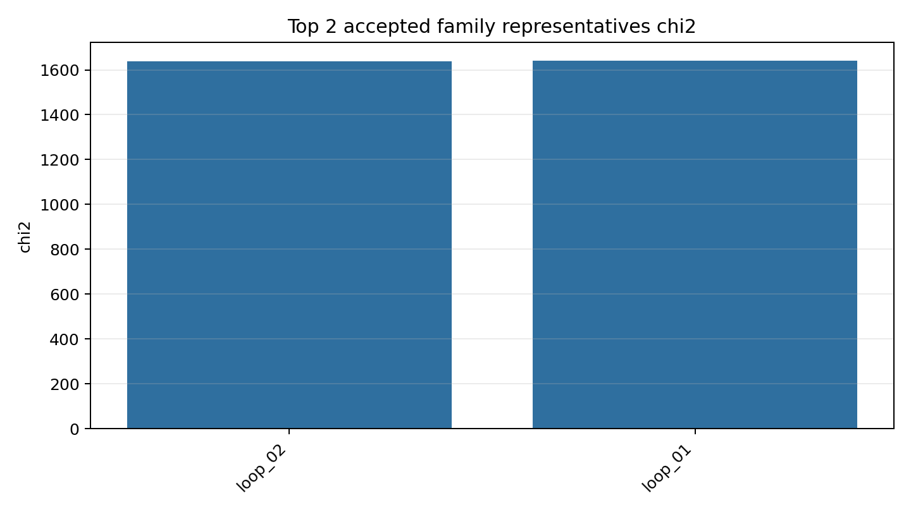
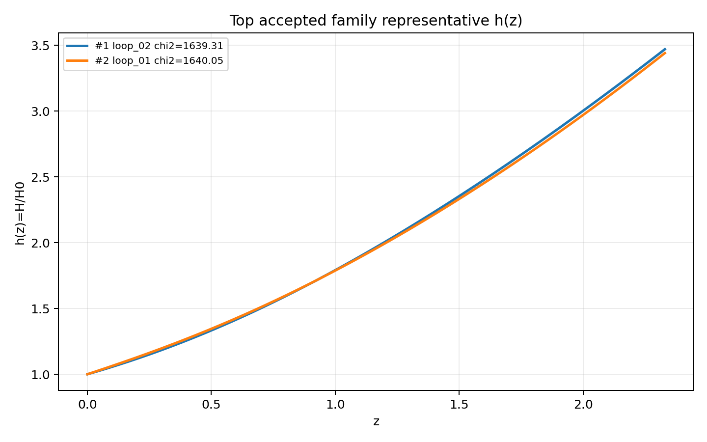
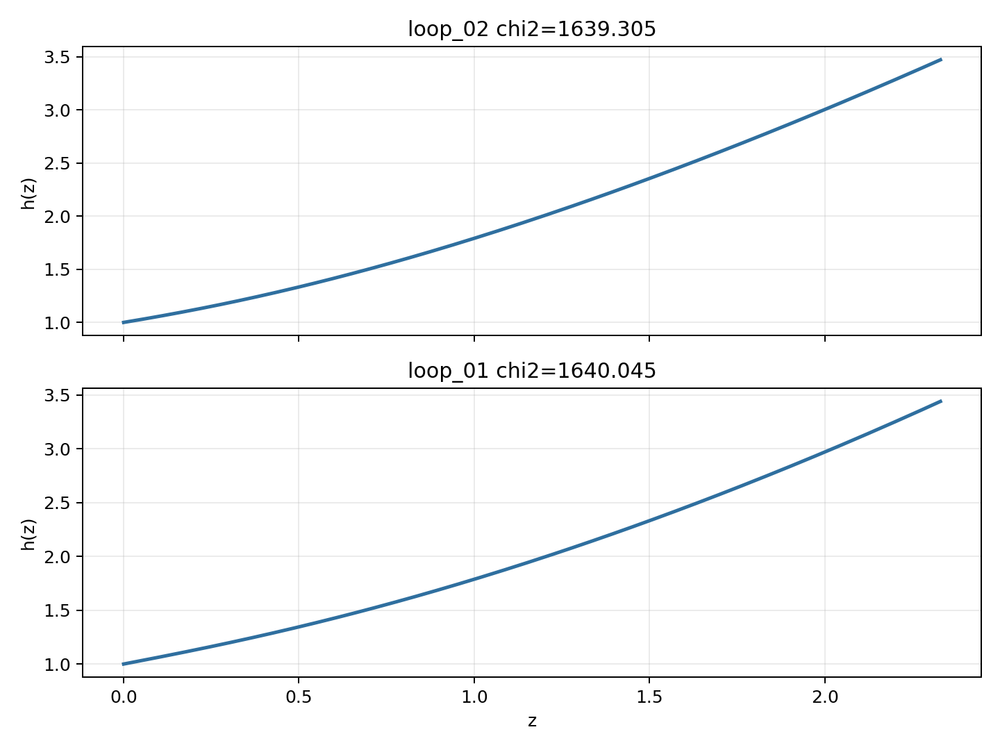

# LangGraph Agent Result Summary: graph_agent_2_no_chi2_early_stop_20260606

This report is generated from current-loop memory and the isolated Solver outputs for accepted attempts.
Human-facing tables and plots use one best representative per theory family; full accepted attempts remain in `accepted_summary.json`.

## Quick Result

| Metric | Value |
|---|---:|
| Total attempts | 2 |
| Accepted attempts | 2 |
| Accepted theory families shown | 2 |
| Best chi2 | 1639.305454 |
| q_not_determined | 0 |
| constraint_drift | 1 |
| q_initial_root_failure | 2 |

## Output Files

- [accepted_lagrangians_and_parameters.md](accepted_lagrangians_and_parameters.md)
- [accepted_lagrangians_full.md](accepted_lagrangians_full.md)
- [accepted_lagrangians_and_parameters.csv](accepted_lagrangians_and_parameters.csv)
- [accepted_summary.json](accepted_summary.json)

## Plots

## Top Accepted Family Representatives

| Rank | Family | Loop | chi2 | Status | Max rel. effect | Dominant correction | Sample | H0 | Omega_m0 | lambda_H | Scalar | Potential | Operators |
|---:|---|---|---:|---|---:|---|---:|---:|---:|---:|---|---|---|
| 1 | scalar=phi1_only|phi1_potential=axion|phi2_potential=None|operator_bucket=R_anchor+derivative+high_curvature | loop_02 | 1639.305454 | eh_dominated | 2.137e-23 | ∇^{c}R^{ab} · ∇_{c}R_{ab} | 721 | 59.161 | 0.3048 | 5.058e+04 | phi1_only | {"phi1": "axion", "phi2": null} | R; ∇^{c}R^{ab} · ∇_{c}R_{ab} |
| 2 | scalar=phi1_only|phi1_potential=quadratic|phi2_potential=None|operator_bucket=R_anchor | loop_01 | 1640.045401 | eh_only | 0 |  | 58 | 66.662 | 0.2725 | 1.238e+04 | phi1_only | {"phi1": "quadratic", "phi2": null} | R |

## Top Family Representative Parameter Choices

| Rank | Loop | varphi1_0 | q1_0 | mu1 | fbar1 | varphi2_0 | q2_0 | mu2 | fbar2 | Free coefficients |
|---:|---|---:|---:|---:|---:|---:|---:|---:|---:|---|
| 1 | loop_02 | 2.6218 | -0.4192 | 0.7626 | 29.7497 | 0 | 0 | 0 | 1 | \alpha=0.5, \beta=6.9963e-05 |
| 2 | loop_01 | 1.8376 | -0.6581 | 1.0791 | 3.87 | 0 | 0 | 0 | 1 | \alpha=0.5 |

## Main Failure Tags

| Tag | Count |
|---|---:|
| q_initial_root_failure | 2 |
| h_absurdly_large | 2 |
| constraint_drift | 1 |
