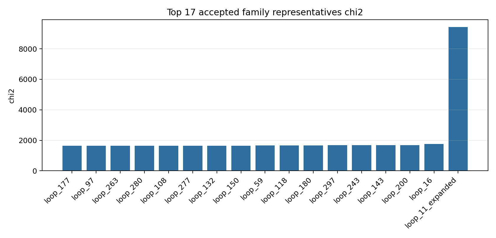
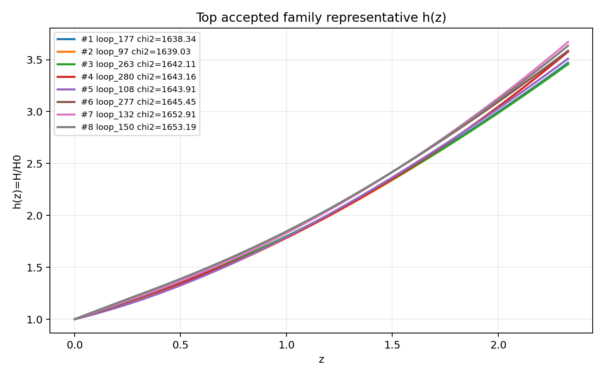
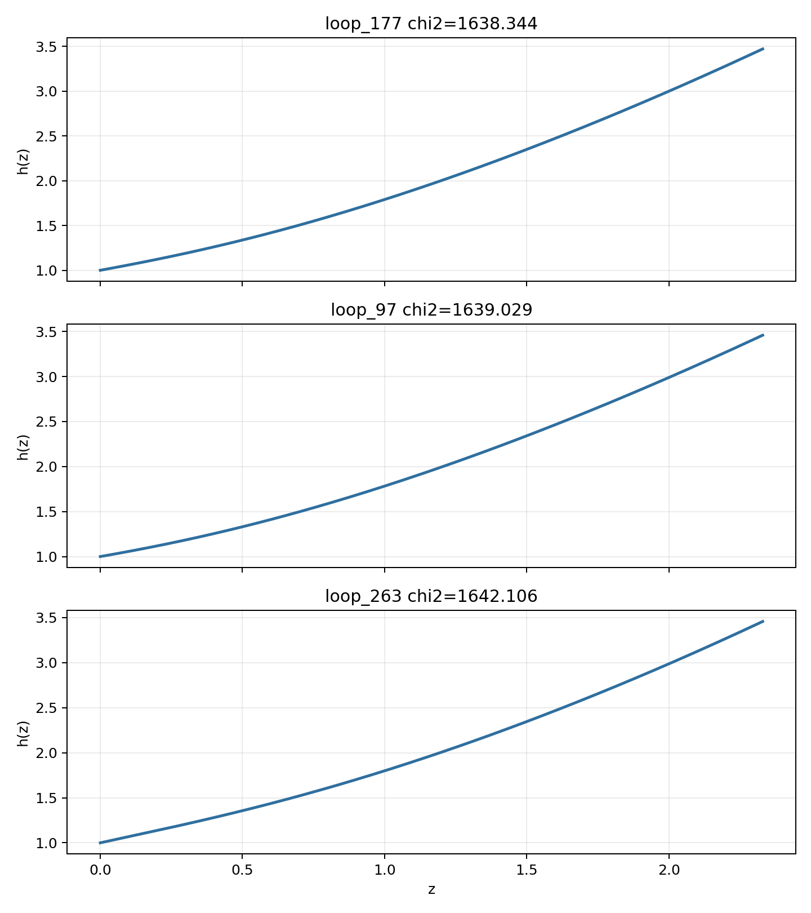

# LangGraph Agent Result Summary: graph_agent_300_effective_penalty_20260604

This report is generated from current-loop memory and the isolated Solver outputs for accepted attempts.
Human-facing tables and plots use one best representative per theory family; full accepted attempts remain in `accepted_summary.json`.

## Quick Result

| Metric | Value |
|---|---:|
| Total attempts | 301 |
| Accepted attempts | 36 |
| Accepted theory families shown | 17 |
| Best chi2 | 1638.344047 |
| q_not_determined | 132 |
| constraint_drift | 61 |
| q_initial_root_failure | 89 |

## Output Files

- [accepted_lagrangians_and_parameters.md](accepted_lagrangians_and_parameters.md)
- [accepted_lagrangians_full.md](accepted_lagrangians_full.md)
- [accepted_lagrangians_and_parameters.csv](accepted_lagrangians_and_parameters.csv)
- [accepted_summary.json](accepted_summary.json)

## Plots

## Top Accepted Family Representatives

| Rank | Family | Loop | chi2 | Status | Max rel. effect | Dominant correction | Sample | H0 | Omega_m0 | lambda_H | Scalar | Potential | Operators |
|---:|---|---|---:|---|---:|---|---:|---:|---:|---:|---|---|---|
| 1 | scalar=phi1_only|phi1_potential=axion|phi2_potential=None|operator_bucket=R_anchor+scalar_curvature | loop_177 | 1638.344047 | eh_dominated | 7.066e-19 | φ1 · R^{bcd}_{a} · R^{a}_{bcd} | 649 | 61.518 | 0.3033 | 5194.696 | phi1_only | {"phi1": "axion", "phi2": null} | φ1 · R^{bcd}_{a} · R^{a}_{bcd}; R; R^{b}_{a} · R^{cd} · R^{a}_{cbd}; φ1 · φ1 · R^{bcd}_{a} · R^{a}_{bcd} |
| 2 | scalar=phi1_only|phi1_potential=quadratic|phi2_potential=None|operator_bucket=R_anchor+derivative+scalar_curvature | loop_97 | 1639.029216 | eh_dominated | 6.086e-21 | ∇^{a}∇_{a}φ1 · R | 10 | 59.438 | 0.302 | 7358.506 | phi1_only | {"phi1": "quadratic", "phi2": null} | R; ∇^{a}∇_{a}φ1 · R |
| 3 | scalar=phi1_only|phi1_potential=quadratic|phi2_potential=None|operator_bucket=R_anchor+derivative+high_curvature+scalar_curvature | loop_263 | 1642.105949 | eh_dominated | 2.289e-17 | φ1 · ∇^{a}∇_{a}R | 329 | 65.765 | 0.2968 | 7822.691 | phi1_only | {"phi1": "quadratic", "phi2": null} | φ1 · ∇^{a}∇_{a}R; R^{cd}_{ab} · R^{afh}_{c} · R^{b}_{hdf}; R; ∇^{c}R^{ab} · ∇_{b}R_{ac} |
| 4 | scalar=both|phi1_potential=axion|phi2_potential=quadratic|operator_bucket=R_anchor | loop_280 | 1643.16001 | eh_only | 0 |  | 522 | 64.4 | 0.2957 | 2.375e+04 | both | {"phi1": "axion", "phi2": "quadratic"} | φ2 · φ2 · φ2 · φ2 · φ2 · φ2; R |
| 5 | scalar=phi1_only|phi1_potential=axion|phi2_potential=None|operator_bucket=R_anchor+derivative+high_curvature+scalar_curvature | loop_108 | 1643.910898 | eh_dominated | 2.938e-19 | ∇^{a}φ1 · ∇^{b}φ1 · R_{ab} | 870 | 66.577 | 0.3129 | 8875.568 | phi1_only | {"phi1": "axion", "phi2": null} | φ1 · ∇^{a}φ1 · ∇_{a}R; ∇^{a}φ1 · ∇^{b}φ1 · R_{ab}; R |
| 6 | scalar=phi1_only|phi1_potential=axion|phi2_potential=None|operator_bucket=R_anchor+high_curvature+scalar_curvature | loop_277 | 1645.445856 | eh_dominated | 4.109e-20 | φ1 · R^{ab} · R_{ab} | 570 | 66.165 | 0.3247 | 1.515e+04 | phi1_only | {"phi1": "axion", "phi2": null} | φ1 · R^{ab} · R_{ab}; R^{cd}_{ab} · R^{afh}_{c} · R^{b}_{hdf}; R |
| 7 | scalar=phi1_only|phi1_potential=quadratic|phi2_potential=None|operator_bucket=R_anchor+high_curvature+scalar_curvature | loop_132 | 1652.906911 | eh_dominated | 2.976e-20 | φ1 · R · R | 780 | 70.349 | 0.3172 | 2.059e+04 | phi1_only | {"phi1": "quadratic", "phi2": null} | R_{ab} · R^{adef} · R^{b}_{def}; φ1 · R · R; R; R^{bd}_{ac} · R^{agh}_{b} · R^{c}_{dgh} |
| 8 | scalar=phi1_only|phi1_potential=quadratic|phi2_potential=None|operator_bucket=R_anchor | loop_150 | 1653.193319 | eh_only | 0 |  | 639 | 63.529 | 0.3157 | 1.664e+04 | phi1_only | {"phi1": "quadratic", "phi2": null} | R |
| 9 | scalar=phi1_only|phi1_potential=axion|phi2_potential=None|operator_bucket=R_anchor+derivative+scalar_curvature | loop_59 | 1655.124543 | eh_dominated | 1.863e-27 | φ1 · ∇^{a}∇_{a}φ1 · R | 531 | 66.512 | 0.261 | 5.407e+04 | phi1_only | {"phi1": "axion", "phi2": null} | φ1 · ∇^{a}∇_{a}φ1 · R; R |
| 10 | scalar=phi1_only|phi1_potential=axion|phi2_potential=None|operator_bucket=R_anchor+derivative | loop_118 | 1666.311808 | eh_dominated | 9.061e-20 | R^{cd}_{ab} · R^{afh}_{c} · R^{b}_{hdf} | 987 | 71.749 | 0.2711 | 6757.89 | phi1_only | {"phi1": "axion", "phi2": null} | ∇^{e}R^{bcd}_{a} · ∇_{e}R^{a}_{bcd}; R^{cd}_{ab} · R^{afh}_{c} · R^{b}_{hdf}; R |
| 11 | scalar=phi1_only|phi1_potential=quadratic|phi2_potential=None|operator_bucket=R_anchor+derivative+high_curvature | loop_180 | 1668.758591 | eh_dominated | 2.192e-22 | ∇^{c}R^{ab} · ∇_{c}R_{ab} | 49 | 57.686 | 0.3426 | 1.681e+04 | phi1_only | {"phi1": "quadratic", "phi2": null} | ∇^{c}R^{ab} · ∇_{c}R_{ab}; R · R^{ab} · R_{ab}; R^{cd}_{ab} · R^{afh}_{c} · R^{b}_{fdh}; R |
| 12 | scalar=phi1_only|phi1_potential=axion|phi2_potential=None|operator_bucket=R_anchor | loop_297 | 1678.718943 | eh_only | 0 |  | 614 | 65.046 | 0.2832 | 2.057e+04 | phi1_only | {"phi1": "axion", "phi2": null} | R |
| 13 | scalar=phi1_only|phi1_potential=axion|phi2_potential=None|operator_bucket=R_anchor+high_curvature | loop_243 | 1679.835491 | eh_dominated | 2.619e-19 | R^{bd}_{ac} · R^{agh}_{b} · R^{c}_{dgh} | 78 | 71.13 | 0.3273 | 2316.007 | phi1_only | {"phi1": "axion", "phi2": null} | R^{bd}_{ac} · R^{agh}_{b} · R^{c}_{dgh}; R; R · R · R |
| 14 | scalar=phi1_only|phi1_potential=quadratic|phi2_potential=None|operator_bucket=R_anchor+scalar_curvature | loop_143 | 1680.463807 | eh_dominated | 5.623e-24 | φ1 · R^{bcd}_{a} · R^{a}_{bcd} | 494 | 66.258 | 0.2796 | 4.458e+04 | phi1_only | {"phi1": "quadratic", "phi2": null} | φ1 · φ1; φ1 · R^{bcd}_{a} · R^{a}_{bcd}; R |
| 15 | scalar=phi1_only|phi1_potential=quadratic|phi2_potential=None|operator_bucket=R_anchor+high_curvature | loop_200 | 1691.766732 | eh_dominated | 8.018e-26 | R_{ab} · R^{adef} · R^{b}_{def} | 344 | 59.118 | 0.2001 | 3.019e+04 | phi1_only | {"phi1": "quadratic", "phi2": null} | R; R_{ab} · R^{adef} · R^{b}_{def} |
| 16 | scalar=both|phi1_potential=quadratic|phi2_potential=axion|operator_bucket=R_anchor | loop_16 | 1756.864092 | eh_only | 0 |  | 490 | 64.621 | 0.3522 | 6313.884 | both | {"phi1": "quadratic", "phi2": "axion"} | R |
| 17 | scalar=phi2_only|phi1_potential=None|phi2_potential=axion|operator_bucket=high_curvature+scalar_curvature | loop_11_expanded | 9434.007717 | unclear |  |  | 684 | 58.815 | 0.245 | 3.122e+04 | phi2_only | {"phi1": null, "phi2": "axion"} | R^{ab} · R^{d}_{a} · R_{bd}; φ2 · φ2 · φ2 · φ2 · R; φ2 · φ2 · R^{bcd}_{a} · R^{a}_{bcd}; R^{cd}_{ab} · R^{afh}_{c} · R^{b}_{hdf} |

## Top Family Representative Parameter Choices

| Rank | Loop | varphi1_0 | q1_0 | mu1 | fbar1 | varphi2_0 | q2_0 | mu2 | fbar2 | Free coefficients |
|---:|---|---:|---:|---:|---:|---:|---:|---:|---:|---|
| 1 | loop_177 | 1.7028 | -0.5064 | 1.2503 | 1.3033 | 0 | 0 | 0 | 1 | \alpha=-2.9084e-08, \beta=0.5, \gamma=4.4970e-06, \delta=-9.1546e-09 |
| 2 | loop_97 | 2.3614 | -0.4442 | 0.8459 | 9.537 | 0 | 0 | 0 | 1 | \alpha=0.5, \beta=5.1344e-10 |
| 3 | loop_263 | 1.459 | -0.6951 | 1.3248 | 0.2027 | 0 | 0 | 0 | 1 | \alpha=3.7545e-06, \beta=9.3513e-07, \gamma=0.5, \delta=4.0711e-05 |
| 4 | loop_280 | 1.3613 | -0.6882 | 1.4336 | 3.2193 | 0.1757 | 1.6716 | 0.0067 | 11.5931 | \alpha=6.8524e-07, \beta=0.5 |
| 5 | loop_108 | 3.9866 | -0.2539 | 0.5061 | 20.0694 | 0 | 0 | 0 | 1 | \alpha=-1.0826e-10, \beta=-5.7365e-05, \gamma=0.5 |
| 6 | loop_277 | 1.8014 | -0.547 | 1.0757 | 21.3449 | 0 | 0 | 0 | 1 | \alpha=3.9650e-08, \beta=5.3613e-08, \gamma=0.5 |
| 7 | loop_132 | 1.2944 | -0.7102 | 1.4642 | 0.4804 | 0 | 0 | 0 | 1 | \alpha=-4.6402e-10, \beta=-1.0029e-07, \gamma=0.5, \delta=-1.5741e-06 |
| 8 | loop_150 | 1.111 | -0.8266 | 1.6652 | 1.4404 | 0 | 0 | 0 | 1 | \alpha=0.5 |
| 9 | loop_59 | 1.5061 | -0.6771 | 1.3244 | 16.409 | 0 | 0 | 0 | 1 | \alpha=-3.5086e-09, \beta=0.5 |
| 10 | loop_118 | 1.3018 | -0.8411 | 1.5188 | 1.4881 | 0 | 0 | 0 | 1 | \alpha=-5.0711e-06, \beta=9.4492e-05, \gamma=0.5 |
| 11 | loop_180 | 1.2692 | -0.7129 | 1.4606 | 2.329 | 0 | 0 | 0 | 1 | \alpha=8.7555e-06, \beta=-1.7354e-07, \gamma=1.7421e-07, \delta=0.5 |
| 12 | loop_297 | 3.58 | -0.4106 | 0.571 | 9.7501 | 0 | 0 | 0 | 1 | \alpha=0.5 |
| 13 | loop_243 | 3.7754 | 0.5191 | 1.482 | 0.8399 | 0 | 0 | 0 | 1 | \alpha=-3.7676e-06, \beta=0.5, \gamma=-1.2875e-06 |
| 14 | loop_143 | 0.8422 | -1.0733 | 0.0594 | 0.9784 | 0 | 0 | 0 | 1 | \alpha=-1.1238e-09, \beta=-2.9572e-10, \gamma=0.5 |
| 15 | loop_200 | 3.1816 | -0.5131 | 0.6694 | 0.4117 | 0 | 0 | 0 | 1 | \alpha=0.5, \beta=3.3301e-08 |
| 16 | loop_16 | 2.461 | -0.4863 | 0.7763 | 0.1325 | 0.3686 | 0.6777 | 2.5590e-04 | 0.8118 | \alpha=0.5 |
| 17 | loop_11_expanded | 0 | 0 | 0 | 1 | 2.8995 | -16.3786 | 0.0108 | 0.2075 | \alpha=-4.2090e-05, \beta=-8.0257e-05, \gamma=1.5020e-08, \delta=3.9898e-06 |

## Main Failure Tags

| Tag | Count |
|---|---:|
| missing_ranking | 264 |
| no_accepted_samples | 264 |
| q_not_determined | 132 |
| q_initial_root_failure | 89 |
| constraint_drift | 61 |
| no_scalar_constraint | 41 |
| h_absurdly_large | 36 |
| integration_failure | 13 |
| symbolic_timeout | 3 |
| pre_sampling_timeout | 1 |
