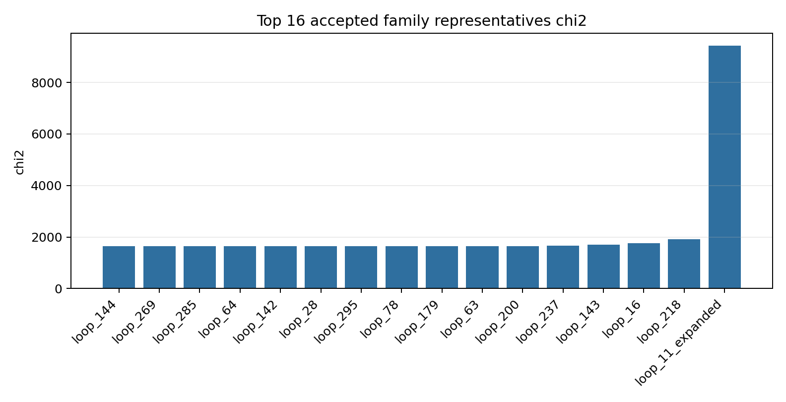
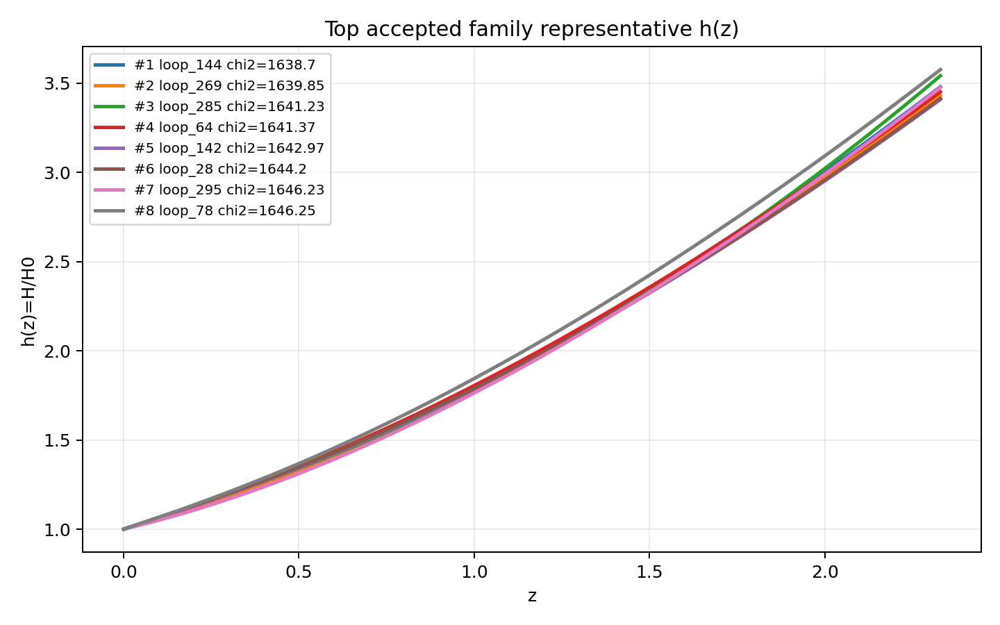
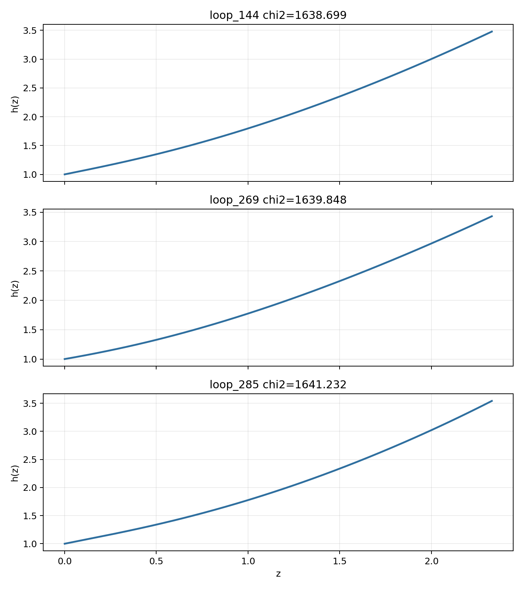

# LangGraph Agent Result Summary: graph_agent_300_eh_baseline_reward_20260605

This report is generated from current-loop memory and the isolated Solver outputs for accepted attempts.
Human-facing tables and plots use one best representative per theory family; full accepted attempts remain in `accepted_summary.json`.

## Quick Result

| Metric | Value |
|---|---:|
| Total attempts | 303 |
| Accepted attempts | 52 |
| Accepted theory families shown | 16 |
| Best chi2 | 1638.699177 |
| q_not_determined | 126 |
| constraint_drift | 77 |
| q_initial_root_failure | 94 |

## Output Files

- [accepted_lagrangians_and_parameters.md](accepted_lagrangians_and_parameters.md)
- [accepted_lagrangians_full.md](accepted_lagrangians_full.md)
- [accepted_lagrangians_and_parameters.csv](accepted_lagrangians_and_parameters.csv)
- [accepted_summary.json](accepted_summary.json)

## Plots

## Top Accepted Family Representatives

| Rank | Family | Loop | chi2 | Status | Max rel. effect | Dominant correction | Sample | H0 | Omega_m0 | lambda_H | Scalar | Potential | Operators |
|---:|---|---|---:|---|---:|---|---:|---:|---:|---:|---|---|---|
| 1 | scalar=phi1_only|phi1_potential=quadratic|phi2_potential=None|operator_bucket=R_anchor+derivative+high_curvature+scalar_curvature | loop_144 | 1638.699177 | eh_dominated | 5.459e-19 | ∇^{a}φ1 · ∇_{a}R | 316 | 60.911 | 0.3012 | 5403.395 | phi1_only | {"phi1": "quadratic", "phi2": null} | ∇^{a}φ1 · ∇_{a}R; R_{ab} · R^{adef} · R^{b}_{def}; R; φ1 · ∇^{a}φ1 · ∇_{a}R |
| 2 | scalar=phi1_only|phi1_potential=axion|phi2_potential=None|operator_bucket=R_anchor | loop_269 | 1639.848483 | eh_only | 0 |  | 117 | 70.974 | 0.2973 | 1.996e+04 | phi1_only | {"phi1": "axion", "phi2": null} | R |
| 3 | scalar=phi1_only|phi1_potential=quadratic|phi2_potential=None|operator_bucket=R_anchor+derivative+high_curvature | loop_285 | 1641.232497 | eh_dominated | 6.615e-25 | ∇^{a}∇_{a}R · R^{c}_{c} | 557 | 71.708 | 0.2925 | 5.737e+04 | phi1_only | {"phi1": "quadratic", "phi2": null} | ∇^{a}∇_{a}R · R^{c}_{c}; R |
| 4 | scalar=both|phi1_potential=quadratic|phi2_potential=quadratic|operator_bucket=R_anchor | loop_64 | 1641.374377 | eh_only | 0 |  | 543 | 68.39 | 0.2941 | 5.071e+04 | both | {"phi1": "quadratic", "phi2": "quadratic"} | R |
| 5 | scalar=phi1_only|phi1_potential=quadratic|phi2_potential=None|operator_bucket=R_anchor | loop_142 | 1642.965099 | eh_only | 0 |  | 933 | 62.805 | 0.2908 | 2196.457 | phi1_only | {"phi1": "quadratic", "phi2": null} | R |
| 6 | scalar=phi1_only|phi1_potential=axion|phi2_potential=None|operator_bucket=R_anchor+derivative+high_curvature+scalar_curvature | loop_28 | 1644.197538 | eh_dominated | 4.808e-21 | φ1 · R^{ab} · R_{ab} | 813 | 68.079 | 0.291 | 1.744e+04 | phi1_only | {"phi1": "axion", "phi2": null} | φ1 · R^{ab} · R_{ab}; R; ∇^{a}∇^{b}R · R_{ab} |
| 7 | scalar=phi1_only|phi1_potential=axion|phi2_potential=None|operator_bucket=R_anchor+derivative | loop_295 | 1646.231779 | eh_dominated | 2.783e-26 | ∇^{a}R · ∇_{a}R | 886 | 70.395 | 0.2887 | 3.827e+04 | phi1_only | {"phi1": "axion", "phi2": null} | R; ∇^{e}R^{bcd}_{a} · ∇_{e}R^{a}_{bcd}; φ1 · φ1; ∇^{a}R · ∇_{a}R |
| 8 | scalar=phi1_only|phi1_potential=axion|phi2_potential=None|operator_bucket=R_anchor+derivative+high_curvature | loop_78 | 1646.253591 | eh_dominated | 3.125e-23 | ∇^{e}R^{bcd}_{a} · ∇_{e}R^{a}_{bcd} | 107 | 65.644 | 0.3154 | 1.748e+04 | phi1_only | {"phi1": "axion", "phi2": null} | φ1 · φ1; ∇^{e}R^{bcd}_{a} · ∇_{e}R^{a}_{bcd}; R · R^{ab} · R_{ab}; R |
| 9 | scalar=phi1_only|phi1_potential=quadratic|phi2_potential=None|operator_bucket=R_anchor+derivative+scalar_curvature | loop_179 | 1646.963249 | eh_dominated | 2.252e-22 | φ1 · ∇^{a}φ1 · ∇_{a}R | 476 | 59.759 | 0.2784 | 6580.698 | phi1_only | {"phi1": "quadratic", "phi2": null} | R; φ1 · ∇^{a}φ1 · ∇_{a}R |
| 10 | scalar=phi1_only|phi1_potential=quadratic|phi2_potential=None|operator_bucket=R_anchor+derivative | loop_63 | 1649.03686 | eh_dominated | 1.555e-26 | ∇^{a}R · ∇_{a}R | 984 | 66.808 | 0.2873 | 3.321e+04 | phi1_only | {"phi1": "quadratic", "phi2": null} | R; ∇^{a}R · ∇_{a}R; R^{cd}_{ab} · R^{afh}_{c} · R^{b}_{fdh} |
| 11 | scalar=phi1_only|phi1_potential=quadratic|phi2_potential=None|operator_bucket=R_anchor+high_curvature | loop_200 | 1650.839828 | eh_dominated | 1.418e-26 | R_{ab} · R^{adef} · R^{b}_{def} | 361 | 61.135 | 0.2987 | 3.230e+04 | phi1_only | {"phi1": "quadratic", "phi2": null} | R; R_{ab} · R^{adef} · R^{b}_{def} |
| 12 | scalar=phi1_only|phi1_potential=axion|phi2_potential=None|operator_bucket=R_anchor+high_curvature+scalar_curvature | loop_237 | 1659.874559 | eh_dominated | 2.300e-22 | R · R^{ab} · R_{ab} | 362 | 70.994 | 0.2581 | 4535.618 | phi1_only | {"phi1": "axion", "phi2": null} | R; φ1 · φ1 · R · R; R · R^{ab} · R_{ab}; R^{b}_{a} · R^{cd} · R^{a}_{cbd} |
| 13 | scalar=both|phi1_potential=axion|phi2_potential=quadratic|operator_bucket=R_anchor | loop_143 | 1696.043979 | eh_only | 0 |  | 558 | 62.466 | 0.2368 | 2284.355 | both | {"phi1": "axion", "phi2": "quadratic"} | R |
| 14 | scalar=both|phi1_potential=quadratic|phi2_potential=axion|operator_bucket=R_anchor | loop_16 | 1756.864092 | eh_only | 0 |  | 490 | 64.621 | 0.3522 | 6313.884 | both | {"phi1": "quadratic", "phi2": "axion"} | R |
| 15 | scalar=phi1_only|phi1_potential=axion|phi2_potential=None|operator_bucket=R_anchor+derivative+scalar_curvature | loop_218 | 1911.306031 | eh_dominated | 8.926e-20 | ∇^{a}∇_{a}φ1 · R | 309 | 60.496 | 0.2002 | 2657.207 | phi1_only | {"phi1": "axion", "phi2": null} | R; ∇^{a}∇_{a}φ1 · R |
| 16 | scalar=phi2_only|phi1_potential=None|phi2_potential=axion|operator_bucket=high_curvature+scalar_curvature | loop_11_expanded | 9434.007717 | unclear |  |  | 684 | 58.815 | 0.245 | 3.122e+04 | phi2_only | {"phi1": null, "phi2": "axion"} | R^{ab} · R^{d}_{a} · R_{bd}; φ2 · φ2 · φ2 · φ2 · R; φ2 · φ2 · R^{bcd}_{a} · R^{a}_{bcd}; R^{cd}_{ab} · R^{afh}_{c} · R^{b}_{hdf} |

## Top Family Representative Parameter Choices

| Rank | Loop | varphi1_0 | q1_0 | mu1 | fbar1 | varphi2_0 | q2_0 | mu2 | fbar2 | Free coefficients |
|---:|---|---:|---:|---:|---:|---:|---:|---:|---:|---|
| 1 | loop_144 | 1.6298 | -0.6211 | 1.1972 | 1.1871 | 0 | 0 | 0 | 1 | \alpha=2.6420e-08, \beta=1.5299e-09, \gamma=0.5, \delta=4.9953e-09 |
| 2 | loop_269 | 2.3635 | -0.4456 | 0.8542 | 5.6907 | 0 | 0 | 0 | 1 | \alpha=0.5 |
| 3 | loop_285 | 1.4854 | -0.6522 | 1.3158 | 0.0831 | 0 | 0 | 0 | 1 | \alpha=-3.5826e-06, \beta=0.5 |
| 4 | loop_64 | 1.7451 | -0.6349 | 1.1218 | 0.2002 | 1.807 | -1.11 | 4.4512e-04 | 0.1133 | \alpha=0.5 |
| 5 | loop_142 | 1.7156 | -0.62 | 1.1468 | 0.5985 | 0 | 0 | 0 | 1 | \alpha=0.5 |
| 6 | loop_28 | 1.5772 | -0.664 | 1.2391 | 11.0495 | 0 | 0 | 0 | 1 | \alpha=8.0902e-09, \beta=0.5, \gamma=2.5319e-09 |
| 7 | loop_295 | 2.722 | -0.272 | 2.0381 | 0.1629 | 0 | 0 | 0 | 1 | \alpha=0.5, \beta=-5.1287e-09, \gamma=-1.7757e-10, \delta=2.9858e-08 |
| 8 | loop_78 | 1.7931 | -0.6001 | 0.4614 | 1.9993 | 0 | 0 | 0 | 1 | \alpha=-1.5807e-09, \beta=1.4601e-06, \gamma=8.7213e-10, \delta=0.5 |
| 9 | loop_179 | 1.6446 | -0.7361 | 1.1833 | 0.6199 | 0 | 0 | 0 | 1 | \alpha=0.5, \beta=-7.8087e-08 |
| 10 | loop_63 | 1.2016 | -0.7844 | 1.5924 | 27.596 | 0 | 0 | 0 | 1 | \alpha=0.5, \beta=9.4556e-09, \gamma=1.6362e-09 |
| 11 | loop_200 | 1.5541 | -0.7292 | 1.2337 | 0.1061 | 0 | 0 | 0 | 1 | \alpha=0.5, \beta=7.7178e-09 |
| 12 | loop_237 | 1.6319 | -0.6321 | 1.2342 | 13.1849 | 0 | 0 | 0 | 1 | \alpha=0.5, \beta=1.4523e-08, \gamma=4.8660e-08, \delta=1.1782e-10 |
| 13 | loop_143 | 3.9969 | -1.0925 | 2.8243 | 0.5242 | 2.7472 | 1.371 | 4.4308e-04 | 3.4356 | \alpha=0.5 |
| 14 | loop_16 | 2.461 | -0.4863 | 0.7763 | 0.1325 | 0.3686 | 0.6777 | 2.5590e-04 | 0.8118 | \alpha=0.5 |
| 15 | loop_218 | 1.0803 | -0.9772 | 1.8485 | 1.6296 | 0 | 0 | 0 | 1 | \alpha=0.5, \beta=-7.7507e-10 |
| 16 | loop_11_expanded | 0 | 0 | 0 | 1 | 2.8995 | -16.3786 | 0.0108 | 0.2075 | \alpha=-4.2090e-05, \beta=-8.0257e-05, \gamma=1.5020e-08, \delta=3.9898e-06 |

## Main Failure Tags

| Tag | Count |
|---|---:|
| missing_ranking | 250 |
| no_accepted_samples | 250 |
| q_not_determined | 126 |
| q_initial_root_failure | 94 |
| constraint_drift | 77 |
| h_absurdly_large | 51 |
| no_scalar_constraint | 36 |
| integration_failure | 10 |
| symbolic_timeout | 4 |
| pre_sampling_timeout | 1 |
