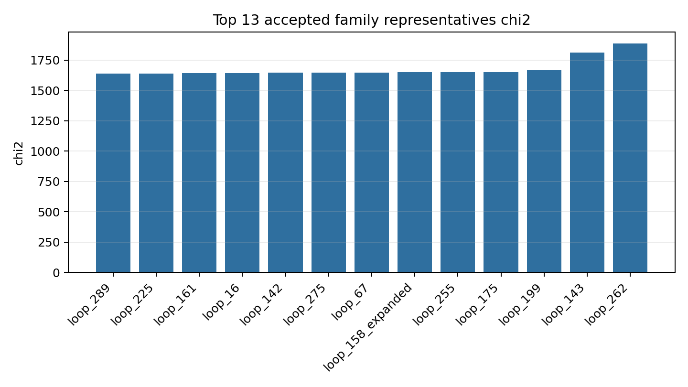
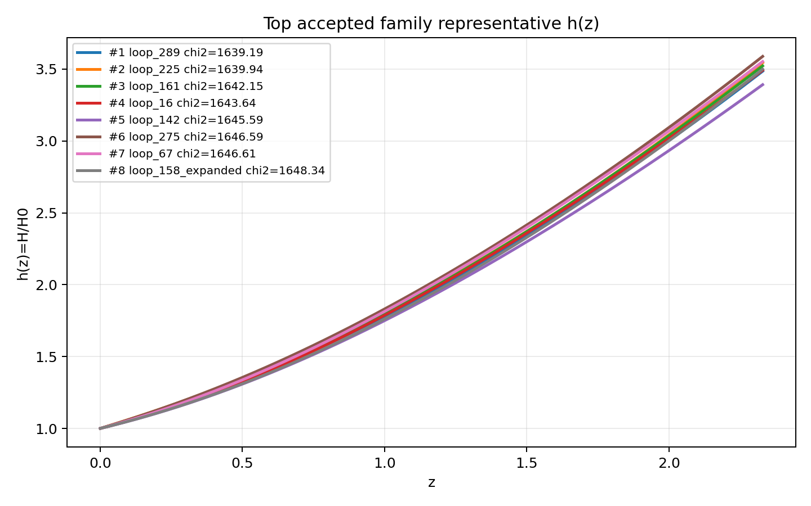
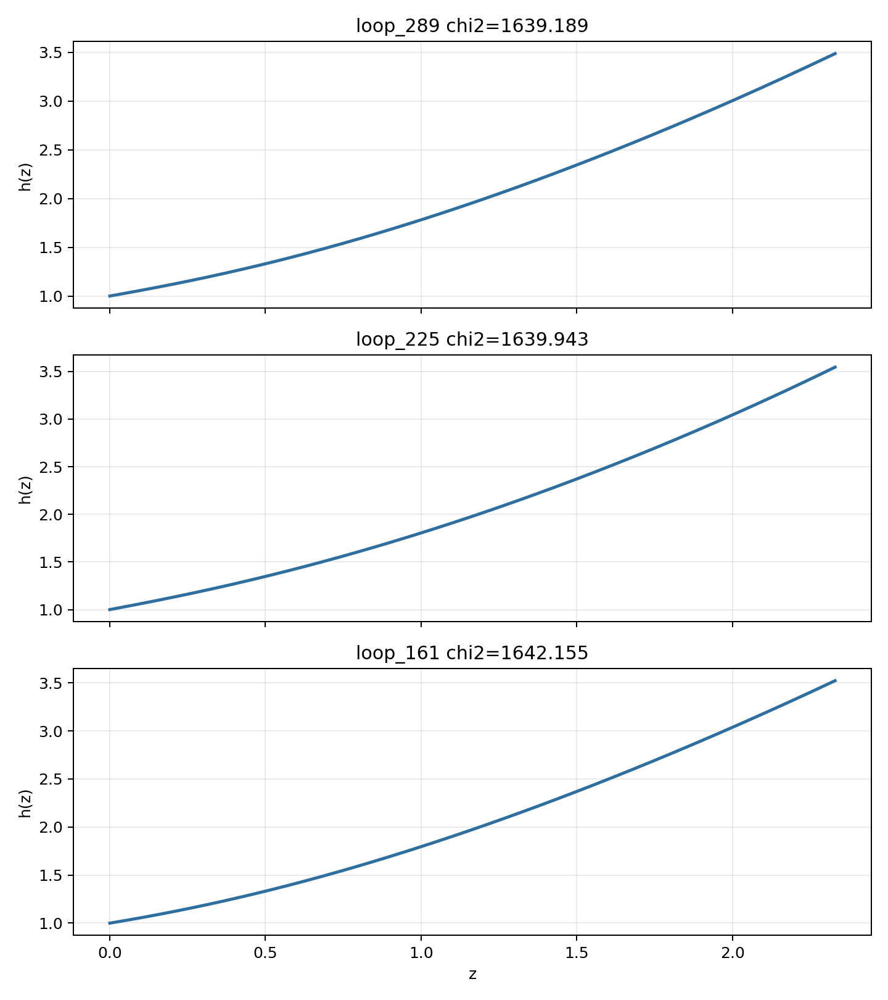

# LangGraph Agent Result Summary: graph_agent_300_local_debug_full_20260603

This report is generated from current-loop memory and the isolated Solver outputs for accepted attempts.
Human-facing tables and plots use one best representative per theory family; full accepted attempts remain in `accepted_summary.json`.

## Quick Result

| Metric | Value |
|---|---:|
| Total attempts | 300 |
| Accepted attempts | 34 |
| Accepted theory families shown | 13 |
| Best chi2 | 1639.189017 |
| q_not_determined | 165 |
| constraint_drift | 92 |
| q_initial_root_failure | 62 |

## Output Files

- [accepted_lagrangians_and_parameters.md](accepted_lagrangians_and_parameters.md)
- [accepted_lagrangians_full.md](accepted_lagrangians_full.md)
- [accepted_lagrangians_and_parameters.csv](accepted_lagrangians_and_parameters.csv)
- [accepted_summary.json](accepted_summary.json)

## Plots

## Top Accepted Family Representatives

| Rank | Family | Loop | chi2 | Sample | H0 | Omega_m0 | lambda_H | Scalar | Potential | Operators |
|---:|---|---|---:|---:|---:|---:|---:|---|---|---|
| 1 | scalar=phi1_only|phi1_potential=axion|phi2_potential=None|operator_bucket=R_anchor+derivative+scalar_curvature | loop_289 | 1639.189017 | 860 | 67.289 | 0.3023 | 3089.764 | phi1_only | {"phi1": "axion", "phi2": null} | R; φ1 · ∇^{a}∇_{a}R |
| 2 | scalar=phi1_only|phi1_potential=quadratic|phi2_potential=None|operator_bucket=R_anchor+derivative+scalar_curvature | loop_225 | 1639.942652 | 58 | 68.302 | 0.2795 | 8412.893 | phi1_only | {"phi1": "quadratic", "phi2": null} | ∇^{a}φ1 · ∇_{a}R; R |
| 3 | scalar=phi1_only|phi1_potential=quadratic|phi2_potential=None|operator_bucket=R_anchor | loop_161 | 1642.154673 | 846 | 70.155 | 0.3125 | 2016.365 | phi1_only | {"phi1": "quadratic", "phi2": null} | R |
| 4 | scalar=phi1_only|phi1_potential=axion|phi2_potential=None|operator_bucket=R_anchor+derivative | loop_16 | 1643.6384 | 540 | 58.289 | 0.3092 | 1.548e+04 | phi1_only | {"phi1": "axion", "phi2": null} | R; ∇^{a}∇_{a}φ1 |
| 5 | scalar=phi1_only|phi1_potential=axion|phi2_potential=None|operator_bucket=R_anchor | loop_142 | 1645.588149 | 506 | 66.047 | 0.2912 | 4.047e+04 | phi1_only | {"phi1": "axion", "phi2": null} | R |
| 6 | scalar=phi1_only|phi1_potential=axion|phi2_potential=None|operator_bucket=R_anchor+high_curvature+scalar_curvature | loop_275 | 1646.590958 | 844 | 65.805 | 0.312 | 3.368e+04 | phi1_only | {"phi1": "axion", "phi2": null} | φ1 · R · R; R; φ1 · R^{ab} · R_{ab} |
| 7 | scalar=phi1_only|phi1_potential=quadratic|phi2_potential=None|operator_bucket=R_anchor+derivative+high_curvature+scalar_curvature | loop_67 | 1646.606111 | 700 | 62.211 | 0.3215 | 2.253e+04 | phi1_only | {"phi1": "quadratic", "phi2": null} | φ1 · ∇^{a}∇^{b}φ1 · R_{ab}; R; φ1 · φ1 · R^{bcd}_{a} · R^{a}_{bcd}; ∇^{a}φ1 · ∇_{a}φ1 |
| 8 | scalar=phi1_only|phi1_potential=axion|phi2_potential=None|operator_bucket=R_anchor+derivative+high_curvature+scalar_curvature | loop_158_expanded | 1648.342556 | 2798 | 69.375 | 0.2973 | 4063.448 | phi1_only | {"phi1": "axion", "phi2": null} | R · R · R; ∇^{a}∇_{a}R; R; φ1 · R^{ab} · R_{ab} |
| 9 | scalar=phi1_only|phi1_potential=axion|phi2_potential=None|operator_bucket=R_anchor+derivative+high_curvature | loop_255 | 1651.103398 | 287 | 67.926 | 0.2524 | 6.747e+04 | phi1_only | {"phi1": "axion", "phi2": null} | R; R · R; ∇^{a}∇^{b}R · R_{ab}; ∇^{a}∇_{a}R |
| 10 | scalar=phi1_only|phi1_potential=quadratic|phi2_potential=None|operator_bucket=R_anchor+derivative+high_curvature | loop_175 | 1651.224598 | 104 | 63.639 | 0.3328 | 2304.331 | phi1_only | {"phi1": "quadratic", "phi2": null} | R^{ab} · R_{ab}; ∇^{e}R^{bcd}_{a} · ∇_{e}R^{a}_{bcd}; R; R · R^{bcd}_{a} · R^{a}_{bcd} |
| 11 | scalar=phi1_only|phi1_potential=quadratic|phi2_potential=None|operator_bucket=R_anchor+high_curvature | loop_199 | 1666.493296 | 618 | 61.722 | 0.3287 | 2.308e+04 | phi1_only | {"phi1": "quadratic", "phi2": null} | R^{ab} · R_{ab}; R |
| 12 | scalar=both|phi1_potential=axion|phi2_potential=quadratic|operator_bucket=R_anchor | loop_143 | 1813.010036 | 919 | 67.11 | 0.3021 | 2332.911 | both | {"phi1": "axion", "phi2": "quadratic"} | R |
| 13 | scalar=both|phi1_potential=axion|phi2_potential=axion|operator_bucket=R_anchor+high_curvature+scalar_curvature | loop_262 | 1885.844051 | 237 | 69.677 | 0.3819 | 2922.867 | both | {"phi1": "axion", "phi2": "axion"} | φ2 · φ2 · R^{ab} · R_{ab}; R |

## Top Family Representative Parameter Choices

| Rank | Loop | varphi1_0 | q1_0 | mu1 | fbar1 | varphi2_0 | q2_0 | mu2 | fbar2 | Free coefficients |
|---:|---|---:|---:|---:|---:|---:|---:|---:|---:|---|
| 1 | loop_289 | 1.2709 | -0.483 | 1.8391 | 0.6556 | 0 | 0 | 0 | 1 | \alpha=0.5, \beta=-1.3328e-07 |
| 2 | loop_225 | 2.0105 | -0.619 | 0.9873 | 16.1726 | 0 | 0 | 0 | 1 | \alpha=-7.2552e-10, \beta=0.5 |
| 3 | loop_161 | 2.6902 | -0.3723 | 0.7422 | 0.0758 | 0 | 0 | 0 | 1 | \alpha=0.5 |
| 4 | loop_16 | 3.4023 | -0.2256 | 0.6992 | 1.7541 | 0 | 0 | 0 | 1 | \alpha=0.5, \beta=-4.0437e-07 |
| 5 | loop_142 | 3.8757 | -0.2773 | 0.5302 | 10.5716 | 0 | 0 | 0 | 1 | \alpha=0.5 |
| 6 | loop_275 | 2.1615 | -0.5112 | 0.9286 | 3.0884 | 0 | 0 | 0 | 1 | \alpha=-5.6210e-10, \beta=0.5, \gamma=6.5160e-09 |
| 7 | loop_67 | 3.8147 | -0.2904 | 0.5234 | 0.0863 | 0 | 0 | 0 | 1 | \alpha=4.7361e-07, \beta=0.5, \gamma=2.3211e-08, \delta=-4.5845e-05 |
| 8 | loop_158_expanded | 2.8293 | -0.2674 | 0.7875 | 1.9407 | 0 | 0 | 0 | 1 | \alpha=3.4501e-06, \beta=-2.7269e-05, \gamma=0.5, \delta=-9.9698e-10 |
| 9 | loop_255 | 1.3803 | -0.8655 | 1.4008 | 16.9988 | 0 | 0 | 0 | 1 | \alpha=0.5, \beta=-4.5988e-07, \gamma=-2.4389e-10, \delta=-1.0171e-05 |
| 10 | loop_175 | 2.0195 | -0.4975 | 0.9597 | 26.9974 | 0 | 0 | 0 | 1 | \alpha=1.2991e-05, \beta=-6.5196e-08, \gamma=0.5, \delta=4.9870e-05 |
| 11 | loop_199 | 3.8598 | -0.3221 | 0.5132 | 1.9865 | 0 | 0 | 0 | 1 | \alpha=2.3303e-10, \beta=0.5 |
| 12 | loop_143 | 2.1887 | -0.5275 | 0.9827 | 1.5526 | 0.8296 | 1.251 | 0.0011 | 7.0898 | \alpha=0.5 |
| 13 | loop_262 | 0.6421 | -1.1725 | 2.3802 | 6.773 | 2.3077 | -1.0644 | 0.0092 | 0.2155 | \alpha=-1.4070e-09, \beta=0.5 |

## Main Failure Tags

| Tag | Count |
|---|---:|
| missing_ranking | 266 |
| no_accepted_samples | 266 |
| q_not_determined | 165 |
| constraint_drift | 92 |
| q_initial_root_failure | 62 |
| h_absurdly_large | 37 |
| integration_failure | 7 |
| no_scalar_constraint | 6 |
| symbolic_timeout | 1 |
