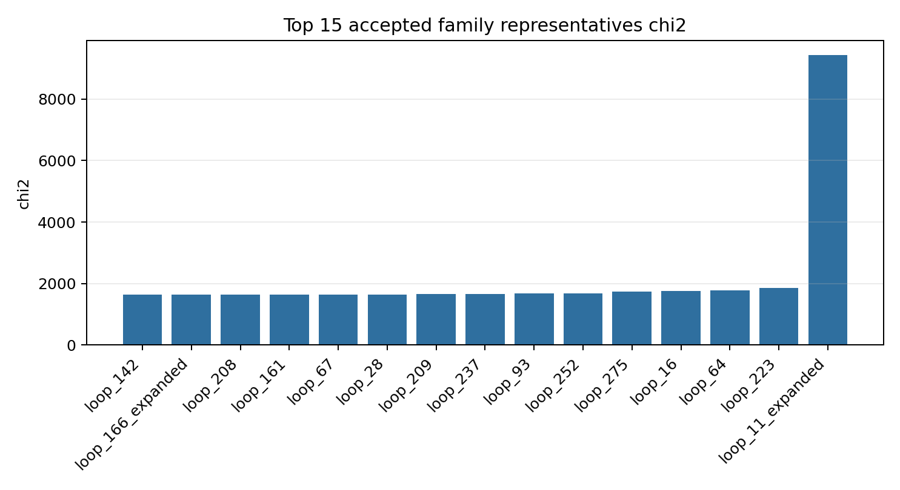
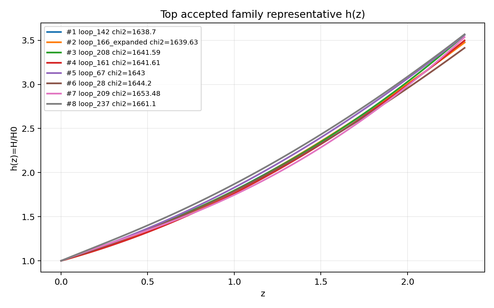
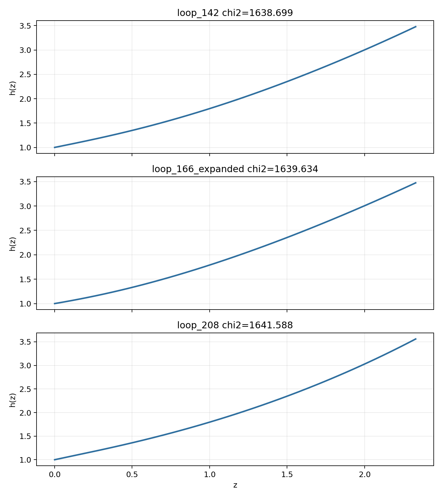

# LangGraph Agent Result Summary: graph_agent_300_reward2000_20260604

This report is generated from current-loop memory and the isolated Solver outputs for accepted attempts.
Human-facing tables and plots use one best representative per theory family; full accepted attempts remain in `accepted_summary.json`.

## Quick Result

| Metric | Value |
|---|---:|
| Total attempts | 303 |
| Accepted attempts | 32 |
| Accepted theory families shown | 15 |
| Best chi2 | 1638.699177 |
| q_not_determined | 123 |
| constraint_drift | 77 |
| q_initial_root_failure | 84 |

## Output Files

- [accepted_lagrangians_and_parameters.md](accepted_lagrangians_and_parameters.md)
- [accepted_lagrangians_full.md](accepted_lagrangians_full.md)
- [accepted_lagrangians_and_parameters.csv](accepted_lagrangians_and_parameters.csv)
- [accepted_summary.json](accepted_summary.json)

## Plots

## Top Accepted Family Representatives

| Rank | Family | Loop | chi2 | Status | Max rel. effect | Dominant correction | Sample | H0 | Omega_m0 | lambda_H | Scalar | Potential | Operators |
|---:|---|---|---:|---|---:|---|---:|---:|---:|---:|---|---|---|
| 1 | scalar=phi1_only|phi1_potential=quadratic|phi2_potential=None|operator_bucket=R_anchor+derivative+high_curvature | loop_142 | 1638.699177 | eh_dominated | 1.048e-16 | R · R | 37 | 60.911 | 0.3012 | 5403.395 | phi1_only | {"phi1": "quadratic", "phi2": null} | R; ∇^{a}∇_{a}φ1; R · R; ∇^{a}R · ∇_{a}R |
| 2 | scalar=phi1_only|phi1_potential=axion|phi2_potential=None|operator_bucket=R_anchor+derivative+high_curvature | loop_166_expanded | 1639.634363 | eh_dominated | 3.447e-26 | R · R^{bcd}_{a} · R^{a}_{bcd} | 898 | 67.029 | 0.3065 | 5.367e+04 | phi1_only | {"phi1": "axion", "phi2": null} | φ1 · ∇^{a}∇_{a}φ1; R · R^{bcd}_{a} · R^{a}_{bcd}; R |
| 3 | scalar=phi1_only|phi1_potential=quadratic|phi2_potential=None|operator_bucket=R_anchor | loop_208 | 1641.587762 | eh_only | 0 |  | 101 | 63.298 | 0.227 | 8346.478 | phi1_only | {"phi1": "quadratic", "phi2": null} | R |
| 4 | scalar=phi1_only|phi1_potential=quadratic|phi2_potential=None|operator_bucket=R_anchor+high_curvature+scalar_curvature | loop_161 | 1641.605888 | eh_dominated | 2.982e-20 | φ1 · R^{bcd}_{a} · R^{a}_{bcd} | 820 | 64.373 | 0.2619 | 1.994e+04 | phi1_only | {"phi1": "quadratic", "phi2": null} | φ1 · φ1; φ1 · R^{bcd}_{a} · R^{a}_{bcd}; φ1 · φ1 · R^{ab} · R_{ab}; R |
| 5 | scalar=phi1_only|phi1_potential=quadratic|phi2_potential=None|operator_bucket=R_anchor+derivative+high_curvature+scalar_curvature | loop_67 | 1643.004172 | eh_dominated | 1.370e-24 | φ1 · ∇^{a}∇^{b}φ1 · R_{ab} | 876 | 59.09 | 0.2842 | 1.403e+04 | phi1_only | {"phi1": "quadratic", "phi2": null} | φ1 · ∇^{a}∇^{b}φ1 · R_{ab}; R |
| 6 | scalar=phi1_only|phi1_potential=axion|phi2_potential=None|operator_bucket=R_anchor+derivative+high_curvature+scalar_curvature | loop_28 | 1644.197538 | eh_dominated | 4.808e-21 | φ1 · R^{ab} · R_{ab} | 813 | 68.079 | 0.291 | 1.744e+04 | phi1_only | {"phi1": "axion", "phi2": null} | φ1 · R^{ab} · R_{ab}; R; ∇^{a}∇^{b}R · R_{ab} |
| 7 | scalar=phi1_only|phi1_potential=axion|phi2_potential=None|operator_bucket=R_anchor | loop_209 | 1653.483771 | eh_only | 0 |  | 92 | 66.193 | 0.2659 | 4395.516 | phi1_only | {"phi1": "axion", "phi2": null} | R |
| 8 | scalar=phi1_only|phi1_potential=axion|phi2_potential=None|operator_bucket=R_anchor+scalar_curvature | loop_237 | 1661.099146 | eh_dominated | 2.277e-26 | φ1 · φ1 · R^{bcd}_{a} · R^{a}_{bcd} | 752 | 59.311 | 0.2895 | 1.297e+04 | phi1_only | {"phi1": "axion", "phi2": null} | R; φ1 · φ1 · R^{bcd}_{a} · R^{a}_{bcd} |
| 9 | scalar=phi1_only|phi1_potential=quadratic|phi2_potential=None|operator_bucket=R_anchor+scalar_curvature | loop_93 | 1668.189677 | eh_dominated | 1.159e-19 | φ1 · R^{bcd}_{a} · R^{a}_{bcd} | 630 | 72.928 | 0.2688 | 5571.422 | phi1_only | {"phi1": "quadratic", "phi2": null} | φ1 · R^{bcd}_{a} · R^{a}_{bcd}; R; R^{bd}_{ac} · R^{agh}_{b} · R^{c}_{dgh}; R^{cd}_{ab} · R^{afh}_{c} · R^{b}_{hdf} |
| 10 | scalar=phi1_only|phi1_potential=quadratic|phi2_potential=None|operator_bucket=R_anchor+derivative+scalar_curvature | loop_252 | 1678.198977 | eh_dominated | 2.749e-19 | R^{bcd}_{a} · R^{a}_{bcd} | 153 | 69.199 | 0.256 | 5.199e+04 | phi1_only | {"phi1": "quadratic", "phi2": null} | R; R^{bcd}_{a} · R^{a}_{bcd}; φ1 · ∇^{a}∇_{a}φ1 · R |
| 11 | scalar=phi1_only|phi1_potential=axion|phi2_potential=None|operator_bucket=R_anchor+high_curvature+scalar_curvature | loop_275 | 1726.754471 | eh_dominated | 5.460e-19 | φ1 · R · R | 712 | 73.26 | 0.2881 | 1.012e+04 | phi1_only | {"phi1": "axion", "phi2": null} | R; φ1 · R · R |
| 12 | scalar=both|phi1_potential=quadratic|phi2_potential=axion|operator_bucket=R_anchor | loop_16 | 1756.864092 | eh_only | 0 |  | 490 | 64.621 | 0.3522 | 6313.884 | both | {"phi1": "quadratic", "phi2": "axion"} | R |
| 13 | scalar=phi1_only|phi1_potential=quadratic|phi2_potential=None|operator_bucket=R_anchor+derivative | loop_64 | 1779.633534 | eh_dominated | 5.523e-22 | ∇^{a}R · ∇_{a}R | 156 | 63.985 | 0.3983 | 1.130e+04 | phi1_only | {"phi1": "quadratic", "phi2": null} | R; R^{cd}_{ab} · R^{afh}_{c} · R^{b}_{hdf}; ∇^{a}R · ∇_{a}R |
| 14 | scalar=phi1_only|phi1_potential=quadratic|phi2_potential=None|operator_bucket=R_anchor+high_curvature | loop_223 | 1851.126856 | eh_dominated | 3.832e-23 | R_{ab} · R^{adef} · R^{b}_{def} | 86 | 68.571 | 0.2435 | 4.447e+04 | phi1_only | {"phi1": "quadratic", "phi2": null} | R_{ab} · R^{adef} · R^{b}_{def}; R |
| 15 | scalar=phi2_only|phi1_potential=None|phi2_potential=axion|operator_bucket=high_curvature+scalar_curvature | loop_11_expanded | 9434.007717 | unclear |  |  | 684 | 58.815 | 0.245 | 3.122e+04 | phi2_only | {"phi1": null, "phi2": "axion"} | R^{ab} · R^{d}_{a} · R_{bd}; φ2 · φ2 · φ2 · φ2 · R; φ2 · φ2 · R^{bcd}_{a} · R^{a}_{bcd}; R^{cd}_{ab} · R^{afh}_{c} · R^{b}_{hdf} |

## Top Family Representative Parameter Choices

| Rank | Loop | varphi1_0 | q1_0 | mu1 | fbar1 | varphi2_0 | q2_0 | mu2 | fbar2 | Free coefficients |
|---:|---|---:|---:|---:|---:|---:|---:|---:|---:|---|
| 1 | loop_142 | 1.6298 | -0.6211 | 1.1972 | 1.1871 | 0 | 0 | 0 | 1 | \alpha=0.5, \beta=2.6420e-08, \gamma=1.5299e-09, \delta=4.9953e-09 |
| 2 | loop_166_expanded | 2.6555 | -0.3973 | 0.7599 | 5.9004 | 0 | 0 | 0 | 1 | \alpha=-5.5922e-08, \beta=1.4303e-07, \gamma=0.5 |
| 3 | loop_208 | 1.5583 | -0.8445 | 1.2714 | 3.5705 | 0 | 0 | 0 | 1 | \alpha=0.5 |
| 4 | loop_161 | 2.412 | -0.5571 | 0.1328 | 25.0246 | 0 | 0 | 0 | 1 | \alpha=-8.6834e-10, \beta=4.8991e-08, \gamma=3.0293e-06, \delta=0.5 |
| 5 | loop_67 | 1.6604 | -0.7123 | 1.1721 | 1.278 | 0 | 0 | 0 | 1 | \alpha=-9.6354e-09, \beta=0.5 |
| 6 | loop_28 | 1.5772 | -0.664 | 1.2391 | 11.0495 | 0 | 0 | 0 | 1 | \alpha=8.0902e-09, \beta=0.5, \gamma=2.5319e-09 |
| 7 | loop_209 | 1.0621 | -0.8582 | 1.8392 | 1.5467 | 0 | 0 | 0 | 1 | \alpha=0.5 |
| 8 | loop_237 | 1.2671 | -0.8627 | 1.4806 | 20.2258 | 0 | 0 | 0 | 1 | \alpha=0.5, \beta=-2.0044e-10 |
| 9 | loop_93 | 1.5072 | -0.7216 | 1.3047 | 3.466 | 0 | 0 | 0 | 1 | \alpha=-6.6514e-09, \beta=0.5, \gamma=-1.5850e-10, \delta=9.1518e-06 |
| 10 | loop_252 | 1.5567 | -0.7464 | 1.2697 | 6.9685 | 0 | 0 | 0 | 1 | \alpha=0.5, \beta=3.7149e-10, \gamma=-5.8197e-08 |
| 11 | loop_275 | 0.9105 | -1.0608 | 1.9482 | 24.545 | 0 | 0 | 0 | 1 | \alpha=0.5, \beta=3.1046e-07 |
| 12 | loop_16 | 2.461 | -0.4863 | 0.7763 | 0.1325 | 0.3686 | 0.6777 | 2.5590e-04 | 0.8118 | \alpha=0.5 |
| 13 | loop_64 | 0.9183 | -0.8626 | 1.8435 | 1.087 | 0 | 0 | 0 | 1 | \alpha=0.5, \beta=-1.2439e-10, \gamma=4.4971e-06 |
| 14 | loop_223 | 0.7668 | -1.3209 | 2.18 | 13.663 | 0 | 0 | 0 | 1 | \alpha=7.4918e-05, \beta=0.5 |
| 15 | loop_11_expanded | 0 | 0 | 0 | 1 | 2.8995 | -16.3786 | 0.0108 | 0.2075 | \alpha=-4.2090e-05, \beta=-8.0257e-05, \gamma=1.5020e-08, \delta=3.9898e-06 |

## Main Failure Tags

| Tag | Count |
|---|---:|
| missing_ranking | 271 |
| no_accepted_samples | 271 |
| q_not_determined | 123 |
| q_initial_root_failure | 84 |
| constraint_drift | 77 |
| no_scalar_constraint | 45 |
| h_absurdly_large | 35 |
| integration_failure | 14 |
| symbolic_timeout | 3 |
