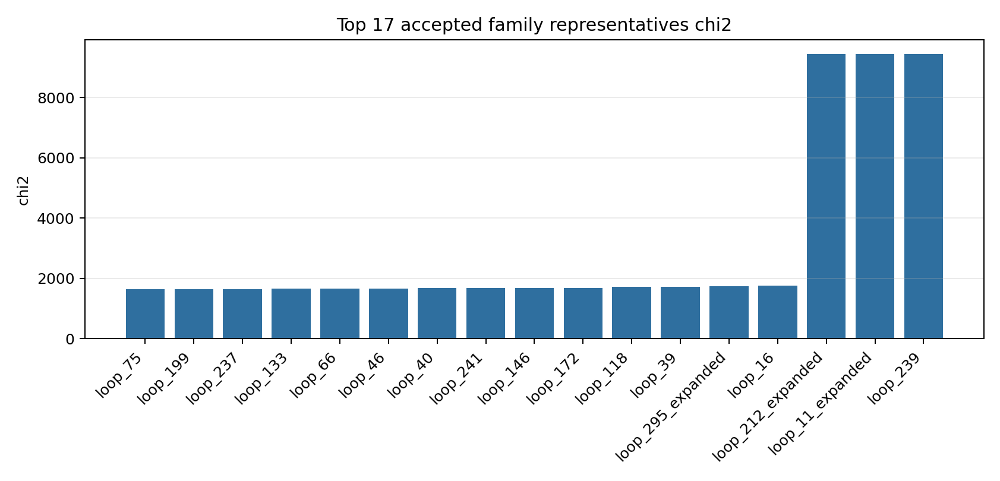
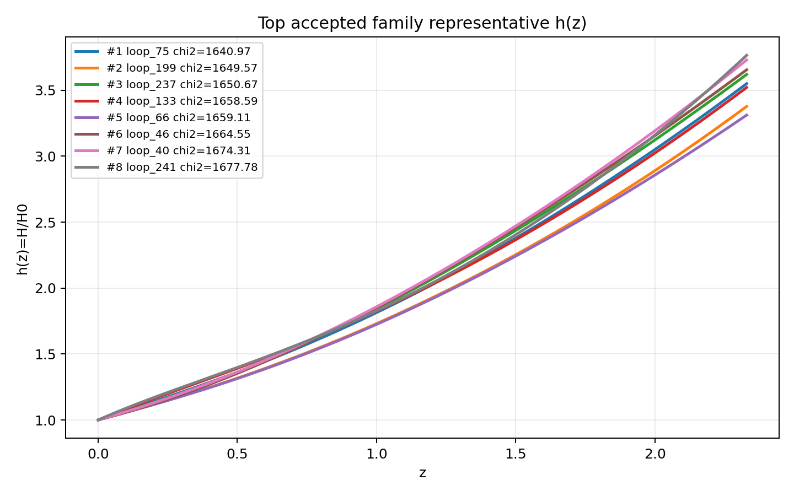
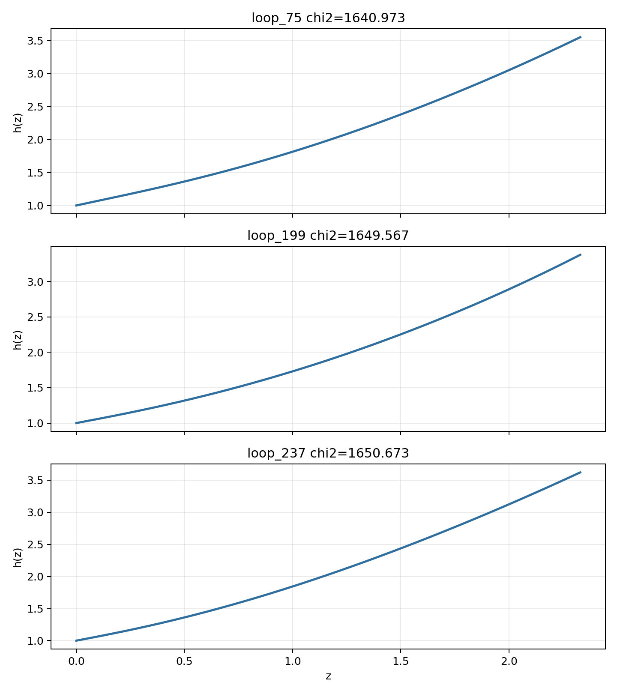

# LangGraph Agent Result Summary: graph_agent_300_scalar_fair_debug_20260603

This report is generated from current-loop memory and the isolated Solver outputs for accepted attempts.
Human-facing tables and plots use one best representative per theory family; full accepted attempts remain in `accepted_summary.json`.

## Quick Result

| Metric | Value |
|---|---:|
| Total attempts | 304 |
| Accepted attempts | 38 |
| Accepted theory families shown | 17 |
| Best chi2 | 1640.9734 |
| q_not_determined | 122 |
| constraint_drift | 64 |
| q_initial_root_failure | 89 |

## Output Files

- [accepted_lagrangians_and_parameters.md](accepted_lagrangians_and_parameters.md)
- [accepted_lagrangians_full.md](accepted_lagrangians_full.md)
- [accepted_lagrangians_and_parameters.csv](accepted_lagrangians_and_parameters.csv)
- [accepted_summary.json](accepted_summary.json)

## Plots

## Top Accepted Family Representatives

| Rank | Family | Loop | chi2 | Sample | H0 | Omega_m0 | lambda_H | Scalar | Potential | Operators |
|---:|---|---|---:|---:|---:|---:|---:|---|---|---|
| 1 | scalar=phi1_only|phi1_potential=quadratic|phi2_potential=None|operator_bucket=R_anchor+high_curvature+scalar_curvature | loop_75 | 1640.9734 | 275 | 63.548 | 0.3071 | 2824.208 | phi1_only | {"phi1": "quadratic", "phi2": null} | R; φ1 · R^{ab} · R_{ab} |
| 2 | scalar=phi1_only|phi1_potential=quadratic|phi2_potential=None|operator_bucket=R_anchor+high_curvature | loop_199 | 1649.567186 | 355 | 69.905 | 0.2283 | 1.221e+04 | phi1_only | {"phi1": "quadratic", "phi2": null} | R^{ab} · R_{ab}; R |
| 3 | scalar=phi1_only|phi1_potential=axion|phi2_potential=None|operator_bucket=R_anchor+high_curvature+scalar_curvature | loop_237 | 1650.673035 | 850 | 68.855 | 0.3325 | 8355.406 | phi1_only | {"phi1": "axion", "phi2": null} | R^{ab} · R^{d}_{a} · R_{bd}; R; φ1 · φ1 · R · R |
| 4 | scalar=phi1_only|phi1_potential=axion|phi2_potential=None|operator_bucket=R_anchor+derivative+scalar_curvature | loop_133 | 1658.592046 | 612 | 62.346 | 0.2942 | 6.563e+04 | phi1_only | {"phi1": "axion", "phi2": null} | R; φ1 · ∇^{a}φ1 · ∇_{a}R |
| 5 | scalar=phi1_only|phi1_potential=quadratic|phi2_potential=None|operator_bucket=R_anchor+derivative | loop_66 | 1659.11236 | 572 | 66.14 | 0.2675 | 2403.027 | phi1_only | {"phi1": "quadratic", "phi2": null} | ∇^{a}∇_{a}φ1; R |
| 6 | scalar=phi1_only|phi1_potential=quadratic|phi2_potential=None|operator_bucket=R_anchor+derivative+scalar_curvature | loop_46 | 1664.552041 | 416 | 64.445 | 0.3429 | 4.858e+04 | phi1_only | {"phi1": "quadratic", "phi2": null} | φ1 · R^{bcd}_{a} · R^{a}_{bcd}; R; ∇^{a}φ1 · ∇_{a}φ1 · R; R^{cd}_{ab} · R^{afh}_{c} · R^{b}_{hdf} |
| 7 | scalar=phi1_only|phi1_potential=axion|phi2_potential=None|operator_bucket=R_anchor | loop_40 | 1674.305113 | 462 | 65.31 | 0.3194 | 2.782e+04 | phi1_only | {"phi1": "axion", "phi2": null} | R |
| 8 | scalar=phi1_only|phi1_potential=quadratic|phi2_potential=None|operator_bucket=R_anchor | loop_241 | 1677.775825 | 371 | 65.864 | 0.2957 | 5.564e+04 | phi1_only | {"phi1": "quadratic", "phi2": null} | R |
| 9 | scalar=phi1_only|phi1_potential=axion|phi2_potential=None|operator_bucket=R_anchor+derivative+high_curvature+scalar_curvature | loop_146 | 1686.029546 | 752 | 57.78 | 0.3535 | 2460.894 | phi1_only | {"phi1": "axion", "phi2": null} | R · R^{bcd}_{a} · R^{a}_{bcd}; ∇^{c}R^{ab} · ∇_{c}R_{ab}; R; ∇^{a}∇^{b}φ1 · R_{ab} |
| 10 | scalar=phi1_only|phi1_potential=quadratic|phi2_potential=None|operator_bucket=R_anchor+derivative+high_curvature+scalar_curvature | loop_172 | 1686.631821 | 386 | 65.871 | 0.22 | 1.288e+04 | phi1_only | {"phi1": "quadratic", "phi2": null} | R^{ab} · R_{ab}; R; φ1 · ∇^{a}∇^{b}φ1 · R_{ab}; R^{b}_{a} · R^{cd} · R^{a}_{cbd} |
| 11 | scalar=phi1_only|phi1_potential=axion|phi2_potential=None|operator_bucket=R_anchor+derivative+high_curvature | loop_118 | 1714.522956 | 359 | 62.871 | 0.2712 | 6.446e+04 | phi1_only | {"phi1": "axion", "phi2": null} | R; ∇^{e}R^{bcd}_{a} · ∇_{e}R^{a}_{bcd}; R^{cd}_{ab} · R^{afh}_{c} · R^{b}_{hdf}; R^{ab} · R^{d}_{a} · R_{bd} |
| 12 | scalar=phi1_only|phi1_potential=quadratic|phi2_potential=None|operator_bucket=R_anchor+derivative+high_curvature | loop_39 | 1722.722042 | 691 | 67.64 | 0.3821 | 2.838e+04 | phi1_only | {"phi1": "quadratic", "phi2": null} | R^{bcd}_{a} · R^{a}_{bcd}; ∇^{a}∇_{a}R · R^{c}_{c}; R |
| 13 | scalar=phi1_only|phi1_potential=axion|phi2_potential=None|operator_bucket=R_anchor+derivative | loop_295_expanded | 1743.313128 | 231 | 67.463 | 0.3923 | 5407.489 | phi1_only | {"phi1": "axion", "phi2": null} | R; ∇^{e}R^{bcd}_{a} · ∇_{e}R^{a}_{bcd}; φ1 · φ1; ∇^{a}R · ∇_{a}R |
| 14 | scalar=both|phi1_potential=quadratic|phi2_potential=axion|operator_bucket=R_anchor | loop_16 | 1756.864092 | 490 | 64.621 | 0.3522 | 6313.884 | both | {"phi1": "quadratic", "phi2": "axion"} | R |
| 15 | scalar=phi2_only|phi1_potential=None|phi2_potential=axion|operator_bucket=scalar_curvature | loop_212_expanded | 9434.007716 | 255 | 62.109 | 0.2453 | 2634.135 | phi2_only | {"phi1": null, "phi2": "axion"} | φ2 · φ2 · φ2 · φ2 · R; φ2 · φ2 · φ2; φ2 · φ2 · φ2 · φ2 · φ2 · φ2 |
| 16 | scalar=phi2_only|phi1_potential=None|phi2_potential=axion|operator_bucket=high_curvature+scalar_curvature | loop_11_expanded | 9434.007717 | 684 | 58.815 | 0.245 | 3.122e+04 | phi2_only | {"phi1": null, "phi2": "axion"} | R^{ab} · R^{d}_{a} · R_{bd}; φ2 · φ2 · φ2 · φ2 · R; φ2 · φ2 · R^{bcd}_{a} · R^{a}_{bcd}; R^{cd}_{ab} · R^{afh}_{c} · R^{b}_{hdf} |
| 17 | scalar=phi2_only|phi1_potential=None|phi2_potential=quadratic|operator_bucket=derivative+high_curvature+scalar_curvature | loop_239 | 9434.007723 | 10 | 59.875 | 0.2154 | 9966.243 | phi2_only | {"phi1": null, "phi2": "quadratic"} | φ2 · φ2 · φ2 · φ2; φ2 · R · R; ∇^{a}R · ∇_{a}R; φ2 · φ2 · φ2 · φ2 · R |

## Top Family Representative Parameter Choices

| Rank | Loop | varphi1_0 | q1_0 | mu1 | fbar1 | varphi2_0 | q2_0 | mu2 | fbar2 | Free coefficients |
|---:|---|---:|---:|---:|---:|---:|---:|---:|---:|---|
| 1 | loop_75 | 1.3819 | -0.6994 | 1.386 | 1.9162 | 0 | 0 | 0 | 1 | \alpha=0.5, \beta=-1.0784e-07 |
| 2 | loop_199 | 2.0183 | -0.6775 | 1.012 | 2.5037 | 0 | 0 | 0 | 1 | \alpha=6.4317e-08, \beta=0.5 |
| 3 | loop_237 | 4.2895 | -0.5317 | 2.2181 | 0.5185 | 0 | 0 | 0 | 1 | \alpha=2.7087e-10, \beta=0.5, \gamma=-6.2664e-10 |
| 4 | loop_133 | 1.0252 | -0.9193 | 1.796 | 17.9073 | 0 | 0 | 0 | 1 | \alpha=0.5, \beta=-2.5870e-10 |
| 5 | loop_66 | 1.8172 | -0.5877 | 1.1074 | 13.4027 | 0 | 0 | 0 | 1 | \alpha=-1.7931e-07, \beta=0.5 |
| 6 | loop_46 | 4.3567 | -0.2428 | 0.4523 | 4.4085 | 0 | 0 | 0 | 1 | \alpha=-3.7248e-09, \beta=0.5, \gamma=2.1842e-05, \delta=4.5893e-09 |
| 7 | loop_40 | 2.3871 | -0.4964 | 0.8314 | 4.2711 | 0 | 0 | 0 | 1 | \alpha=0.5 |
| 8 | loop_241 | 0.8758 | -0.998 | 2.0519 | 13.4835 | 0 | 0 | 0 | 1 | \alpha=0.5 |
| 9 | loop_146 | 1.2685 | -0.7331 | 1.444 | 5.6812 | 0 | 0 | 0 | 1 | \alpha=-7.6356e-08, \beta=-3.0688e-07, \gamma=0.5, \delta=3.5215e-08 |
| 10 | loop_172 | 3.5735 | -0.4373 | 0.5929 | 1.8055 | 0 | 0 | 0 | 1 | \alpha=1.1756e-10, \beta=0.5, \gamma=6.1782e-08, \delta=2.9681e-05 |
| 11 | loop_118 | 0.7905 | -1.1429 | 2.2153 | 23.2852 | 0 | 0 | 0 | 1 | \alpha=0.5, \beta=6.6527e-05, \gamma=1.0114e-06, \delta=9.0605e-10 |
| 12 | loop_39 | 3.3449 | -0.2835 | 0.5693 | 4.0605 | 0 | 0 | 0 | 1 | \alpha=-1.4592e-07, \beta=-8.1086e-10, \gamma=0.5 |
| 13 | loop_295_expanded | 3.426 | -0.273 | 0.2245 | 5.1841 | 0 | 0 | 0 | 1 | \alpha=0.5, \beta=8.0376e-09, \gamma=-4.3727e-09, \delta=-2.2354e-09 |
| 14 | loop_16 | 2.461 | -0.4863 | 0.7763 | 0.1325 | 0.3686 | 0.6777 | 2.5590e-04 | 0.8118 | \alpha=0.5 |
| 15 | loop_212_expanded | 0 | 0 | 0 | 1 | 2.9907 | -16.5467 | 0.0017 | 14.2207 | \alpha=-7.2547e-05, \beta=1.0594e-08, \gamma=3.8820e-08 |
| 16 | loop_11_expanded | 0 | 0 | 0 | 1 | 2.8995 | -16.3786 | 0.0108 | 0.2075 | \alpha=-4.2090e-05, \beta=-8.0257e-05, \gamma=1.5020e-08, \delta=3.9898e-06 |
| 17 | loop_239 | 0 | 0 | 0 | 1 | 2.8316 | -13.8444 | 0.0982 | 2.5049 | \alpha=5.4712e-05, \beta=1.7432e-07, \gamma=-5.8591e-09, \delta=-9.0263e-05 |

## Main Failure Tags

| Tag | Count |
|---|---:|
| missing_ranking | 266 |
| no_accepted_samples | 266 |
| q_not_determined | 122 |
| q_initial_root_failure | 89 |
| constraint_drift | 64 |
| no_scalar_constraint | 51 |
| h_absurdly_large | 33 |
| integration_failure | 10 |
| symbolic_timeout | 3 |
