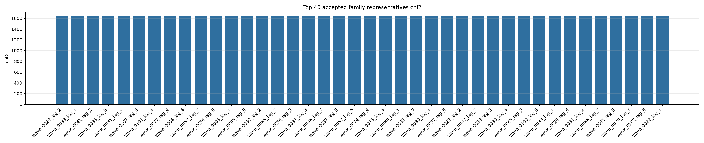
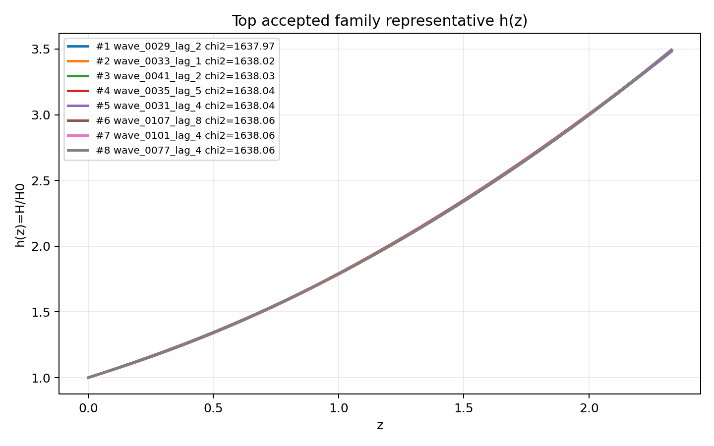
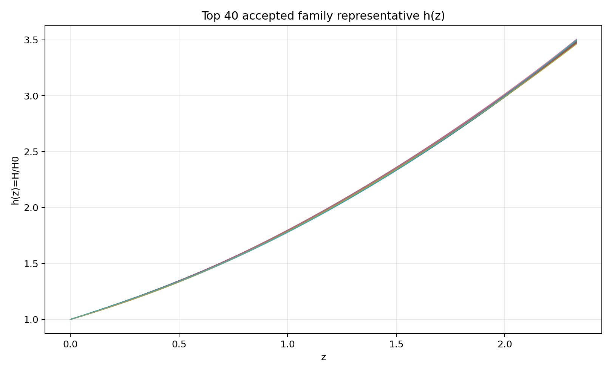
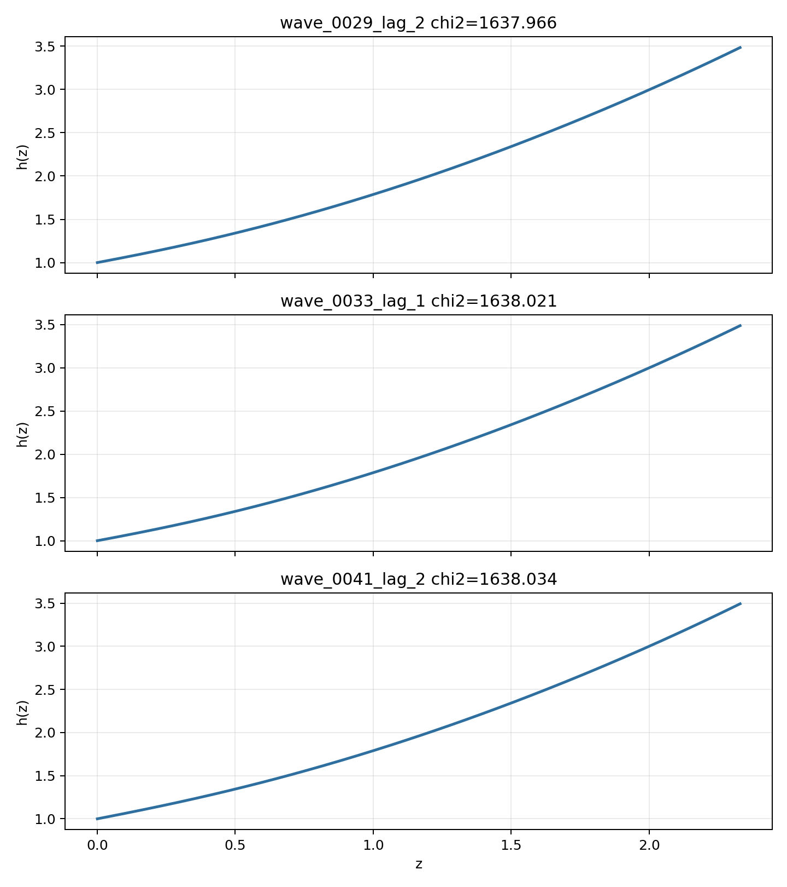

# LangGraph Agent Result Summary: graph_agent_batch_1600_llm_v3

This report is generated from current-loop memory and the isolated Solver outputs for accepted attempts.
Human-facing tables and plots use one best representative per theory family; full accepted attempts remain in `accepted_summary.json`.

## Quick Result

| Metric | Value |
|---|---:|
| Total attempts | 880 |
| Accepted attempts | 309 |
| Accepted theory families shown | 49 |
| Best chi2 | 1637.96608 |
| q_not_determined | 42 |
| constraint_drift | 235 |
| q_initial_root_failure | 391 |

## Output Files

- [accepted_lagrangians_and_parameters.md](accepted_lagrangians_and_parameters.md)
- [accepted_lagrangians_full.md](accepted_lagrangians_full.md)
- [accepted_lagrangians_and_parameters.csv](accepted_lagrangians_and_parameters.csv)
- [accepted_summary.json](accepted_summary.json)

## Plots

## Top Accepted Family Representatives

| Rank | Family | Loop | chi2 | Status | Max rel. effect | Dominant correction | Sample | H0 | Omega_m0 | lambda_H | Scalar | Potential | Operators |
|---:|---|---|---:|---|---:|---|---:|---:|---:|---:|---|---|---|
| 1 | scalar=both|phi1_potential=axion|phi2_potential=axion|operator_bucket=R_anchor+derivative+high_curvature | wave_0029_lag_2 | 1637.96608 | moderate | 4.471e-04 | ∇^{c}R^{ab} · ∇_{c}R_{ab} | 366 | 65.599 | 0.2727 | 3916.603 | both | {"phi1": "axion", "phi2": "axion"} | R; ∇^{c}R^{ab} · ∇_{c}R_{ab} |
| 2 | scalar=phi1_only|phi1_potential=axion|phi2_potential=None|operator_bucket=R_anchor | wave_0033_lag_1 | 1638.020982 | eh_only | 0 |  | 186 | 68.402 | 0.2746 | 8151.282 | phi1_only | {"phi1": "axion", "phi2": null} | R |
| 3 | scalar=both|phi1_potential=quadratic|phi2_potential=axion|operator_bucket=R_anchor+derivative | wave_0041_lag_2 | 1638.034487 | weak | 3.524e-06 | ∇^{e}R^{bcd}_{a} · ∇_{e}R^{a}_{bcd} | 603 | 71.175 | 0.2653 | 5048.99 | both | {"phi1": "quadratic", "phi2": "axion"} | R; ∇^{e}R^{bcd}_{a} · ∇_{e}R^{a}_{bcd} |
| 4 | scalar=both|phi1_potential=axion|phi2_potential=quadratic|operator_bucket=R_anchor+derivative | wave_0035_lag_5 | 1638.038172 | weak | 2.455e-06 | ∇^{e}R^{bcd}_{a} · ∇_{e}R^{a}_{bcd} | 572 | 57.776 | 0.2816 | 5865.961 | both | {"phi1": "axion", "phi2": "quadratic"} | R; ∇^{e}R^{bcd}_{a} · ∇_{e}R^{a}_{bcd} |
| 5 | scalar=both|phi1_potential=quadratic|phi2_potential=quadratic|operator_bucket=R_anchor+high_curvature+scalar_curvature | wave_0031_lag_4 | 1638.040974 | weak | 1.267e-06 | φ1 · φ1 · R · R | 914 | 69.934 | 0.3016 | 7831.59 | both | {"phi1": "quadratic", "phi2": "quadratic"} | R; φ1 · φ1 · R · R |
| 6 | scalar=phi1_only|phi1_potential=quadratic|phi2_potential=None|operator_bucket=R_anchor+derivative+high_curvature+scalar_curvature | wave_0107_lag_8 | 1638.055644 | weak | 8.219e-05 | φ1 · ∇^{a}∇^{b}φ1 · R_{ab} | 581 | 69.745 | 0.2662 | 6894.138 | phi1_only | {"phi1": "quadratic", "phi2": null} | R; R^{ab} · R_{ab}; R^{ab} · R^{d}_{a} · R_{bd}; R_{ab} · R^{adef} · R^{b}_{def}; ∇^{c}R^{ab} · ∇_{c}R_{ab}; φ1 · φ1 · R^{ab} · R_{ab}; φ1 · ∇^{a}∇^{b}φ1 · R_{ab}; ∇^{a}φ1 · ∇^{b}φ1 · R_{ab} |
| 7 | scalar=phi1_only|phi1_potential=quadratic|phi2_potential=None|operator_bucket=R_anchor+high_curvature+scalar_curvature | wave_0101_lag_4 | 1638.057556 | weak | 3.390e-06 | R^{ab} · R^{d}_{a} · R_{bd} | 419 | 70.111 | 0.2653 | 7404.913 | phi1_only | {"phi1": "quadratic", "phi2": null} | R; R^{ab} · R^{d}_{a} · R_{bd}; φ1 · R^{bcd}_{a} · R^{a}_{bcd} |
| 8 | scalar=phi1_only|phi1_potential=quadratic|phi2_potential=None|operator_bucket=R_anchor+scalar_curvature | wave_0077_lag_4 | 1638.062671 | weak | 2.798e-05 | φ1 · φ1 · R^{bcd}_{a} · R^{a}_{bcd} | 929 | 61.855 | 0.2644 | 7050.472 | phi1_only | {"phi1": "quadratic", "phi2": null} | R; φ1 · φ1 · R^{bcd}_{a} · R^{a}_{bcd} |
| 9 | scalar=both|phi1_potential=axion|phi2_potential=axion|operator_bucket=R_anchor+high_curvature | wave_0064_lag_4 | 1638.07453 | eh_dominated | 2.768e-14 | R^{ab} · R^{d}_{a} · R_{bd} | 821 | 64.551 | 0.2822 | 7036.276 | both | {"phi1": "axion", "phi2": "axion"} | R; R^{ab} · R^{d}_{a} · R_{bd} |
| 10 | scalar=both|phi1_potential=quadratic|phi2_potential=quadratic|operator_bucket=R_anchor+derivative | wave_0052_lag_2 | 1638.074679 | weak | 3.807e-05 | ∇^{e}R^{bcd}_{a} · ∇_{e}R^{a}_{bcd} | 502 | 61.682 | 0.2658 | 6740.419 | both | {"phi1": "quadratic", "phi2": "quadratic"} | R; ∇^{e}R^{bcd}_{a} · ∇_{e}R^{a}_{bcd} |
| 11 | scalar=both|phi1_potential=quadratic|phi2_potential=axion|operator_bucket=R_anchor+derivative+high_curvature+scalar_curvature | wave_0056_lag_8 | 1638.074751 | moderate | 3.024e-04 | φ1 · φ1 · ∇^{a}∇_{a}R | 191 | 67.905 | 0.2654 | 6270.26 | both | {"phi1": "quadratic", "phi2": "axion"} | R; R · R^{ab} · R_{ab}; ∇^{e}R^{bcd}_{a} · ∇_{e}R^{a}_{bcd}; φ2 · ∇^{a}∇_{a}R; φ1 · φ1 · R^{bcd}_{a} · R^{a}_{bcd}; φ1 · φ1 · ∇^{a}∇_{a}R; φ1 · ∇^{a}∇^{b}φ2 · R_{ab}; ∇^{a}φ2 · ∇^{b}φ2 · R_{ab} |
| 12 | scalar=phi1_only|phi1_potential=quadratic|phi2_potential=None|operator_bucket=R_anchor | wave_0095_lag_1 | 1638.075674 | eh_only | 0 |  | 412 | 64.021 | 0.2654 | 7484.678 | phi1_only | {"phi1": "quadratic", "phi2": null} | R |
| 13 | scalar=phi1_only|phi1_potential=quadratic|phi2_potential=None|operator_bucket=R_anchor+derivative+high_curvature | wave_0095_lag_8 | 1638.07644 | weak | 6.446e-06 | ∇^{e}R^{bcd}_{a} · ∇_{e}R^{a}_{bcd} | 461 | 60.108 | 0.2668 | 7610.298 | phi1_only | {"phi1": "quadratic", "phi2": null} | R; R · R · R; R^{bd}_{ac} · R^{agh}_{b} · R^{c}_{dgh}; R^{cd}_{ab} · R^{afh}_{c} · R^{b}_{fdh}; ∇^{c}R^{ab} · ∇_{c}R_{ab}; ∇^{e}R^{bcd}_{a} · ∇_{e}R^{a}_{bcd} |
| 14 | scalar=phi1_only|phi1_potential=quadratic|phi2_potential=None|operator_bucket=R_anchor+high_curvature | wave_0080_lag_2 | 1638.086149 | weak | 9.052e-05 | R^{ab} · R_{ab} | 147 | 62.899 | 0.2667 | 7373.115 | phi1_only | {"phi1": "quadratic", "phi2": null} | R; R^{ab} · R_{ab} |
| 15 | scalar=both|phi1_potential=quadratic|phi2_potential=axion|operator_bucket=R_anchor | wave_0065_lag_2 | 1638.089396 | eh_only | 0 |  | 551 | 58.633 | 0.2637 | 7267.213 | both | {"phi1": "quadratic", "phi2": "axion"} | R |
| 16 | scalar=both|phi1_potential=quadratic|phi2_potential=axion|operator_bucket=R_anchor+high_curvature+scalar_curvature | wave_0056_lag_3 | 1638.090406 | weak | 1.498e-06 | φ1 · φ1 · R · R | 969 | 61.894 | 0.2615 | 5437.731 | both | {"phi1": "quadratic", "phi2": "axion"} | R; φ1 · φ1 · R · R |
| 17 | scalar=both|phi1_potential=axion|phi2_potential=axion|operator_bucket=R_anchor+derivative | wave_0037_lag_3 | 1638.094744 | moderate | 1.014e-04 | ∇^{e}R^{bcd}_{a} · ∇_{e}R^{a}_{bcd} | 96 | 65.115 | 0.2826 | 5501.953 | both | {"phi1": "axion", "phi2": "axion"} | R; ∇^{e}R^{bcd}_{a} · ∇_{e}R^{a}_{bcd} |
| 18 | scalar=both|phi1_potential=axion|phi2_potential=quadratic|operator_bucket=R_anchor+derivative+high_curvature+scalar_curvature | wave_0046_lag_7 | 1638.105504 | weak | 7.447e-05 | φ2 · R · R | 843 | 70.387 | 0.2806 | 5094.766 | both | {"phi1": "axion", "phi2": "quadratic"} | R; ∇^{a}R · ∇_{a}R; φ2 · R · R; φ1 · ∇^{a}∇^{b}φ1 · R_{ab} |
| 19 | scalar=both|phi1_potential=axion|phi2_potential=quadratic|operator_bucket=R_anchor+derivative+high_curvature | wave_0037_lag_5 | 1638.114093 | moderate | 6.733e-04 | ∇^{c}R^{ab} · ∇_{b}R_{ac} | 398 | 66.535 | 0.2848 | 7382.587 | both | {"phi1": "axion", "phi2": "quadratic"} | R; ∇^{c}R^{ab} · ∇_{b}R_{ac} |
| 20 | scalar=both|phi1_potential=axion|phi2_potential=quadratic|operator_bucket=R_anchor+high_curvature+scalar_curvature | wave_0057_lag_6 | 1638.127402 | active | 0.022 | φ2 · R · R | 560 | 63.009 | 0.2858 | 6702.166 | both | {"phi1": "axion", "phi2": "quadratic"} | R; R^{ab} · R^{d}_{a} · R_{bd}; φ2 · R · R |
| 21 | scalar=both|phi1_potential=quadratic|phi2_potential=quadratic|operator_bucket=R_anchor+scalar_curvature | wave_0074_lag_4 | 1638.131101 | eh_dominated | 3.186e-13 | φ2 · R^{bcd}_{a} · R^{a}_{bcd} | 931 | 71.897 | 0.2625 | 6948.925 | both | {"phi1": "quadratic", "phi2": "quadratic"} | R; φ2 · R^{bcd}_{a} · R^{a}_{bcd} |
| 22 | scalar=both|phi1_potential=quadratic|phi2_potential=axion|operator_bucket=R_anchor+scalar_curvature | wave_0075_lag_4 | 1638.143573 | eh_dominated | 4.852e-16 | φ1 · φ2 · R^{bcd}_{a} · R^{a}_{bcd} | 981 | 73.036 | 0.261 | 7700.262 | both | {"phi1": "quadratic", "phi2": "axion"} | R; φ1 · φ2 · R^{bcd}_{a} · R^{a}_{bcd} |
| 23 | scalar=phi1_only|phi1_potential=quadratic|phi2_potential=None|operator_bucket=R_anchor+derivative | wave_0080_lag_1 | 1638.166764 | moderate | 7.981e-04 | ∇^{e}R^{bcd}_{a} · ∇_{e}R^{a}_{bcd} | 750 | 61.625 | 0.2605 | 7075.227 | phi1_only | {"phi1": "quadratic", "phi2": null} | R; ∇^{e}R^{bcd}_{a} · ∇_{e}R^{a}_{bcd} |
| 24 | scalar=phi1_only|phi1_potential=axion|phi2_potential=None|operator_bucket=R_anchor+derivative+high_curvature+scalar_curvature | wave_0085_lag_7 | 1638.195065 | weak | 1.805e-05 | ∇^{c}R^{ab} · ∇_{b}R_{ac} | 864 | 58.912 | 0.2822 | 5999.065 | phi1_only | {"phi1": "axion", "phi2": null} | R; R · R · R; ∇^{c}R^{ab} · ∇_{b}R_{ac}; ∇^{e}R^{bcd}_{a} · ∇_{e}R^{a}_{bcd}; φ1 · R^{bcd}_{a} · R^{a}_{bcd}; φ1 · φ1 · R · R; φ1 · φ1 · R^{bcd}_{a} · R^{a}_{bcd} |
| 25 | scalar=phi1_only|phi1_potential=axion|phi2_potential=None|operator_bucket=R_anchor+high_curvature | wave_0089_lag_4 | 1638.23119 | eh_dominated | 4.686e-07 | R · R · R | 351 | 60.724 | 0.2886 | 6275.875 | phi1_only | {"phi1": "axion", "phi2": null} | R; R · R · R |
| 26 | scalar=both|phi1_potential=axion|phi2_potential=quadratic|operator_bucket=R_anchor+high_curvature | wave_0037_lag_6 | 1638.231315 | moderate | 6.391e-04 | R_{ab} · R^{adef} · R^{b}_{def} | 90 | 63.07 | 0.2709 | 7479.353 | both | {"phi1": "axion", "phi2": "quadratic"} | R; R_{ab} · R^{adef} · R^{b}_{def} |
| 27 | scalar=both|phi1_potential=quadratic|phi2_potential=axion|operator_bucket=R_anchor+high_curvature | wave_0023_lag_2 | 1638.235207 | moderate | 2.654e-04 | R_{ab} · R^{adef} · R^{b}_{def} | 196 | 70.833 | 0.2853 | 5182.86 | both | {"phi1": "quadratic", "phi2": "axion"} | R; R_{ab} · R^{adef} · R^{b}_{def} |
| 28 | scalar=both|phi1_potential=axion|phi2_potential=quadratic|operator_bucket=R_anchor+scalar_curvature | wave_0047_lag_2 | 1638.250313 | moderate | 0.005 | φ1 · R^{bcd}_{a} · R^{a}_{bcd} | 147 | 72.695 | 0.284 | 5460.837 | both | {"phi1": "axion", "phi2": "quadratic"} | R; φ1 · R^{bcd}_{a} · R^{a}_{bcd} |
| 29 | scalar=both|phi1_potential=quadratic|phi2_potential=axion|operator_bucket=R_anchor+derivative+high_curvature | wave_0038_lag_3 | 1638.254122 | moderate | 0.002 | ∇^{c}R^{ab} · ∇_{c}R_{ab} | 617 | 68.811 | 0.2996 | 5916.347 | both | {"phi1": "quadratic", "phi2": "axion"} | R; ∇^{c}R^{ab} · ∇_{c}R_{ab} |
| 30 | scalar=both|phi1_potential=axion|phi2_potential=quadratic|operator_bucket=R_anchor+derivative+scalar_curvature | wave_0039_lag_4 | 1638.298815 | weak | 1.089e-05 | ∇^{a}φ1 · ∇_{a}R | 111 | 70.823 | 0.2874 | 5848.384 | both | {"phi1": "axion", "phi2": "quadratic"} | R; ∇^{a}R · ∇_{a}R; ∇^{a}φ1 · ∇_{a}R |
| 31 | scalar=both|phi1_potential=axion|phi2_potential=quadratic|operator_bucket=R_anchor | wave_0065_lag_3 | 1638.337204 | eh_only | 0 |  | 754 | 68.861 | 0.2708 | 6704.317 | both | {"phi1": "axion", "phi2": "quadratic"} | R |
| 32 | scalar=phi1_only|phi1_potential=axion|phi2_potential=None|operator_bucket=R_anchor+high_curvature+scalar_curvature | wave_0109_lag_5 | 1638.34081 | active | 0.01 | φ1 · R^{ab} · R_{ab} | 690 | 73.714 | 0.2855 | 7177.418 | phi1_only | {"phi1": "axion", "phi2": null} | R; R^{b}_{a} · R^{cd} · R^{a}_{cbd}; φ1 · R^{ab} · R_{ab}; φ1 · φ1 · R^{ab} · R_{ab} |
| 33 | scalar=both|phi1_potential=quadratic|phi2_potential=quadratic|operator_bucket=R_anchor+derivative+high_curvature | wave_0033_lag_4 | 1638.341954 | moderate | 2.017e-04 | ∇^{a}∇_{a}R · R^{c}_{c} | 878 | 64.99 | 0.3026 | 5671.589 | both | {"phi1": "quadratic", "phi2": "quadratic"} | R; R_{ab} · R^{adef} · R^{b}_{def}; ∇^{a}∇_{a}R · R^{c}_{c}; ∇^{c}R^{ab} · ∇_{c}R_{ab} |
| 34 | scalar=both|phi1_potential=axion|phi2_potential=axion|operator_bucket=R_anchor+derivative+high_curvature+scalar_curvature | wave_0028_lag_6 | 1638.345998 | moderate | 0.002 | φ1 · φ2 · R^{bcd}_{a} · R^{a}_{bcd} | 998 | 65.368 | 0.3034 | 4549.373 | both | {"phi1": "axion", "phi2": "axion"} | R; φ1 · φ2 · R · R; φ1 · φ2 · R^{bcd}_{a} · R^{a}_{bcd}; φ1 · ∇^{a}∇_{a}φ1 · R |
| 35 | scalar=both|phi1_potential=axion|phi2_potential=axion|operator_bucket=R_anchor+derivative+scalar_curvature | wave_0031_lag_2 | 1638.353284 | weak | 1.362e-06 | φ1 · ∇^{a}φ2 · ∇_{a}R | 493 | 72.434 | 0.2905 | 6275.038 | both | {"phi1": "axion", "phi2": "axion"} | R; φ1 · ∇^{a}φ2 · ∇_{a}R |
| 36 | scalar=both|phi1_potential=axion|phi2_potential=axion|operator_bucket=R_anchor+high_curvature+scalar_curvature | wave_0066_lag_2 | 1638.392762 | moderate | 0.002 | φ1 · φ1 · R · R | 197 | 62.535 | 0.2935 | 5551.821 | both | {"phi1": "axion", "phi2": "axion"} | R; φ1 · φ1 · R · R |
| 37 | scalar=phi1_only|phi1_potential=axion|phi2_potential=None|operator_bucket=R_anchor+derivative | wave_0091_lag_5 | 1638.406547 | weak | 1.595e-05 | ∇^{e}R^{bcd}_{a} · ∇_{e}R^{a}_{bcd} | 394 | 71.455 | 0.2796 | 5845.38 | phi1_only | {"phi1": "axion", "phi2": null} | R; ∇^{e}R^{bcd}_{a} · ∇_{e}R^{a}_{bcd} |
| 38 | scalar=phi1_only|phi1_potential=axion|phi2_potential=None|operator_bucket=R_anchor+derivative+high_curvature | wave_0029_lag_7 | 1638.407757 | active | 0.041 | R^{ab} · R_{ab} | 800 | 62.283 | 0.302 | 4930.903 | phi1_only | {"phi1": "axion", "phi2": null} | R; R^{ab} · R_{ab}; R_{ab} · R^{adef} · R^{b}_{def}; ∇^{c}R^{ab} · ∇_{b}R_{ac}; ∇^{a}∇_{a}φ1 |
| 39 | scalar=phi1_only|phi1_potential=axion|phi2_potential=None|operator_bucket=R_anchor+scalar_curvature | wave_0102_lag_6 | 1638.512533 | moderate | 0.005 | φ1 · φ1 · R^{bcd}_{a} · R^{a}_{bcd} | 570 | 65.817 | 0.3012 | 6328.679 | phi1_only | {"phi1": "axion", "phi2": null} | R; φ1 · φ1 · R^{bcd}_{a} · R^{a}_{bcd} |
| 40 | scalar=both|phi1_potential=axion|phi2_potential=axion|operator_bucket=R_anchor | wave_0022_lag_1 | 1638.679512 | eh_only | 0 |  | 865 | 71.267 | 0.2942 | 1.925e+04 | both | {"phi1": "axion", "phi2": "axion"} | R |

## Top Family Representative Parameter Choices

| Rank | Loop | varphi1_0 | q1_0 | mu1 | fbar1 | varphi2_0 | q2_0 | mu2 | fbar2 | Free coefficients |
|---:|---|---:|---:|---:|---:|---:|---:|---:|---:|---|
| 1 | wave_0029_lag_2 | 1.8319 | -0.6224 | 1.1269 | 2.0164 | -0.3808 | 0.0848 | 7.2077e-04 | 1.5315 | \alpha=0.5, \beta=5.2608e+10 |
| 2 | wave_0033_lag_1 | 1.8781 | -0.6053 | 1.1025 | 2.0153 | 0 | 0 | 0 | 1 | \alpha=0.5 |
| 3 | wave_0041_lag_2 | 1.8846 | -0.6677 | 1.0562 | 1.6572 | -0.1723 | 0.026 | 7.2099e-04 | 1.0023 | \alpha=0.5, \beta=1.1452e+09 |
| 4 | wave_0035_lag_5 | 1.8793 | -0.5941 | 1.0968 | 2.0444 | -0.1927 | 0.3231 | 7.1682e-04 | 1.1293 | \alpha=0.5, \beta=1.4531e+09 |
| 5 | wave_0031_lag_4 | 1.8253 | -0.5556 | 1.0794 | 1.4463 | -0.3799 | 0.5577 | 7.4657e-04 | 1.0599 | \alpha=0.5, \beta=-7.1517e+08 |
| 6 | wave_0107_lag_8 | 1.8743 | -0.669 | 1.061 | 1.94 | 0 | 0 | 0 | 1 | \alpha=0.5, \beta=0.9041, \gamma=1.3740e+09, \delta=21.4043, \epsilon=-5.1612e+09, \zeta=2.1437e+08, \eta=2.6425e+10, \theta=5.8722 |
| 7 | wave_0101_lag_4 | 1.8724 | -0.6712 | 1.0624 | 1.8781 | 0 | 0 | 0 | 1 | \alpha=0.5, \beta=-5.0964e+09, \gamma=-1.9774e+05 |
| 8 | wave_0077_lag_4 | 1.8706 | -0.6729 | 1.0639 | 1.7127 | 0 | 0 | 0 | 1 | \alpha=0.5, \beta=-9.8805e+09 |
| 9 | wave_0064_lag_4 | 1.9103 | -0.5798 | 1.0854 | 1.9652 | -0.1191 | 0.3794 | 7.3266e-04 | 1.1284 | \alpha=0.5, \beta=33.9245 |
| 10 | wave_0052_lag_2 | 1.8692 | -0.6718 | 1.0638 | 1.9144 | -0.0869 | 0.0485 | 7.3670e-04 | 1.0642 | \alpha=0.5, \beta=-3.9294e+10 |
| 11 | wave_0056_lag_8 | 1.8774 | -0.6706 | 1.0597 | 1.8943 | -0.1037 | 0.2988 | 7.4434e-04 | 1.0479 | \alpha=0.5, \beta=4.7108e+06, \gamma=-83.1081, \delta=1216.1994, \epsilon=-1.1163e+09, \zeta=6.6321e+10, \eta=8.5486e+04, \theta=4.7222e+05 |
| 12 | wave_0095_lag_1 | 1.8745 | -0.6693 | 1.0615 | 1.9684 | 0 | 0 | 0 | 1 | \alpha=0.5 |
| 13 | wave_0095_lag_8 | 1.8733 | -0.6673 | 1.0614 | 1.8247 | 0 | 0 | 0 | 1 | \alpha=0.5, \beta=184.4771, \gamma=299.8035, \delta=231.4035, \epsilon=7.2586e+04, \zeta=1.0811e+10 |
| 14 | wave_0080_lag_2 | 1.8722 | -0.6697 | 1.0617 | 1.7254 | 0 | 0 | 0 | 1 | \alpha=0.5, \beta=-2460.5153 |
| 15 | wave_0065_lag_2 | 1.8737 | -0.6746 | 1.0624 | 1.8468 | -0.1848 | 0.1059 | 7.4332e-04 | 1.1387 | \alpha=0.5 |
| 16 | wave_0056_lag_3 | 1.8777 | -0.6768 | 1.0615 | 1.7997 | -0.1928 | 0.4866 | 7.1325e-04 | 1.1277 | \alpha=0.5, \beta=1.8571e+08 |
| 17 | wave_0037_lag_3 | 1.939 | -0.5703 | 1.0713 | 1.9753 | -0.0148 | 0.3648 | 7.5428e-04 | 1.2106 | \alpha=0.5, \beta=-4.6448e+10 |
| 18 | wave_0046_lag_7 | 1.9189 | -0.5756 | 1.0839 | 1.9405 | -0.1192 | 0.4611 | 7.4924e-04 | 1.2016 | \alpha=0.5, \beta=1.9442e+09, \gamma=4.1306e+07, \delta=3.2908e+08 |
| 19 | wave_0037_lag_5 | 1.8955 | -0.5659 | 1.1023 | 1.7853 | -0.0575 | 0.5041 | 6.9510e-04 | 1.1208 | \alpha=0.5, \beta=-1.0000e+12 |
| 20 | wave_0057_lag_6 | 1.9026 | -0.5738 | 1.0862 | 1.9933 | -0.1289 | 0.2348 | 7.1772e-04 | 1.2118 | \alpha=0.5, \beta=-1.0000e+12, \gamma=-2.6117e+10 |
| 21 | wave_0074_lag_4 | 1.8747 | -0.677 | 1.0624 | 1.8129 | -0.1042 | 0.1221 | 7.3902e-04 | 1.2049 | \alpha=0.5, \beta=-0.5129 |
| 22 | wave_0075_lag_4 | 1.8835 | -0.6737 | 1.0592 | 1.7122 | -0.1908 | 0.283 | 7.3584e-04 | 1.0744 | \alpha=0.5, \beta=2.373 |
| 23 | wave_0080_lag_1 | 1.8741 | -0.6773 | 1.0643 | 1.9885 | 0 | 0 | 0 | 1 | \alpha=0.5, \beta=1.0000e+12 |
| 24 | wave_0085_lag_7 | 1.9172 | -0.5737 | 1.082 | 1.982 | 0 | 0 | 0 | 1 | \alpha=0.5, \beta=-9.7846e+09, \gamma=-1.1687e+10, \delta=-2.2059e+09, \epsilon=3.0019e+05, \zeta=1.4604e+09, \eta=1.2823e+09 |
| 25 | wave_0089_lag_4 | 1.9129 | -0.5629 | 1.0812 | 1.9691 | 0 | 0 | 0 | 1 | \alpha=0.5, \beta=3.6346e+08 |
| 26 | wave_0037_lag_6 | 1.9141 | -0.6014 | 1.0856 | 2.0501 | -0.2048 | 0.0559 | 7.2649e-04 | 1.2186 | \alpha=0.5, \beta=1.0000e+12 |
| 27 | wave_0023_lag_2 | 2.1784 | -0.5543 | 0.9159 | 0.5158 | 0.0928 | -0.4837 | 7.6735e-04 | 2.4122 | \alpha=0.5, \beta=-9.5739e+10 |
| 28 | wave_0047_lag_2 | 1.9022 | -0.574 | 1.0883 | 1.9811 | -0.0997 | 0.1903 | 7.1268e-04 | 1.1655 | \alpha=0.5, \beta=2.3326e+08 |
| 29 | wave_0038_lag_3 | 1.8602 | -0.551 | 1.0614 | 1.6248 | -0.2277 | 0.5345 | 7.2126e-04 | 1.1482 | \alpha=0.5, \beta=1.0000e+12 |
| 30 | wave_0039_lag_4 | 1.9431 | -0.5529 | 1.0758 | 1.8203 | -0.1387 | 0.3727 | 6.9584e-04 | 1.1221 | \alpha=0.5, \beta=1838.3054, \gamma=-5.6049e+05 |
| 31 | wave_0065_lag_3 | 1.9223 | -0.5951 | 1.0857 | 1.9704 | -0.1225 | 0.4966 | 7.4238e-04 | 1.1421 | \alpha=0.5 |
| 32 | wave_0109_lag_5 | 1.9109 | -0.575 | 1.0841 | 1.9433 | 0 | 0 | 0 | 1 | \alpha=0.5, \beta=1.0000e+12, \gamma=9.9386e+08, \delta=-1.0000e+12 |
| 33 | wave_0033_lag_4 | 1.8469 | -0.5411 | 1.0681 | 1.6638 | -0.2838 | -0.0194 | 6.8731e-04 | 1.0392 | \alpha=0.5, \beta=7.4555e+10, \gamma=-1.0434e+11, \delta=-2.5577e+10 |
| 34 | wave_0028_lag_6 | 1.8149 | -0.5046 | 1.1485 | 1.6518 | -0.2689 | 0.4066 | 7.9242e-04 | 1.68 | \alpha=0.5, \beta=3.0054e+11, \gamma=1.0000e+12, \delta=-2.5796e+10 |
| 35 | wave_0031_lag_2 | 1.8742 | -0.5667 | 1.1072 | 1.8121 | -0.3023 | 0.2935 | 7.3074e-04 | 1.0509 | \alpha=0.5, \beta=-1.8631e+09 |
| 36 | wave_0066_lag_2 | 1.9174 | -0.5502 | 1.0795 | 1.9104 | -0.1754 | 0.2948 | 7.2643e-04 | 1.1155 | \alpha=0.5, \beta=-3.1981e+11 |
| 37 | wave_0091_lag_5 | 1.9174 | -0.5825 | 1.086 | 1.9071 | 0 | 0 | 0 | 1 | \alpha=0.5, \beta=9.3133e+09 |
| 38 | wave_0029_lag_7 | 1.9122 | -0.5036 | 1.0713 | 2.18 | 0 | 0 | 0 | 1 | \alpha=0.5, \beta=4.9486e+05, \gamma=-1.0000e+12, \delta=1.0000e+12, \epsilon=1.0157 |
| 39 | wave_0102_lag_6 | 1.9089 | -0.495 | 1.0827 | 1.9699 | 0 | 0 | 0 | 1 | \alpha=0.5, \beta=-1.0000e+12 |
| 40 | wave_0022_lag_1 | 1.4568 | -0.6347 | 1.3796 | 1.8375 | 0.2661 | -0.5214 | 4.8613e-04 | 1.0569 | \alpha=0.5 |

## Main Failure Tags

| Tag | Count |
|---|---:|
| no_accepted_samples | 699 |
| q_initial_root_failure | 391 |
| constraint_drift | 235 |
| symbolic_timeout | 129 |
| h_absurdly_large | 117 |
| no_scalar_constraint | 52 |
| integration_failure | 49 |
| q_not_determined | 42 |
