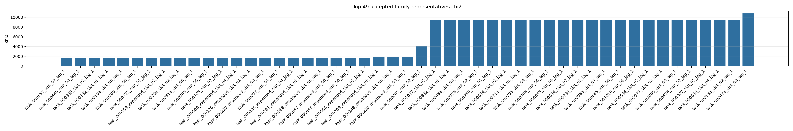
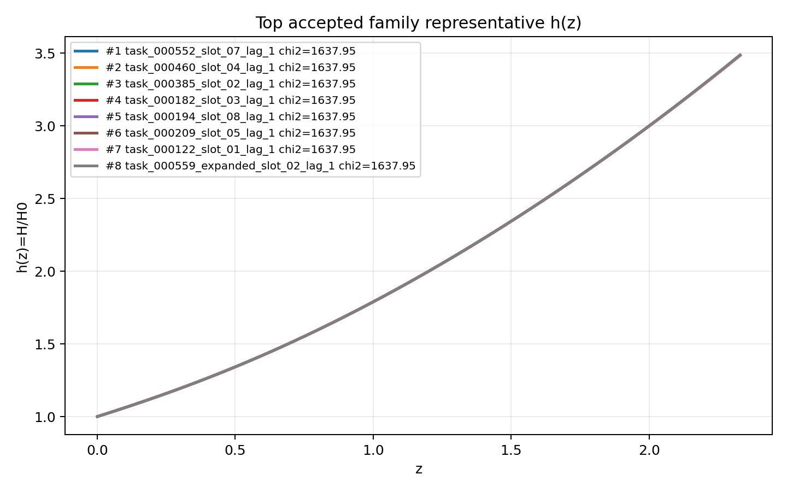
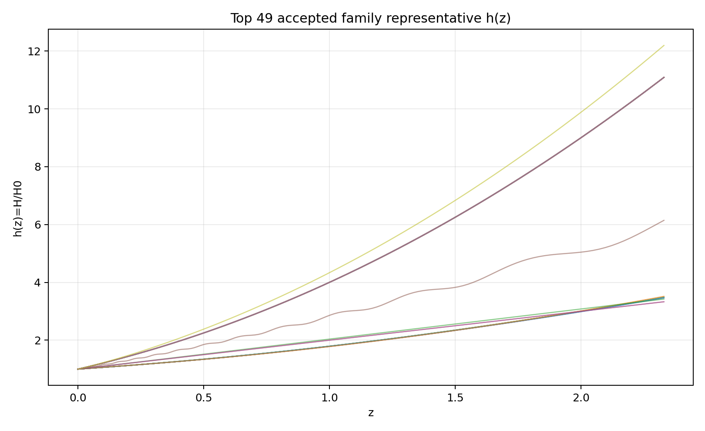
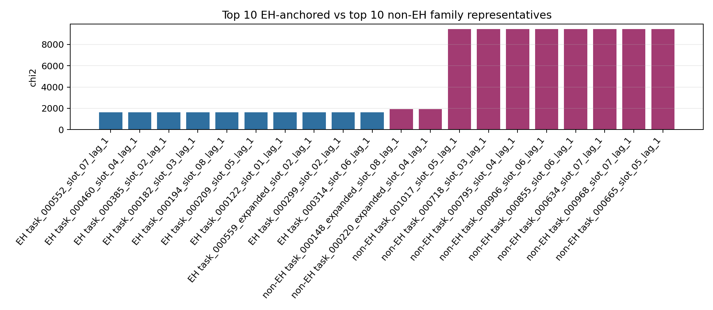
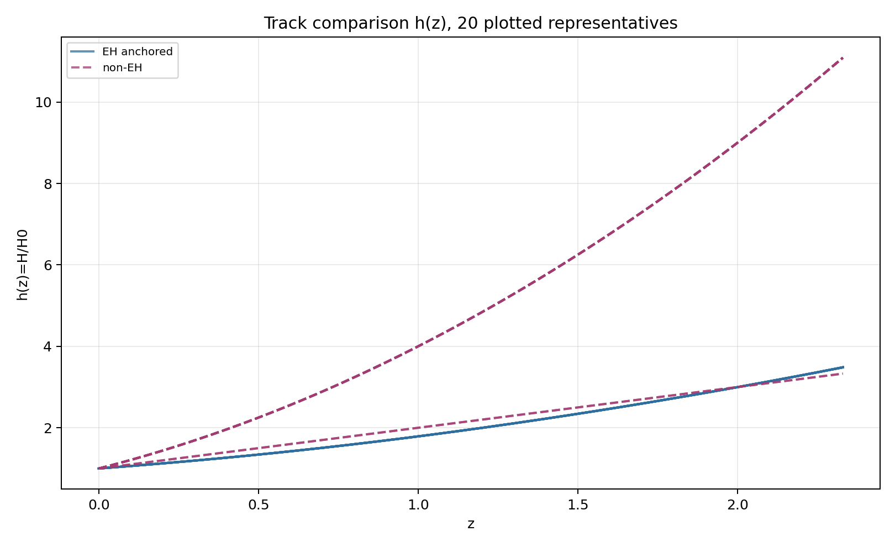
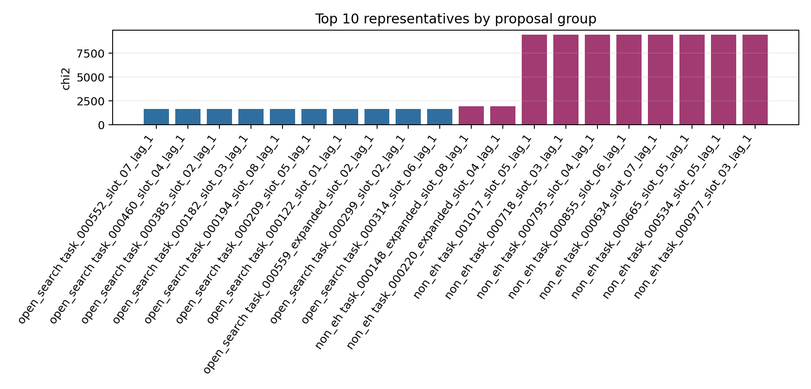
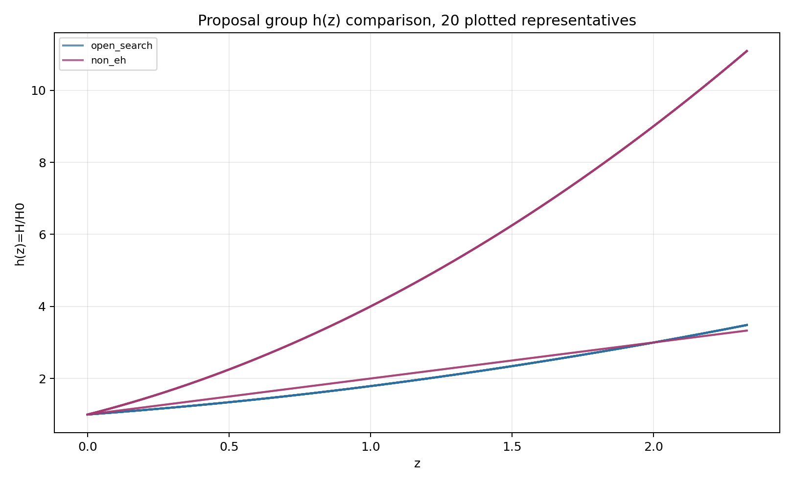
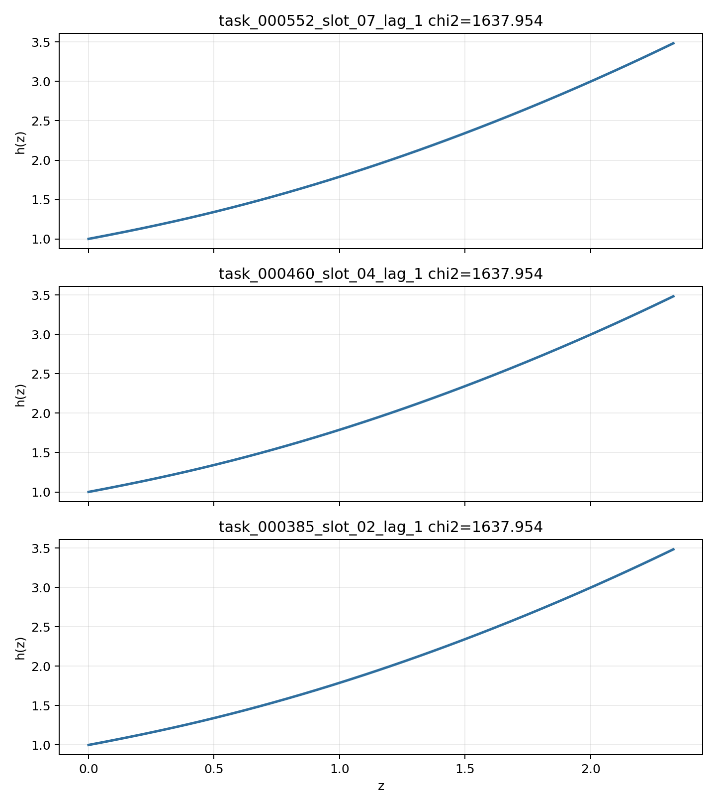

# LangGraph Agent Result Summary: graph_agent_batch_2000_sector_async_v7

This report is generated from current-loop memory and the isolated Solver outputs for accepted attempts.
Human-facing tables and plots use one best representative per theory family; full accepted attempts remain in `accepted_summary.json`.

## Quick Result

| Metric | Value |
|---|---:|
| Total attempts | 1103 |
| Accepted attempts | 255 |
| Accepted theory families shown | 49 |
| Best chi2 | 1637.953931 |
| q_not_determined | 198 |
| constraint_drift | 453 |
| q_initial_root_failure | 415 |

## Output Files

- [accepted_lagrangians_and_parameters.md](accepted_lagrangians_and_parameters.md)
- [accepted_lagrangians_full.md](accepted_lagrangians_full.md)
- [accepted_lagrangians_and_parameters.csv](accepted_lagrangians_and_parameters.csv)
- [accepted_summary.json](accepted_summary.json)

## Plots

## Proposal Group Comparison

- [Top open-search representatives](top_open_search.md)
- [Top non-EH representatives](top_non_eh.md)

## Track Comparison

- [Top EH-anchored representatives](top_eh_anchored.md)
- [Top non-EH representatives](top_non_eh.md)

## Top Accepted Family Representatives

| Rank | Group | Track | Family | Loop | chi2 | Status | Max rel. effect | Dominant correction | Sample | H0 | Omega_m0 | lambda_H | Scalar | Potential | Operators |
|---:|---|---|---|---|---:|---|---:|---|---:|---:|---:|---:|---|---|---|
| 1 | open_search | eh_anchored | scalar=both|phi1_potential=axion|phi2_potential=quadratic|operator_bucket=R_anchor | task_000552_slot_07_lag_1 | 1637.953931 | eh_only | 0 |  | 1 | 63.356 | 0.2737 | 3656.511 | both | {"phi1": "axion", "phi2": "quadratic"} | R; φ2 · φ2 |
| 2 | open_search | eh_anchored | scalar=both|phi1_potential=axion|phi2_potential=axion|operator_bucket=R_anchor+scalar_curvature | task_000460_slot_04_lag_1 | 1637.953931 | weak | 1.991e-05 | φ2 · φ2 · R^{bcd}_{a} · R^{a}_{bcd} | 4 | 63.356 | 0.2737 | 3656.511 | both | {"phi1": "axion", "phi2": "axion"} | R; φ2 · φ2 · R^{bcd}_{a} · R^{a}_{bcd}; φ2 · φ2 |
| 3 | open_search | eh_anchored | scalar=both|phi1_potential=axion|phi2_potential=quadratic|operator_bucket=R_anchor+scalar_curvature | task_000385_slot_02_lag_1 | 1637.953931 | weak | 1.991e-05 | φ2 · φ2 · R^{bcd}_{a} · R^{a}_{bcd} | 4 | 63.356 | 0.2737 | 3656.511 | both | {"phi1": "axion", "phi2": "quadratic"} | R; φ2 · φ2 · R^{bcd}_{a} · R^{a}_{bcd}; φ2 · φ2 |
| 4 | open_search | eh_anchored | scalar=both|phi1_potential=axion|phi2_potential=quadratic|operator_bucket=R_anchor+derivative+high_curvature+scalar_curvature | task_000182_slot_03_lag_1 | 1637.954425 | active | 8196.614 | φ1 · R^{ab} · R_{ab} | 13 | 63.356 | 0.2737 | 3656.511 | both | {"phi1": "axion", "phi2": "quadratic"} | R; R · R · R; R^{cd}_{ab} · R^{afh}_{c} · R^{b}_{fdh}; ∇^{c}R^{ab} · ∇_{b}R_{ac}; φ1 · R^{ab} · R_{ab}; ∇^{a}φ1 · ∇_{a}φ2; ∇^{a}φ2 · ∇_{a}φ2; φ1 · φ1 · ∇^{a}φ2 · ∇_{a}φ2 |
| 5 | open_search | eh_anchored | scalar=both|phi1_potential=axion|phi2_potential=quadratic|operator_bucket=R_anchor+derivative+high_curvature | task_000194_slot_08_lag_1 | 1637.954426 | active | 1.119 | ∇^{c}R^{ab} · ∇_{b}R_{ac} | 2 | 63.356 | 0.2737 | 3656.511 | both | {"phi1": "axion", "phi2": "quadratic"} | R; ∇^{c}R^{ab} · ∇_{b}R_{ac}; φ2 · ∇^{a}φ2 · ∇_{a}φ2 |
| 6 | open_search | eh_anchored | scalar=both|phi1_potential=axion|phi2_potential=quadratic|operator_bucket=R_anchor+high_curvature | task_000209_slot_05_lag_1 | 1637.954426 | active | 1.119 | R^{cd}_{ab} · R^{afh}_{c} · R^{b}_{fdh} | 1 | 63.356 | 0.2737 | 3656.511 | both | {"phi1": "axion", "phi2": "quadratic"} | R; R · R^{ab} · R_{ab}; R^{cd}_{ab} · R^{afh}_{c} · R^{b}_{fdh} |
| 7 | open_search | eh_anchored | scalar=both|phi1_potential=axion|phi2_potential=axion|operator_bucket=R_anchor | task_000122_slot_01_lag_1 | 1637.954426 | eh_only | 0 |  | 1 | 63.356 | 0.2737 | 3656.511 | both | {"phi1": "axion", "phi2": "axion"} | R |
| 8 | open_search | eh_anchored | scalar=phi1_only|phi1_potential=axion|phi2_potential=None|operator_bucket=R_anchor+derivative+high_curvature+scalar_curvature | task_000559_expanded_slot_02_lag_1 | 1637.954674 | active | 2.114e+04 | R^{b}_{a} · R^{cd} · R^{a}_{cbd} | 432 | 71.949 | 0.2725 | 6899.036 | phi1_only | {"phi1": "axion", "phi2": null} | R; R^{ab} · R_{ab}; R^{b}_{a} · R^{cd} · R^{a}_{cbd}; R_{ab} · R^{adef} · R^{b}_{def}; ∇^{a}R · ∇_{a}R; φ1 · R · R; φ1 · R^{ab} · R_{ab} |
| 9 | open_search | eh_anchored | scalar=phi1_only|phi1_potential=axion|phi2_potential=None|operator_bucket=R_anchor+scalar_curvature | task_000299_slot_02_lag_1 | 1637.961769 | moderate | 0.009 | φ1 · φ1 · R^{bcd}_{a} · R^{a}_{bcd} | 259 | 61.859 | 0.274 | 2860.653 | phi1_only | {"phi1": "axion", "phi2": null} | R; φ1 · φ1 · R^{bcd}_{a} · R^{a}_{bcd} |
| 10 | open_search | eh_anchored | scalar=phi1_only|phi1_potential=axion|phi2_potential=None|operator_bucket=R_anchor+high_curvature | task_000314_slot_06_lag_1 | 1637.961769 | eh_dominated | 2.444e-11 | R^{ab} · R_{ab} | 1 | 61.859 | 0.274 | 2860.653 | phi1_only | {"phi1": "axion", "phi2": null} | R; R^{ab} · R_{ab} |
| 11 | open_search | eh_anchored | scalar=phi1_only|phi1_potential=quadratic|phi2_potential=None|operator_bucket=R_anchor+derivative+high_curvature+scalar_curvature | task_000283_slot_05_lag_1 | 1637.962178 | active | 2.479e+11 | R · R | 940 | 67.14 | 0.2711 | 3764.891 | phi1_only | {"phi1": "quadratic", "phi2": null} | R; R · R; R_{ab} · R^{adef} · R^{b}_{def}; ∇^{c}R^{ab} · ∇_{b}R_{ac}; φ1 · R^{ab} · R_{ab}; φ1 · φ1 · R^{bcd}_{a} · R^{a}_{bcd} |
| 12 | open_search | eh_anchored | scalar=both|phi1_potential=axion|phi2_potential=quadratic|operator_bucket=R_anchor+high_curvature+scalar_curvature | task_000105_slot_07_lag_1 | 1637.965099 | eh_dominated | 9.494e-15 | φ1 · φ1 · R · R | 364 | 70.982 | 0.2731 | 4210.042 | both | {"phi1": "axion", "phi2": "quadratic"} | R; φ1 · φ1 · R · R |
| 13 | open_search | eh_anchored | scalar=both|phi1_potential=quadratic|phi2_potential=quadratic|operator_bucket=R_anchor | task_000088_expanded_slot_04_lag_1 | 1637.968592 | eh_only | 0 |  | 2836 | 63.67 | 0.274 | 3601.219 | both | {"phi1": "quadratic", "phi2": "quadratic"} | R |
| 14 | open_search | eh_anchored | scalar=both|phi1_potential=quadratic|phi2_potential=axion|operator_bucket=R_anchor | task_000176_expanded_slot_01_lag_1 | 1637.969841 | eh_only | 0 |  | 54 | 68.306 | 0.2755 | 3039.373 | both | {"phi1": "quadratic", "phi2": "axion"} | R |
| 15 | open_search | eh_anchored | scalar=phi1_only|phi1_potential=axion|phi2_potential=None|operator_bucket=R_anchor+high_curvature+scalar_curvature | task_000219_expanded_slot_03_lag_1 | 1638.00013 | active | 35.202 | φ1 · φ1 · R^{ab} · R_{ab} | 945 | 65.4 | 0.2751 | 4005.641 | phi1_only | {"phi1": "axion", "phi2": null} | R; R^{cd}_{ab} · R^{afh}_{c} · R^{b}_{fdh}; φ1 · R^{bcd}_{a} · R^{a}_{bcd}; φ1 · φ1 · R^{ab} · R_{ab} |
| 16 | open_search | eh_anchored | scalar=phi1_only|phi1_potential=axion|phi2_potential=None|operator_bucket=R_anchor | task_000097_slot_01_lag_1 | 1638.000157 | eh_only | 0 |  | 641 | 69.892 | 0.2774 | 3396.39 | phi1_only | {"phi1": "axion", "phi2": null} | R |
| 17 | open_search | eh_anchored | scalar=phi1_only|phi1_potential=quadratic|phi2_potential=None|operator_bucket=R_anchor+high_curvature+scalar_curvature | task_000335_expanded_slot_04_lag_1 | 1638.008304 | eh_dominated | 1.310e-19 | φ1 · R^{ab} · R_{ab} | 735 | 68.727 | 0.2718 | 7533.114 | phi1_only | {"phi1": "quadratic", "phi2": null} | R; R · R · R; φ1 · R^{ab} · R_{ab} |
| 18 | open_search | eh_anchored | scalar=phi1_only|phi1_potential=quadratic|phi2_potential=None|operator_bucket=R_anchor+high_curvature | task_000381_expanded_slot_05_lag_1 | 1638.008484 | eh_dominated | 5.467e-19 | R · R^{bcd}_{a} · R^{a}_{bcd} | 985 | 58 | 0.2755 | 2525.075 | phi1_only | {"phi1": "quadratic", "phi2": null} | R; R · R^{bcd}_{a} · R^{a}_{bcd}; φ1 · φ1 |
| 19 | open_search | eh_anchored | scalar=both|phi1_potential=quadratic|phi2_potential=axion|operator_bucket=R_anchor+scalar_curvature | task_000588_expanded_slot_05_lag_1 | 1638.043088 | weak | 9.900e-05 | φ2 · φ2 · R^{bcd}_{a} · R^{a}_{bcd} | 2291 | 72.388 | 0.2756 | 5354.506 | both | {"phi1": "quadratic", "phi2": "axion"} | R; φ2 · φ2 · R^{bcd}_{a} · R^{a}_{bcd} |
| 20 | open_search | eh_anchored | scalar=phi1_only|phi1_potential=quadratic|phi2_potential=None|operator_bucket=R_anchor+scalar_curvature | task_000547_expanded_slot_08_lag_1 | 1638.238672 | eh_dominated | 1.003e-18 | φ1 · R^{bcd}_{a} · R^{a}_{bcd} | 1685 | 62.446 | 0.2718 | 2132.292 | phi1_only | {"phi1": "quadratic", "phi2": null} | R; φ1 · R^{bcd}_{a} · R^{a}_{bcd} |
| 21 | open_search | eh_anchored | scalar=phi1_only|phi1_potential=quadratic|phi2_potential=None|operator_bucket=R_anchor | task_000643_expanded_slot_08_lag_1 | 1638.43813 | eh_only | 0 |  | 2559 | 63.843 | 0.2787 | 2815.382 | phi1_only | {"phi1": "quadratic", "phi2": null} | R; φ1 · φ1 |
| 22 | open_search | eh_anchored | scalar=phi1_only|phi1_potential=quadratic|phi2_potential=None|operator_bucket=R_anchor+derivative+scalar_curvature | task_000056_expanded_slot_05_lag_1 | 1639.400136 | weak | 5.376e-05 | φ1 · R^{bcd}_{a} · R^{a}_{bcd} | 2914 | 69.464 | 0.2953 | 4902.976 | phi1_only | {"phi1": "quadratic", "phi2": null} | R; φ1 · R^{bcd}_{a} · R^{a}_{bcd}; ∇^{a}φ1 · ∇_{a}φ1 |
| 23 | open_search | eh_anchored | scalar=phi2_only|phi1_potential=None|phi2_potential=quadratic|operator_bucket=R_anchor+high_curvature+scalar_curvature | task_000709_expanded_slot_06_lag_1 | 1939.459005 | active | 1.387e+04 | R_{ab} · R^{adef} · R^{b}_{def} | 2229 | 67.587 | 0.2723 | 7290.081 | phi2_only | {"phi1": null, "phi2": "quadratic"} | R; R_{ab} · R^{adef} · R^{b}_{def}; φ2 · φ2 · R; φ2 · φ2 · φ2 · φ2 · R; φ2 · φ2 · R^{ab} · R_{ab}; φ2 · φ2 · R^{bcd}_{a} · R^{a}_{bcd}; φ2 · φ2 |
| 24 | non_eh | non_eh | scalar=phi2_only|phi1_potential=None|phi2_potential=axion|operator_bucket=derivative+high_curvature+scalar_curvature | task_000148_expanded_slot_08_lag_1 | 1946.870857 | unclear |  |  | 1959 | 63.692 | 0.2599 | 3953.285 | phi2_only | {"phi1": null, "phi2": "axion"} | R · R · R; R · R^{ab} · R_{ab}; φ2 · R^{ab} · R_{ab}; φ2 · R^{bcd}_{a} · R^{a}_{bcd}; ∇^{a}∇_{a}φ2; φ2 · ∇^{a}∇_{a}φ2; φ2 · φ2 · φ2 · ∇^{a}∇_{a}φ2; φ2 · φ2 · ∇^{a}φ2 · ∇_{a}φ2 |
| 25 | non_eh | non_eh | scalar=phi2_only|phi1_potential=None|phi2_potential=quadratic|operator_bucket=derivative+high_curvature+scalar_curvature | task_000220_expanded_slot_04_lag_1 | 1946.870857 | unclear |  |  | 2346 | 67.9 | 0.2848 | 3402.047 | phi2_only | {"phi1": null, "phi2": "quadratic"} | R^{ab} · R_{ab}; R^{cd}_{ab} · R^{afh}_{c} · R^{b}_{fdh}; φ2 · R^{ab} · R_{ab}; φ2 · R^{bcd}_{a} · R^{a}_{bcd}; φ2 · φ2 · R · R; φ2 · ∇^{a}φ2 · ∇_{a}φ2; φ2 · φ2 · φ2 · φ2 · φ2 · φ2; φ2 · φ2 · ∇^{a}φ2 · ∇_{a}φ2 |
| 26 | open_search | eh_anchored | scalar=both|phi1_potential=quadratic|phi2_potential=axion|operator_bucket=R_anchor+derivative+high_curvature+scalar_curvature | task_000002_slot_02_lag_1 | 4024.068817 | moderate | 1.025e-04 | ∇^{a}φ1 · ∇^{b}φ2 · R_{ab} | 886 | 69.737 | 0.2554 | 854.711 | both | {"phi1": "quadratic", "phi2": "axion"} | R; φ2 · ∇^{a}∇_{a}φ2 · R; ∇^{a}∇_{a}φ1 · φ2 · R; ∇^{a}φ1 · ∇^{b}φ2 · R_{ab}; φ2 · φ2 · φ2 · φ2 · φ2 |
| 27 | non_eh | non_eh | scalar=both|phi1_potential=quadratic|phi2_potential=axion|operator_bucket=derivative+high_curvature+scalar_curvature | task_001017_slot_05_lag_1 | 9432.077249 | unclear |  |  | 315 | 74 | 0.2818 | 4680.435 | both | {"phi1": "quadratic", "phi2": "axion"} | φ2 · R; φ2 · φ2 · R; φ1 · R^{bcd}_{a} · R^{a}_{bcd}; φ2 · R · R; φ1 · φ1 · ∇^{a}φ2 · ∇_{a}φ2 |
| 28 | open_search | eh_anchored | scalar=phi2_only|phi1_potential=None|phi2_potential=axion|operator_bucket=R_anchor+scalar_curvature | task_000832_slot_05_lag_1 | 9434.002787 | eh_dominated | 1.599e-08 | φ2 · R | 686 | 68.389 | 0.2928 | 2937.595 | phi2_only | {"phi1": null, "phi2": "axion"} | R; φ2 · R |
| 29 | open_search | eh_anchored | scalar=phi2_only|phi1_potential=None|phi2_potential=quadratic|operator_bucket=R_anchor+scalar_curvature | task_000484_slot_03_lag_1 | 9434.002788 | eh_dominated | 6.544e-09 | φ2 · R | 524 | 68.076 | 0.2963 | 1153.921 | phi2_only | {"phi1": null, "phi2": "quadratic"} | R; φ2 · R |
| 30 | open_search | eh_anchored | scalar=phi2_only|phi1_potential=None|phi2_potential=axion|operator_bucket=R_anchor+derivative+high_curvature+scalar_curvature | task_000928_slot_02_lag_1 | 9434.002826 | active | 1.506e+10 | ∇^{a}∇_{a}R | 308 | 58.558 | 0.2652 | 6898.212 | phi2_only | {"phi1": null, "phi2": "axion"} | R; ∇^{a}∇_{a}R; R · R · R; R^{ab} · R^{d}_{a} · R_{bd}; R^{cd}_{ab} · R^{afh}_{c} · R^{b}_{fdh}; φ2 · R; φ2 · R^{ab} · R_{ab}; φ2 · φ2 |
| 31 | open_search | eh_anchored | scalar=phi2_only|phi1_potential=None|phi2_potential=quadratic|operator_bucket=R_anchor+derivative+scalar_curvature | task_000950_slot_05_lag_1 | 9434.002963 | active | 0.023 | ∇^{a}∇_{a}φ2 · R | 666 | 62.449 | 0.3071 | 8948.749 | phi2_only | {"phi1": null, "phi2": "quadratic"} | R; φ2 · R; ∇^{a}∇_{a}φ2 · R; φ2 · φ2 · φ2 · φ2 · R; φ2 · φ2 · R^{bcd}_{a} · R^{a}_{bcd}; ∇^{a}φ2 · ∇_{a}φ2; φ2 · φ2 · ∇^{a}∇_{a}φ2; φ2 · φ2 · φ2 · ∇^{a}∇_{a}φ2 |
| 32 | open_search | eh_anchored | scalar=phi2_only|phi1_potential=None|phi2_potential=quadratic|operator_bucket=R_anchor+derivative+high_curvature+scalar_curvature | task_000654_slot_01_lag_1 | 9434.003068 | active | 2192.756 | ∇^{a}∇^{b}R · R_{ab} | 5 | 59.543 | 0.2436 | 7482.608 | phi2_only | {"phi1": null, "phi2": "quadratic"} | R; R · R^{bcd}_{a} · R^{a}_{bcd}; R^{bd}_{ac} · R^{agh}_{b} · R^{c}_{dgh}; ∇^{a}∇^{b}R · R_{ab}; φ2 · R; φ2 · φ2 · R^{bcd}_{a} · R^{a}_{bcd}; φ2 · φ2 · φ2 · φ2 · φ2 |
| 33 | non_eh | non_eh | scalar=phi2_only|phi1_potential=None|phi2_potential=axion|operator_bucket=scalar_curvature | task_000718_slot_03_lag_1 | 9434.003101 | unclear |  |  | 589 | 73.136 | 0.2893 | 6821.387 | phi2_only | {"phi1": null, "phi2": "axion"} | φ2 · R |
| 34 | non_eh | non_eh | scalar=phi2_only|phi1_potential=None|phi2_potential=quadratic|operator_bucket=derivative+scalar_curvature | task_000795_slot_04_lag_1 | 9434.003124 | unclear |  |  | 656 | 62.996 | 0.306 | 5276.383 | phi2_only | {"phi1": null, "phi2": "quadratic"} | φ2 · R; φ2 · φ2 · R; ∇^{a}∇_{a}φ2 · R |
| 35 | open_search | non_eh | scalar=phi2_only|phi1_potential=None|phi2_potential=axion|operator_bucket=scalar_curvature | task_000906_slot_06_lag_1 | 9434.003128 | unclear |  |  | 329 | 64.977 | 0.2346 | 5983.693 | phi2_only | {"phi1": null, "phi2": "axion"} | φ2 · R |
| 36 | non_eh | non_eh | scalar=phi2_only|phi1_potential=None|phi2_potential=quadratic|operator_bucket=scalar_curvature | task_000855_slot_06_lag_1 | 9434.003134 | unclear |  |  | 574 | 63.384 | 0.2754 | 3118.635 | phi2_only | {"phi1": null, "phi2": "quadratic"} | φ2 · R; φ2 · φ2 · φ2 · φ2; φ2 · φ2 · φ2 · φ2 · φ2 · φ2 |
| 37 | non_eh | non_eh | scalar=phi2_only|phi1_potential=None|phi2_potential=axion|operator_bucket=high_curvature+scalar_curvature | task_000634_slot_07_lag_1 | 9434.004473 | unclear |  |  | 719 | 58.132 | 0.2917 | 4989.07 | phi2_only | {"phi1": null, "phi2": "axion"} | φ2 · R; φ2 · φ2 · φ2 · R; φ2 · φ2 · R^{ab} · R_{ab} |
| 38 | open_search | eh_anchored | scalar=both|phi1_potential=quadratic|phi2_potential=quadratic|operator_bucket=R_anchor+scalar_curvature | task_000739_slot_03_lag_1 | 9434.006523 | weak | 5.142e-06 | φ2 · R | 105 | 72.485 | 0.2492 | 2492.151 | both | {"phi1": "quadratic", "phi2": "quadratic"} | R; φ2 · R |
| 39 | open_search | non_eh | scalar=both|phi1_potential=axion|phi2_potential=quadratic|operator_bucket=scalar_curvature | task_000968_slot_07_lag_1 | 9434.006532 | unclear |  |  | 89 | 66.005 | 0.2775 | 1862.726 | both | {"phi1": "axion", "phi2": "quadratic"} | φ2 · R |
| 40 | non_eh | non_eh | scalar=both|phi1_potential=axion|phi2_potential=quadratic|operator_bucket=scalar_curvature | task_000665_slot_05_lag_1 | 9434.006579 | unclear |  |  | 84 | 66.831 | 0.2307 | 7853.183 | both | {"phi1": "axion", "phi2": "quadratic"} | R^{cd}_{ab} · R^{afh}_{c} · R^{b}_{fdh}; φ2 · R; φ2 · φ2; φ1 · φ2 · φ2 · φ2 · φ2 |
| 41 | open_search | non_eh | scalar=both|phi1_potential=quadratic|phi2_potential=quadratic|operator_bucket=scalar_curvature | task_001018_slot_06_lag_1 | 9434.006981 | unclear |  |  | 955 | 62.398 | 0.2713 | 5494.914 | both | {"phi1": "quadratic", "phi2": "quadratic"} | φ2 · R |
| 42 | non_eh | non_eh | scalar=both|phi1_potential=quadratic|phi2_potential=quadratic|operator_bucket=scalar_curvature | task_000534_slot_05_lag_1 | 9434.007055 | unclear |  |  | 880 | 70.808 | 0.2805 | 6896.976 | both | {"phi1": "quadratic", "phi2": "quadratic"} | φ2 · R |
| 43 | non_eh | non_eh | scalar=phi2_only|phi1_potential=None|phi2_potential=quadratic|operator_bucket=high_curvature+scalar_curvature | task_000977_slot_03_lag_1 | 9434.007097 | unclear |  |  | 245 | 72.996 | 0.2589 | 1624.001 | phi2_only | {"phi1": null, "phi2": "quadratic"} | R_{ab} · R^{adef} · R^{b}_{def}; φ2 · φ2 · φ2 · R |
| 44 | open_search | non_eh | scalar=both|phi1_potential=axion|phi2_potential=axion|operator_bucket=scalar_curvature | task_001000_slot_04_lag_1 | 9434.007149 | unclear |  |  | 847 | 59.138 | 0.3175 | 5522.175 | both | {"phi1": "axion", "phi2": "axion"} | φ2 · R |
| 45 | non_eh | non_eh | scalar=phi2_only|phi1_potential=None|phi2_potential=axion|operator_bucket=derivative+scalar_curvature | task_000426_slot_02_lag_1 | 9434.007203 | unclear |  |  | 446 | 70.467 | 0.2244 | 7242.788 | phi2_only | {"phi1": null, "phi2": "axion"} | φ2 · φ2 · R; φ2 · φ2 · φ2 · ∇^{a}∇_{a}φ2 |
| 46 | non_eh | non_eh | scalar=both|phi1_potential=quadratic|phi2_potential=axion|operator_bucket=scalar_curvature | task_000307_slot_05_lag_1 | 9434.007463 | unclear |  |  | 322 | 58 | 0.2664 | 3523.766 | both | {"phi1": "quadratic", "phi2": "axion"} | φ2 · R |
| 47 | non_eh | non_eh | scalar=both|phi1_potential=axion|phi2_potential=axion|operator_bucket=scalar_curvature | task_000638_slot_04_lag_1 | 9434.007635 | unclear |  |  | 999 | 63.924 | 0.2635 | 3137.474 | both | {"phi1": "axion", "phi2": "axion"} | φ2 · R; φ2 · φ2 · φ2 · φ2 · R; φ1 · φ2 · φ2 · φ2 |
| 48 | non_eh | non_eh | scalar=both|phi1_potential=axion|phi2_potential=axion|operator_bucket=derivative+scalar_curvature | task_000133_slot_02_lag_1 | 9434.012708 | unclear |  |  | 903 | 63.191 | 0.2762 | 2163.527 | both | {"phi1": "axion", "phi2": "axion"} | R^{bcd}_{a} · R^{a}_{bcd}; R^{cd}_{ab} · R^{afh}_{c} · R^{b}_{hdf}; φ2 · φ2 · φ2 · R; φ1 · ∇^{a}φ2 · ∇_{a}φ2; φ2 · ∇^{a}φ2 · ∇_{a}φ2 |
| 49 | non_eh | non_eh | scalar=both|phi1_potential=axion|phi2_potential=quadratic|operator_bucket=derivative+high_curvature+scalar_curvature | task_000474_slot_03_lag_1 | 1.076373e+04 | unclear |  |  | 574 | 63.847 | 0.2788 | 5689.829 | both | {"phi1": "axion", "phi2": "quadratic"} | φ2 · φ2 · R; φ1 · R · R; φ1 · φ1 · ∇^{a}∇_{a}φ2; φ1 · ∇^{a}φ1 · φ2 · ∇_{a}φ2 |

## Top Family Representative Parameter Choices

| Rank | Loop | varphi1_0 | q1_0 | mu1 | fbar1 | varphi2_0 | q2_0 | mu2 | fbar2 | Free coefficients |
|---:|---|---:|---:|---:|---:|---:|---:|---:|---:|---|
| 1 | task_000552_slot_07_lag_1 | 2.0036 | -0.6199 | 0.9954 | 19.0377 | 2.3725e-05 | 2.0357e-05 | 1.2089e-05 | 1.0094 | \alpha=0.5, \beta=-1.0000e-04 |
| 2 | task_000460_slot_04_lag_1 | 2.0036 | -0.6199 | 0.9954 | 19.0377 | 2.3725e-05 | 2.0357e-05 | 1.2089e-05 | 1.0094 | \alpha=0.5, \beta=3.1623e+18, \gamma=-3.1623 |
| 3 | task_000385_slot_02_lag_1 | 2.0036 | -0.6199 | 0.9954 | 19.0377 | 2.3725e-05 | 2.0357e-05 | 1.2089e-05 | 1.0094 | \alpha=0.5, \beta=3.1623e+18, \gamma=-3.1623 |
| 4 | task_000182_slot_03_lag_1 | 2.0036 | -0.6199 | 0.9954 | 19.0377 | 2.3725e-05 | 2.0357e-05 | 1.2089e-05 | 1.0094 | \alpha=0.5, \beta=-3.1623e+09, \gamma=1.0000e+05, \delta=-1.0000e-04, \epsilon=1.0000e+14, \zeta=-3.1623e-09, \eta=3.1623e+18, \theta=-3.1623 |
| 5 | task_000194_slot_08_lag_1 | 2.0036 | -0.6199 | 0.9954 | 19.0377 | 2.3725e-05 | 2.0357e-05 | 1.2089e-05 | 1.0094 | \alpha=0.5, \beta=1.0000e+14, \gamma=-3.1623e-09 |
| 6 | task_000209_slot_05_lag_1 | 2.0036 | -0.6199 | 0.9954 | 19.0377 | 2.3725e-05 | 2.0357e-05 | 1.2089e-05 | 1.0094 | \alpha=0.5, \beta=-1.0000e-04, \gamma=1.0000e+14 |
| 7 | task_000122_slot_01_lag_1 | 2.0036 | -0.6199 | 0.9954 | 19.0377 | 2.3725e-05 | 2.0357e-05 | 1.2089e-05 | 1.0094 | \alpha=0.5 |
| 8 | task_000559_expanded_slot_02_lag_1 | 2.0003 | -0.6235 | 0.9973 | 19.5142 | 0 | 0 | 0 | 1 | \alpha=0.5, \beta=-3.9968e-05, \gamma=2.3942e+19, \delta=2.3395e+14, \epsilon=-6.1712e+10, \zeta=0.6167, \eta=-1067.721 |
| 9 | task_000299_slot_02_lag_1 | 2.0069 | -0.618 | 0.9939 | 17.4472 | 0 | 0 | 0 | 1 | \alpha=0.5, \beta=-7.1757e+10 |
| 10 | task_000314_slot_06_lag_1 | 2.0069 | -0.618 | 0.9939 | 17.4472 | 0 | 0 | 0 | 1 | \alpha=0.5, \beta=-1.0000e-04 |
| 11 | task_000283_slot_05_lag_1 | 2.0048 | -0.6249 | 0.9955 | 25.4197 | 0 | 0 | 0 | 1 | \alpha=0.5, \beta=-1.7572e+18, \gamma=-2.0718e-04, \delta=-3.7139e+16, \epsilon=-2.9490e+19, \zeta=2.7555e+16 |
| 12 | task_000105_slot_07_lag_1 | 1.9694 | -0.6304 | 1.0113 | 19.8446 | 1.6857e-05 | 2.0122e-05 | 1.0653e-05 | 1.2946 | \alpha=0.5, \beta=0.3845 |
| 13 | task_000088_expanded_slot_04_lag_1 | 2.0001 | -0.6219 | 0.9961 | 17.4429 | 1.0000e-05 | 1.9823e-05 | 1.1861e-05 | 1.0001 | \alpha=0.5 |
| 14 | task_000176_expanded_slot_01_lag_1 | 2.0014 | -0.6184 | 0.9949 | 23.5896 | 2.1188e-05 | 1.2998e-05 | 1.0000e-05 | 1.0081 | \alpha=0.5 |
| 15 | task_000219_expanded_slot_03_lag_1 | 2.0067 | -0.618 | 0.9934 | 15.169 | 0 | 0 | 0 | 1 | \alpha=0.5, \beta=9.9005e+14, \gamma=5.3504e+10, \delta=-1.1253e+15 |
| 16 | task_000097_slot_01_lag_1 | 1.9954 | -0.6153 | 0.9974 | 17.8469 | 0 | 0 | 0 | 1 | \alpha=0.5 |
| 17 | task_000335_expanded_slot_04_lag_1 | 2.0029 | -0.6224 | 0.9962 | 19.8229 | 0 | 0 | 0 | 1 | \alpha=0.5, \beta=9.8398e-10, \gamma=-1.3980e-08 |
| 18 | task_000381_expanded_slot_05_lag_1 | 2.0658 | -0.6031 | 0.9954 | 24.7436 | 0 | 0 | 0 | 1 | \alpha=0.5, \beta=1.1112e-05, \gamma=4.5015e-09 |
| 19 | task_000588_expanded_slot_05_lag_1 | 2.0003 | -0.6202 | 0.9951 | 14.6432 | 4.2984e-05 | 2.4438e-05 | 3.4978e-05 | 1.008 | \alpha=0.5, \beta=-2.2022e+19 |
| 20 | task_000547_expanded_slot_08_lag_1 | 1.8616 | -0.6612 | 1.0652 | 29.8456 | 0 | 0 | 0 | 1 | \alpha=0.5, \beta=2.6126e-09 |
| 21 | task_000643_expanded_slot_08_lag_1 | 2.0101 | -0.6039 | 0.9944 | 18.6537 | 0 | 0 | 0 | 1 | \alpha=0.5, \beta=5.0673e-10 |
| 22 | task_000056_expanded_slot_05_lag_1 | 1.5851 | -0.6177 | 1.2373 | 20.389 | 0 | 0 | 0 | 1 | \alpha=0.5, \beta=1.9987e+06, \gamma=-3.0138e-09 |
| 23 | task_000709_expanded_slot_06_lag_1 | 0 | 0 | 0 | 1 | 1.8524e-05 | -0.0136 | 5.0135e-05 | 1.6262 | \alpha=0.5, \beta=1.9584e+19, \gamma=0.0019, \delta=2.2938e+11, \epsilon=-1.3967e-08, \zeta=-1.9234e+13, \eta=1.0814e-08 |
| 24 | task_000148_expanded_slot_08_lag_1 | 0 | 0 | 0 | 1 | 1.0870e-05 | 2.5755 | 1.2230e-05 | 1.3577 | \alpha=5.6821e+14, \beta=1.2696e-10, \gamma=1.3956e+06, \delta=-3.9429e+05, \epsilon=-6.7877e+06, \zeta=-3.0543e+11, \eta=-6.6326e+06, \theta=7.7051e+06 |
| 25 | task_000220_expanded_slot_04_lag_1 | 0 | 0 | 0 | 1 | 2.6372e-05 | -0.2538 | 1.0912e-05 | 1.4137 | \alpha=1.9170e-04, \beta=677.519, \gamma=-1.5127e+04, \delta=3.2466e+06, \epsilon=8.8533e+14, \zeta=4.1568e+13, \eta=-611.9883, \theta=-7.9329e+17 |
| 26 | task_000002_slot_02_lag_1 | 0.0116 | -1.9377 | 72.5478 | 0.2144 | 0.2308 | 2.0359 | 0.0052 | 0.4605 | \alpha=0.5, \beta=2.4121e+08, \gamma=9.5417e+08, \delta=-1.0181e+10, \epsilon=4.4086e-05 |
| 27 | task_001017_slot_05_lag_1 | 2.0027 | -1.4444 | 0.9959 | 18.0906 | 3.1538e-05 | 1.3999e-05 | 1.6513e-05 | 1.0112 | \alpha=1.4192e+04, \beta=1.1636e-07, \gamma=-3.6488e+06, \delta=-5.8374e+07, \epsilon=2.2599e+04 |
| 28 | task_000832_slot_05_lag_1 | 0 | 0 | 0 | 1 | 5.3412e-05 | 0.8041 | 2.0067e-05 | 1.2232 | \alpha=0.5, \beta=-0.4397 |
| 29 | task_000484_slot_03_lag_1 | 0 | 0 | 0 | 1 | 8.9793e-05 | 8.3669 | 2.2229e-05 | 0.7513 | \alpha=0.5, \beta=-0.042 |
| 30 | task_000928_slot_02_lag_1 | 0 | 0 | 0 | 1 | 1.0000e-05 | 0.8173 | 1.0607e-05 | 1.0112 | \alpha=0.5, \beta=-3.5830e+17, \gamma=3.2411e+07, \delta=-1.8869e+08, \epsilon=2.5498e-09, \zeta=-0.4496, \eta=-3.4281e-10, \theta=-6.0762e-07 |
| 31 | task_000950_slot_05_lag_1 | 0 | 0 | 0 | 1 | 3.0085e-05 | 0.8625 | 1.4875e-05 | 0.8835 | \alpha=0.5, \beta=-0.4016, \gamma=-2.7600e+14, \delta=5.4565e-07, \epsilon=-3.1079e-04, \zeta=-2.0131e+05, \eta=-1.7550e-09, \theta=-4.8197e+11 |
| 32 | task_000654_slot_01_lag_1 | 0 | 0 | 0 | 1 | 1.0000e-05 | 0.8681 | 1.0000e-05 | 1.0114 | \alpha=0.5, \beta=-7.5987e+10, \gamma=-0.0519, \delta=3.4369e+18, \epsilon=-0.4356, \zeta=-2.0714e+11, \eta=3.4812e-08 |
| 33 | task_000718_slot_03_lag_1 | 0 | 0 | 0 | 1 | 2.0523e-05 | 0.7775 | 1.5784e-05 | 0.9526 | \alpha=0.1861 |
| 34 | task_000795_slot_04_lag_1 | 0 | 0 | 0 | 1 | -4.0873e-05 | -0.8001 | 2.7786e-05 | 4.0369 | \alpha=-0.1912, \beta=1.7363e-08, \gamma=-1.5301e+19 |
| 35 | task_000906_slot_06_lag_1 | 0 | 0 | 0 | 1 | 2.1296e-05 | 7.7821 | 1.0000e-05 | 1.0104 | \alpha=0.0151 |
| 36 | task_000855_slot_06_lag_1 | 0 | 0 | 0 | 1 | 1.8323e-05 | 0.8021 | 1.7695e-05 | 0.8679 | \alpha=0.1717, \beta=3.4809e+08, \gamma=1.3674e-04 |
| 37 | task_000634_slot_07_lag_1 | 0 | 0 | 0 | 1 | 1.0198e-04 | 6.7489 | 1.0000e-05 | 1.4833 | \alpha=0.0216, \beta=6.0619e-07, \gamma=8.5702e+18 |
| 38 | task_000739_slot_03_lag_1 | 2.101 | -0.1834 | 0.9956 | 20.5564 | 5.4253e-05 | 1.3158e-05 | 1.3232e-05 | 1.0094 | \alpha=0.5, \beta=-118.102 |
| 39 | task_000968_slot_07_lag_1 | 2.0886 | -1.0799 | 0.9945 | 20.9994 | 3.3985e-05 | 5.6270e-05 | 1.0000e-05 | 1.0082 | \alpha=6594.3058 |
| 40 | task_000665_slot_05_lag_1 | 2.081 | -0.1685 | 0.9968 | 18.9525 | 2.2830e-05 | 1.0000e-05 | 2.7622e-05 | 1.01 | \alpha=-6.0922e+09, \beta=1.4498e+04, \gamma=6.0898e+10, \delta=3.5734e+07 |
| 41 | task_001018_slot_06_lag_1 | 1.2533 | -2.4672 | 1.5124 | 32.9115 | 2.5646e-05 | 3.8384e-05 | 1.0000e-05 | 1.1385 | \alpha=1.4717e+04 |
| 42 | task_000534_slot_05_lag_1 | 1.9663 | -1.0875 | 0.9941 | 18.045 | 3.3514e-05 | 2.2974e-05 | 1.6343e-05 | 1.01 | \alpha=9864.524 |
| 43 | task_000977_slot_03_lag_1 | 0 | 0 | 0 | 1 | 1.0000e-05 | -1.8518e-05 | 3.1508e-05 | 1.009 | \alpha=9.2384e+12, \beta=-2.8416e+13 |
| 44 | task_001000_slot_04_lag_1 | 1.941 | -1.0956 | 0.9955 | 16.7838 | 2.0676e-05 | 1.1832e-05 | 1.0000e-05 | 1.0109 | \alpha=1.7523e+04 |
| 45 | task_000426_slot_02_lag_1 | 0 | 0 | 0 | 1 | 1.8056e-05 | -3.7501e-05 | 2.0236e-05 | 1.0075 | \alpha=-1.0913e+08, \beta=8.5850e+07 |
| 46 | task_000307_slot_05_lag_1 | 2.0726 | -1.2408 | 0.9962 | 15.3116 | 2.9589e-05 | 1.1002e-05 | 3.1613e-05 | 1.0072 | \alpha=1.5195e+04 |
| 47 | task_000638_slot_04_lag_1 | 2.1981 | -4.2195 | 0.6289 | 16.3546 | 2.2540e-05 | 3.2910e-05 | 1.0000e-05 | 0.6022 | \alpha=3.2000e+04, \beta=5.0467e-09, \gamma=-8.6694e+16 |
| 48 | task_000133_slot_02_lag_1 | 1.3217 | -2.1825 | 1.0474 | 18.4927 | -2.4405e-05 | 1.5730e-05 | 1.0000e-05 | 1.0172 | \alpha=1.1595e+06, \beta=5.3712e+10, \gamma=5.1191e+13, \delta=5.0347e+17, \epsilon=-1.5780e+17 |
| 49 | task_000474_slot_03_lag_1 | 1.326 | 0.0039 | 1.1238 | 25.2038 | -1.4535e-05 | 2.9140e-05 | 1.7199e-05 | 1.6888 | \alpha=3.5576e+09, \beta=-1.4499e+11, \gamma=-5.1814e+07, \delta=-2.6760e+09 |

## Main Failure Tags

| Tag | Count |
|---|---:|
| no_accepted_samples | 845 |
| constraint_drift | 453 |
| q_initial_root_failure | 415 |
| q_not_determined | 198 |
| h_absurdly_large | 172 |
| symbolic_timeout | 130 |
| integration_failure | 102 |
| no_scalar_constraint | 60 |
