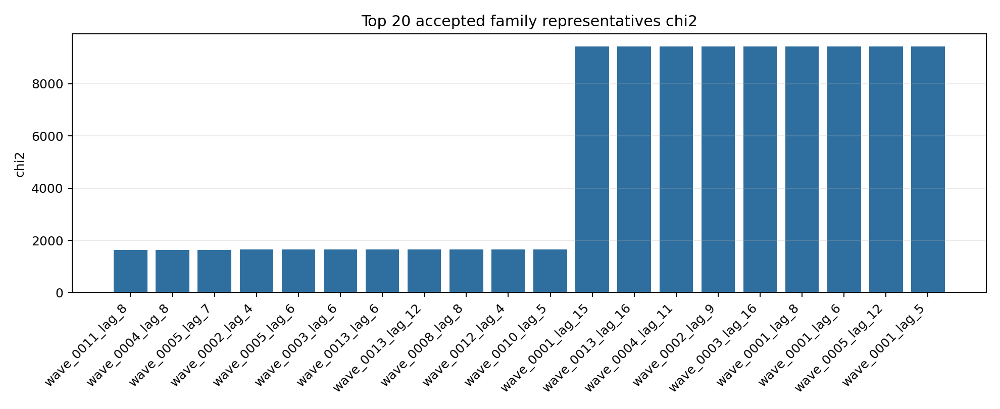
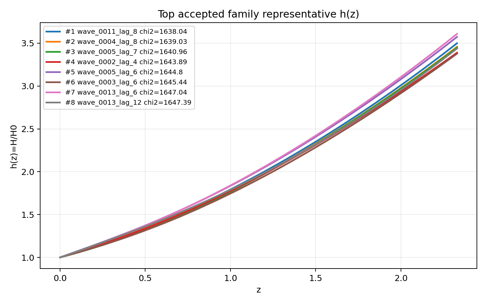
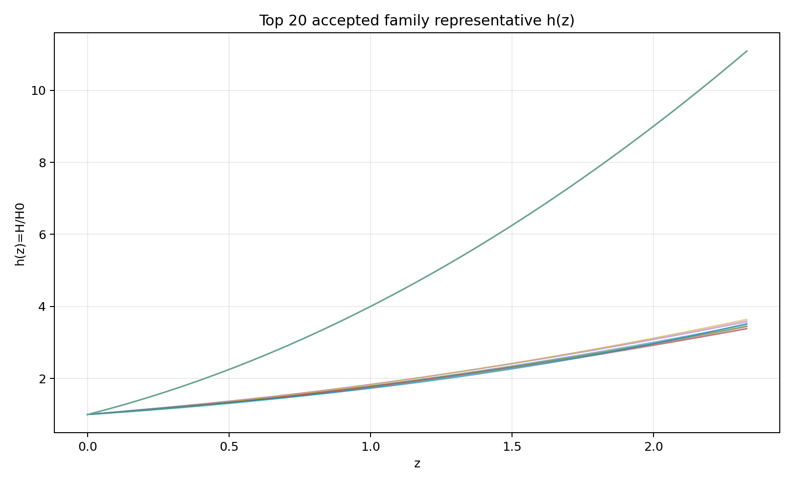
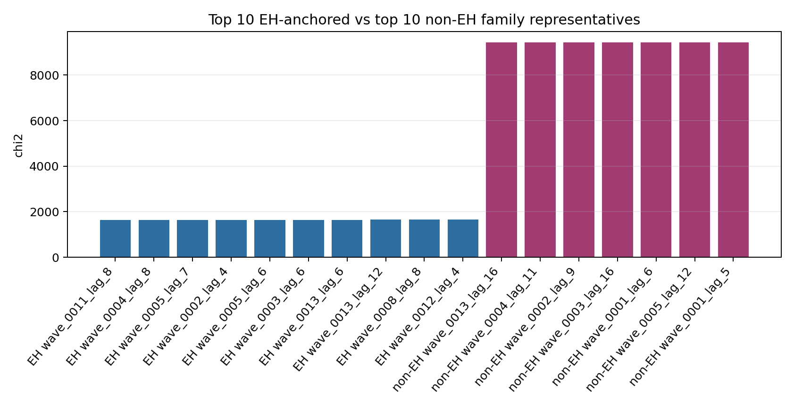
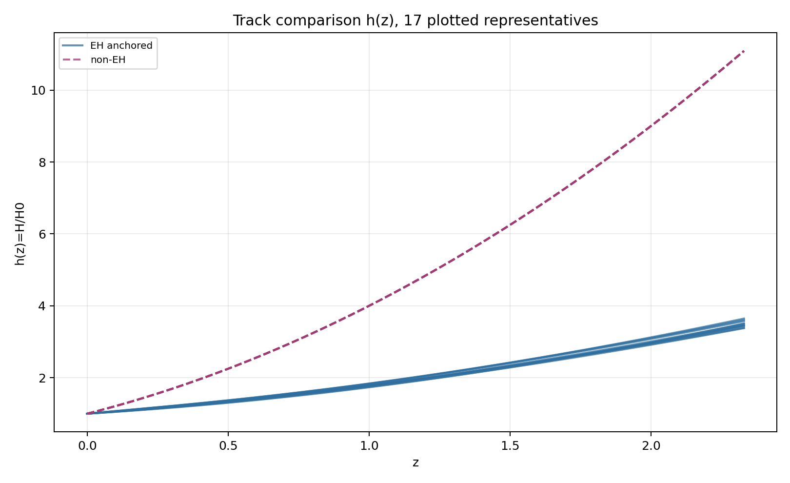
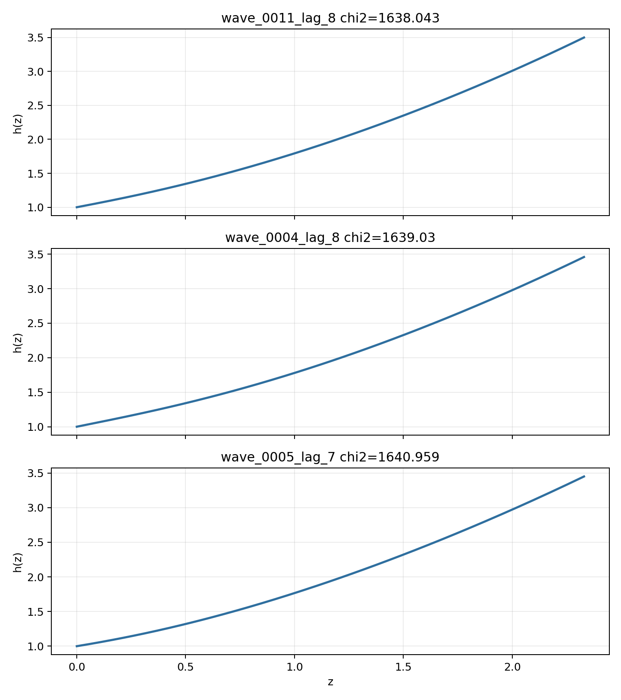

# LangGraph Agent Result Summary: graph_agent_batch_208_split_v4

This report is generated from current-loop memory and the isolated Solver outputs for accepted attempts.
Human-facing tables and plots use one best representative per theory family; full accepted attempts remain in `accepted_summary.json`.

## Quick Result

| Metric | Value |
|---|---:|
| Total attempts | 208 |
| Accepted attempts | 70 |
| Accepted theory families shown | 20 |
| Best chi2 | 1638.042839 |
| q_not_determined | 8 |
| constraint_drift | 62 |
| q_initial_root_failure | 91 |

## Output Files

- [accepted_lagrangians_and_parameters.md](accepted_lagrangians_and_parameters.md)
- [accepted_lagrangians_full.md](accepted_lagrangians_full.md)
- [accepted_lagrangians_and_parameters.csv](accepted_lagrangians_and_parameters.csv)
- [accepted_summary.json](accepted_summary.json)

## Plots

## Track Comparison

- [Top EH-anchored representatives](top_eh_anchored.md)
- [Top non-EH representatives](top_non_eh.md)

## Top Accepted Family Representatives

| Rank | Track | Family | Loop | chi2 | Status | Max rel. effect | Dominant correction | Sample | H0 | Omega_m0 | lambda_H | Scalar | Potential | Operators |
|---:|---|---|---|---:|---|---:|---|---:|---:|---:|---:|---|---|---|
| 1 | eh_anchored | scalar=phi1_only|phi1_potential=quadratic|phi2_potential=None|operator_bucket=R_anchor | wave_0011_lag_8 | 1638.042839 | eh_only | 0 |  | 410 | 65.429 | 0.2734 | 2329.564 | phi1_only | {"phi1": "quadratic", "phi2": null} | R |
| 2 | eh_anchored | scalar=phi1_only|phi1_potential=quadratic|phi2_potential=None|operator_bucket=R_anchor+derivative+scalar_curvature | wave_0004_lag_8 | 1639.029936 | moderate | 2.935e-04 | φ1 · ∇^{a}∇_{a}R | 476 | 70.461 | 0.293 | 1010.39 | phi1_only | {"phi1": "quadratic", "phi2": null} | R; φ1 · ∇^{a}∇_{a}R |
| 3 | eh_anchored | scalar=phi1_only|phi1_potential=quadratic|phi2_potential=None|operator_bucket=R_anchor+derivative+high_curvature+scalar_curvature | wave_0005_lag_7 | 1640.959345 | weak | 8.154e-06 | ∇^{a}φ1 · ∇^{b}φ1 · R_{ab} | 584 | 72.61 | 0.2826 | 1.641e+04 | phi1_only | {"phi1": "quadratic", "phi2": null} | R; R · R; ∇^{a}φ1 · ∇^{b}φ1 · R_{ab} |
| 4 | eh_anchored | scalar=phi1_only|phi1_potential=quadratic|phi2_potential=None|operator_bucket=R_anchor+high_curvature+scalar_curvature | wave_0002_lag_4 | 1643.892678 | weak | 1.025e-06 | φ1 · φ1 · R^{ab} · R_{ab} | 928 | 69.903 | 0.2775 | 5.197e+04 | phi1_only | {"phi1": "quadratic", "phi2": null} | R; φ1 · φ1 · R^{ab} · R_{ab} |
| 5 | eh_anchored | scalar=phi1_only|phi1_potential=quadratic|phi2_potential=None|operator_bucket=R_anchor+derivative | wave_0005_lag_6 | 1644.803417 | eh_only | 0 |  | 396 | 74.938 | 0.3169 | 3842.994 | phi1_only | {"phi1": "quadratic", "phi2": null} | R; φ1 · ∇^{a}∇_{a}φ1 |
| 6 | eh_anchored | scalar=phi1_only|phi1_potential=quadratic|phi2_potential=None|operator_bucket=R_anchor+derivative+high_curvature | wave_0003_lag_6 | 1645.440639 | eh_dominated | 8.803e-08 | ∇^{c}R^{ab} · ∇_{b}R_{ac} | 377 | 68.452 | 0.2835 | 6.904e+04 | phi1_only | {"phi1": "quadratic", "phi2": null} | R; ∇^{c}R^{ab} · ∇_{b}R_{ac} |
| 7 | eh_anchored | scalar=phi1_only|phi1_potential=quadratic|phi2_potential=None|operator_bucket=R_anchor+high_curvature | wave_0013_lag_6 | 1647.038092 | moderate | 1.877e-04 | R^{ab} · R_{ab} | 886 | 61.259 | 0.3228 | 5.094e+04 | phi1_only | {"phi1": "quadratic", "phi2": null} | R; R^{ab} · R_{ab} |
| 8 | eh_anchored | scalar=phi1_only|phi1_potential=axion|phi2_potential=None|operator_bucket=R_anchor+derivative+scalar_curvature | wave_0013_lag_12 | 1647.387644 | moderate | 0.001 | ∇^{a}∇_{a}φ1 · R | 397 | 73.894 | 0.2353 | 1.058e+04 | phi1_only | {"phi1": "axion", "phi2": null} | R; ∇^{a}∇_{a}φ1 · R; φ1 · ∇^{a}∇_{a}φ1 · R; ∇^{a}φ1 · ∇_{a}φ1 · R |
| 9 | eh_anchored | scalar=phi1_only|phi1_potential=axion|phi2_potential=None|operator_bucket=R_anchor+derivative | wave_0008_lag_8 | 1651.956163 | eh_only | 0 |  | 178 | 58.644 | 0.3238 | 1.938e+04 | phi1_only | {"phi1": "axion", "phi2": null} | R; ∇^{a}φ1 · ∇_{a}φ1 |
| 10 | eh_anchored | scalar=phi1_only|phi1_potential=axion|phi2_potential=None|operator_bucket=R_anchor | wave_0012_lag_4 | 1656.395923 | eh_only | 0 |  | 90 | 71.696 | 0.2605 | 7758.513 | phi1_only | {"phi1": "axion", "phi2": null} | R |
| 11 | eh_anchored | scalar=phi1_only|phi1_potential=quadratic|phi2_potential=None|operator_bucket=R_anchor+scalar_curvature | wave_0010_lag_5 | 1659.252065 | active | 0.026 | φ1 · R^{bcd}_{a} · R^{a}_{bcd} | 360 | 66.142 | 0.2577 | 2023.715 | phi1_only | {"phi1": "quadratic", "phi2": null} | R; φ1 · R^{bcd}_{a} · R^{a}_{bcd} |
| 12 | eh_anchored | scalar=phi2_only|phi1_potential=None|phi2_potential=axion|operator_bucket=R_anchor+derivative+high_curvature+scalar_curvature | wave_0001_lag_15 | 9431.932834 | weak | 2.560e-05 | φ2 · R^{ab} · R_{ab} | 84 | 69.587 | 0.3814 | 6.655e+04 | phi2_only | {"phi1": null, "phi2": "axion"} | R; φ2 · R^{ab} · R_{ab}; ∇^{a}∇_{a}φ2 · R; φ2 · φ2 · φ2 · φ2 · R; φ2 · φ2 · R^{ab} · R_{ab}; φ2 · φ2 · R^{bcd}_{a} · R^{a}_{bcd}; ∇^{a}φ2 · ∇_{a}φ2 · R; ∇^{a}∇_{a}φ2 |
| 13 | non_eh | scalar=phi2_only|phi1_potential=None|phi2_potential=quadratic|operator_bucket=high_curvature+scalar_curvature | wave_0013_lag_16 | 9434.003155 | unclear |  |  | 34 | 74.704 | 0.3105 | 1055.4 | phi2_only | {"phi1": null, "phi2": "quadratic"} | R^{cd}_{ab} · R^{afh}_{c} · R^{b}_{fdh}; R^{cd}_{ab} · R^{afh}_{c} · R^{b}_{hdf}; R_{ab} · R^{adef} · R^{b}_{def}; φ2 · R; φ2 · R^{ab} · R_{ab}; φ2 · φ2 · R^{ab} · R_{ab}; φ2 · φ2 · φ2 |
| 14 | non_eh | scalar=phi2_only|phi1_potential=None|phi2_potential=axion|operator_bucket=high_curvature+scalar_curvature | wave_0004_lag_11 | 9434.004829 | unclear |  |  | 819 | 72.324 | 0.3258 | 592.513 | phi2_only | {"phi1": null, "phi2": "axion"} | R · R; φ2 · R |
| 15 | non_eh | scalar=both|phi1_potential=quadratic|phi2_potential=axion|operator_bucket=scalar_curvature | wave_0002_lag_9 | 9434.006131 | unclear |  |  | 34 | 64.939 | 0.302 | 5785.17 | both | {"phi1": "quadratic", "phi2": "axion"} | φ2 · R |
| 16 | non_eh | scalar=phi2_only|phi1_potential=None|phi2_potential=quadratic|operator_bucket=derivative+high_curvature+scalar_curvature | wave_0003_lag_16 | 9434.007647 | unclear |  |  | 642 | 61.044 | 0.374 | 764.319 | phi2_only | {"phi1": null, "phi2": "quadratic"} | R^{ab} · R_{ab}; R^{b}_{a} · R^{cd} · R^{a}_{cbd}; φ2 · φ2 · R; ∇^{a}∇_{a}φ2 · R; φ2 · ∇^{a}φ2 · ∇_{a}R; φ2 · ∇^{a}φ2 · ∇_{a}φ2; φ2 · φ2 · φ2 · ∇^{a}∇_{a}φ2; φ2 · φ2 · ∇^{a}φ2 · ∇_{a}φ2 |
| 17 | eh_anchored | scalar=phi2_only|phi1_potential=None|phi2_potential=axion|operator_bucket=R_anchor+derivative+scalar_curvature | wave_0001_lag_8 | 9434.007984 | eh_dominated | 1.703e-12 | φ2 · φ2 · φ2 · R | 245 | 71.03 | 0.3507 | 5.723e+04 | phi2_only | {"phi1": null, "phi2": "axion"} | R; φ2 · φ2 · φ2 · R; ∇^{a}∇_{a}φ2 |
| 18 | non_eh | scalar=phi2_only|phi1_potential=None|phi2_potential=quadratic|operator_bucket=scalar_curvature | wave_0001_lag_6 | 9434.007984 | unclear |  |  | 29 | 65.66 | 0.2535 | 3888.662 | phi2_only | {"phi1": null, "phi2": "quadratic"} | φ2 · φ2 · φ2 · φ2 · R |
| 19 | non_eh | scalar=phi2_only|phi1_potential=None|phi2_potential=axion|operator_bucket=derivative+high_curvature+scalar_curvature | wave_0005_lag_12 | 9434.007984 | unclear |  |  | 747 | 69.673 | 0.3284 | 3577.338 | phi2_only | {"phi1": null, "phi2": "axion"} | R · R^{bcd}_{a} · R^{a}_{bcd}; ∇^{a}R · ∇_{a}R; φ2 · φ2 · R; φ2 · φ2 · φ2 · R; φ2 · φ2 · φ2 · φ2 · R; φ2 · φ2 · φ2 · φ2 · φ2 · φ2 |
| 20 | non_eh | scalar=phi2_only|phi1_potential=None|phi2_potential=axion|operator_bucket=scalar_curvature | wave_0001_lag_5 | 9434.007984 | unclear |  |  | 184 | 64.395 | 0.3205 | 984.83 | phi2_only | {"phi1": null, "phi2": "axion"} | φ2 · φ2 · φ2 · R |

## Top Family Representative Parameter Choices

| Rank | Loop | varphi1_0 | q1_0 | mu1 | fbar1 | varphi2_0 | q2_0 | mu2 | fbar2 | Free coefficients |
|---:|---|---:|---:|---:|---:|---:|---:|---:|---:|---|
| 1 | wave_0011_lag_8 | 1.9716 | -0.6315 | 1.0094 | 18.99 | 0 | 0 | 0 | 1 | \alpha=0.5 |
| 2 | wave_0004_lag_8 | 1.6075 | -0.6275 | 1.2203 | 3.7792 | 0 | 0 | 0 | 1 | \alpha=0.5, \beta=9.4151e+04 |
| 3 | wave_0005_lag_7 | 2.9686 | -0.4303 | 0.6837 | 8.3466 | 0 | 0 | 0 | 1 | \alpha=0.5, \beta=-387.9684, \gamma=3.3578e+10 |
| 4 | wave_0002_lag_4 | 1.9337 | -0.6077 | 1.0298 | 1.4304 | 0 | 0 | 0 | 1 | \alpha=0.5, \beta=1.0000e+12 |
| 5 | wave_0005_lag_6 | 1.3763 | -0.7002 | 1.3802 | 1.3936 | 0 | 0 | 0 | 1 | \alpha=0.5, \beta=2.0306e-07 |
| 6 | wave_0003_lag_6 | 2.2543 | -0.4678 | 0.896 | 1.027 | 0 | 0 | 0 | 1 | \alpha=0.5, \beta=1.0000e+12 |
| 7 | wave_0013_lag_6 | 1.4506 | -0.6566 | 1.3138 | 1.7951 | 0 | 0 | 0 | 1 | \alpha=0.5, \beta=2.4355e+05 |
| 8 | wave_0013_lag_12 | 1.4688 | -0.8487 | 1.3429 | 5.5069 | 0 | 0 | 0 | 1 | \alpha=0.5, \beta=-4.1816e+08, \gamma=-1.0000e+12, \delta=1.0000e+12 |
| 9 | wave_0008_lag_8 | 1.6608 | -0.5545 | 1.1737 | 4.181 | 0 | 0 | 0 | 1 | \alpha=0.5, \beta=-1.1919e-08 |
| 10 | wave_0012_lag_4 | 1.3724 | -0.4516 | 1.8814 | 0.6016 | 0 | 0 | 0 | 1 | \alpha=0.5 |
| 11 | wave_0010_lag_5 | 1.1872 | -0.8241 | 1.6365 | 21.5587 | 0 | 0 | 0 | 1 | \alpha=0.5, \beta=-9.2186e+07 |
| 12 | wave_0001_lag_15 | 0 | 0 | 0 | 1 | -0.0038 | 9.4158e-04 | 0.5316 | 0.0595 | \alpha=0.5, \beta=-1.0000e+12, \gamma=9.6491e+11, \delta=-1.0000e+12, \epsilon=1.0000e+12, \zeta=1.0000e+12, \eta=-1.0000e+12, \theta=9.6941e-10 |
| 13 | wave_0013_lag_16 | 0 | 0 | 0 | 1 | 0.1499 | -14.5201 | 1.1219e-04 | 14.0834 | \alpha=-6.5563e+06, \beta=1.4081e+06, \gamma=3.6922e+06, \delta=-0.0108, \epsilon=1.3493e+05, \zeta=-7.5126e+08, \eta=1.0713e-05 |
| 14 | wave_0004_lag_11 | 0 | 0 | 0 | 1 | 0.0293 | -2.8849 | 0.0618 | 3.5914 | \alpha=-13.2617, \beta=-0.057 |
| 15 | wave_0002_lag_9 | 0.4573 | -1.6154 | 0.378 | 0.2284 | -0.8186 | 4.005 | 0.2538 | 3.003 | \alpha=0.1164 |
| 16 | wave_0003_lag_16 | 0 | 0 | 0 | 1 | -2.6999 | 2.4199 | 6.7477e-04 | 0.1072 | \alpha=-9.1519, \beta=-1.5771e+06, \gamma=-0.0324, \delta=-159.3945, \epsilon=-6.6157e+05, \zeta=9.8481e-07, \eta=2.0319e-05, \theta=-4.5225e-09 |
| 17 | wave_0001_lag_8 | 0 | 0 | 0 | 1 | -5.4248e-04 | 1.8046e-04 | 8.3806e-04 | 23.7657 | \alpha=0.5, \beta=1.0000e+12, \gamma=-4.0687e-07 |
| 18 | wave_0001_lag_6 | 0 | 0 | 0 | 1 | -0.0024 | 5.9798e-04 | 3.8379e-04 | 11.1141 | \alpha=-1.0000e+12 |
| 19 | wave_0005_lag_12 | 0 | 0 | 0 | 1 | -0.0028 | 8.9379e-04 | 0.0313 | 0.1973 | \alpha=8.3787e+10, \beta=-6.4301e+11, \gamma=-2.1066e+08, \delta=-1.0000e+12, \epsilon=-1.0000e+12, \zeta=-1.3770e-07 |
| 20 | wave_0001_lag_5 | 0 | 0 | 0 | 1 | 0.0059 | -0.002 | 7.1617e-04 | 6.1002 | \alpha=3.3938e+10 |

## Main Failure Tags

| Tag | Count |
|---|---:|
| no_accepted_samples | 188 |
| q_initial_root_failure | 91 |
| constraint_drift | 62 |
| h_absurdly_large | 62 |
| q_not_determined | 8 |
| integration_failure | 7 |
| symbolic_timeout | 2 |
| no_scalar_constraint | 1 |
