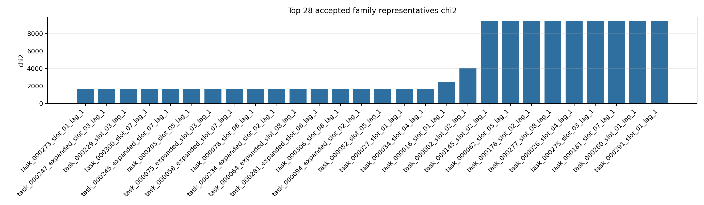
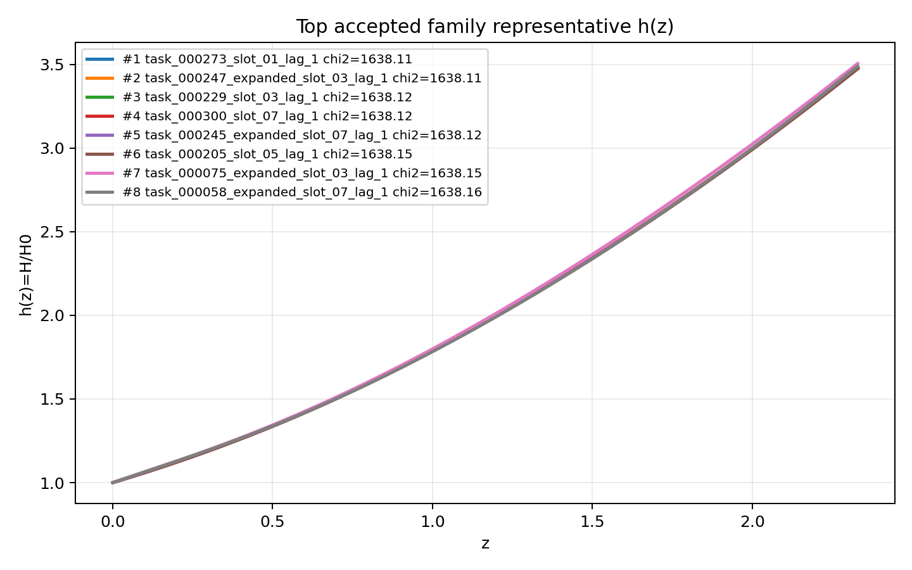
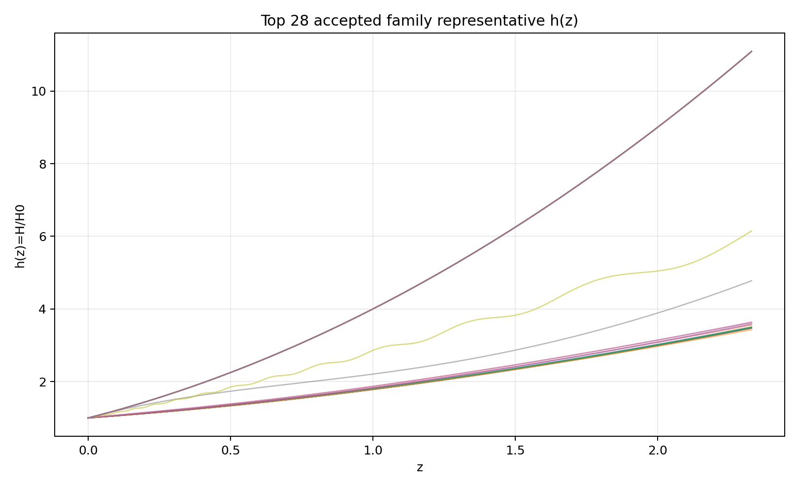
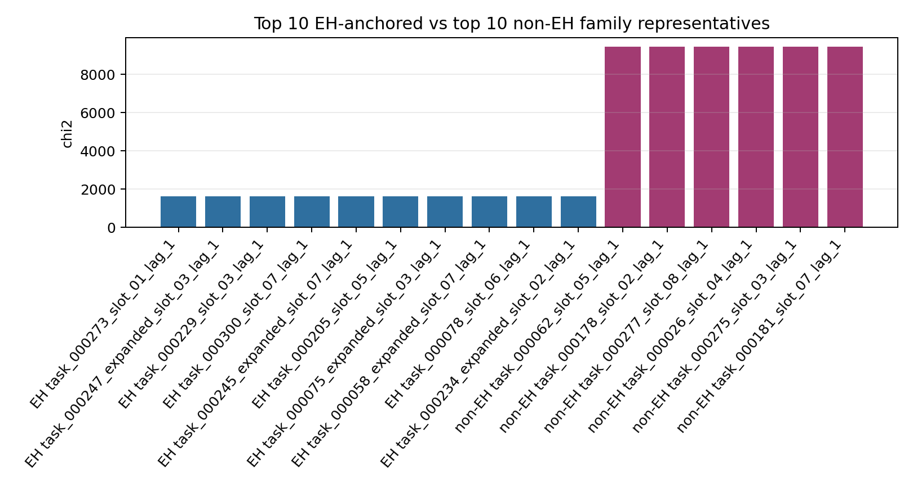
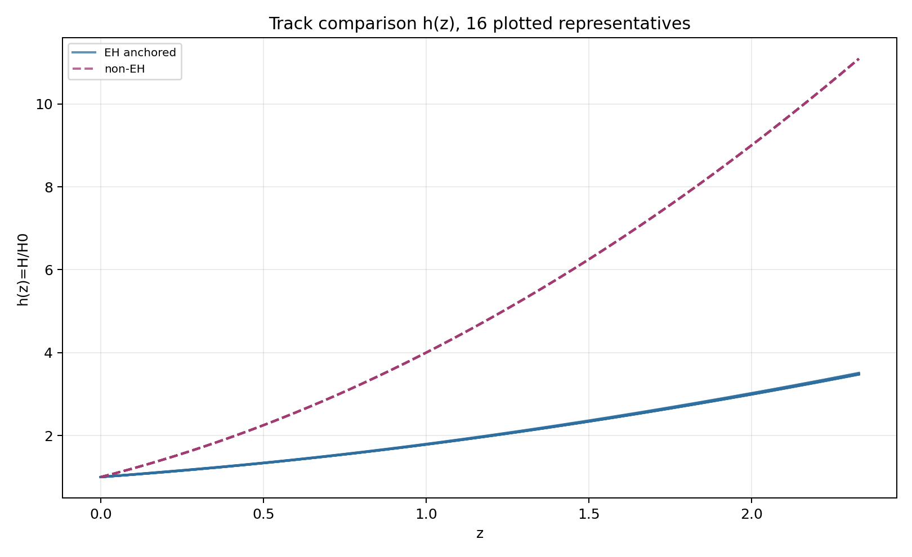
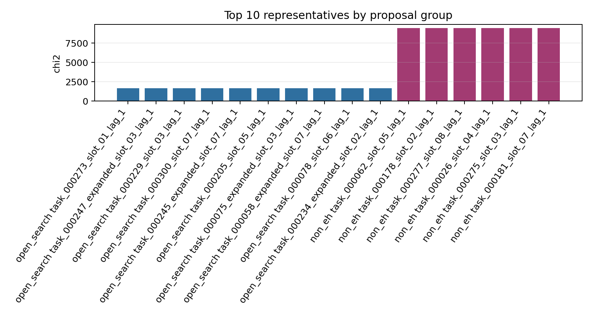
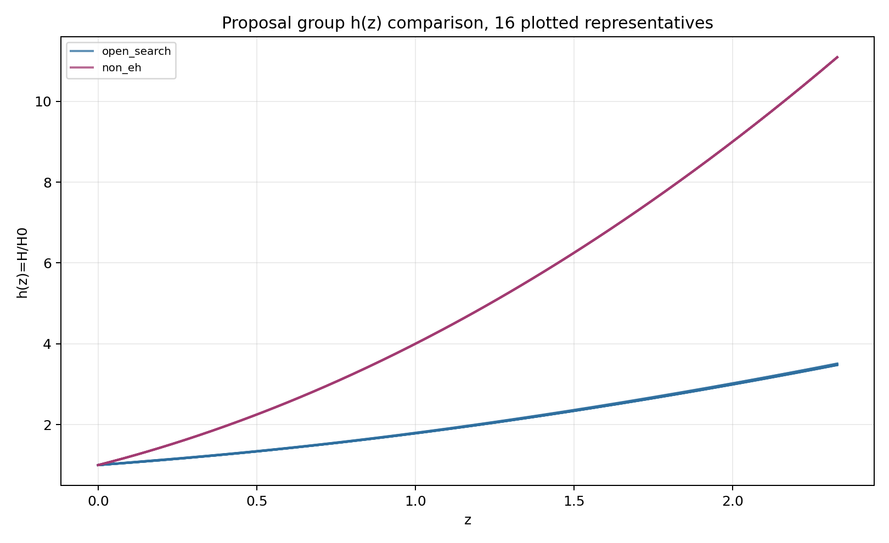
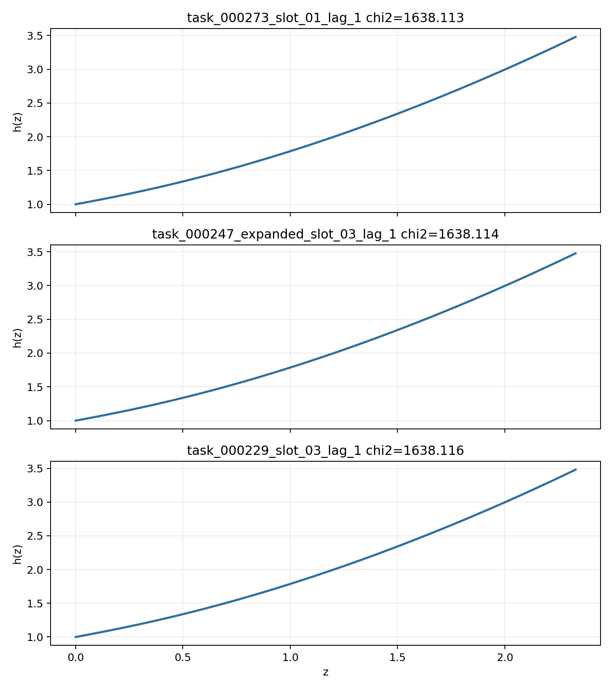

# LangGraph Agent Result Summary: graph_agent_batch_312_sector_async_v6

This report is generated from current-loop memory and the isolated Solver outputs for accepted attempts.
Human-facing tables and plots use one best representative per theory family; full accepted attempts remain in `accepted_summary.json`.

## Quick Result

| Metric | Value |
|---|---:|
| Total attempts | 363 |
| Accepted attempts | 120 |
| Accepted theory families shown | 28 |
| Best chi2 | 1638.113013 |
| q_not_determined | 69 |
| constraint_drift | 182 |
| q_initial_root_failure | 160 |

## Output Files

- [accepted_lagrangians_and_parameters.md](accepted_lagrangians_and_parameters.md)
- [accepted_lagrangians_full.md](accepted_lagrangians_full.md)
- [accepted_lagrangians_and_parameters.csv](accepted_lagrangians_and_parameters.csv)
- [accepted_summary.json](accepted_summary.json)

## Plots

## Proposal Group Comparison

- [Top open-search representatives](top_open_search.md)
- [Top non-EH representatives](top_non_eh.md)

## Track Comparison

- [Top EH-anchored representatives](top_eh_anchored.md)
- [Top non-EH representatives](top_non_eh.md)

## Top Accepted Family Representatives

| Rank | Group | Track | Family | Loop | chi2 | Status | Max rel. effect | Dominant correction | Sample | H0 | Omega_m0 | lambda_H | Scalar | Potential | Operators |
|---:|---|---|---|---|---:|---|---:|---|---:|---:|---:|---:|---|---|---|
| 1 | open_search | eh_anchored | scalar=phi1_only|phi1_potential=quadratic|phi2_potential=None|operator_bucket=R_anchor | task_000273_slot_01_lag_1 | 1638.113013 | eh_only | 0 |  | 124 | 62.687 | 0.2786 | 4599.829 | phi1_only | {"phi1": "quadratic", "phi2": null} | R |
| 2 | open_search | eh_anchored | scalar=phi1_only|phi1_potential=quadratic|phi2_potential=None|operator_bucket=R_anchor+high_curvature+scalar_curvature | task_000247_expanded_slot_03_lag_1 | 1638.114263 | eh_dominated | 1.006e-13 | φ1 · R^{ab} · R_{ab} | 1674 | 69.794 | 0.2787 | 4435.689 | phi1_only | {"phi1": "quadratic", "phi2": null} | R; φ1 · R^{ab} · R_{ab} |
| 3 | open_search | eh_anchored | scalar=phi1_only|phi1_potential=quadratic|phi2_potential=None|operator_bucket=R_anchor+scalar_curvature | task_000229_slot_03_lag_1 | 1638.116086 | weak | 2.512e-06 | φ1 · R^{bcd}_{a} · R^{a}_{bcd} | 1 | 68.251 | 0.2784 | 4661.175 | phi1_only | {"phi1": "quadratic", "phi2": null} | R; φ1 · R^{bcd}_{a} · R^{a}_{bcd} |
| 4 | open_search | eh_anchored | scalar=both|phi1_potential=quadratic|phi2_potential=quadratic|operator_bucket=R_anchor | task_000300_slot_07_lag_1 | 1638.117759 | eh_only | 0 |  | 501 | 71.237 | 0.2785 | 4625.51 | both | {"phi1": "quadratic", "phi2": "quadratic"} | R |
| 5 | open_search | eh_anchored | scalar=phi1_only|phi1_potential=quadratic|phi2_potential=None|operator_bucket=R_anchor+high_curvature | task_000245_expanded_slot_07_lag_1 | 1638.121478 | moderate | 0.001 | R^{ab} · R_{ab} | 833 | 72.101 | 0.2786 | 4189.926 | phi1_only | {"phi1": "quadratic", "phi2": null} | R; R^{ab} · R_{ab} |
| 6 | open_search | eh_anchored | scalar=phi1_only|phi1_potential=quadratic|phi2_potential=None|operator_bucket=R_anchor+derivative+high_curvature+scalar_curvature | task_000205_slot_05_lag_1 | 1638.149023 | active | 3.064e+04 | ∇^{a}∇_{a}R · R^{c}_{c} | 1 | 67.871 | 0.2775 | 3790.416 | phi1_only | {"phi1": "quadratic", "phi2": null} | R; R^{bcd}_{a} · R^{a}_{bcd}; R · R · R; R^{cd}_{ab} · R^{afh}_{c} · R^{b}_{fdh}; ∇^{a}∇_{a}R · R^{c}_{c}; φ1 · R^{bcd}_{a} · R^{a}_{bcd} |
| 7 | open_search | eh_anchored | scalar=phi1_only|phi1_potential=axion|phi2_potential=None|operator_bucket=R_anchor+high_curvature | task_000075_expanded_slot_03_lag_1 | 1638.154473 | active | 8513.85 | R^{ab} · R^{d}_{a} · R_{bd} | 110 | 64.529 | 0.3078 | 1652.261 | phi1_only | {"phi1": "axion", "phi2": null} | R; R^{ab} · R^{d}_{a} · R_{bd} |
| 8 | open_search | eh_anchored | scalar=phi1_only|phi1_potential=axion|phi2_potential=None|operator_bucket=R_anchor+high_curvature+scalar_curvature | task_000058_expanded_slot_07_lag_1 | 1638.164106 | weak | 4.153e-05 | φ1 · R · R | 1050 | 58 | 0.2877 | 1445.24 | phi1_only | {"phi1": "axion", "phi2": null} | R; φ1 · R · R |
| 9 | open_search | eh_anchored | scalar=phi1_only|phi1_potential=axion|phi2_potential=None|operator_bucket=R_anchor | task_000078_slot_06_lag_1 | 1638.180337 | eh_only | 0 |  | 578 | 69.284 | 0.3039 | 1457.702 | phi1_only | {"phi1": "axion", "phi2": null} | R |
| 10 | open_search | eh_anchored | scalar=both|phi1_potential=axion|phi2_potential=quadratic|operator_bucket=R_anchor+high_curvature+scalar_curvature | task_000234_expanded_slot_02_lag_1 | 1638.26859 | eh_dominated | 2.953e-13 | φ1 · R^{ab} · R_{ab} | 1526 | 62.509 | 0.2876 | 4445.197 | both | {"phi1": "axion", "phi2": "quadratic"} | R; φ1 · R^{ab} · R_{ab} |
| 11 | open_search | eh_anchored | scalar=phi1_only|phi1_potential=axion|phi2_potential=None|operator_bucket=R_anchor+derivative+high_curvature | task_000064_expanded_slot_08_lag_1 | 1638.572595 | moderate | 5.315e-04 | R^{bd}_{ac} · R^{agh}_{b} · R^{c}_{dgh} | 1120 | 72.628 | 0.3093 | 993.957 | phi1_only | {"phi1": "axion", "phi2": null} | R; R · R; R^{ab} · R^{d}_{a} · R_{bd}; R^{bd}_{ac} · R^{agh}_{b} · R^{c}_{dgh}; ∇^{c}R^{ab} · ∇_{b}R_{ac} |
| 12 | open_search | eh_anchored | scalar=both|phi1_potential=quadratic|phi2_potential=quadratic|operator_bucket=R_anchor+derivative | task_000281_expanded_slot_06_lag_1 | 1639.583387 | eh_only | 0 |  | 1113 | 72.135 | 0.2959 | 4629.405 | both | {"phi1": "quadratic", "phi2": "quadratic"} | R; φ1 · φ1; φ2 · ∇^{a}φ2 · ∇_{a}φ2; φ1 · φ2 · ∇^{a}φ2 · ∇_{a}φ2 |
| 13 | open_search | eh_anchored | scalar=phi1_only|phi1_potential=quadratic|phi2_potential=None|operator_bucket=R_anchor+derivative+high_curvature | task_000306_slot_08_lag_1 | 1642.062742 | eh_dominated | 1.326e-07 | ∇^{c}R^{ab} · ∇_{c}R_{ab} | 523 | 61.434 | 0.266 | 3249.442 | phi1_only | {"phi1": "quadratic", "phi2": null} | R; ∇^{a}R · ∇_{a}R; ∇^{c}R^{ab} · ∇_{c}R_{ab}; φ1 · φ1 |
| 14 | open_search | eh_anchored | scalar=both|phi1_potential=axion|phi2_potential=axion|operator_bucket=R_anchor+high_curvature | task_000094_expanded_slot_02_lag_1 | 1643.317532 | eh_dominated | 1.865e-08 | R · R | 2678 | 68.562 | 0.3207 | 1394.161 | both | {"phi1": "axion", "phi2": "axion"} | R; R · R |
| 15 | open_search | eh_anchored | scalar=both|phi1_potential=axion|phi2_potential=axion|operator_bucket=R_anchor | task_000052_slot_05_lag_1 | 1644.846792 | eh_only | 0 |  | 643 | 69.412 | 0.3218 | 1475.62 | both | {"phi1": "axion", "phi2": "axion"} | R |
| 16 | open_search | eh_anchored | scalar=phi1_only|phi1_potential=axion|phi2_potential=None|operator_bucket=R_anchor+scalar_curvature | task_000027_slot_01_lag_1 | 1655.498369 | eh_dominated | 1.118e-07 | φ1 · R^{bcd}_{a} · R^{a}_{bcd} | 504 | 73.191 | 0.3354 | 1487.836 | phi1_only | {"phi1": "axion", "phi2": null} | R; φ1 · R^{bcd}_{a} · R^{a}_{bcd} |
| 17 | open_search | eh_anchored | scalar=both|phi1_potential=axion|phi2_potential=quadratic|operator_bucket=R_anchor+scalar_curvature | task_000034_slot_04_lag_1 | 1655.49837 | eh_dominated | 5.959e-13 | φ1 · R^{bcd}_{a} · R^{a}_{bcd} | 1 | 73.191 | 0.3354 | 1487.836 | both | {"phi1": "axion", "phi2": "quadratic"} | R; φ1 · R^{bcd}_{a} · R^{a}_{bcd} |
| 18 | open_search | eh_anchored | scalar=both|phi1_potential=axion|phi2_potential=quadratic|operator_bucket=R_anchor | task_000016_slot_01_lag_1 | 2460.440124 | eh_only | 0 |  | 872 | 70.101 | 0.3717 | 6.608e+04 | both | {"phi1": "axion", "phi2": "quadratic"} | R |
| 19 | open_search | eh_anchored | scalar=both|phi1_potential=quadratic|phi2_potential=axion|operator_bucket=R_anchor+derivative+high_curvature+scalar_curvature | task_000002_slot_02_lag_1 | 4024.068817 | moderate | 1.025e-04 | ∇^{a}φ1 · ∇^{b}φ2 · R_{ab} | 886 | 69.737 | 0.2554 | 854.711 | both | {"phi1": "quadratic", "phi2": "axion"} | R; φ2 · ∇^{a}∇_{a}φ2 · R; ∇^{a}∇_{a}φ1 · φ2 · R; ∇^{a}φ1 · ∇^{b}φ2 · R_{ab}; φ2 · φ2 · φ2 · φ2 · φ2 |
| 20 | open_search | eh_anchored | scalar=phi2_only|phi1_potential=None|phi2_potential=axion|operator_bucket=R_anchor+scalar_curvature | task_000145_slot_02_lag_1 | 9434.002767 | eh_dominated | 8.910e-10 | φ2 · R | 669 | 63.648 | 0.305 | 1665.328 | phi2_only | {"phi1": null, "phi2": "axion"} | R; φ2 · R |
| 21 | non_eh | non_eh | scalar=phi2_only|phi1_potential=None|phi2_potential=axion|operator_bucket=derivative+high_curvature+scalar_curvature | task_000062_slot_05_lag_1 | 9434.0031 | unclear |  |  | 524 | 62.477 | 0.3085 | 824.258 | phi2_only | {"phi1": null, "phi2": "axion"} | R · R; ∇^{a}∇^{b}R · R_{ab}; φ2 · R; φ2 · ∇^{a}φ2 · ∇_{a}R; ∇^{a}φ2 · ∇^{b}φ2 · R_{ab}; φ2 · φ2 · φ2; φ2 · ∇^{a}φ2 · ∇_{a}φ2 |
| 22 | non_eh | non_eh | scalar=phi2_only|phi1_potential=None|phi2_potential=axion|operator_bucket=scalar_curvature | task_000178_slot_02_lag_1 | 9434.003103 | unclear |  |  | 806 | 64.506 | 0.3003 | 1719.876 | phi2_only | {"phi1": null, "phi2": "axion"} | φ2 · R; φ2 · φ2 |
| 23 | non_eh | non_eh | scalar=phi2_only|phi1_potential=None|phi2_potential=quadratic|operator_bucket=derivative+high_curvature+scalar_curvature | task_000277_slot_08_lag_1 | 9434.003114 | unclear |  |  | 684 | 70.649 | 0.2724 | 3394.421 | phi2_only | {"phi1": null, "phi2": "quadratic"} | R^{bd}_{ac} · R^{agh}_{b} · R^{c}_{dgh}; ∇^{c}R^{ab} · ∇_{c}R_{ab}; ∇^{e}R^{bcd}_{a} · ∇_{e}R^{a}_{bcd}; φ2 · R; ∇^{a}∇^{b}φ2 · R_{ab}; φ2 · ∇^{a}∇_{a}φ2 · R; φ2 · φ2 · φ2 |
| 24 | non_eh | non_eh | scalar=phi2_only|phi1_potential=None|phi2_potential=quadratic|operator_bucket=scalar_curvature | task_000026_slot_04_lag_1 | 9434.003135 | unclear |  |  | 915 | 73.268 | 0.3288 | 1610.268 | phi2_only | {"phi1": null, "phi2": "quadratic"} | φ2 · R |
| 25 | non_eh | non_eh | scalar=both|phi1_potential=quadratic|phi2_potential=quadratic|operator_bucket=derivative+scalar_curvature | task_000275_slot_03_lag_1 | 9434.006612 | unclear |  |  | 783 | 70.018 | 0.2928 | 4534.6 | both | {"phi1": "quadratic", "phi2": "quadratic"} | φ2 · R; φ2 · ∇^{a}φ2 · ∇_{a}φ2 |
| 26 | non_eh | non_eh | scalar=phi2_only|phi1_potential=None|phi2_potential=axion|operator_bucket=derivative+scalar_curvature | task_000181_slot_07_lag_1 | 9434.007467 | unclear |  |  | 617 | 63.942 | 0.3023 | 2480.923 | phi2_only | {"phi1": null, "phi2": "axion"} | φ2 · φ2 · φ2 · R; ∇^{a}φ2 · ∇_{a}R; φ2 · φ2 · φ2 · φ2 · R; φ2 · φ2; φ2 · φ2 · φ2; ∇^{a}∇_{a}φ2; φ2 · φ2 · ∇^{a}∇_{a}φ2; φ2 · φ2 · ∇^{a}φ2 · ∇_{a}φ2 |
| 27 | open_search | eh_anchored | scalar=both|phi1_potential=quadratic|phi2_potential=axion|operator_bucket=R_anchor+high_curvature+scalar_curvature | task_000260_slot_01_lag_1 | 9434.007547 | active | 365.435 | φ2 · φ2 · R^{ab} · R_{ab} | 273 | 58.705 | 0.2981 | 7880.601 | both | {"phi1": "quadratic", "phi2": "axion"} | R; R^{bcd}_{a} · R^{a}_{bcd}; φ2 · φ2 · R; φ2 · φ2 · R^{ab} · R_{ab}; φ1 · φ2 · φ2 |
| 28 | open_search | eh_anchored | scalar=phi2_only|phi1_potential=None|phi2_potential=quadratic|operator_bucket=R_anchor+scalar_curvature | task_000291_slot_01_lag_1 | 9434.007596 | eh_dominated | 3.616e-10 | φ2 · φ2 · R | 582 | 69.153 | 0.2694 | 6063.565 | phi2_only | {"phi1": null, "phi2": "quadratic"} | R; φ2 · φ2 · R |

## Top Family Representative Parameter Choices

| Rank | Loop | varphi1_0 | q1_0 | mu1 | fbar1 | varphi2_0 | q2_0 | mu2 | fbar2 | Free coefficients |
|---:|---|---:|---:|---:|---:|---:|---:|---:|---:|---|
| 1 | task_000273_slot_01_lag_1 | 2.1643 | -0.5732 | 0.9241 | 6.5204 | 0 | 0 | 0 | 1 | \alpha=0.5 |
| 2 | task_000247_expanded_slot_03_lag_1 | 2.1645 | -0.5729 | 0.924 | 6.3037 | 0 | 0 | 0 | 1 | \alpha=0.5, \beta=-0.002 |
| 3 | task_000229_slot_03_lag_1 | 2.1642 | -0.5741 | 0.9241 | 6.8202 | 0 | 0 | 0 | 1 | \alpha=0.5, \beta=-5.8771e+04 |
| 4 | task_000300_slot_07_lag_1 | 2.1644 | -0.5741 | 0.924 | 6.5001 | -1.2161e-04 | 0.0591 | 0.0045 | 1.0007 | \alpha=0.5 |
| 5 | task_000245_expanded_slot_07_lag_1 | 2.1645 | -0.5727 | 0.9241 | 6.29 | 0 | 0 | 0 | 1 | \alpha=0.5, \beta=1.1525e+04 |
| 6 | task_000205_slot_05_lag_1 | 2.1661 | -0.574 | 0.924 | 6.1782 | 0 | 0 | 0 | 1 | \alpha=0.5, \beta=-1.0000e-04, \gamma=1.0000e+14, \delta=-3.1623e-09, \epsilon=3.1623e+18, \zeta=-3.1623 |
| 7 | task_000075_expanded_slot_03_lag_1 | 9.4447 | -0.6302 | 3.2239 | 0.3469 | 0 | 0 | 0 | 1 | \alpha=0.5, \beta=-3.1726e+16 |
| 8 | task_000058_expanded_slot_07_lag_1 | 8.002 | 0.6877 | 3.2604 | 0.3471 | 0 | 0 | 0 | 1 | \alpha=0.5, \beta=-7833.2744 |
| 9 | task_000078_slot_06_lag_1 | 9.612 | -0.6648 | 3.213 | 0.3538 | 0 | 0 | 0 | 1 | \alpha=0.5 |
| 10 | task_000234_expanded_slot_02_lag_1 | 2.1653 | -0.5528 | 0.9241 | 6.666 | -0.0308 | -0.059 | 0.0044 | 0.9978 | \alpha=0.5, \beta=0.006 |
| 11 | task_000064_expanded_slot_08_lag_1 | 7.7704 | -0.6341 | 3.0321 | 0.3715 | 0 | 0 | 0 | 1 | \alpha=0.5, \beta=-5.188, \gamma=-1.4150e-10, \delta=2.5939e+08, \epsilon=5.1132e-08 |
| 12 | task_000281_expanded_slot_06_lag_1 | 2.1644 | -0.5109 | 0.9241 | 6.4401 | 2.9363 | 0.051 | 5.179 | 1.0015 | \alpha=0.5, \beta=1.8313e-10, \gamma=5.2342e+08, \delta=-3.7349e-07 |
| 13 | task_000306_slot_08_lag_1 | 1.5734 | -0.7645 | 1.2437 | 10.5913 | 0 | 0 | 0 | 1 | \alpha=0.5, \beta=1.3370e-05, \gamma=7.3913e+06, \delta=1.8490e-10 |
| 14 | task_000094_expanded_slot_02_lag_1 | 10 | -0.6171 | 3.0169 | 0.3672 | 1.7939e-05 | 1.0000e-05 | 1.3657e-05 | 0.9495 | \alpha=0.5, \beta=-0.0181 |
| 15 | task_000052_slot_05_lag_1 | 8.3941 | -0.6321 | 3.5576 | 0.3079 | 1.8142e-05 | 1.1054e-05 | 1.1584e-05 | 1.0016 | \alpha=0.5 |
| 16 | task_000027_slot_01_lag_1 | 9.8138 | -0.7545 | 3.1668 | 0.3635 | 0 | 0 | 0 | 1 | \alpha=0.5, \beta=18.753 |
| 17 | task_000034_slot_04_lag_1 | 9.8138 | -0.7545 | 3.1668 | 0.3635 | 1.0000e-05 | 1.0000e-05 | 1.0000e-05 | 1 | \alpha=0.5, \beta=-1.0000e-04 |
| 18 | task_000016_slot_01_lag_1 | 0.1981 | -1.7461 | 4.2859 | 15.5254 | -0.6458 | -2.3874e-05 | 4.3960e-04 | 0.8941 | \alpha=0.5 |
| 19 | task_000002_slot_02_lag_1 | 0.0116 | -1.9377 | 72.5478 | 0.2144 | 0.2308 | 2.0359 | 0.0052 | 0.4605 | \alpha=0.5, \beta=2.4121e+08, \gamma=9.5417e+08, \delta=-1.0181e+10, \epsilon=4.4086e-05 |
| 20 | task_000145_slot_02_lag_1 | 0 | 0 | 0 | 1 | 1.7254e-05 | -8.0808 | 1.7637e-05 | 1.3048 | \alpha=0.5, \beta=0.043 |
| 21 | task_000062_slot_05_lag_1 | 0 | 0 | 0 | 1 | 1.5462e-05 | 0.7802 | 1.0000e-05 | 1.4293 | \alpha=3.9619e+05, \beta=-8.3907e+08, \gamma=0.1977, \delta=-3.8307e-06, \epsilon=1.7830e+09, \zeta=-1.9626e+16, \eta=8.3500e-10 |
| 22 | task_000178_slot_02_lag_1 | 0 | 0 | 0 | 1 | 1.1273e-05 | 0.785 | 1.2356e-05 | 0.6935 | \alpha=0.1913, \beta=3.3519e+15 |
| 23 | task_000277_slot_08_lag_1 | 0 | 0 | 0 | 1 | 1.0000e-05 | -0.7651 | 1.2541e-05 | 1.3224 | \alpha=1.2711e+11, \beta=1.2124e+07, \gamma=-6.2433e+04, \delta=-0.178, \epsilon=9.5361e-05, \zeta=-2.0247e+07, \eta=2.4479e+17 |
| 24 | task_000026_slot_04_lag_1 | 0 | 0 | 0 | 1 | 1.6123e-05 | -8.0723 | 1.0290e-05 | 1.6774 | \alpha=-0.0204 |
| 25 | task_000275_slot_03_lag_1 | 2.1645 | -1.3898 | 0.924 | 6.4633 | -6.4262e-05 | -3.4613e-04 | 0.0797 | 0.9981 | \alpha=-1561.155, \beta=1662.4486 |
| 26 | task_000181_slot_07_lag_1 | 0 | 0 | 0 | 1 | 1.0000e-05 | -1.9187e-05 | 1.0154e-05 | 1.1949 | \alpha=-3.1780e+13, \beta=0.0152, \gamma=4.7830e-06, \delta=-0.0116, \epsilon=1.7644e+07, \zeta=2.1952e+12, \eta=2.4911e+19, \theta=-2.5446e+16 |
| 27 | task_000260_slot_01_lag_1 | 2.3284 | -1.2756 | 0.9209 | 8.2216 | 34.6645 | 4.1799e-05 | 0.0105 | 1.0017 | \alpha=0.5, \beta=1.4610e-08, \gamma=1.3964e-04, \delta=-5.8647e+14, \epsilon=11.9722 |
| 28 | task_000291_slot_01_lag_1 | 0 | 0 | 0 | 1 | 1.4209e-05 | -3.9757e-04 | 1.6422e-05 | 1.1013 | \alpha=0.5, \beta=3.2920e+07 |

## Main Failure Tags

| Tag | Count |
|---|---:|
| no_accepted_samples | 243 |
| constraint_drift | 182 |
| q_initial_root_failure | 160 |
| h_absurdly_large | 110 |
| q_not_determined | 69 |
| no_scalar_constraint | 20 |
| integration_failure | 17 |
| symbolic_timeout | 14 |
