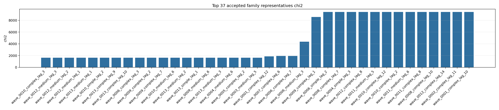
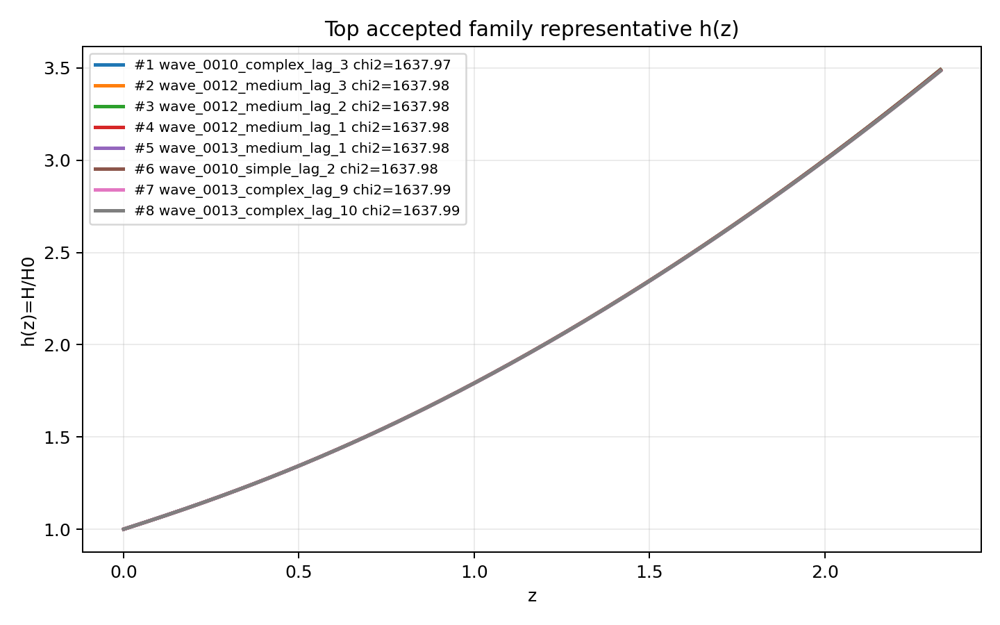
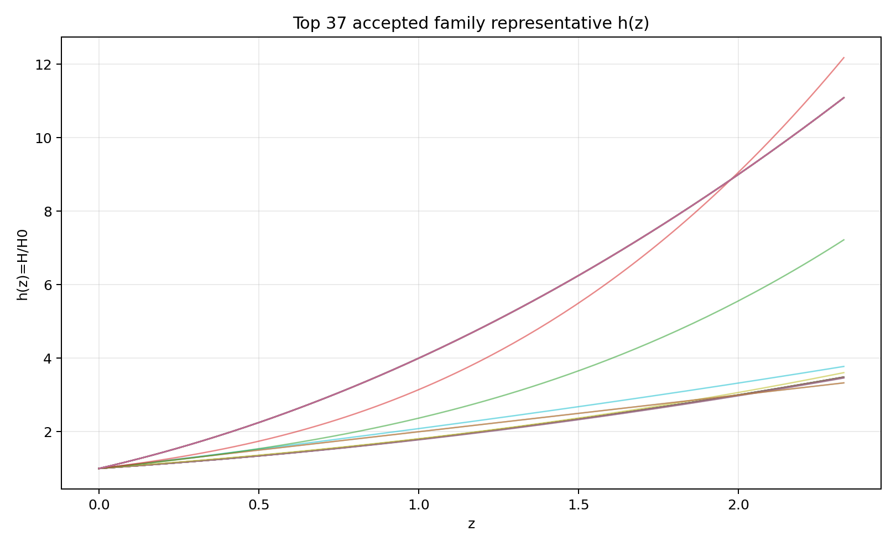
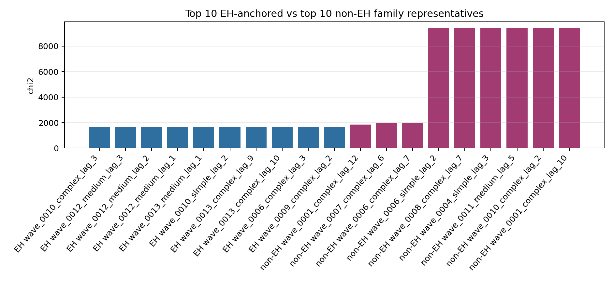
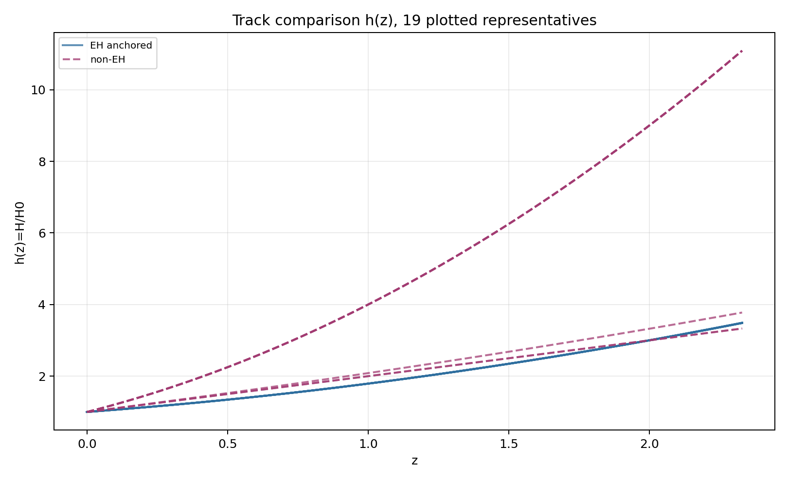
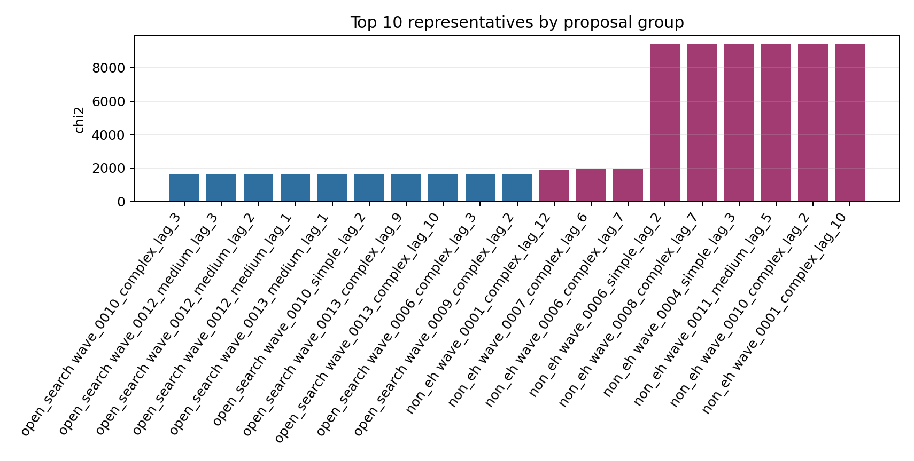
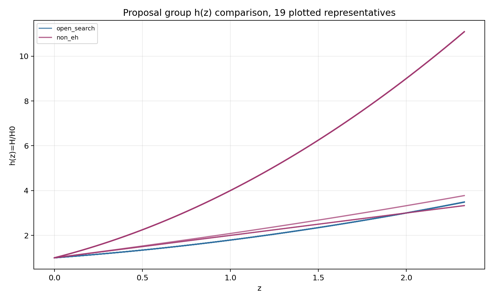
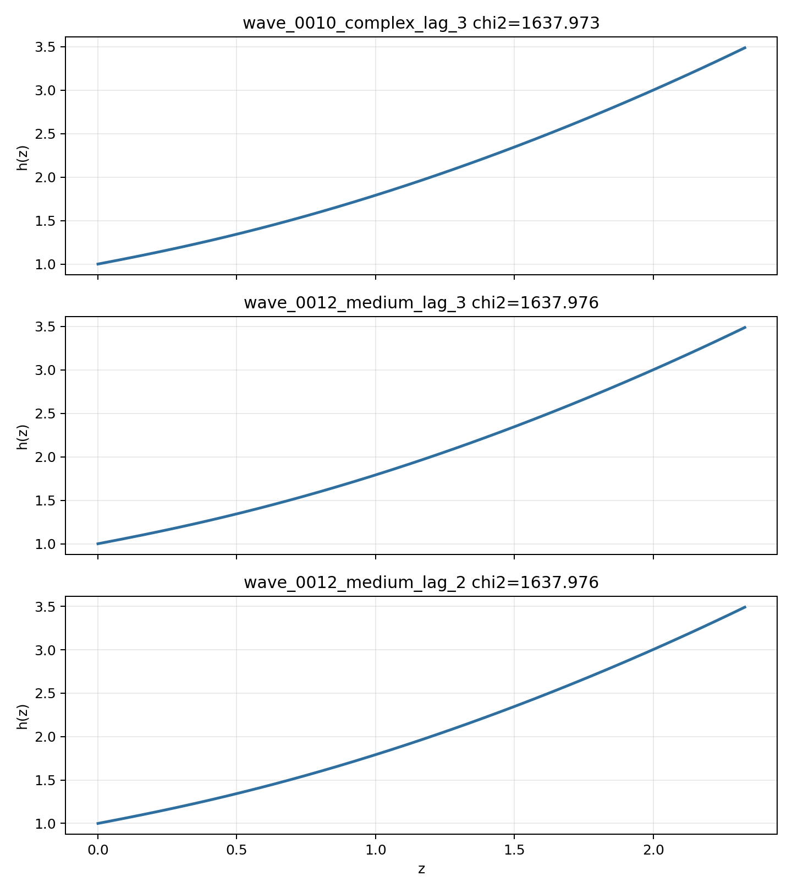

# LangGraph Agent Result Summary: graph_agent_batch_312_sector_v3

This report is generated from current-loop memory and the isolated Solver outputs for accepted attempts.
Human-facing tables and plots use one best representative per theory family; full accepted attempts remain in `accepted_summary.json`.

## Quick Result

| Metric | Value |
|---|---:|
| Total attempts | 312 |
| Accepted attempts | 101 |
| Accepted theory families shown | 37 |
| Best chi2 | 1637.972747 |
| q_not_determined | 66 |
| constraint_drift | 122 |
| q_initial_root_failure | 136 |

## Output Files

- [accepted_lagrangians_and_parameters.md](accepted_lagrangians_and_parameters.md)
- [accepted_lagrangians_full.md](accepted_lagrangians_full.md)
- [accepted_lagrangians_and_parameters.csv](accepted_lagrangians_and_parameters.csv)
- [accepted_summary.json](accepted_summary.json)

## Plots

## Proposal Group Comparison

- [Top open-search representatives](top_open_search.md)
- [Top non-EH representatives](top_non_eh.md)

## Track Comparison

- [Top EH-anchored representatives](top_eh_anchored.md)
- [Top non-EH representatives](top_non_eh.md)

## Top Accepted Family Representatives

| Rank | Group | Track | Family | Loop | chi2 | Status | Max rel. effect | Dominant correction | Sample | H0 | Omega_m0 | lambda_H | Scalar | Potential | Operators |
|---:|---|---|---|---|---:|---|---:|---|---:|---:|---:|---:|---|---|---|
| 1 | open_search | eh_anchored | scalar=both|phi1_potential=axion|phi2_potential=axion|operator_bucket=R_anchor+high_curvature+scalar_curvature | wave_0010_complex_lag_3 | 1637.972747 | weak | 4.204e-05 | φ1 · φ2 · R · R | 772 | 62.907 | 0.2737 | 7.375e+04 | both | {"phi1": "axion", "phi2": "axion"} | R; φ1 · φ2 · R · R |
| 2 | open_search | eh_anchored | scalar=both|phi1_potential=axion|phi2_potential=axion|operator_bucket=R_anchor+scalar_curvature | wave_0012_medium_lag_3 | 1637.975726 | weak | 5.012e-06 | φ1 · R^{bcd}_{a} · R^{a}_{bcd} | 5 | 73.2 | 0.274 | 7.653e+04 | both | {"phi1": "axion", "phi2": "axion"} | R; φ1 · R^{bcd}_{a} · R^{a}_{bcd} |
| 3 | open_search | eh_anchored | scalar=phi1_only|phi1_potential=axion|phi2_potential=None|operator_bucket=R_anchor+scalar_curvature | wave_0012_medium_lag_2 | 1637.975739 | moderate | 0.005 | φ1 · φ1 · R^{bcd}_{a} · R^{a}_{bcd} | 686 | 71.85 | 0.2737 | 7.737e+04 | phi1_only | {"phi1": "axion", "phi2": null} | R; φ1 · φ1 · R^{bcd}_{a} · R^{a}_{bcd} |
| 4 | open_search | eh_anchored | scalar=phi1_only|phi1_potential=axion|phi2_potential=None|operator_bucket=R_anchor+high_curvature | wave_0012_medium_lag_1 | 1637.975876 | weak | 5.012e-06 | R · R^{ab} · R_{ab} | 5 | 73.2 | 0.274 | 7.653e+04 | phi1_only | {"phi1": "axion", "phi2": null} | R; R · R^{ab} · R_{ab} |
| 5 | open_search | eh_anchored | scalar=phi1_only|phi1_potential=axion|phi2_potential=None|operator_bucket=R_anchor+high_curvature+scalar_curvature | wave_0013_medium_lag_1 | 1637.976448 | eh_dominated | 4.872e-23 | φ1 · φ1 · R^{ab} · R_{ab} | 1 | 62.938 | 0.2739 | 6.310e+04 | phi1_only | {"phi1": "axion", "phi2": null} | R; φ1 · φ1 · R^{ab} · R_{ab} |
| 6 | open_search | eh_anchored | scalar=phi1_only|phi1_potential=axion|phi2_potential=None|operator_bucket=R_anchor | wave_0010_simple_lag_2 | 1637.978802 | eh_only | 0 |  | 813 | 61.267 | 0.2738 | 7.048e+04 | phi1_only | {"phi1": "axion", "phi2": null} | R |
| 7 | open_search | eh_anchored | scalar=both|phi1_potential=axion|phi2_potential=axion|operator_bucket=R_anchor+derivative+high_curvature+scalar_curvature | wave_0013_complex_lag_9 | 1637.988491 | moderate | 2.512e-04 | ∇^{a}∇^{b}φ2 · R_{ab} | 1 | 73.505 | 0.2742 | 8.000e+04 | both | {"phi1": "axion", "phi2": "axion"} | R; ∇^{a}∇^{b}φ2 · R_{ab} |
| 8 | open_search | eh_anchored | scalar=both|phi1_potential=axion|phi2_potential=quadratic|operator_bucket=R_anchor+high_curvature+scalar_curvature | wave_0013_complex_lag_10 | 1637.988491 | weak | 9.599e-05 | φ1 · φ2 · R · R | 1 | 73.505 | 0.2742 | 8.000e+04 | both | {"phi1": "axion", "phi2": "quadratic"} | R; φ1 · φ2 · R · R |
| 9 | open_search | eh_anchored | scalar=both|phi1_potential=axion|phi2_potential=quadratic|operator_bucket=R_anchor+scalar_curvature | wave_0006_complex_lag_3 | 1637.988491 | moderate | 0.001 | φ1 · φ1 · R^{bcd}_{a} · R^{a}_{bcd} | 818 | 73.505 | 0.2742 | 9.816e+04 | both | {"phi1": "axion", "phi2": "quadratic"} | R; φ1 · φ1 · R^{bcd}_{a} · R^{a}_{bcd} |
| 10 | open_search | eh_anchored | scalar=phi1_only|phi1_potential=axion|phi2_potential=None|operator_bucket=R_anchor+derivative+high_curvature | wave_0009_complex_lag_2 | 1637.988637 | moderate | 0.008 | ∇^{c}R^{ab} · ∇_{c}R_{ab} | 1 | 73.505 | 0.2742 | 8.000e+04 | phi1_only | {"phi1": "axion", "phi2": null} | R; R^{cd}_{ab} · R^{afh}_{c} · R^{b}_{fdh}; R^{cd}_{ab} · R^{afh}_{c} · R^{b}_{hdf}; ∇^{c}R^{ab} · ∇_{b}R_{ac}; ∇^{c}R^{ab} · ∇_{c}R_{ab} |
| 11 | open_search | eh_anchored | scalar=phi1_only|phi1_potential=axion|phi2_potential=None|operator_bucket=R_anchor+derivative+high_curvature+scalar_curvature | wave_0009_complex_lag_7 | 1637.988637 | moderate | 0.008 | ∇^{a}∇^{b}φ1 · R_{ab} | 1 | 73.505 | 0.2742 | 8.000e+04 | phi1_only | {"phi1": "axion", "phi2": null} | R; R · R · R; ∇^{c}R^{ab} · ∇_{c}R_{ab}; φ1 · R · R; ∇^{a}∇^{b}φ1 · R_{ab}; ∇^{a}φ1 · ∇_{a}φ1 · R; φ1 · ∇^{a}∇^{b}φ1 · R_{ab} |
| 12 | open_search | eh_anchored | scalar=both|phi1_potential=axion|phi2_potential=axion|operator_bucket=R_anchor | wave_0010_medium_lag_6 | 1637.998129 | eh_only | 0 |  | 5 | 73.2 | 0.2744 | 6.972e+04 | both | {"phi1": "axion", "phi2": "axion"} | R |
| 13 | open_search | eh_anchored | scalar=phi1_only|phi1_potential=quadratic|phi2_potential=None|operator_bucket=R_anchor+scalar_curvature | wave_0013_medium_lag_2 | 1638.061431 | moderate | 2.512e-04 | φ1 · R^{bcd}_{a} · R^{a}_{bcd} | 1 | 73.505 | 0.2742 | 8.000e+04 | phi1_only | {"phi1": "quadratic", "phi2": null} | R; φ1 · R^{bcd}_{a} · R^{a}_{bcd} |
| 14 | open_search | eh_anchored | scalar=phi1_only|phi1_potential=quadratic|phi2_potential=None|operator_bucket=R_anchor | wave_0013_simple_lag_1 | 1638.09071 | eh_only | 0 |  | 862 | 73.446 | 0.2707 | 3.429e+04 | phi1_only | {"phi1": "quadratic", "phi2": null} | R |
| 15 | open_search | eh_anchored | scalar=both|phi1_potential=axion|phi2_potential=quadratic|operator_bucket=R_anchor | wave_0009_medium_lag_6 | 1638.090986 | eh_only | 0 |  | 72 | 68.4 | 0.2746 | 5.401e+04 | both | {"phi1": "axion", "phi2": "quadratic"} | R |
| 16 | open_search | eh_anchored | scalar=both|phi1_potential=quadratic|phi2_potential=axion|operator_bucket=R_anchor | wave_0013_medium_lag_3 | 1638.14169 | eh_only | 0 |  | 72 | 68.4 | 0.2746 | 5.401e+04 | both | {"phi1": "quadratic", "phi2": "axion"} | R |
| 17 | open_search | eh_anchored | scalar=both|phi1_potential=axion|phi2_potential=quadratic|operator_bucket=R_anchor+high_curvature | wave_0004_medium_lag_6 | 1638.375377 | eh_dominated | 7.879e-14 | R^{ab} · R_{ab} | 1 | 70.324 | 0.266 | 5.038e+04 | both | {"phi1": "axion", "phi2": "quadratic"} | R; R^{ab} · R_{ab} |
| 18 | open_search | eh_anchored | scalar=phi1_only|phi1_potential=axion|phi2_potential=None|operator_bucket=R_anchor+derivative+scalar_curvature | wave_0005_complex_lag_2 | 1638.375556 | moderate | 1.212e-04 | ∇^{a}φ1 · ∇_{a}φ1 · R | 1 | 70.324 | 0.266 | 5.038e+04 | phi1_only | {"phi1": "axion", "phi2": null} | R; φ1 · R^{bcd}_{a} · R^{a}_{bcd}; ∇^{a}φ1 · ∇_{a}φ1 · R |
| 19 | open_search | eh_anchored | scalar=both|phi1_potential=quadratic|phi2_potential=quadratic|operator_bucket=R_anchor | wave_0003_medium_lag_5 | 1644.687241 | eh_only | 0 |  | 997 | 66.792 | 0.2372 | 3.649e+04 | both | {"phi1": "quadratic", "phi2": "quadratic"} | R |
| 20 | non_eh | non_eh | scalar=both|phi1_potential=axion|phi2_potential=axion|operator_bucket=derivative+high_curvature+scalar_curvature | wave_0001_complex_lag_12 | 1861.637101 | unclear |  |  | 944 | 63.439 | 0.2336 | 2983.235 | both | {"phi1": "axion", "phi2": "axion"} | ∇^{c}R^{ab} · ∇_{c}R_{ab}; φ2 · R^{ab} · R_{ab}; φ2 · R^{bcd}_{a} · R^{a}_{bcd}; ∇^{a}φ1 · ∇_{a}φ1 · φ2; φ2 · φ2 · φ2 · ∇^{a}∇_{a}φ2; φ2 · φ2 · ∇^{a}φ2 · ∇_{a}φ2 |
| 21 | non_eh | non_eh | scalar=phi2_only|phi1_potential=None|phi2_potential=quadratic|operator_bucket=high_curvature+scalar_curvature | wave_0007_complex_lag_6 | 1946.870851 | unclear |  |  | 521 | 69.683 | 0.2538 | 4.874e+04 | phi2_only | {"phi1": null, "phi2": "quadratic"} | R^{bd}_{ac} · R^{agh}_{b} · R^{c}_{dgh}; φ2 · R · R; φ2 · R^{ab} · R_{ab}; φ2 · φ2 · R^{ab} · R_{ab}; φ2 · φ2 · R^{bcd}_{a} · R^{a}_{bcd} |
| 22 | non_eh | non_eh | scalar=phi2_only|phi1_potential=None|phi2_potential=axion|operator_bucket=derivative+high_curvature+scalar_curvature | wave_0006_complex_lag_7 | 1946.870851 | unclear |  |  | 537 | 66.938 | 0.2462 | 5.840e+04 | phi2_only | {"phi1": null, "phi2": "axion"} | φ2 · R^{bcd}_{a} · R^{a}_{bcd}; φ2 · φ2 · R · R; φ2 · φ2 · R^{ab} · R_{ab}; φ2 · φ2 · R^{bcd}_{a} · R^{a}_{bcd}; φ2 · φ2 · ∇^{a}∇_{a}R; ∇^{a}φ2 · ∇_{a}φ2 · R |
| 23 | open_search | eh_anchored | scalar=phi1_only|phi1_potential=quadratic|phi2_potential=None|operator_bucket=R_anchor+high_curvature | wave_0006_medium_lag_3 | 4353.829709 | active | 2.186e+05 | R^{ab} · R_{ab} | 554 | 70.231 | 0.2727 | 5.906e+04 | phi1_only | {"phi1": "quadratic", "phi2": null} | R; R^{ab} · R_{ab}; φ1 · φ1 |
| 24 | open_search | eh_anchored | scalar=both|phi1_potential=quadratic|phi2_potential=axion|operator_bucket=R_anchor+scalar_curvature | wave_0009_complex_lag_1 | 8558.418566 | eh_dominated | 3.288e-25 | φ1 · φ2 · R^{bcd}_{a} · R^{a}_{bcd} | 511 | 61.571 | 0.2389 | 2.200e+04 | both | {"phi1": "quadratic", "phi2": "axion"} | R; φ1 · φ2 · R^{bcd}_{a} · R^{a}_{bcd}; φ1 · φ1 |
| 25 | non_eh | non_eh | scalar=phi2_only|phi1_potential=None|phi2_potential=axion|operator_bucket=scalar_curvature | wave_0006_simple_lag_2 | 9434.003114 | unclear |  |  | 513 | 71.217 | 0.2578 | 3.784e+04 | phi2_only | {"phi1": null, "phi2": "axion"} | φ2 · R |
| 26 | non_eh | non_eh | scalar=phi2_only|phi1_potential=None|phi2_potential=quadratic|operator_bucket=derivative+high_curvature+scalar_curvature | wave_0008_complex_lag_7 | 9434.003123 | unclear |  |  | 777 | 70.532 | 0.2671 | 4.474e+04 | phi2_only | {"phi1": null, "phi2": "quadratic"} | R · R^{ab} · R_{ab}; R · R^{bcd}_{a} · R^{a}_{bcd}; ∇^{a}∇^{b}R · R_{ab}; φ2 · R; φ2 · φ2 · R · R |
| 27 | non_eh | non_eh | scalar=phi2_only|phi1_potential=None|phi2_potential=quadratic|operator_bucket=scalar_curvature | wave_0004_simple_lag_3 | 9434.003397 | unclear |  |  | 855 | 66.05 | 0.2525 | 4.431e+04 | phi2_only | {"phi1": null, "phi2": "quadratic"} | φ2 · R |
| 28 | open_search | eh_anchored | scalar=both|phi1_potential=axion|phi2_potential=quadratic|operator_bucket=R_anchor+derivative+scalar_curvature | wave_0012_complex_lag_8 | 9434.006772 | eh_dominated | 3.495e-10 | φ2 · R | 744 | 68.85 | 0.2815 | 5.084e+04 | both | {"phi1": "axion", "phi2": "quadratic"} | R; ∇^{e}R^{bcd}_{a} · ∇_{e}R^{a}_{bcd}; φ2 · R |
| 29 | non_eh | non_eh | scalar=both|phi1_potential=axion|phi2_potential=quadratic|operator_bucket=scalar_curvature | wave_0011_medium_lag_5 | 9434.006816 | unclear |  |  | 628 | 70.453 | 0.2928 | 7.066e+04 | both | {"phi1": "axion", "phi2": "quadratic"} | φ2 · φ2 · φ2 · R |
| 30 | open_search | eh_anchored | scalar=both|phi1_potential=quadratic|phi2_potential=axion|operator_bucket=R_anchor+high_curvature+scalar_curvature | wave_0010_complex_lag_12 | 9434.006843 | eh_dominated | 2.337e-08 | φ2 · R | 633 | 60.09 | 0.2879 | 7.319e+04 | both | {"phi1": "quadratic", "phi2": "axion"} | R; R^{bcd}_{a} · R^{a}_{bcd}; φ2 · R; φ2 · R^{bcd}_{a} · R^{a}_{bcd}; φ1 · φ2 · R^{ab} · R_{ab} |
| 31 | non_eh | non_eh | scalar=phi2_only|phi1_potential=None|phi2_potential=axion|operator_bucket=high_curvature+scalar_curvature | wave_0010_complex_lag_2 | 9434.0073 | unclear |  |  | 922 | 70.927 | 0.2887 | 6.895e+04 | phi2_only | {"phi1": null, "phi2": "axion"} | R · R · R; R^{b}_{a} · R^{cd} · R^{a}_{cbd}; φ2 · φ2 · R |
| 32 | open_search | eh_anchored | scalar=both|phi1_potential=quadratic|phi2_potential=quadratic|operator_bucket=R_anchor+scalar_curvature | wave_0011_medium_lag_6 | 9434.007449 | eh_dominated | 1.067e-12 | φ2 · φ2 · R | 775 | 68.116 | 0.276 | 2.642e+04 | both | {"phi1": "quadratic", "phi2": "quadratic"} | R; φ2 · φ2 · R |
| 33 | open_search | eh_anchored | scalar=phi2_only|phi1_potential=None|phi2_potential=axion|operator_bucket=R_anchor+high_curvature+scalar_curvature | wave_0011_complex_lag_8 | 9434.007538 | eh_dominated | 7.281e-13 | φ2 · φ2 · R | 597 | 73.962 | 0.2885 | 5.564e+04 | phi2_only | {"phi1": null, "phi2": "axion"} | R; R^{ab} · R_{ab}; R · R · R; φ2 · φ2 · R; φ2 · R^{ab} · R_{ab} |
| 34 | open_search | eh_anchored | scalar=phi2_only|phi1_potential=None|phi2_potential=quadratic|operator_bucket=R_anchor+high_curvature+scalar_curvature | wave_0008_complex_lag_10 | 9434.007587 | active | 3.916e+05 | R^{bcd}_{a} · R^{a}_{bcd} | 636 | 67.313 | 0.2495 | 7.397e+04 | phi2_only | {"phi1": null, "phi2": "quadratic"} | R; R^{bcd}_{a} · R^{a}_{bcd}; R^{ab} · R^{d}_{a} · R_{bd}; φ2 · φ2 · φ2 · φ2 · R; φ2 · φ2 · R^{ab} · R_{ab}; φ2 · φ2 · φ2 |
| 35 | open_search | eh_anchored | scalar=phi2_only|phi1_potential=None|phi2_potential=quadratic|operator_bucket=R_anchor+derivative+high_curvature+scalar_curvature | wave_0012_complex_lag_14 | 9434.007629 | active | 1.273 | R^{ab} · R_{ab} | 83 | 61.267 | 0.2738 | 7.048e+04 | phi2_only | {"phi1": null, "phi2": "quadratic"} | R; R^{ab} · R_{ab}; R · R · R; ∇^{a}∇^{b}R · R_{ab}; φ2 · φ2 · φ2 · φ2 · R; φ2 · φ2 · R^{ab} · R_{ab} |
| 36 | open_search | eh_anchored | scalar=both|phi1_potential=axion|phi2_potential=quadratic|operator_bucket=R_anchor+derivative+high_curvature+scalar_curvature | wave_0002_complex_lag_11 | 9434.007711 | active | 3.137e+05 | φ1 · R^{ab} · R_{ab} | 9 | 66.904 | 0.2364 | 3.535e+04 | both | {"phi1": "axion", "phi2": "quadratic"} | R; R^{cd}_{ab} · R^{afh}_{c} · R^{b}_{fdh}; R_{ab} · R^{adef} · R^{b}_{def}; φ1 · R^{ab} · R_{ab}; φ2 · φ2 · φ2 · φ2 · R; φ2 · φ2 · R · R; φ1 · φ2 · φ2; ∇^{a}φ2 · ∇_{a}φ2 |
| 37 | non_eh | non_eh | scalar=phi2_only|phi1_potential=None|phi2_potential=axion|operator_bucket=derivative+scalar_curvature | wave_0001_complex_lag_10 | 9434.007718 | unclear |  |  | 33 | 73.2 | 0.283 | 1.354e+04 | phi2_only | {"phi1": null, "phi2": "axion"} | ∇^{a}R · ∇_{a}R; φ2 · R; φ2 · ∇^{a}∇_{a}R; φ2 · φ2 · φ2 · φ2 · R; φ2 · φ2 · φ2 |

## Top Family Representative Parameter Choices

| Rank | Loop | varphi1_0 | q1_0 | mu1 | fbar1 | varphi2_0 | q2_0 | mu2 | fbar2 | Free coefficients |
|---:|---|---:|---:|---:|---:|---:|---:|---:|---:|---|
| 1 | wave_0010_complex_lag_3 | 1.9652 | -0.6302 | 1.0128 | 32.8201 | 1.0988e-05 | 1.5389e-05 | 6.8883e-06 | 1 | \alpha=0.5, \beta=2.8799e+19 |
| 2 | wave_0012_medium_lag_3 | 1.9657 | -0.6297 | 1.0124 | 35.5913 | 2.7680e-06 | 2.9232e-05 | 3.1959e-06 | 1.0007 | \alpha=0.5, \beta=-5.7139e+08 |
| 3 | wave_0012_medium_lag_2 | 1.9659 | -0.6308 | 1.0125 | 30.8408 | 0 | 0 | 0 | 1 | \alpha=0.5, \beta=-2.2034e+16 |
| 4 | wave_0012_medium_lag_1 | 1.9657 | -0.6297 | 1.0124 | 35.5913 | 0 | 0 | 0 | 1 | \alpha=0.5, \beta=-8.5955e+13 |
| 5 | wave_0013_medium_lag_1 | 1.9651 | -0.6298 | 1.0128 | 37.4454 | 0 | 0 | 0 | 1 | \alpha=0.5, \beta=-1.0000e-04 |
| 6 | wave_0010_simple_lag_2 | 1.9654 | -0.6307 | 1.0125 | 45.9166 | 0 | 0 | 0 | 1 | \alpha=0.5 |
| 7 | wave_0013_complex_lag_9 | 1.966 | -0.6284 | 1.0124 | 29.0484 | 1.0000e-05 | 1.0000e-05 | 1.0000e-05 | 1 | \alpha=0.5, \beta=-6.4304e+15 |
| 8 | wave_0013_complex_lag_10 | 1.966 | -0.6284 | 1.0124 | 29.0484 | 1.0000e-05 | 1.0000e-05 | 1.0000e-05 | 1 | \alpha=0.5, \beta=-1.0000e+20 |
| 9 | wave_0006_complex_lag_3 | 1.966 | -0.6284 | 1.0124 | 29.0484 | 7.9629e-06 | 1.0409e-05 | 4.6202e-06 | 0.9994 | \alpha=0.5, \beta=1.5126e+16 |
| 10 | wave_0009_complex_lag_2 | 1.966 | -0.6284 | 1.0124 | 29.0484 | 0 | 0 | 0 | 1 | \alpha=0.5, \beta=-5.1443e+15, \gamma=8.1532e+16, \delta=-2.5783e+15, \epsilon=1.6268e+17 |
| 11 | wave_0009_complex_lag_7 | 1.966 | -0.6284 | 1.0124 | 29.0484 | 0 | 0 | 0 | 1 | \alpha=0.5, \beta=-5.1443e+15, \gamma=8.1532e+16, \delta=-1.6393e+10, \epsilon=1.0343e+12, \zeta=-2.6557e+15, \eta=1.0572e+16 |
| 12 | wave_0010_medium_lag_6 | 1.9655 | -0.6282 | 1.0125 | 42.3376 | 3.5481e-06 | 2.8184e-05 | 7.0795e-06 | 1.0007 | \alpha=0.5 |
| 13 | wave_0013_medium_lag_2 | 1.966 | -0.6272 | 1.0124 | 29.0484 | 0 | 0 | 0 | 1 | \alpha=0.5, \beta=-3.2709e+10 |
| 14 | wave_0013_simple_lag_1 | 1.9679 | -0.6325 | 1.0132 | 33.147 | 0 | 0 | 0 | 1 | \alpha=0.5 |
| 15 | wave_0009_medium_lag_6 | 1.965 | -0.6263 | 1.0128 | 46.5186 | 1.0000e-05 | 1.0000e-05 | 1.0000e-05 | 1 | \alpha=0.5 |
| 16 | wave_0013_medium_lag_3 | 1.965 | -0.6259 | 1.0128 | 46.5186 | 1.0000e-05 | 1.0000e-05 | 1.0000e-05 | 1 | \alpha=0.5 |
| 17 | wave_0004_medium_lag_6 | 1.976 | -0.6372 | 1.0121 | 35.1974 | 1.0000e-05 | 1.0000e-05 | 1.0000e-05 | 1 | \alpha=0.5, \beta=-1.0000e-04 |
| 18 | wave_0005_complex_lag_2 | 1.976 | -0.6372 | 1.0121 | 35.1974 | 0 | 0 | 0 | 1 | \alpha=0.5, \beta=-1.0000e-04, \gamma=1.0000e+14 |
| 19 | wave_0003_medium_lag_5 | 1.5629 | -0.8317 | 1.2612 | 34.0148 | 0.1462 | -0.0015 | 0.0052 | 1.0000e+05 | \alpha=0.5 |
| 20 | wave_0001_complex_lag_12 | 0.1022 | 2.4695e-04 | 0.3956 | 50.4636 | -13.041 | 0.4103 | 0.0013 | 3.0134e+04 | \alpha=8.5234e+10, \beta=-2.4083e+05, \gamma=-6.4725e+05, \delta=-4.3198e+05, \epsilon=-3.2071e+09, \zeta=4.7083e-05 |
| 21 | wave_0007_complex_lag_6 | 0 | 0 | 0 | 1 | 1.9081e-05 | -3.5404e-05 | 1.3283e-05 | 0.8475 | \alpha=1.2146e+13, \beta=1.0422e+18, \gamma=1.8386e+07, \delta=6.5917e+05, \epsilon=1.1157e+17 |
| 22 | wave_0006_complex_lag_7 | 0 | 0 | 0 | 1 | 1.4920e-05 | -3.7095e-04 | 1.0000e-05 | 0.9685 | \alpha=11.4502, \beta=-6.1005e+11, \gamma=4.1689e-05, \delta=1.8963e+16, \epsilon=-4.7547e+14, \zeta=2.2288e+16 |
| 23 | wave_0006_medium_lag_3 | 1.6407 | -0.9913 | 0.6759 | 31.2035 | 0 | 0 | 0 | 1 | \alpha=0.5, \beta=3.8131e+14, \gamma=-1.1454e-10 |
| 24 | wave_0009_complex_lag_1 | 2.0616 | -1.1769 | 1.0112 | 50.6734 | 5.7376e-06 | 3.2951e-05 | 6.7124e-06 | 1 | \alpha=0.5, \beta=0.0033, \gamma=2.8304e-10 |
| 25 | wave_0006_simple_lag_2 | 0 | 0 | 0 | 1 | 1.3164e-05 | -0.765 | 1.5808e-05 | 0.8629 | \alpha=-0.1685 |
| 26 | wave_0008_complex_lag_7 | 0 | 0 | 0 | 1 | 1.1794e-05 | -7.9971 | 1.0000e-05 | 0.9369 | \alpha=1.5596e-07, \beta=-1.1664e-06, \gamma=-2.3764e+17, \delta=-0.0167, \epsilon=-1.7414e+14 |
| 27 | wave_0004_simple_lag_3 | 0 | 0 | 0 | 1 | 0.1203 | 11.2619 | 0.0074 | 7.2777e+04 | \alpha=0.0111 |
| 28 | wave_0012_complex_lag_8 | 1.3145 | -1.905 | 0.6282 | 50.9425 | -1.0000e-05 | 1.4864e-05 | 1.3474e-05 | 0.8659 | \alpha=0.5, \beta=-2.2257e-10, \gamma=-0.8882 |
| 29 | wave_0011_medium_lag_5 | 2.029 | -0.5081 | 1.0146 | 35.2928 | 9.6093e-06 | 5.1000e-06 | 6.6551e-06 | 0.9997 | \alpha=2.2650e+14 |
| 30 | wave_0010_complex_lag_12 | 1.9652 | -0.5079 | 1.0124 | 30.4985 | 5.5960e-06 | 2.4927e-05 | 2.2586e-05 | 0.999 | \alpha=0.5, \beta=3.6476e-09, \gamma=-152.799, \delta=-6.5884e+08, \epsilon=1.6615e+09 |
| 31 | wave_0010_complex_lag_2 | 0 | 0 | 0 | 1 | 9.4886e-06 | -1.2956e-04 | 6.2279e-06 | 0.9996 | \alpha=-1.1241e+05, \beta=-2.1077e+19, \gamma=-6.0942e+07 |
| 32 | wave_0011_medium_lag_6 | 1.9211 | -0.7453 | 1.0146 | 27.697 | 1.3760e-05 | 8.9614e-06 | 3.6018e-06 | 1.0002 | \alpha=0.5, \beta=1.9671e+06 |
| 33 | wave_0011_complex_lag_8 | 0 | 0 | 0 | 1 | 1.0589e-05 | -0.0017 | 1.6627e-05 | 0.9558 | \alpha=0.5, \beta=-4.6728e-09, \gamma=-6.5072, \delta=1.0053e+07, \epsilon=-4.0400e-07 |
| 34 | wave_0008_complex_lag_10 | 0 | 0 | 0 | 1 | 1.0000e-05 | -0.1122 | 1.2351e-05 | 1.4939 | \alpha=0.5, \beta=-1.0714e+15, \gamma=1.7950e+09, \delta=8.3620e+14, \epsilon=1.1657e-06, \zeta=3.4829e+09 |
| 35 | wave_0012_complex_lag_14 | 0 | 0 | 0 | 1 | 1.0000e-05 | -0.9077 | 1.0000e-05 | 1 | \alpha=0.5, \beta=-3.1623e+09, \gamma=1.0000e+05, \delta=-1.0000e-04, \epsilon=1.0000e+14, \zeta=-3.1623e-09 |
| 36 | wave_0002_complex_lag_11 | 2.1912 | -0.4404 | 0.9566 | 34.0563 | -0.1012 | -0.0024 | 0.0042 | 9.5768e+04 | \alpha=0.5, \beta=-1.0000e+14, \gamma=3.1623e-09, \delta=-3.1623e+18, \epsilon=3.1623, \zeta=-3.1623e+09, \eta=1.0000e+05, \theta=-1.0000e-04 |
| 37 | wave_0001_complex_lag_10 | 0 | 0 | 0 | 1 | -3.1623e-05 | -0.0447 | 0.0316 | 31.6228 | \alpha=3.1623e+18, \beta=-3.1623, \gamma=3.1623e+09, \delta=-1.0000e+05, \epsilon=1.0000e-04 |

## Main Failure Tags

| Tag | Count |
|---|---:|
| no_accepted_samples | 261 |
| q_initial_root_failure | 136 |
| constraint_drift | 122 |
| h_absurdly_large | 75 |
| q_not_determined | 66 |
| integration_failure | 27 |
| symbolic_timeout | 26 |
| no_scalar_constraint | 15 |
