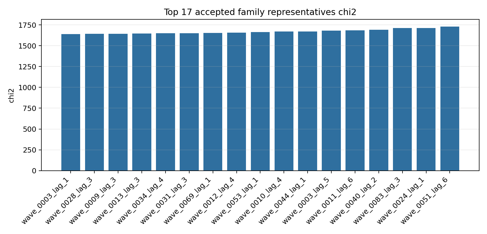
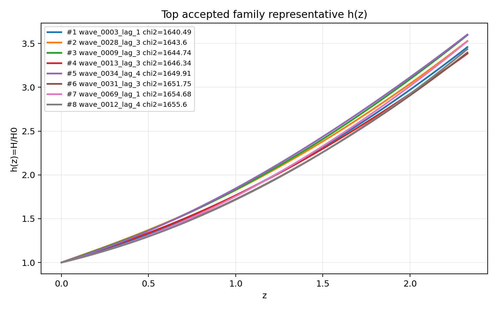
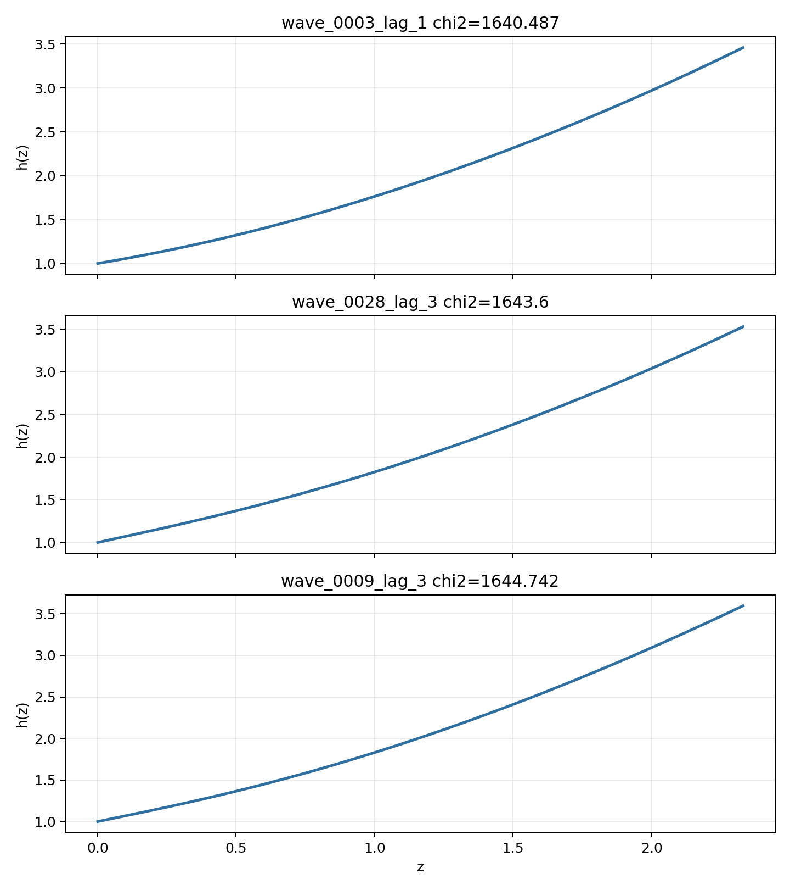

# LangGraph Agent Result Summary: graph_agent_batch_4000_llm_v2

This report is generated from current-loop memory and the isolated Solver outputs for accepted attempts.
Human-facing tables and plots use one best representative per theory family; full accepted attempts remain in `accepted_summary.json`.

## Quick Result

| Metric | Value |
|---|---:|
| Total attempts | 704 |
| Accepted attempts | 0 |
| Accepted theory families shown | 17 |
| Best chi2 |  |
| q_not_determined | 0 |
| constraint_drift | 0 |
| q_initial_root_failure | 0 |

## Output Files

- [accepted_lagrangians_and_parameters.md](accepted_lagrangians_and_parameters.md)
- [accepted_lagrangians_full.md](accepted_lagrangians_full.md)
- [accepted_lagrangians_and_parameters.csv](accepted_lagrangians_and_parameters.csv)
- [accepted_summary.json](accepted_summary.json)

## Plots

## Top Accepted Family Representatives

| Rank | Family | Loop | chi2 | Status | Max rel. effect | Dominant correction | Sample | H0 | Omega_m0 | lambda_H | Scalar | Potential | Operators |
|---:|---|---|---:|---|---:|---|---:|---:|---:|---:|---|---|---|
| 1 | scalar=phi1_only|phi1_potential=quadratic|phi2_potential=None|operator_bucket=R_anchor+derivative+scalar_curvature | wave_0003_lag_1 | 1640.486961 | unclear |  |  |  |  |  |  | phi1_only | {"phi1": "quadratic", "phi2": null} | R; ∇^{a}φ1 · ∇_{a}φ1 · R |
| 2 | scalar=phi1_only|phi1_potential=axion|phi2_potential=None|operator_bucket=R_anchor+high_curvature | wave_0028_lag_3 | 1643.599994 | unclear |  |  |  |  |  |  | phi1_only | {"phi1": "axion", "phi2": null} | R; R^{ab} · R_{ab} |
| 3 | scalar=phi1_only|phi1_potential=quadratic|phi2_potential=None|operator_bucket=R_anchor+high_curvature+scalar_curvature | wave_0009_lag_3 | 1644.742241 | unclear |  |  |  |  |  |  | phi1_only | {"phi1": "quadratic", "phi2": null} | R; R · R; φ1 · R · R |
| 4 | scalar=phi1_only|phi1_potential=quadratic|phi2_potential=None|operator_bucket=R_anchor+high_curvature | wave_0013_lag_3 | 1646.339806 | unclear |  |  |  |  |  |  | phi1_only | {"phi1": "quadratic", "phi2": null} | R; R · R; R^{ab} · R_{ab} |
| 5 | scalar=phi1_only|phi1_potential=axion|phi2_potential=None|operator_bucket=R_anchor+derivative | wave_0034_lag_4 | 1649.908553 | unclear |  |  |  |  |  |  | phi1_only | {"phi1": "axion", "phi2": null} | R; R^{bcd}_{a} · R^{a}_{bcd}; R^{cd}_{ab} · R^{afh}_{c} · R^{b}_{fdh}; ∇^{a}∇_{a}φ1 |
| 6 | scalar=phi1_only|phi1_potential=quadratic|phi2_potential=None|operator_bucket=R_anchor+derivative | wave_0031_lag_3 | 1651.746943 | unclear |  |  |  |  |  |  | phi1_only | {"phi1": "quadratic", "phi2": null} | R; ∇^{a}R · ∇_{a}R; ∇^{a}∇_{a}φ1 |
| 7 | scalar=phi1_only|phi1_potential=quadratic|phi2_potential=None|operator_bucket=R_anchor | wave_0069_lag_1 | 1654.676501 | unclear |  |  |  |  |  |  | phi1_only | {"phi1": "quadratic", "phi2": null} | R; R^{cd}_{ab} · R^{afh}_{c} · R^{b}_{fdh} |
| 8 | scalar=phi1_only|phi1_potential=axion|phi2_potential=None|operator_bucket=R_anchor+derivative+scalar_curvature | wave_0012_lag_4 | 1655.604545 | unclear |  |  |  |  |  |  | phi1_only | {"phi1": "axion", "phi2": null} | R; φ1 · R^{bcd}_{a} · R^{a}_{bcd}; φ1 · φ1 · R^{bcd}_{a} · R^{a}_{bcd}; φ1 · φ1 · ∇^{a}∇_{a}R |
| 9 | scalar=phi1_only|phi1_potential=axion|phi2_potential=None|operator_bucket=R_anchor | wave_0053_lag_1 | 1664.49201 | unclear |  |  |  |  |  |  | phi1_only | {"phi1": "axion", "phi2": null} | R; R^{cd}_{ab} · R^{afh}_{c} · R^{b}_{hdf} |
| 10 | scalar=phi1_only|phi1_potential=axion|phi2_potential=None|operator_bucket=R_anchor+high_curvature+scalar_curvature | wave_0010_lag_4 | 1670.029873 | unclear |  |  |  |  |  |  | phi1_only | {"phi1": "axion", "phi2": null} | R; φ1 · φ1 · R · R; φ1 · φ1 · R^{bcd}_{a} · R^{a}_{bcd} |
| 11 | scalar=phi1_only|phi1_potential=axion|phi2_potential=None|operator_bucket=R_anchor+scalar_curvature | wave_0044_lag_1 | 1671.846552 | unclear |  |  |  |  |  |  | phi1_only | {"phi1": "axion", "phi2": null} | R; φ1 · φ1 · R^{bcd}_{a} · R^{a}_{bcd} |
| 12 | scalar=phi1_only|phi1_potential=quadratic|phi2_potential=None|operator_bucket=R_anchor+derivative+high_curvature+scalar_curvature | wave_0003_lag_5 | 1681.728595 | unclear |  |  |  |  |  |  | phi1_only | {"phi1": "quadratic", "phi2": null} | R; R^{ab} · R_{ab}; R^{bcd}_{a} · R^{a}_{bcd}; ∇^{a}φ1 · ∇_{a}R; φ1 · ∇^{a}∇_{a}φ1 · R; ∇^{a}∇_{a}φ1 |
| 13 | scalar=phi1_only|phi1_potential=axion|phi2_potential=None|operator_bucket=R_anchor+derivative+high_curvature+scalar_curvature | wave_0011_lag_6 | 1685.921976 | unclear |  |  |  |  |  |  | phi1_only | {"phi1": "axion", "phi2": null} | R; R · R · R; ∇^{a}∇_{a}φ1 · R; ∇^{a}∇^{b}φ1 · R_{ab}; φ1 · ∇^{a}∇_{a}φ1 · R |
| 14 | scalar=phi1_only|phi1_potential=quadratic|phi2_potential=None|operator_bucket=R_anchor+derivative+high_curvature | wave_0040_lag_2 | 1691.807219 | unclear |  |  |  |  |  |  | phi1_only | {"phi1": "quadratic", "phi2": null} | R; R · R; ∇^{a}R · ∇_{a}R |
| 15 | scalar=both|phi1_potential=axion|phi2_potential=quadratic|operator_bucket=R_anchor+derivative | wave_0083_lag_3 | 1713.438612 | unclear |  |  |  |  |  |  | both | {"phi1": "axion", "phi2": "quadratic"} | R; ∇^{a}∇_{a}φ1 |
| 16 | scalar=phi1_only|phi1_potential=quadratic|phi2_potential=None|operator_bucket=R_anchor+scalar_curvature | wave_0024_lag_1 | 1714.208637 | unclear |  |  |  |  |  |  | phi1_only | {"phi1": "quadratic", "phi2": null} | R; φ1 · φ1 · R^{bcd}_{a} · R^{a}_{bcd} |
| 17 | scalar=both|phi1_potential=quadratic|phi2_potential=quadratic|operator_bucket=R_anchor+derivative+high_curvature+scalar_curvature | wave_0051_lag_6 | 1729.649158 | unclear |  |  |  |  |  |  | both | {"phi1": "quadratic", "phi2": "quadratic"} | R; ∇^{a}R · ∇_{a}R; φ1 · R^{bcd}_{a} · R^{a}_{bcd}; ∇^{a}∇^{b}φ1 · R_{ab}; φ1 · φ1 · R^{bcd}_{a} · R^{a}_{bcd}; φ1 · φ2 · R^{ab} · R_{ab}; ∇^{a}φ2 · ∇_{a}φ2 · R; ∇^{a}φ1 · ∇^{b}φ1 · R_{ab} |

## Top Family Representative Parameter Choices

| Rank | Loop | varphi1_0 | q1_0 | mu1 | fbar1 | varphi2_0 | q2_0 | mu2 | fbar2 | Free coefficients |
|---:|---|---:|---:|---:|---:|---:|---:|---:|---:|---|
| 1 | wave_0003_lag_1 |  |  |  |  |  |  |  |  |  |
| 2 | wave_0028_lag_3 |  |  |  |  |  |  |  |  |  |
| 3 | wave_0009_lag_3 |  |  |  |  |  |  |  |  |  |
| 4 | wave_0013_lag_3 |  |  |  |  |  |  |  |  |  |
| 5 | wave_0034_lag_4 |  |  |  |  |  |  |  |  |  |
| 6 | wave_0031_lag_3 |  |  |  |  |  |  |  |  |  |
| 7 | wave_0069_lag_1 |  |  |  |  |  |  |  |  |  |
| 8 | wave_0012_lag_4 |  |  |  |  |  |  |  |  |  |
| 9 | wave_0053_lag_1 |  |  |  |  |  |  |  |  |  |
| 10 | wave_0010_lag_4 |  |  |  |  |  |  |  |  |  |
| 11 | wave_0044_lag_1 |  |  |  |  |  |  |  |  |  |
| 12 | wave_0003_lag_5 |  |  |  |  |  |  |  |  |  |
| 13 | wave_0011_lag_6 |  |  |  |  |  |  |  |  |  |
| 14 | wave_0040_lag_2 |  |  |  |  |  |  |  |  |  |
| 15 | wave_0083_lag_3 |  |  |  |  |  |  |  |  |  |
| 16 | wave_0024_lag_1 |  |  |  |  |  |  |  |  |  |
| 17 | wave_0051_lag_6 |  |  |  |  |  |  |  |  |  |

## Main Failure Tags

| Tag | Count |
|---|---:|
| no_accepted_samples | 304 |
| symbolic_timeout | 120 |
