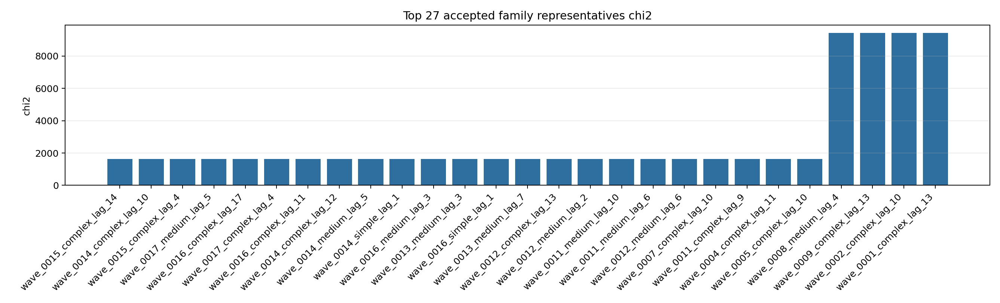
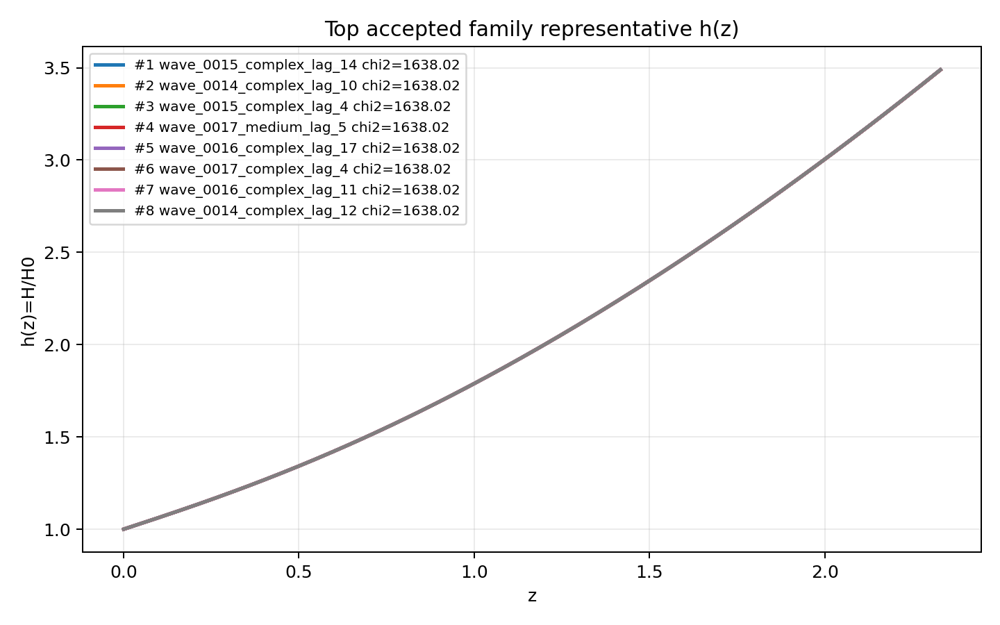
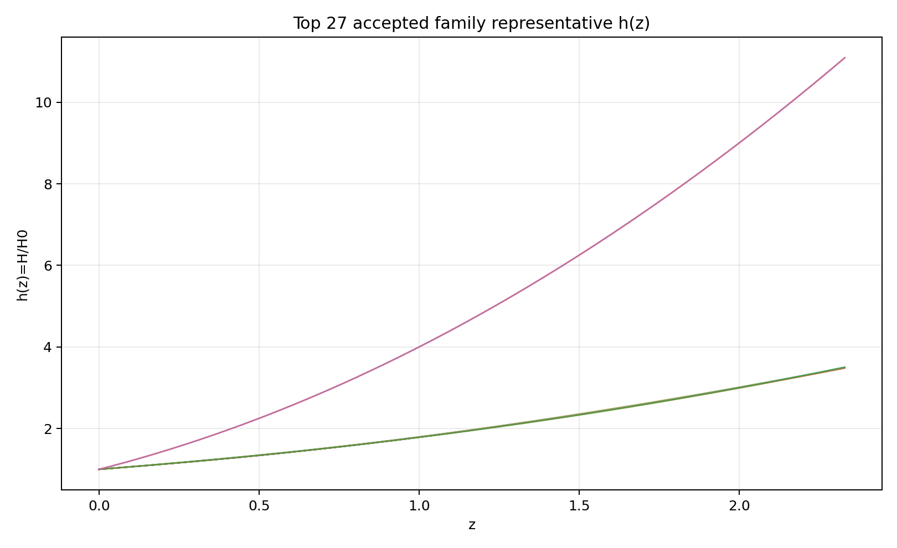
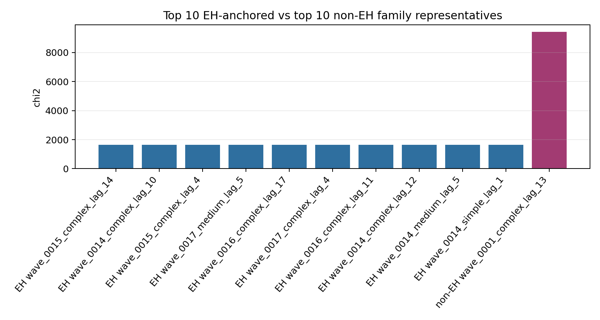
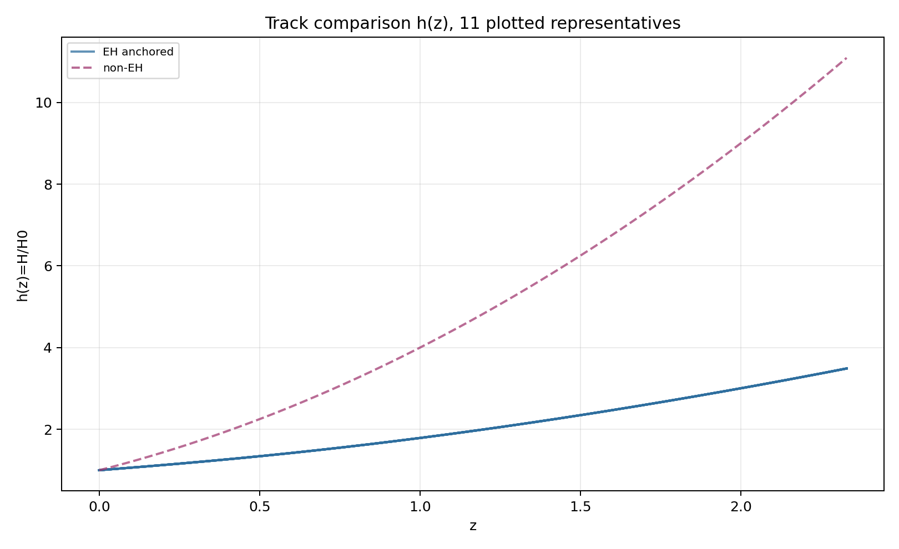
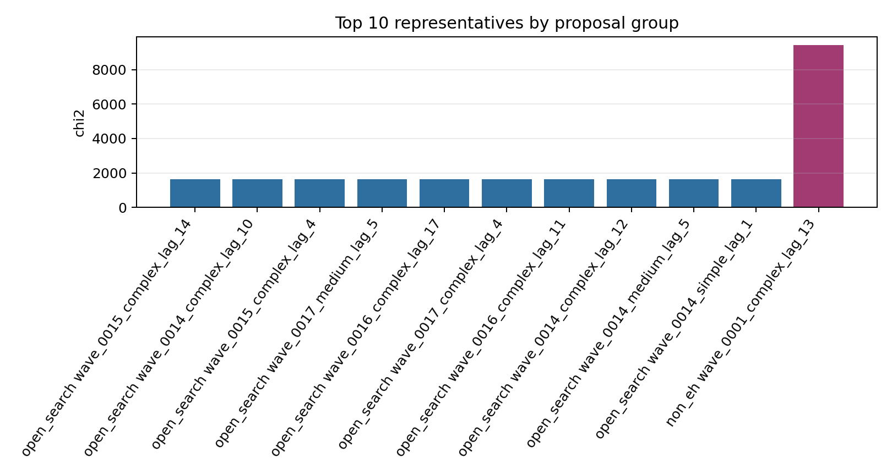
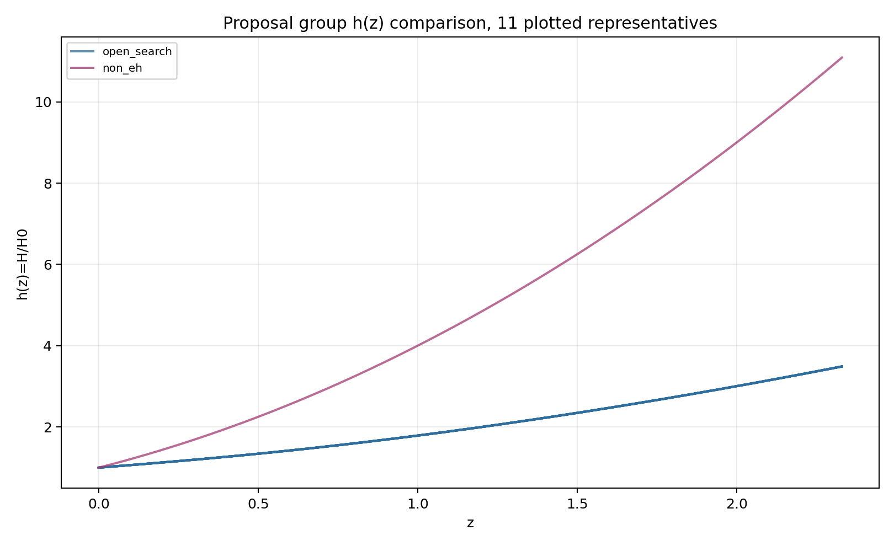
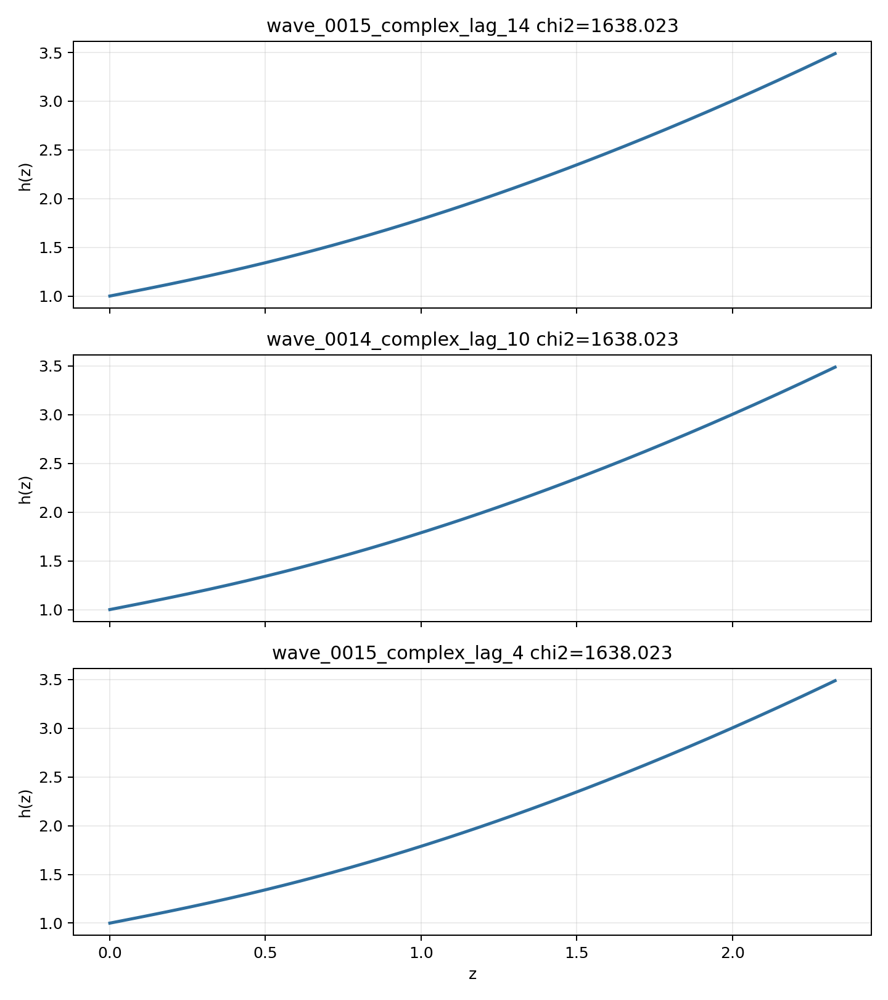

# LangGraph Agent Result Summary: graph_agent_batch_480_sector_v2

This report is generated from current-loop memory and the isolated Solver outputs for accepted attempts.
Human-facing tables and plots use one best representative per theory family; full accepted attempts remain in `accepted_summary.json`.

## Quick Result

| Metric | Value |
|---|---:|
| Total attempts | 398 |
| Accepted attempts | 101 |
| Accepted theory families shown | 27 |
| Best chi2 | 1638.022712 |
| q_not_determined | 20 |
| constraint_drift | 42 |
| q_initial_root_failure | 134 |

## Output Files

- [accepted_lagrangians_and_parameters.md](accepted_lagrangians_and_parameters.md)
- [accepted_lagrangians_full.md](accepted_lagrangians_full.md)
- [accepted_lagrangians_and_parameters.csv](accepted_lagrangians_and_parameters.csv)
- [accepted_summary.json](accepted_summary.json)

## Plots

## Proposal Group Comparison

- [Top open-search representatives](top_open_search.md)
- [Top non-EH representatives](top_non_eh.md)

## Track Comparison

- [Top EH-anchored representatives](top_eh_anchored.md)
- [Top non-EH representatives](top_non_eh.md)

## Top Accepted Family Representatives

| Rank | Group | Track | Family | Loop | chi2 | Status | Max rel. effect | Dominant correction | Sample | H0 | Omega_m0 | lambda_H | Scalar | Potential | Operators |
|---:|---|---|---|---|---:|---|---:|---|---:|---:|---:|---:|---|---|---|
| 1 | open_search | eh_anchored | scalar=both|phi1_potential=axion|phi2_potential=axion|operator_bucket=R_anchor+derivative+scalar_curvature | wave_0015_complex_lag_14 | 1638.022712 | active | 3.136e+06 | ∇^{a}φ1 · ∇_{a}R | 81 | 67.39 | 0.3004 | 1.512e+04 | both | {"phi1": "axion", "phi2": "axion"} | R; ∇^{a}φ1 · ∇_{a}R; φ1 · φ2 · ∇^{a}∇_{a}φ2; φ1 · ∇^{a}φ2 · ∇_{a}φ2; φ1 · φ2 · φ2 · φ2 · φ2 · φ2 |
| 2 | open_search | eh_anchored | scalar=both|phi1_potential=axion|phi2_potential=axion|operator_bucket=R_anchor+high_curvature+scalar_curvature | wave_0014_complex_lag_10 | 1638.022723 | moderate | 8.710e-04 | R^{ab} · R_{ab} | 771 | 67.39 | 0.3004 | 1.512e+04 | both | {"phi1": "axion", "phi2": "axion"} | R; R^{ab} · R_{ab}; φ2 · φ2 · R^{bcd}_{a} · R^{a}_{bcd} |
| 3 | open_search | eh_anchored | scalar=both|phi1_potential=axion|phi2_potential=quadratic|operator_bucket=R_anchor+scalar_curvature | wave_0015_complex_lag_4 | 1638.022723 | eh_dominated | 1.063e-23 | φ2 · φ2 · R^{bcd}_{a} · R^{a}_{bcd} | 1 | 67.39 | 0.3004 | 1.512e+04 | both | {"phi1": "axion", "phi2": "quadratic"} | R; φ2 · φ2 · R^{bcd}_{a} · R^{a}_{bcd} |
| 4 | open_search | eh_anchored | scalar=both|phi1_potential=axion|phi2_potential=quadratic|operator_bucket=R_anchor+derivative+scalar_curvature | wave_0017_medium_lag_5 | 1638.022723 | eh_dominated | 9.917e-17 | φ1 · ∇^{a}∇_{a}R | 1 | 67.39 | 0.3004 | 1.512e+04 | both | {"phi1": "axion", "phi2": "quadratic"} | R; φ1 · ∇^{a}∇_{a}R |
| 5 | open_search | eh_anchored | scalar=both|phi1_potential=axion|phi2_potential=quadratic|operator_bucket=R_anchor+derivative+high_curvature | wave_0016_complex_lag_17 | 1638.022726 | active | 2.767e+10 | ∇^{a}∇_{a}R | 3 | 67.39 | 0.3004 | 1.512e+04 | both | {"phi1": "axion", "phi2": "quadratic"} | R; R · R; ∇^{a}∇_{a}R; φ1 · φ2; φ1 · ∇^{a}φ2 · ∇_{a}φ2 |
| 6 | open_search | eh_anchored | scalar=both|phi1_potential=axion|phi2_potential=axion|operator_bucket=R_anchor+derivative | wave_0017_complex_lag_4 | 1638.022744 | eh_only | 0 |  | 1 | 67.39 | 0.3004 | 1.512e+04 | both | {"phi1": "axion", "phi2": "axion"} | R; φ1 · ∇^{a}φ2 · ∇_{a}φ2 |
| 7 | open_search | eh_anchored | scalar=both|phi1_potential=quadratic|phi2_potential=quadratic|operator_bucket=R_anchor+scalar_curvature | wave_0016_complex_lag_11 | 1638.024668 | weak | 9.968e-06 | φ2 · φ2 · R^{bcd}_{a} · R^{a}_{bcd} | 2 | 73.2 | 0.3005 | 1.527e+04 | both | {"phi1": "quadratic", "phi2": "quadratic"} | R; φ2 · φ2 · R^{bcd}_{a} · R^{a}_{bcd}; φ2 · φ2 |
| 8 | open_search | eh_anchored | scalar=both|phi1_potential=quadratic|phi2_potential=axion|operator_bucket=R_anchor+derivative+scalar_curvature | wave_0014_complex_lag_12 | 1638.024668 | weak | 1.995e-05 | φ1 · φ1 · R^{bcd}_{a} · R^{a}_{bcd} | 5 | 73.2 | 0.3005 | 1.527e+04 | both | {"phi1": "quadratic", "phi2": "axion"} | R; φ1 · ∇^{a}∇_{a}R; φ1 · φ1 · R^{bcd}_{a} · R^{a}_{bcd} |
| 9 | open_search | eh_anchored | scalar=both|phi1_potential=quadratic|phi2_potential=quadratic|operator_bucket=R_anchor+derivative+scalar_curvature | wave_0014_medium_lag_5 | 1638.024668 | weak | 5.012e-06 | ∇^{a}φ1 · ∇_{a}R | 5 | 73.2 | 0.3005 | 1.527e+04 | both | {"phi1": "quadratic", "phi2": "quadratic"} | R; ∇^{a}φ1 · ∇_{a}R |
| 10 | open_search | eh_anchored | scalar=phi1_only|phi1_potential=axion|phi2_potential=None|operator_bucket=R_anchor | wave_0014_simple_lag_1 | 1638.026707 | eh_only | 0 |  | 763 | 65.029 | 0.3008 | 1.541e+04 | phi1_only | {"phi1": "axion", "phi2": null} | R |
| 11 | open_search | eh_anchored | scalar=both|phi1_potential=axion|phi2_potential=quadratic|operator_bucket=R_anchor | wave_0016_medium_lag_3 | 1638.033311 | eh_only | 0 |  | 7 | 68.4 | 0.3005 | 1.515e+04 | both | {"phi1": "axion", "phi2": "quadratic"} | R |
| 12 | open_search | eh_anchored | scalar=both|phi1_potential=quadratic|phi2_potential=quadratic|operator_bucket=R_anchor | wave_0013_medium_lag_3 | 1638.038602 | eh_only | 0 |  | 589 | 61.211 | 0.3003 | 1.687e+04 | both | {"phi1": "quadratic", "phi2": "quadratic"} | R |
| 13 | open_search | eh_anchored | scalar=phi1_only|phi1_potential=quadratic|phi2_potential=None|operator_bucket=R_anchor | wave_0016_simple_lag_1 | 1638.038901 | eh_only | 0 |  | 587 | 65.069 | 0.3003 | 1.518e+04 | phi1_only | {"phi1": "quadratic", "phi2": null} | R |
| 14 | open_search | eh_anchored | scalar=both|phi1_potential=axion|phi2_potential=quadratic|operator_bucket=R_anchor+high_curvature | wave_0013_medium_lag_7 | 1638.042157 | eh_dominated | 1.003e-12 | R^{ab} · R_{ab} | 1 | 72.569 | 0.3008 | 1.412e+04 | both | {"phi1": "axion", "phi2": "quadratic"} | R; R^{ab} · R_{ab} |
| 15 | open_search | eh_anchored | scalar=both|phi1_potential=axion|phi2_potential=axion|operator_bucket=R_anchor+derivative+high_curvature+scalar_curvature | wave_0012_complex_lag_13 | 1638.042181 | active | 0.112 | ∇^{a}∇_{a}R | 673 | 57.552 | 0.3004 | 1.593e+04 | both | {"phi1": "axion", "phi2": "axion"} | R; ∇^{a}∇_{a}R; ∇^{a}φ1 · ∇_{a}R; ∇^{a}∇^{b}φ1 · φ2 · R_{ab} |
| 16 | open_search | eh_anchored | scalar=both|phi1_potential=quadratic|phi2_potential=axion|operator_bucket=R_anchor | wave_0012_medium_lag_2 | 1638.0486 | eh_only | 0 |  | 958 | 66.332 | 0.3016 | 1.639e+04 | both | {"phi1": "quadratic", "phi2": "axion"} | R |
| 17 | open_search | eh_anchored | scalar=both|phi1_potential=quadratic|phi2_potential=axion|operator_bucket=R_anchor+high_curvature | wave_0011_medium_lag_10 | 1638.059295 | weak | 4.384e-06 | R^{ab} · R_{ab} | 531 | 62.282 | 0.3025 | 1.536e+04 | both | {"phi1": "quadratic", "phi2": "axion"} | R; R^{ab} · R_{ab} |
| 18 | open_search | eh_anchored | scalar=both|phi1_potential=axion|phi2_potential=axion|operator_bucket=R_anchor | wave_0011_medium_lag_6 | 1638.163774 | eh_only | 0 |  | 520 | 71.113 | 0.304 | 1.952e+04 | both | {"phi1": "axion", "phi2": "axion"} | R |
| 19 | open_search | eh_anchored | scalar=both|phi1_potential=axion|phi2_potential=axion|operator_bucket=R_anchor+high_curvature | wave_0012_medium_lag_6 | 1638.163774 | active | 1.659e+10 | R^{ab} · R_{ab} | 11 | 71.113 | 0.304 | 1.952e+04 | both | {"phi1": "axion", "phi2": "axion"} | R; R^{ab} · R_{ab} |
| 20 | open_search | eh_anchored | scalar=both|phi1_potential=quadratic|phi2_potential=axion|operator_bucket=R_anchor+high_curvature+scalar_curvature | wave_0007_complex_lag_10 | 1638.578615 | moderate | 0.003 | φ1 · φ2 · R · R | 750 | 69.681 | 0.2523 | 2.875e+04 | both | {"phi1": "quadratic", "phi2": "axion"} | R; φ1 · R^{ab} · R_{ab}; φ2 · R^{bcd}_{a} · R^{a}_{bcd}; φ1 · φ1 · R^{ab} · R_{ab}; φ1 · φ2 · R · R |
| 21 | open_search | eh_anchored | scalar=both|phi1_potential=axion|phi2_potential=quadratic|operator_bucket=R_anchor+high_curvature+scalar_curvature | wave_0011_complex_lag_9 | 1638.639845 | active | 4.687 | φ1 · R^{ab} · R_{ab} | 401 | 60.382 | 0.2513 | 4.202e+04 | both | {"phi1": "axion", "phi2": "quadratic"} | R; φ1 · R^{ab} · R_{ab}; φ2 · φ2 |
| 22 | open_search | eh_anchored | scalar=both|phi1_potential=quadratic|phi2_potential=axion|operator_bucket=R_anchor+derivative+high_curvature+scalar_curvature | wave_0004_complex_lag_11 | 1638.751051 | active | 0.02 | φ1 · ∇^{a}φ1 · ∇_{a}R | 720 | 58.365 | 0.2499 | 9.513e+04 | both | {"phi1": "quadratic", "phi2": "axion"} | R; φ2 · φ2 · R^{ab} · R_{ab}; φ1 · ∇^{a}φ1 · ∇_{a}R; φ1 · ∇^{a}∇_{a}φ1 · R |
| 23 | open_search | eh_anchored | scalar=both|phi1_potential=axion|phi2_potential=quadratic|operator_bucket=R_anchor+derivative+high_curvature+scalar_curvature | wave_0005_complex_lag_10 | 1638.907447 | active | 1.415e+05 | R^{ab} · R_{ab} | 23 | 66.302 | 0.2424 | 3.760e+04 | both | {"phi1": "axion", "phi2": "quadratic"} | R; R^{ab} · R_{ab}; φ1 · ∇^{a}∇_{a}φ1 · R; ∇^{a}φ1 · ∇^{b}φ2 · R_{ab} |
| 24 | open_search | eh_anchored | scalar=both|phi1_potential=quadratic|phi2_potential=axion|operator_bucket=R_anchor+scalar_curvature | wave_0008_medium_lag_4 | 9434.006712 | weak | 3.347e-05 | φ2 · R | 954 | 75.38 | 0.269 | 2.988e+04 | both | {"phi1": "quadratic", "phi2": "axion"} | R; φ2 · R |
| 25 | open_search | eh_anchored | scalar=both|phi1_potential=axion|phi2_potential=axion|operator_bucket=R_anchor+scalar_curvature | wave_0009_complex_lag_13 | 9434.007421 | eh_dominated | 1.555e-09 | φ2 · φ2 · R | 555 | 68.709 | 0.2523 | 1.550e+04 | both | {"phi1": "axion", "phi2": "axion"} | R; φ2 · φ2 · R; φ2 · φ2 · φ2 · R; φ1 · φ2 |
| 26 | open_search | eh_anchored | scalar=both|phi1_potential=quadratic|phi2_potential=quadratic|operator_bucket=R_anchor+derivative+high_curvature+scalar_curvature | wave_0002_complex_lag_10 | 9434.007711 | eh_dominated | 1.536e-22 | R^{cd}_{ab} · R^{afh}_{c} · R^{b}_{fdh} | 883 | 67.836 | 0.2483 | 5.667e+04 | both | {"phi1": "quadratic", "phi2": "quadratic"} | R; R^{cd}_{ab} · R^{afh}_{c} · R^{b}_{fdh}; φ2 · φ2 · φ2 · R; φ1 · R · R; φ1 · ∇^{a}φ2 · ∇_{a}φ2; ∇^{a}φ1 · φ2 · φ2 · ∇_{a}φ2 |
| 27 | non_eh | non_eh | scalar=phi2_only|phi1_potential=None|phi2_potential=axion|operator_bucket=derivative+high_curvature+scalar_curvature | wave_0001_complex_lag_13 | 9434.007718 | unclear |  |  | 909 | 67.325 | 0.3934 | 596.694 | phi2_only | {"phi1": null, "phi2": "axion"} | R · R; R^{bcd}_{a} · R^{a}_{bcd}; R · R^{ab} · R_{ab}; φ2 · φ2 · φ2 · φ2 · R; φ2 · φ2 · φ2 · φ2 · φ2; φ2 · ∇^{a}φ2 · ∇_{a}φ2; φ2 · φ2 · φ2 · φ2 · φ2 · φ2 |

## Top Family Representative Parameter Choices

| Rank | Loop | varphi1_0 | q1_0 | mu1 | fbar1 | varphi2_0 | q2_0 | mu2 | fbar2 | Free coefficients |
|---:|---|---:|---:|---:|---:|---:|---:|---:|---:|---|
| 1 | wave_0015_complex_lag_14 | 1.7138 | -0.5844 | 1.1463 | 16.1092 | -0.0527 | -0.0028 | 0.0039 | 4.1636e+04 | \alpha=0.5, \beta=-3.1623e+18, \gamma=3.1623, \delta=-3.1623e+09, \epsilon=1.0000e+05 |
| 2 | wave_0014_complex_lag_10 | 1.7138 | -0.5844 | 1.1463 | 16.1092 | -0.0527 | -0.0028 | 0.0039 | 4.1636e+04 | \alpha=0.5, \beta=-9.9547e+04, \gamma=1.4708e+06 |
| 3 | wave_0015_complex_lag_4 | 1.7138 | -0.5844 | 1.1463 | 16.1092 | -0.0527 | -0.0028 | 0.0039 | 4.1636e+04 | \alpha=0.5, \beta=-1.0000e-04 |
| 4 | wave_0017_medium_lag_5 | 1.7138 | -0.5844 | 1.1463 | 16.1092 | -0.0527 | -0.0028 | 0.0039 | 4.1636e+04 | \alpha=0.5, \beta=-1.0000e-04 |
| 5 | wave_0016_complex_lag_17 | 1.7138 | -0.5844 | 1.1463 | 16.1092 | -0.0527 | -0.0028 | 0.0039 | 4.1636e+04 | \alpha=0.5, \beta=-3.1623e-09, \gamma=3.1623e+18, \delta=-3.1623, \epsilon=3.1623e+09 |
| 6 | wave_0017_complex_lag_4 | 1.7138 | -0.5844 | 1.1463 | 16.1092 | -0.0527 | -0.0028 | 0.0039 | 4.1636e+04 | \alpha=0.5, \beta=-1.0000e-04 |
| 7 | wave_0016_complex_lag_11 | 1.7132 | -0.5849 | 1.146 | 16.0927 | -0.0521 | -0.0028 | 0.0039 | 4.1686e+04 | \alpha=0.5, \beta=1.0000e+14, \gamma=-3.1623e-09 |
| 8 | wave_0014_complex_lag_12 | 1.7132 | -0.5849 | 1.146 | 16.0927 | -0.0521 | -0.0028 | 0.0039 | 4.1686e+04 | \alpha=0.5, \beta=-5.2076e+06, \gamma=1.8478e+11 |
| 9 | wave_0014_medium_lag_5 | 1.7132 | -0.5849 | 1.146 | 16.0927 | -0.0521 | -0.0028 | 0.0039 | 4.1686e+04 | \alpha=0.5, \beta=-5.2076e+06 |
| 10 | wave_0014_simple_lag_1 | 1.7136 | -0.5838 | 1.1462 | 16.0535 | 0 | 0 | 0 | 1 | \alpha=0.5 |
| 11 | wave_0016_medium_lag_3 | 1.7137 | -0.5863 | 1.146 | 16.1083 | -0.0523 | -0.0028 | 0.0039 | 4.1646e+04 | \alpha=0.5 |
| 12 | wave_0013_medium_lag_3 | 1.7143 | -0.5869 | 1.1452 | 16.7498 | -0.0544 | -0.0029 | 0.0039 | 4.0366e+04 | \alpha=0.5 |
| 13 | wave_0016_simple_lag_1 | 1.7134 | -0.5839 | 1.1463 | 16.0935 | 0 | 0 | 0 | 1 | \alpha=0.5 |
| 14 | wave_0013_medium_lag_7 | 1.7125 | -0.5871 | 1.1464 | 16.1156 | -0.0533 | -0.0028 | 0.0039 | 3.8482e+04 | \alpha=0.5, \beta=-1.0000e-04 |
| 15 | wave_0012_complex_lag_13 | 1.7139 | -0.5867 | 1.1459 | 16.0012 | -0.052 | -0.0028 | 0.0038 | 4.3521e+04 | \alpha=0.5, \beta=-1.4169e+07, \gamma=-5.4279e+08, \delta=1.7079e+07 |
| 16 | wave_0012_medium_lag_2 | 1.711 | -0.5877 | 1.1461 | 15.9489 | -0.0521 | -0.0028 | 0.0038 | 3.8011e+04 | \alpha=0.5 |
| 17 | wave_0011_medium_lag_10 | 1.7179 | -0.5833 | 1.1414 | 16.7513 | -0.055 | -0.0028 | 0.0039 | 4.3988e+04 | \alpha=0.5, \beta=517.0919 |
| 18 | wave_0011_medium_lag_6 | 1.7169 | -0.5849 | 1.1409 | 16.7861 | -0.0544 | -0.003 | 0.0041 | 5.6096e+04 | \alpha=0.5 |
| 19 | wave_0012_medium_lag_6 | 1.7169 | -0.5849 | 1.1409 | 16.7861 | -0.0544 | -0.003 | 0.0041 | 5.6096e+04 | \alpha=0.5, \beta=-3.1623e+18 |
| 20 | wave_0007_complex_lag_10 | 1.7408 | -0.7342 | 1.1413 | 20.4618 | -0.0665 | -0.0027 | 0.0021 | 5.8123e+04 | \alpha=0.5, \beta=1.5839e+10, \gamma=-2.0351e+11, \delta=-1.2402e+14, \epsilon=8.0235e+15 |
| 21 | wave_0011_complex_lag_9 | 1.7383 | -0.7345 | 1.144 | 23.8019 | -0.0629 | -0.0033 | 0.002 | 6.8975e+04 | \alpha=0.5, \beta=-1.0000e+14, \gamma=3.1623e-09 |
| 22 | wave_0004_complex_lag_11 | 1.7304 | -0.7395 | 1.1491 | 24.7222 | -0.0533 | -0.0029 | 0.0017 | 6.3152e+04 | \alpha=0.5, \beta=2.1303e-08, \gamma=2.7144e+17, \delta=0.0064 |
| 23 | wave_0005_complex_lag_10 | 1.749 | -0.7475 | 1.1419 | 21.0388 | -0.0617 | -0.0034 | 0.0026 | 1.0000e+05 | \alpha=0.5, \beta=-1.0000e+14, \gamma=3.1623e-09, \delta=-3.1623e+18 |
| 24 | wave_0008_medium_lag_4 | 1.7447 | -2.5985 | 1.1415 | 17.9575 | -0.0574 | -0.0032 | 0.002 | 7.2753e+04 | \alpha=0.5, \beta=-8.7074 |
| 25 | wave_0009_complex_lag_13 | 1.1713 | -0.8774 | 0.9809 | 14.5427 | -0.0892 | -0.0031 | 0.0062 | 4.2244e+04 | \alpha=0.5, \beta=-23.4826, \gamma=1.0120e-04, \delta=-6.0346e+05 |
| 26 | wave_0002_complex_lag_10 | 1.3187 | -1.8117 | 0.8405 | 35.8091 | -0.0766 | 0.0016 | 0.0051 | 1.0000e+05 | \alpha=0.5, \beta=7.9233e-04, \gamma=2.5882e-05, \delta=-3.9609e-09, \epsilon=-1.0158e+07, \zeta=-2.3363e+18 |
| 27 | wave_0001_complex_lag_13 | 0 | 0 | 0 | 1 | -0.5263 | 0.5064 | 0.0732 | 4.7916e-04 | \alpha=2.2173e+15, \beta=1.4344e+16, \gamma=616.0775, \delta=-0.8997, \epsilon=4.1463e+19, \zeta=9.5235e+10, \eta=3.3699e+18 |

## Main Failure Tags

| Tag | Count |
|---|---:|
| no_accepted_samples | 338 |
| q_initial_root_failure | 134 |
| h_absurdly_large | 87 |
| symbolic_timeout | 53 |
| constraint_drift | 42 |
| integration_failure | 24 |
| q_not_determined | 20 |
| no_scalar_constraint | 1 |
