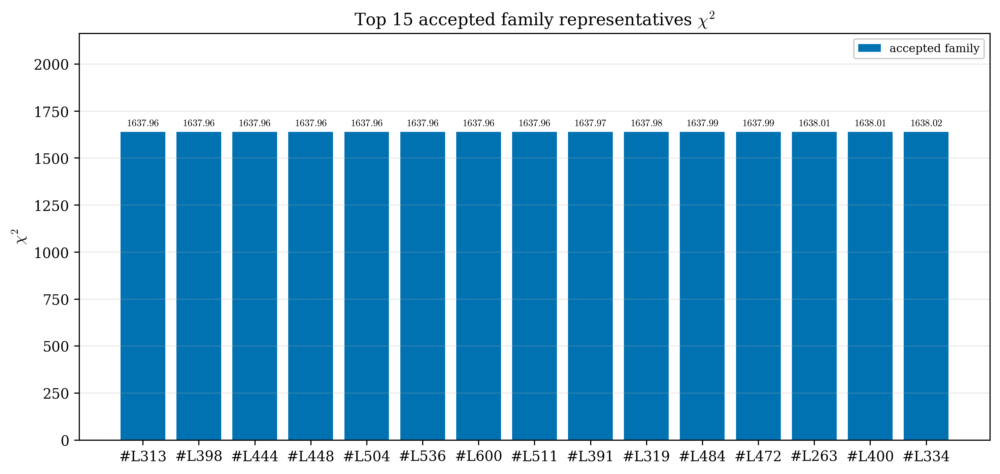
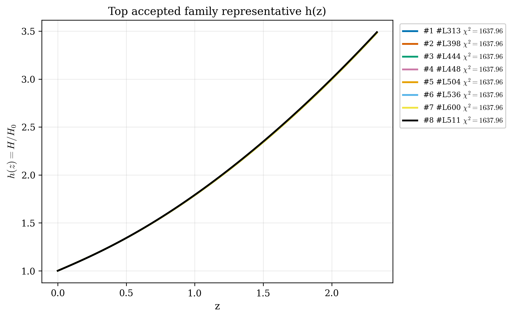
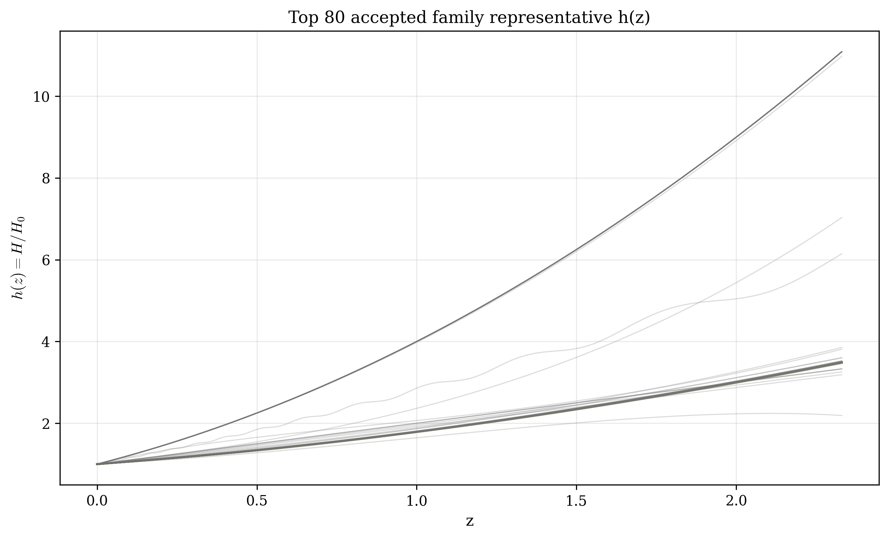
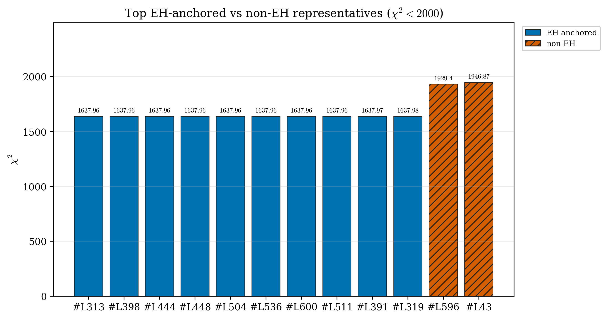
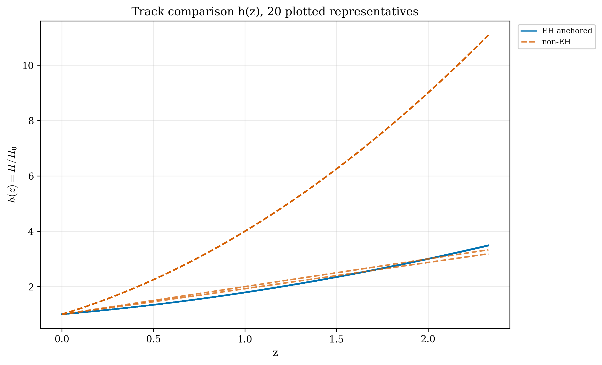
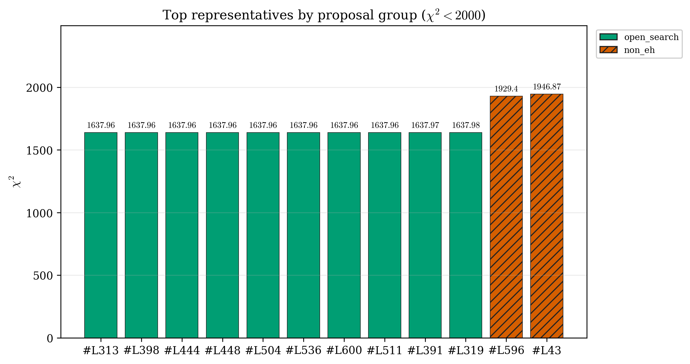
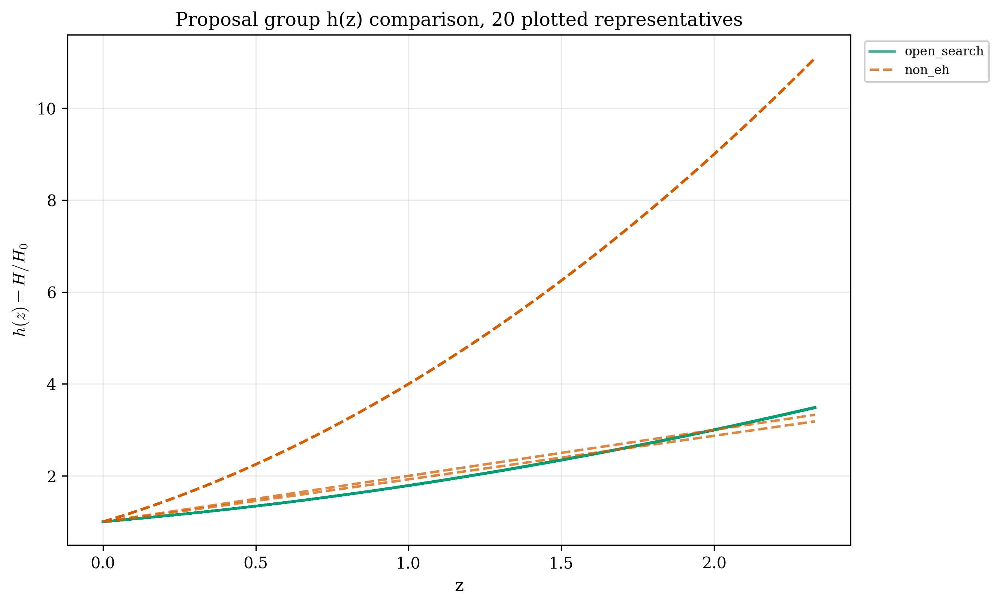
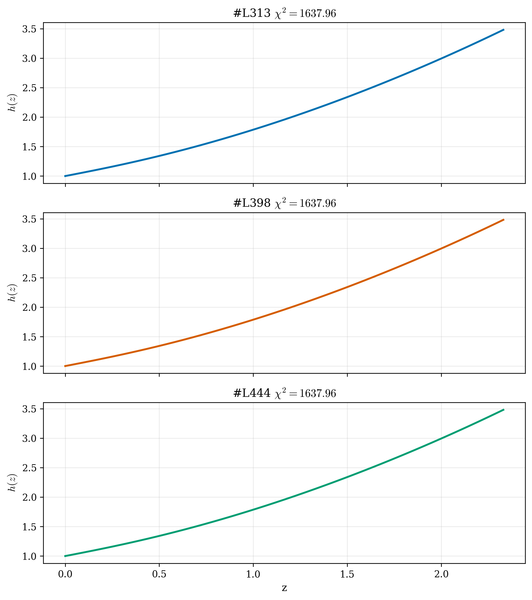

# LangGraph Agent Result Summary: graph_agent_batch_600_sector_async_v9b_nodiv16

This report is generated from current-loop memory and the isolated Solver outputs for accepted attempts.
Human-facing tables and plots use one best representative per theory family; full accepted attempts remain in `accepted_summary.json`.

## Quick Result

| Metric | Value |
|---|---:|
| Total attempts | 688 |
| Accepted attempts | 208 |
| Accepted theory families shown | 91 |
| Best chi2 | 1637.959888 |
| LCDM chi2 | 1645.28 |
| Best delta chi2 vs LCDM | -7.320112 |
| Best chi2 improvement over LCDM | 7.320112 |
| q_not_determined | 114 |
| constraint_drift | 318 |
| q_initial_root_failure | 298 |

## Output Files

- [accepted_lagrangians_and_parameters.md](accepted_lagrangians_and_parameters.md)
- [accepted_lagrangians_full.md](accepted_lagrangians_full.md)
- [accepted_lagrangians_and_parameters.csv](accepted_lagrangians_and_parameters.csv)
- [accepted_summary.json](accepted_summary.json)
- [lcdm_reference.json](lcdm_reference.json) when available
- [benchmark_summary.json](benchmark_summary.json)
- [benchmark_by_sector.csv](benchmark_by_sector.csv)

## Plots

## LCDM Reference

| Quantity | Value |
|---|---:|
| chi2_total | 1645.28 |
| chi2_DES_SN | 1634.06 |
| chi2_DESI_BAO | 11.2222 |
| chi2/N | 0.897588 |
| AIC | 1653.28 |
| BIC | 1675.33 |
| H0 | 70 |
| Omega_m0 | 0.306 |

## Benchmark Metrics

| Sector | Attempts | Accepted | Accept rate | Best chi2 | Delta chi2 vs LCDM | Unique families | chi2<1700 families | Active/moderate MG | Attempts/hour |
|---|---:|---:|---:|---:|---:|---:|---:|---:|---:|
| all | 208 | 208 | 1 | 1637.959888 | -7.320112 | 91 | 42 | 22 | 11.802 |
| open_search | 179 | 179 | 1 | 1637.959888 | -7.320112 | 68 | 42 | 22 | 10.157 |
| non_eh | 29 | 29 | 1 | 1929.396619 | 284.116619 | 23 | 0 | 0 | 1.646 |

## Proposal Group Comparison

- [Top open-search representatives](top_open_search.md)
- [Top non-EH representatives](top_non_eh.md)

## Track Comparison

- [Top EH-anchored representatives](top_eh_anchored.md)
- [Top non-EH representatives](top_non_eh.md)

## Top Accepted Family Representatives

| Rank | Group | Track | Family | Loop | Best stage | Family records | chi2 | Delta chi2 vs LCDM | Status | Max rel. effect | Dominant correction | Sample | H0 | Omega_m0 | lambda_H | Scalar | Potential | Operators |
|---:|---|---|---|---|---|---:|---:|---:|---|---:|---|---:|---:|---:|---:|---|---|---|
| 1 | open_search | eh_anchored | scalar=phi1_only|potential={'phi1': 'axion', 'phi2': None}|operators=R+R · R^{ab} · R_{ab}+R^{bd}_{ac} · R^{agh}_{b} · R^{c}_{dgh}+R^{b}_{a} · R^{cd} · R^{a}_{cbd} | task_000313_expanded_refine_slot_01_lag_1 | refine | 3 | 1637.959888 | -7.320112 | weak | 9.774e-05 | R^{b}_{a} · R^{cd} · R^{a}_{cbd} | 537 | 63.312 | 0.2758 | 6380.438 | phi1_only | {"phi1": "axion", "phi2": null} | R; R · R^{ab} · R_{ab}; R^{bd}_{ac} · R^{agh}_{b} · R^{c}_{dgh}; R^{b}_{a} · R^{cd} · R^{a}_{cbd} |
| 2 | open_search | eh_anchored | scalar=phi1_only|potential={'phi1': 'axion', 'phi2': None}|operators=R+φ1 · φ1 · R^{bcd}_{a} · R^{a}_{bcd} | task_000398_slot_12_lag_1 | initial | 3 | 1637.959888 | -7.320112 | weak | 2.512e-06 | φ1 · φ1 · R^{bcd}_{a} · R^{a}_{bcd} | 1 | 63.312 | 0.2758 | 6380.438 | phi1_only | {"phi1": "axion", "phi2": null} | R; φ1 · φ1 · R^{bcd}_{a} · R^{a}_{bcd} |
| 3 | open_search | eh_anchored | scalar=phi1_only|potential={'phi1': 'axion', 'phi2': None}|operators=R+R · R · R+R_{ab} · R^{adef} · R^{b}_{def} | task_000444_slot_01_lag_1 | initial | 3 | 1637.959888 | -7.320112 | weak | 3.981e-05 | R_{ab} · R^{adef} · R^{b}_{def} | 1 | 63.312 | 0.2758 | 6380.438 | phi1_only | {"phi1": "axion", "phi2": null} | R; R · R · R; R_{ab} · R^{adef} · R^{b}_{def} |
| 4 | open_search | eh_anchored | scalar=phi1_only|potential={'phi1': 'axion', 'phi2': None}|operators=R+R · R^{ab} · R_{ab} | task_000448_slot_05_lag_1 | initial | 3 | 1637.959888 | -7.320112 | weak | 2.512e-06 | R · R^{ab} · R_{ab} | 1 | 63.312 | 0.2758 | 6380.438 | phi1_only | {"phi1": "axion", "phi2": null} | R; R · R^{ab} · R_{ab} |
| 5 | open_search | eh_anchored | scalar=phi1_only|potential={'phi1': 'axion', 'phi2': None}|operators=R+R_{ab} · R^{adef} · R^{b}_{def} | task_000504_slot_05_lag_1 | initial | 3 | 1637.959888 | -7.320112 | weak | 2.512e-06 | R_{ab} · R^{adef} · R^{b}_{def} | 1 | 63.312 | 0.2758 | 6380.438 | phi1_only | {"phi1": "axion", "phi2": null} | R; R_{ab} · R^{adef} · R^{b}_{def} |
| 6 | open_search | eh_anchored | scalar=phi1_only|potential={'phi1': 'axion', 'phi2': None}|operators=R+R · R | task_000536_slot_03_lag_1 | initial | 3 | 1637.959888 | -7.320112 | weak | 2.512e-06 | R · R | 1 | 63.312 | 0.2758 | 6380.438 | phi1_only | {"phi1": "axion", "phi2": null} | R; R · R |
| 7 | open_search | eh_anchored | scalar=phi1_only|potential={'phi1': 'axion', 'phi2': None}|operators=R+R^{bcd}_{a} · R^{a}_{bcd}+∇^{a}∇_{a}R | task_000600_slot_10_lag_1 | initial | 3 | 1637.959888 | -7.320112 | weak | 3.981e-05 | ∇^{a}∇_{a}R | 1 | 63.312 | 0.2758 | 6380.438 | phi1_only | {"phi1": "axion", "phi2": null} | R; R^{bcd}_{a} · R^{a}_{bcd}; ∇^{a}∇_{a}R |
| 8 | open_search | eh_anchored | scalar=phi1_only|potential={'phi1': 'axion', 'phi2': None}|operators=R | task_000511_slot_13_lag_1 | initial | 16 | 1637.964818 | -7.315182 | eh_only | 0 |  | 806 | 61.317 | 0.281 | 3301.894 | phi1_only | {"phi1": "axion", "phi2": null} | R |
| 9 | open_search | eh_anchored | scalar=both|potential={'phi1': 'axion', 'phi2': 'axion'}|operators=R+φ1 · φ2 · R · R | task_000391_expanded_slot_02_lag_1 | expanded | 3 | 1637.972658 | -7.307342 | active | 0.281 | φ1 · φ2 · R · R | 1708 | 66.328 | 0.2803 | 6397.714 | both | {"phi1": "axion", "phi2": "axion"} | R; φ1 · φ2 · R · R |
| 10 | open_search | eh_anchored | scalar=phi1_only|potential={'phi1': 'axion', 'phi2': None}|operators=R+R · R^{ab} · R_{ab}+R · R^{bcd}_{a} · R^{a}_{bcd}+∇^{a}∇^{b}R · R_{ab}+∇^{c}R^{ab} · ∇_{b}R_{ac} | task_000319_slot_08_lag_1 | initial | 3 | 1637.977566 | -7.302434 | eh_dominated | 3.261e-10 | R · R^{bcd}_{a} · R^{a}_{bcd} | 196 | 60.806 | 0.2795 | 6994.087 | phi1_only | {"phi1": "axion", "phi2": null} | R; R · R^{ab} · R_{ab}; R · R^{bcd}_{a} · R^{a}_{bcd}; ∇^{a}∇^{b}R · R_{ab}; ∇^{c}R^{ab} · ∇_{b}R_{ac} |
| 11 | open_search | eh_anchored | scalar=phi1_only|potential={'phi1': 'axion', 'phi2': None}|operators=R+R^{bcd}_{a} · R^{a}_{bcd} | task_000484_expanded_refine_slot_08_lag_1 | refine | 3 | 1637.987078 | -7.292922 | weak | 2.622e-05 | R^{bcd}_{a} · R^{a}_{bcd} | 4654 | 62.45 | 0.2828 | 6871.659 | phi1_only | {"phi1": "axion", "phi2": null} | R; R^{bcd}_{a} · R^{a}_{bcd} |
| 12 | open_search | eh_anchored | scalar=phi1_only|potential={'phi1': 'axion', 'phi2': None}|operators=R+R^{b}_{a} · R^{cd} · R^{a}_{cbd} | task_000472_slot_09_lag_1 | initial | 3 | 1637.991597 | -7.288403 | moderate | 0.004 | R^{b}_{a} · R^{cd} · R^{a}_{cbd} | 577 | 72.489 | 0.2803 | 1.461e+04 | phi1_only | {"phi1": "axion", "phi2": null} | R; R^{b}_{a} · R^{cd} · R^{a}_{cbd} |
| 13 | open_search | eh_anchored | scalar=both|potential={'phi1': 'axion', 'phi2': 'axion'}|operators=R | task_000263_expanded_slot_10_lag_1 | expanded | 11 | 1638.005237 | -7.274763 | eh_only | 0 |  | 691 | 71.81 | 0.2737 | 1700.55 | both | {"phi1": "axion", "phi2": "axion"} | R |
| 14 | open_search | eh_anchored | scalar=both|potential={'phi1': 'axion', 'phi2': 'axion'}|operators=R+∇^{a}∇^{b}R · R_{ab} | task_000400_slot_16_lag_1 | initial | 2 | 1638.005237 | -7.274763 | eh_dominated | 2.392e-17 | ∇^{a}∇^{b}R · R_{ab} | 1 | 71.81 | 0.2737 | 1700.55 | both | {"phi1": "axion", "phi2": "axion"} | R; ∇^{a}∇^{b}R · R_{ab} |
| 15 | open_search | eh_anchored | scalar=both|potential={'phi1': 'axion', 'phi2': 'quadratic'}|operators=R | task_000334_expanded_slot_03_lag_1 | expanded | 10 | 1638.024829 | -7.255171 | eh_only | 0 |  | 2463 | 58 | 0.2792 | 1034.736 | both | {"phi1": "axion", "phi2": "quadratic"} | R |
| 16 | open_search | eh_anchored | scalar=both|potential={'phi1': 'quadratic', 'phi2': 'axion'}|operators=R | task_000474_expanded_slot_14_lag_1 | expanded | 10 | 1638.028947 | -7.251053 | eh_only | 0 |  | 1819 | 59.056 | 0.2704 | 858.116 | both | {"phi1": "quadratic", "phi2": "axion"} | R |
| 17 | open_search | eh_anchored | scalar=both|potential={'phi1': 'axion', 'phi2': 'axion'}|operators=R+R · R^{ab} · R_{ab} | task_000242_expanded_slot_09_lag_1 | expanded | 2 | 1638.034284 | -7.245716 | eh_dominated | 1.415e-19 | R · R^{ab} · R_{ab} | 2951 | 64.589 | 0.2707 | 4622.102 | both | {"phi1": "axion", "phi2": "axion"} | R; R · R^{ab} · R_{ab} |
| 18 | open_search | eh_anchored | scalar=both|potential={'phi1': 'axion', 'phi2': 'quadratic'}|operators=R+R^{ab} · R_{ab} | task_000282_slot_14_lag_1 | initial | 2 | 1638.034284 | -7.245716 | eh_dominated | 9.362e-12 | R^{ab} · R_{ab} | 1 | 64.589 | 0.2707 | 4622.102 | both | {"phi1": "axion", "phi2": "quadratic"} | R; R^{ab} · R_{ab} |
| 19 | open_search | eh_anchored | scalar=both|potential={'phi1': 'axion', 'phi2': 'quadratic'}|operators=R+R · R^{ab} · R_{ab} | task_000377_slot_14_lag_1 | initial | 2 | 1638.034284 | -7.245716 | eh_dominated | 4.382e-19 | R · R^{ab} · R_{ab} | 1 | 64.589 | 0.2707 | 4622.102 | both | {"phi1": "axion", "phi2": "quadratic"} | R; R · R^{ab} · R_{ab} |
| 20 | open_search | eh_anchored | scalar=phi1_only|potential={'phi1': 'axion', 'phi2': None}|operators=R+R · R^{ab} · R_{ab}+R · R^{bcd}_{a} · R^{a}_{bcd}+∇^{a}∇^{b}R · R_{ab}+φ1 · R^{bcd}_{a} · R^{a}_{bcd}+φ1 · φ1 · R^{bcd}_{a} · R^{a}_{bcd} | task_000154_slot_07_lag_1 | initial | 2 | 1638.092992 | -7.187008 | active | 2.981e+08 | φ1 · R^{bcd}_{a} · R^{a}_{bcd} | 574 | 58.913 | 0.3033 | 2581.659 | phi1_only | {"phi1": "axion", "phi2": null} | R; R · R^{ab} · R_{ab}; R · R^{bcd}_{a} · R^{a}_{bcd}; ∇^{a}∇^{b}R · R_{ab}; φ1 · R^{bcd}_{a} · R^{a}_{bcd}; φ1 · φ1 · R^{bcd}_{a} · R^{a}_{bcd} |
| 21 | open_search | eh_anchored | scalar=both|potential={'phi1': 'quadratic', 'phi2': 'axion'}|operators=R+φ2 · R^{ab} · R_{ab} | task_000198_slot_02_lag_1 | initial | 2 | 1638.160165 | -7.119835 | eh_dominated | 6.424e-19 | φ2 · R^{ab} · R_{ab} | 1 | 59.666 | 0.2687 | 1599.641 | both | {"phi1": "quadratic", "phi2": "axion"} | R; φ2 · R^{ab} · R_{ab} |
| 22 | open_search | eh_anchored | scalar=both|potential={'phi1': 'quadratic', 'phi2': 'axion'}|operators=R+φ1 · φ1 · R^{bcd}_{a} · R^{a}_{bcd} | task_000299_slot_08_lag_1 | initial | 2 | 1638.160165 | -7.119835 | moderate | 0.003 | φ1 · φ1 · R^{bcd}_{a} · R^{a}_{bcd} | 13 | 59.666 | 0.2687 | 1599.641 | both | {"phi1": "quadratic", "phi2": "axion"} | R; φ1 · φ1 · R^{bcd}_{a} · R^{a}_{bcd} |
| 23 | open_search | eh_anchored | scalar=both|potential={'phi1': 'quadratic', 'phi2': 'quadratic'}|operators=R+φ1 · R^{bcd}_{a} · R^{a}_{bcd} | task_000157_expanded_slot_10_lag_1 | expanded | 2 | 1638.160165 | -7.119835 | active | 2.453e+07 | φ1 · R^{bcd}_{a} · R^{a}_{bcd} | 959 | 59.666 | 0.2687 | 1599.641 | both | {"phi1": "quadratic", "phi2": "quadratic"} | R; φ1 · R^{bcd}_{a} · R^{a}_{bcd} |
| 24 | open_search | eh_anchored | scalar=both|potential={'phi1': 'quadratic', 'phi2': 'quadratic'}|operators=R | task_000149_expanded_slot_02_lag_1 | expanded | 10 | 1638.255077 | -7.024923 | eh_only | 0 |  | 182 | 59.117 | 0.265 | 1736.813 | both | {"phi1": "quadratic", "phi2": "quadratic"} | R |
| 25 | open_search | eh_anchored | scalar=both|potential={'phi1': 'quadratic', 'phi2': 'quadratic'}|operators=R+φ2 · R^{ab} · R_{ab}+φ1 · φ1 · R^{bcd}_{a} · R^{a}_{bcd}+φ1 · φ2 · R · R | task_000085_expanded_slot_05_lag_1 | expanded | 2 | 1638.270775 | -7.009225 | active | 2.076 | φ1 · φ1 · R^{bcd}_{a} · R^{a}_{bcd} | 1379 | 62.67 | 0.2672 | 1477.15 | both | {"phi1": "quadratic", "phi2": "quadratic"} | R; φ2 · R^{ab} · R_{ab}; φ1 · φ1 · R^{bcd}_{a} · R^{a}_{bcd}; φ1 · φ2 · R · R |
| 26 | open_search | eh_anchored | scalar=phi1_only|potential={'phi1': 'axion', 'phi2': None}|operators=R+R · R^{ab} · R_{ab}+φ1 · φ1 · R^{bcd}_{a} · R^{a}_{bcd}+φ1 · φ1 | task_000418_expanded_slot_11_lag_1 | expanded | 2 | 1638.418776 | -6.861224 | active | 6.247e+04 | φ1 · φ1 · R^{bcd}_{a} · R^{a}_{bcd} | 964 | 68.294 | 0.2693 | 6454.953 | phi1_only | {"phi1": "axion", "phi2": null} | R; R · R^{ab} · R_{ab}; φ1 · φ1 · R^{bcd}_{a} · R^{a}_{bcd}; φ1 · φ1 |
| 27 | open_search | eh_anchored | scalar=both|potential={'phi1': 'quadratic', 'phi2': 'quadratic'}|operators=R+R^{cd}_{ab} · R^{afh}_{c} · R^{b}_{hdf} | task_000097_slot_11_lag_1 | initial | 2 | 1638.485177 | -6.794823 | active | 6.532 | R^{cd}_{ab} · R^{afh}_{c} · R^{b}_{hdf} | 98 | 64.591 | 0.2514 | 1446.156 | both | {"phi1": "quadratic", "phi2": "quadratic"} | R; R^{cd}_{ab} · R^{afh}_{c} · R^{b}_{hdf} |
| 28 | open_search | eh_anchored | scalar=both|potential={'phi1': 'axion', 'phi2': 'quadratic'}|operators=R+φ2 · φ2 · R · R+φ2 · φ2 · R^{bcd}_{a} · R^{a}_{bcd}+φ1 · φ1 | task_000361_slot_09_lag_1 | initial | 2 | 1638.491445 | -6.788555 | active | 200.603 | φ2 · φ2 · R^{bcd}_{a} · R^{a}_{bcd} | 484 | 64.918 | 0.2743 | 1471.284 | both | {"phi1": "axion", "phi2": "quadratic"} | R; φ2 · φ2 · R · R; φ2 · φ2 · R^{bcd}_{a} · R^{a}_{bcd}; φ1 · φ1 |
| 29 | open_search | eh_anchored | scalar=phi1_only|potential={'phi1': 'quadratic', 'phi2': None}|operators=R+R · R | task_000087_expanded_slot_10_lag_1 | expanded | 2 | 1638.586797 | -6.693203 | eh_dominated | 2.827e-15 | R · R | 404 | 66.038 | 0.2484 | 1436.285 | phi1_only | {"phi1": "quadratic", "phi2": null} | R; R · R |
| 30 | open_search | eh_anchored | scalar=phi1_only|potential={'phi1': 'quadratic', 'phi2': None}|operators=R | task_000108_expanded_slot_15_lag_1 | expanded | 10 | 1638.619632 | -6.660368 | eh_only | 0 |  | 2434 | 58.734 | 0.2922 | 5670.949 | phi1_only | {"phi1": "quadratic", "phi2": null} | R |
| 31 | open_search | eh_anchored | scalar=both|potential={'phi1': 'axion', 'phi2': 'quadratic'}|operators=R+φ2 · R^{ab} · R_{ab}+φ2 · φ2 · φ2 · φ2 | task_000248_expanded_slot_02_lag_1 | expanded | 2 | 1638.639254 | -6.640746 | eh_dominated | 6.803e-20 | φ2 · R^{ab} · R_{ab} | 1377 | 71.499 | 0.3074 | 4280.245 | both | {"phi1": "axion", "phi2": "quadratic"} | R; φ2 · R^{ab} · R_{ab}; φ2 · φ2 · φ2 · φ2 |
| 32 | open_search | eh_anchored | scalar=phi1_only|potential={'phi1': 'quadratic', 'phi2': None}|operators=R+R^{bcd}_{a} · R^{a}_{bcd}+∇^{a}∇_{a}R+R · R^{bcd}_{a} · R^{a}_{bcd}+φ1 · R · R | task_000194_expanded_slot_12_lag_1 | expanded | 2 | 1638.973234 | -6.306766 | active | 6.000e+08 | R^{bcd}_{a} · R^{a}_{bcd} | 1736 | 58.617 | 0.305 | 1451.09 | phi1_only | {"phi1": "quadratic", "phi2": null} | R; R^{bcd}_{a} · R^{a}_{bcd}; ∇^{a}∇_{a}R; R · R^{bcd}_{a} · R^{a}_{bcd}; φ1 · R · R |
| 33 | open_search | eh_anchored | scalar=both|potential={'phi1': 'quadratic', 'phi2': 'quadratic'}|operators=R+R · R · R+R^{cd}_{ab} · R^{afh}_{c} · R^{b}_{hdf}+φ1 · φ1 · R^{ab} · R_{ab} | task_000044_expanded_slot_06_lag_1 | expanded | 2 | 1638.978697 | -6.301303 | weak | 8.255e-05 | R^{cd}_{ab} · R^{afh}_{c} · R^{b}_{hdf} | 2815 | 60.639 | 0.2916 | 1122.686 | both | {"phi1": "quadratic", "phi2": "quadratic"} | R; R · R · R; R^{cd}_{ab} · R^{afh}_{c} · R^{b}_{hdf}; φ1 · φ1 · R^{ab} · R_{ab} |
| 34 | open_search | eh_anchored | scalar=phi1_only|potential={'phi1': 'axion', 'phi2': None}|operators=R+R · R+R^{bcd}_{a} · R^{a}_{bcd}+R · R^{ab} · R_{ab}+φ1 · R · R | task_000058_expanded_slot_13_lag_1 | expanded | 2 | 1639.038897 | -6.241103 | weak | 7.766e-05 | R^{bcd}_{a} · R^{a}_{bcd} | 1043 | 69.977 | 0.31 | 952.156 | phi1_only | {"phi1": "axion", "phi2": null} | R; R · R; R^{bcd}_{a} · R^{a}_{bcd}; R · R^{ab} · R_{ab}; φ1 · R · R |
| 35 | open_search | eh_anchored | scalar=phi1_only|potential={'phi1': 'quadratic', 'phi2': None}|operators=R+R · R+R^{bd}_{ac} · R^{agh}_{b} · R^{c}_{dgh}+R^{cd}_{ab} · R^{afh}_{c} · R^{b}_{hdf}+∇^{a}φ1 · ∇_{a}φ1 | task_000089_expanded_slot_13_lag_1 | expanded | 2 | 1639.043139 | -6.236861 | active | 3.450e+09 | R · R | 775 | 69.838 | 0.2784 | 1488.559 | phi1_only | {"phi1": "quadratic", "phi2": null} | R; R · R; R^{bd}_{ac} · R^{agh}_{b} · R^{c}_{dgh}; R^{cd}_{ab} · R^{afh}_{c} · R^{b}_{hdf}; ∇^{a}φ1 · ∇_{a}φ1 |
| 36 | open_search | eh_anchored | scalar=phi1_only|potential={'phi1': 'axion', 'phi2': None}|operators=R+R_{ab} · R^{adef} · R^{b}_{def}+φ1 · φ1 | task_000517_expanded_slot_06_lag_1 | expanded | 2 | 1639.69492 | -5.58508 | active | 8.977e+04 | R_{ab} · R^{adef} · R^{b}_{def} | 2858 | 58.052 | 0.3043 | 3154.191 | phi1_only | {"phi1": "axion", "phi2": null} | R; R_{ab} · R^{adef} · R^{b}_{def}; φ1 · φ1 |
| 37 | open_search | eh_anchored | scalar=both|potential={'phi1': 'quadratic', 'phi2': 'quadratic'}|operators=R+φ1 · R^{ab} · R_{ab} | task_000059_expanded_slot_15_lag_1 | expanded | 2 | 1639.995424 | -5.284576 | moderate | 0.003 | φ1 · R^{ab} · R_{ab} | 2466 | 59.105 | 0.3051 | 705.498 | both | {"phi1": "quadratic", "phi2": "quadratic"} | R; φ1 · R^{ab} · R_{ab} |
| 38 | open_search | eh_anchored | scalar=phi1_only|potential={'phi1': 'quadratic', 'phi2': None}|operators=R+R · R^{ab} · R_{ab} | task_000021_expanded_slot_06_lag_1 | expanded | 2 | 1643.146829 | -2.133171 | weak | 7.110e-06 | R · R^{ab} · R_{ab} | 2203 | 60.166 | 0.2943 | 829.259 | phi1_only | {"phi1": "quadratic", "phi2": null} | R; R · R^{ab} · R_{ab} |
| 39 | open_search | eh_anchored | scalar=both|potential={'phi1': 'axion', 'phi2': 'axion'}|operators=R+φ1 · R^{bcd}_{a} · R^{a}_{bcd}+φ1 · φ2 · R · R+φ1 · φ2 · ∇^{a}∇_{a}φ2+φ1 · ∇^{a}φ1 · ∇_{a}φ2+∇^{a}φ1 · φ2 · ∇_{a}φ2+∇^{a}∇_{a}φ1 · φ2 · φ2+φ2 · φ2 · φ2 · φ2 · φ2 · φ2 | task_000316_expanded_slot_04_lag_1 | expanded | 2 | 1651.17631 | 5.89631 | active | 1.549e+08 | φ1 · R^{bcd}_{a} · R^{a}_{bcd} | 46 | 59.442 | 0.3028 | 3895.59 | both | {"phi1": "axion", "phi2": "axion"} | R; φ1 · R^{bcd}_{a} · R^{a}_{bcd}; φ1 · φ2 · R · R; φ1 · φ2 · ∇^{a}∇_{a}φ2; φ1 · ∇^{a}φ1 · ∇_{a}φ2; ∇^{a}φ1 · φ2 · ∇_{a}φ2; ∇^{a}∇_{a}φ1 · φ2 · φ2; φ2 · φ2 · φ2 · φ2 · φ2 · φ2 |
| 40 | open_search | eh_anchored | scalar=phi1_only|potential={'phi1': 'quadratic', 'phi2': None}|operators=R+R · R+φ1 · R · R+φ1 · R^{ab} · R_{ab} | task_000041_expanded_slot_03_lag_1 | expanded | 2 | 1651.845497 | 6.565497 | moderate | 0.005 | φ1 · R^{ab} · R_{ab} | 1681 | 63.493 | 0.3273 | 767.895 | phi1_only | {"phi1": "quadratic", "phi2": null} | R; R · R; φ1 · R · R; φ1 · R^{ab} · R_{ab} |
| 41 | open_search | eh_anchored | scalar=phi1_only|potential={'phi1': 'quadratic', 'phi2': None}|operators=R+φ1 · R^{ab} · R_{ab} | task_000036_expanded_slot_12_lag_1 | expanded | 2 | 1658.209666 | 12.929666 | moderate | 0.002 | φ1 · R^{ab} · R_{ab} | 2940 | 63.772 | 0.3257 | 865.202 | phi1_only | {"phi1": "quadratic", "phi2": null} | R; φ1 · R^{ab} · R_{ab} |
| 42 | open_search | eh_anchored | scalar=phi1_only|potential={'phi1': 'quadratic', 'phi2': None}|operators=R+R^{bcd}_{a} · R^{a}_{bcd}+R · R^{ab} · R_{ab}+φ1 · R · R | task_000019_expanded_slot_04_lag_1 | expanded | 2 | 1698.460079 | 53.180079 | moderate | 0.004 | φ1 · R · R | 2192 | 64.632 | 0.3335 | 1938.536 | phi1_only | {"phi1": "quadratic", "phi2": null} | R; R^{bcd}_{a} · R^{a}_{bcd}; R · R^{ab} · R_{ab}; φ1 · R · R |
| 43 | non_eh | non_eh | scalar=phi2_only|potential={'phi1': None, 'phi2': 'axion'}|operators=φ2 · φ2 · φ2 · R+φ2 · ∇^{a}∇_{a}R+∇^{a}∇^{b}φ2 · R_{ab}+φ2 · φ2 · φ2 · φ2 · R+φ2 · φ2 · R^{ab} · R_{ab}+φ2 · φ2 · R^{bcd}_{a} · R^{a}_{bcd}+∇^{a}φ2 · ∇_{a}φ2 · R+φ2 · ∇^{a}∇^{b}φ2 · R_{ab} | task_000596_expanded_refine_slot_06_lag_1 | refine | 3 | 1929.396619 | 284.116619 | not_applicable_non_eh |  |  | 4241 | 59.69 | 0.2341 | 9523.5 | phi2_only | {"phi1": null, "phi2": "axion"} | φ2 · φ2 · φ2 · R; φ2 · ∇^{a}∇_{a}R; ∇^{a}∇^{b}φ2 · R_{ab}; φ2 · φ2 · φ2 · φ2 · R; φ2 · φ2 · R^{ab} · R_{ab}; φ2 · φ2 · R^{bcd}_{a} · R^{a}_{bcd}; ∇^{a}φ2 · ∇_{a}φ2 · R; φ2 · ∇^{a}∇^{b}φ2 · R_{ab} |
| 44 | open_search | eh_anchored | scalar=phi2_only|potential={'phi1': None, 'phi2': 'quadratic'}|operators=R+∇^{a}∇^{b}R · R_{ab}+∇^{c}R^{ab} · ∇_{c}R_{ab}+φ2 · R+φ2 · φ2 · R+φ2 · φ2 · R^{ab} · R_{ab}+φ2 · φ2 · R^{bcd}_{a} · R^{a}_{bcd}+φ2 · φ2 · φ2 · φ2 · φ2 · φ2 | task_000074_expanded_slot_03_lag_1 | expanded | 2 | 1942.422359 | 297.142359 | weak | 2.664e-05 | φ2 · φ2 · R^{bcd}_{a} · R^{a}_{bcd} | 2375 | 60.801 | 0.322 | 641.234 | phi2_only | {"phi1": null, "phi2": "quadratic"} | R; ∇^{a}∇^{b}R · R_{ab}; ∇^{c}R^{ab} · ∇_{c}R_{ab}; φ2 · R; φ2 · φ2 · R; φ2 · φ2 · R^{ab} · R_{ab}; φ2 · φ2 · R^{bcd}_{a} · R^{a}_{bcd}; φ2 · φ2 · φ2 · φ2 · φ2 · φ2 |
| 45 | open_search | eh_anchored | scalar=phi2_only|potential={'phi1': None, 'phi2': 'axion'}|operators=R+φ2 · R · R+φ2 · R^{ab} · R_{ab}+φ2 · R^{bcd}_{a} · R^{a}_{bcd}+φ2 · φ2 · R · R+φ2 · φ2 · R^{ab} · R_{ab} | task_000323_expanded_slot_14_lag_1 | expanded | 2 | 1946.870851 | 301.590851 | weak | 4.279e-05 | φ2 · φ2 · R · R | 2818 | 67.839 | 0.3021 | 1416.14 | phi2_only | {"phi1": null, "phi2": "axion"} | R; φ2 · R · R; φ2 · R^{ab} · R_{ab}; φ2 · R^{bcd}_{a} · R^{a}_{bcd}; φ2 · φ2 · R · R; φ2 · φ2 · R^{ab} · R_{ab} |
| 46 | open_search | eh_anchored | scalar=both|potential={'phi1': 'axion', 'phi2': 'axion'}|operators=R+R^{bd}_{ac} · R^{agh}_{b} · R^{c}_{dgh}+φ1 · φ1 · R^{ab} · R_{ab}+φ2 · φ2 · R · R+φ2 · φ2 · R^{ab} · R_{ab}+φ2 · φ2 · R^{bcd}_{a} · R^{a}_{bcd}+φ1 · φ2 · φ2 · φ2 · φ2 · φ2 | task_000381_expanded_slot_03_lag_1 | expanded | 2 | 1946.870851 | 301.590851 | weak | 3.981e-05 | φ2 · φ2 · R^{ab} · R_{ab} | 237 | 69.204 | 0.2755 | 6543.773 | both | {"phi1": "axion", "phi2": "axion"} | R; R^{bd}_{ac} · R^{agh}_{b} · R^{c}_{dgh}; φ1 · φ1 · R^{ab} · R_{ab}; φ2 · φ2 · R · R; φ2 · φ2 · R^{ab} · R_{ab}; φ2 · φ2 · R^{bcd}_{a} · R^{a}_{bcd}; φ1 · φ2 · φ2 · φ2 · φ2 · φ2 |
| 47 | non_eh | non_eh | scalar=phi2_only|potential={'phi1': None, 'phi2': 'quadratic'}|operators=R · R^{ab} · R_{ab}+φ2 · R^{ab} · R_{ab}+φ2 · R^{bcd}_{a} · R^{a}_{bcd}+∇^{a}∇^{b}φ2 · R_{ab}+φ2 · ∇^{a}φ2 · ∇_{a}R+∇^{a}φ2 · ∇_{a}φ2 | task_000043_expanded_refine_slot_05_lag_1 | refine | 3 | 1946.870857 | 301.590857 | not_applicable_non_eh |  |  | 4000 | 66.926 | 0.2909 | 765.743 | phi2_only | {"phi1": null, "phi2": "quadratic"} | R · R^{ab} · R_{ab}; φ2 · R^{ab} · R_{ab}; φ2 · R^{bcd}_{a} · R^{a}_{bcd}; ∇^{a}∇^{b}φ2 · R_{ab}; φ2 · ∇^{a}φ2 · ∇_{a}R; ∇^{a}φ2 · ∇_{a}φ2 |
| 48 | open_search | eh_anchored | scalar=both|potential={'phi1': 'axion', 'phi2': 'axion'}|operators=R+R^{ab} · R_{ab} | task_000025_slot_10_lag_1 | initial | 1 | 2199.207158 | 553.927158 | moderate | 0.003 | R^{ab} · R_{ab} | 898 | 62.374 | 0.2804 | 1.126e+04 | both | {"phi1": "axion", "phi2": "axion"} | R; R^{ab} · R_{ab} |
| 49 | open_search | eh_anchored | scalar=both|potential={'phi1': 'axion', 'phi2': 'axion'}|operators=R+φ1 · φ1+φ2 · φ2+φ1 · ∇^{a}φ1 · ∇_{a}φ2+φ1 · φ2 · φ2 · φ2 · φ2 · φ2 | task_000545_slot_01_lag_1 | initial | 1 | 3667.454736 | 2022.174736 | eh_only | 0 |  | 984 | 71.904 | 0.2866 | 982.198 | both | {"phi1": "axion", "phi2": "axion"} | R; φ1 · φ1; φ2 · φ2; φ1 · ∇^{a}φ1 · ∇_{a}φ2; φ1 · φ2 · φ2 · φ2 · φ2 · φ2 |
| 50 | open_search | eh_anchored | scalar=both|potential={'phi1': 'quadratic', 'phi2': 'axion'}|operators=R+φ2 · ∇^{a}∇_{a}φ2 · R+∇^{a}∇_{a}φ1 · φ2 · R+∇^{a}φ1 · ∇^{b}φ2 · R_{ab}+φ2 · φ2 · φ2 · φ2 · φ2 | task_000002_slot_02_lag_1 | initial | 1 | 4024.068817 | 2378.788817 | moderate | 1.025e-04 | ∇^{a}φ1 · ∇^{b}φ2 · R_{ab} | 886 | 69.737 | 0.2554 | 854.711 | both | {"phi1": "quadratic", "phi2": "axion"} | R; φ2 · ∇^{a}∇_{a}φ2 · R; ∇^{a}∇_{a}φ1 · φ2 · R; ∇^{a}φ1 · ∇^{b}φ2 · R_{ab}; φ2 · φ2 · φ2 · φ2 · φ2 |
| 51 | open_search | eh_anchored | scalar=phi1_only|potential={'phi1': 'axion', 'phi2': None}|operators=R+φ1 · φ1 | task_000144_slot_11_lag_1 | initial | 1 | 4181.706685 | 2536.426685 | eh_only | 0 |  | 969 | 70.674 | 0.3107 | 1939.254 | phi1_only | {"phi1": "axion", "phi2": null} | R; φ1 · φ1 |
| 52 | open_search | eh_anchored | scalar=both|potential={'phi1': 'axion', 'phi2': 'axion'}|operators=R+φ2 · R+φ1 · φ1 · φ2 · φ2 | task_000408_slot_11_lag_1 | initial | 1 | 9325.039046 | 7679.759046 | eh_dominated | 4.853e-07 | φ2 · R | 928 | 64.456 | 0.2884 | 4426.083 | both | {"phi1": "axion", "phi2": "axion"} | R; φ2 · R; φ1 · φ1 · φ2 · φ2 |
| 53 | open_search | eh_anchored | scalar=phi2_only|potential={'phi1': None, 'phi2': 'axion'}|operators=R+φ2 · R | task_000335_slot_04_lag_1 | initial | 1 | 9434.002732 | 7788.722732 | weak | 1.115e-05 | φ2 · R | 927 | 66.08 | 0.2968 | 565.251 | phi2_only | {"phi1": null, "phi2": "axion"} | R; φ2 · R |
| 54 | open_search | eh_anchored | scalar=phi2_only|potential={'phi1': None, 'phi2': 'axion'}|operators=R+R · R · R+R_{ab} · R^{adef} · R^{b}_{def}+φ2 · R+φ2 · φ2+φ2 · φ2 · φ2 · φ2 · φ2 | task_000078_slot_07_lag_1 | initial | 1 | 9434.002753 | 7788.722753 | weak | 3.981e-05 | R_{ab} · R^{adef} · R^{b}_{def} | 162 | 60.941 | 0.3271 | 1215.764 | phi2_only | {"phi1": null, "phi2": "axion"} | R; R · R · R; R_{ab} · R^{adef} · R^{b}_{def}; φ2 · R; φ2 · φ2; φ2 · φ2 · φ2 · φ2 · φ2 |
| 55 | open_search | eh_anchored | scalar=phi2_only|potential={'phi1': None, 'phi2': 'quadratic'}|operators=R+R^{bcd}_{a} · R^{a}_{bcd}+R · R^{ab} · R_{ab}+φ2 · R+∇^{a}φ2 · ∇_{a}φ2+φ2 · ∇^{a}φ2 · ∇_{a}φ2+φ2 · φ2 · φ2 · ∇^{a}∇_{a}φ2 | task_000584_slot_06_lag_1 | initial | 1 | 9434.00278 | 7788.72278 | weak | 1.214e-05 | R · R^{ab} · R_{ab} | 758 | 67.421 | 0.3006 | 1034.783 | phi2_only | {"phi1": null, "phi2": "quadratic"} | R; R^{bcd}_{a} · R^{a}_{bcd}; R · R^{ab} · R_{ab}; φ2 · R; ∇^{a}φ2 · ∇_{a}φ2; φ2 · ∇^{a}φ2 · ∇_{a}φ2; φ2 · φ2 · φ2 · ∇^{a}∇_{a}φ2 |
| 56 | open_search | eh_anchored | scalar=phi2_only|potential={'phi1': None, 'phi2': 'quadratic'}|operators=R+φ2 · R | task_000500_slot_16_lag_1 | initial | 1 | 9434.002785 | 7788.722785 | weak | 1.049e-06 | φ2 · R | 809 | 71.445 | 0.2987 | 6604.704 | phi2_only | {"phi1": null, "phi2": "quadratic"} | R; φ2 · R |
| 57 | non_eh | non_eh | scalar=phi2_only|potential={'phi1': None, 'phi2': 'quadratic'}|operators=φ2 · R+φ2 · φ2 · φ2 | task_000300_slot_09_lag_1 | initial | 1 | 9434.0031 | 7788.7231 | not_applicable_non_eh |  |  | 824 | 68.666 | 0.273 | 884.921 | phi2_only | {"phi1": null, "phi2": "quadratic"} | φ2 · R; φ2 · φ2 · φ2 |
| 58 | non_eh | non_eh | scalar=phi2_only|potential={'phi1': None, 'phi2': 'quadratic'}|operators=φ2 · R+φ2 · φ2 · ∇^{a}∇_{a}φ2 | task_000240_slot_06_lag_1 | initial | 1 | 9434.0031 | 7788.7231 | not_applicable_non_eh |  |  | 756 | 59.897 | 0.2789 | 587.648 | phi2_only | {"phi1": null, "phi2": "quadratic"} | φ2 · R; φ2 · φ2 · ∇^{a}∇_{a}φ2 |
| 59 | non_eh | non_eh | scalar=phi2_only|potential={'phi1': None, 'phi2': 'quadratic'}|operators=φ2 · R | task_000308_slot_09_lag_1 | initial | 2 | 9434.003101 | 7788.723101 | not_applicable_non_eh |  |  | 286 | 66.885 | 0.2887 | 510.319 | phi2_only | {"phi1": null, "phi2": "quadratic"} | φ2 · R |
| 60 | non_eh | non_eh | scalar=phi2_only|potential={'phi1': None, 'phi2': 'quadratic'}|operators=∇^{a}∇_{a}R · R^{c}_{c}+φ2 · R | task_000312_slot_16_lag_1 | initial | 1 | 9434.003132 | 7788.723132 | not_applicable_non_eh |  |  | 379 | 60.995 | 0.2858 | 1100.948 | phi2_only | {"phi1": null, "phi2": "quadratic"} | ∇^{a}∇_{a}R · R^{c}_{c}; φ2 · R |
| 61 | open_search | eh_anchored | scalar=phi2_only|potential={'phi1': None, 'phi2': 'quadratic'}|operators=R+R^{ab} · R_{ab}+R · R^{ab} · R_{ab}+φ2 · R+φ2 · φ2 · φ2 · R+φ2 · φ2+φ2 · φ2 · ∇^{a}∇_{a}φ2 | task_000031_slot_03_lag_1 | initial | 1 | 9434.003467 | 7788.723467 | moderate | 1.047e-04 | R · R^{ab} · R_{ab} | 252 | 59.871 | 0.2801 | 3265.671 | phi2_only | {"phi1": null, "phi2": "quadratic"} | R; R^{ab} · R_{ab}; R · R^{ab} · R_{ab}; φ2 · R; φ2 · φ2 · φ2 · R; φ2 · φ2; φ2 · φ2 · ∇^{a}∇_{a}φ2 |
| 62 | non_eh | non_eh | scalar=both|potential={'phi1': 'quadratic', 'phi2': 'quadratic'}|operators=R^{bcd}_{a} · R^{a}_{bcd}+φ2 · R | task_000099_slot_01_lag_1 | initial | 1 | 9434.005409 | 7788.725409 | not_applicable_non_eh |  |  | 26 | 68.136 | 0.3121 | 2291.316 | both | {"phi1": "quadratic", "phi2": "quadratic"} | R^{bcd}_{a} · R^{a}_{bcd}; φ2 · R |
| 63 | open_search | eh_anchored | scalar=phi2_only|potential={'phi1': None, 'phi2': 'axion'}|operators=R+φ2 · φ2 · R | task_000218_slot_09_lag_1 | initial | 1 | 9434.006364 | 7788.726364 | weak | 1.259e-06 | φ2 · φ2 · R | 17 | 62.04 | 0.313 | 715.619 | phi2_only | {"phi1": null, "phi2": "axion"} | R; φ2 · φ2 · R |
| 64 | non_eh | non_eh | scalar=phi2_only|potential={'phi1': None, 'phi2': 'axion'}|operators=φ2 · φ2 · φ2 · R | task_000146_slot_13_lag_1 | initial | 1 | 9434.006431 | 7788.726431 | not_applicable_non_eh |  |  | 868 | 74 | 0.225 | 2112.48 | phi2_only | {"phi1": null, "phi2": "axion"} | φ2 · φ2 · φ2 · R |
| 65 | non_eh | non_eh | scalar=phi2_only|potential={'phi1': None, 'phi2': 'axion'}|operators=R · R+R^{ab} · R_{ab}+R^{bd}_{ac} · R^{agh}_{b} · R^{c}_{dgh}+∇^{a}R · ∇_{a}R+φ2 · φ2 · R+φ2 · φ2 · R^{ab} · R_{ab} | task_000434_slot_03_lag_1 | initial | 1 | 9434.00644 | 7788.72644 | not_applicable_non_eh |  |  | 533 | 74 | 0.3603 | 500 | phi2_only | {"phi1": null, "phi2": "axion"} | R · R; R^{ab} · R_{ab}; R^{bd}_{ac} · R^{agh}_{b} · R^{c}_{dgh}; ∇^{a}R · ∇_{a}R; φ2 · φ2 · R; φ2 · φ2 · R^{ab} · R_{ab} |
| 66 | open_search | eh_anchored | scalar=both|potential={'phi1': 'axion', 'phi2': 'axion'}|operators=R+φ2 · φ2 · φ2 · R | task_000376_slot_11_lag_1 | initial | 1 | 9434.006826 | 7788.726826 | eh_dominated | 1.718e-11 | φ2 · φ2 · φ2 · R | 958 | 65.088 | 0.276 | 2812.646 | both | {"phi1": "axion", "phi2": "axion"} | R; φ2 · φ2 · φ2 · R |
| 67 | non_eh | non_eh | scalar=phi2_only|potential={'phi1': None, 'phi2': 'quadratic'}|operators=φ2 · φ2 · φ2 · R+∇^{a}φ2 · ∇_{a}φ2 · R | task_000519_slot_08_lag_1 | initial | 1 | 9434.006957 | 7788.726957 | not_applicable_non_eh |  |  | 713 | 71.221 | 0.287 | 4073.894 | phi2_only | {"phi1": null, "phi2": "quadratic"} | φ2 · φ2 · φ2 · R; ∇^{a}φ2 · ∇_{a}φ2 · R |
| 68 | non_eh | non_eh | scalar=phi2_only|potential={'phi1': None, 'phi2': 'axion'}|operators=φ2 · φ2 · R+φ2 · φ2 · φ2 · ∇^{a}∇_{a}φ2 | task_000579_slot_15_lag_1 | initial | 1 | 9434.006971 | 7788.726971 | not_applicable_non_eh |  |  | 589 | 62.128 | 0.3318 | 541.356 | phi2_only | {"phi1": null, "phi2": "axion"} | φ2 · φ2 · R; φ2 · φ2 · φ2 · ∇^{a}∇_{a}φ2 |
| 69 | open_search | eh_anchored | scalar=both|potential={'phi1': 'quadratic', 'phi2': 'axion'}|operators=R+φ2 · R | task_000236_slot_02_lag_1 | initial | 1 | 9434.006977 | 7788.726977 | moderate | 0.007 | φ2 · R | 243 | 66.182 | 0.2807 | 1670.462 | both | {"phi1": "quadratic", "phi2": "axion"} | R; φ2 · R |
| 70 | non_eh | non_eh | scalar=phi2_only|potential={'phi1': None, 'phi2': 'quadratic'}|operators=φ2 · φ2 · R | task_000445_slot_02_lag_1 | initial | 2 | 9434.00698 | 7788.72698 | not_applicable_non_eh |  |  | 865 | 61.294 | 0.3361 | 873.972 | phi2_only | {"phi1": null, "phi2": "quadratic"} | φ2 · φ2 · R |
| 71 | non_eh | non_eh | scalar=phi2_only|potential={'phi1': None, 'phi2': 'quadratic'}|operators=∇^{a}∇_{a}R+R · R^{bcd}_{a} · R^{a}_{bcd}+φ2 · φ2 · R+φ2 · φ2+φ2 · ∇^{a}∇_{a}φ2 | task_000117_slot_09_lag_1 | initial | 1 | 9434.006983 | 7788.726983 | not_applicable_non_eh |  |  | 625 | 61.853 | 0.3426 | 500 | phi2_only | {"phi1": null, "phi2": "quadratic"} | ∇^{a}∇_{a}R; R · R^{bcd}_{a} · R^{a}_{bcd}; φ2 · φ2 · R; φ2 · φ2; φ2 · ∇^{a}∇_{a}φ2 |
| 72 | non_eh | non_eh | scalar=phi2_only|potential={'phi1': None, 'phi2': 'quadratic'}|operators=R · R+φ2 · φ2 · R+φ2 · R · R+φ2 · φ2 · R^{ab} · R_{ab} | task_000281_slot_12_lag_1 | initial | 1 | 9434.007052 | 7788.727052 | not_applicable_non_eh |  |  | 423 | 71.643 | 0.3104 | 652.485 | phi2_only | {"phi1": null, "phi2": "quadratic"} | R · R; φ2 · φ2 · R; φ2 · R · R; φ2 · φ2 · R^{ab} · R_{ab} |
| 73 | non_eh | non_eh | scalar=both|potential={'phi1': 'axion', 'phi2': 'quadratic'}|operators=φ2 · R | task_000315_slot_03_lag_1 | initial | 1 | 9434.00708 | 7788.72708 | not_applicable_non_eh |  |  | 68 | 72.928 | 0.2313 | 2751.412 | both | {"phi1": "axion", "phi2": "quadratic"} | φ2 · R |
| 74 | non_eh | non_eh | scalar=both|potential={'phi1': 'axion', 'phi2': 'axion'}|operators=φ2 · R | task_000424_slot_05_lag_1 | initial | 1 | 9434.00728 | 7788.72728 | not_applicable_non_eh |  |  | 753 | 72.567 | 0.2678 | 1803.275 | both | {"phi1": "axion", "phi2": "axion"} | φ2 · R |
| 75 | non_eh | non_eh | scalar=both|potential={'phi1': 'quadratic', 'phi2': 'axion'}|operators=φ2 · R | task_000092_slot_01_lag_1 | initial | 1 | 9434.007353 | 7788.727353 | not_applicable_non_eh |  |  | 709 | 61.225 | 0.2941 | 1644.506 | both | {"phi1": "quadratic", "phi2": "axion"} | φ2 · R |
| 76 | open_search | eh_anchored | scalar=both|potential={'phi1': 'axion', 'phi2': 'quadratic'}|operators=R+φ2 · R | task_000592_slot_02_lag_1 | initial | 1 | 9434.007446 | 7788.727446 | eh_dominated | 7.239e-08 | φ2 · R | 617 | 70.179 | 0.3081 | 4654.178 | both | {"phi1": "axion", "phi2": "quadratic"} | R; φ2 · R |
| 77 | open_search | eh_anchored | scalar=both|potential={'phi1': 'axion', 'phi2': 'quadratic'}|operators=R+φ2 · φ2 · R | task_000265_slot_15_lag_1 | initial | 1 | 9434.007467 | 7788.727467 | eh_dominated | 1.597e-10 | φ2 · φ2 · R | 599 | 58.911 | 0.2735 | 2615.237 | both | {"phi1": "axion", "phi2": "quadratic"} | R; φ2 · φ2 · R |
| 78 | open_search | eh_anchored | scalar=both|potential={'phi1': 'quadratic', 'phi2': 'axion'}|operators=R+φ2 · φ2 · R | task_000132_slot_12_lag_1 | initial | 1 | 9434.007473 | 7788.727473 | eh_dominated | 5.041e-10 | φ2 · φ2 · R | 105 | 62.045 | 0.2858 | 1737.975 | both | {"phi1": "quadratic", "phi2": "axion"} | R; φ2 · φ2 · R |
| 79 | non_eh | non_eh | scalar=phi2_only|potential={'phi1': None, 'phi2': 'axion'}|operators=R^{cd}_{ab} · R^{afh}_{c} · R^{b}_{hdf}+φ2 · φ2 · φ2 · R+φ2 · R^{bcd}_{a} · R^{a}_{bcd}+φ2 · φ2 · R^{ab} · R_{ab}+∇^{a}∇_{a}φ2+φ2 · φ2 · φ2 · φ2+φ2 · φ2 · ∇^{a}∇_{a}φ2+φ2 · φ2 · φ2 · ∇^{a}∇_{a}φ2 | task_000275_slot_01_lag_1 | initial | 1 | 9434.007504 | 7788.727504 | not_applicable_non_eh |  |  | 813 | 63.189 | 0.3011 | 1449.286 | phi2_only | {"phi1": null, "phi2": "axion"} | R^{cd}_{ab} · R^{afh}_{c} · R^{b}_{hdf}; φ2 · φ2 · φ2 · R; φ2 · R^{bcd}_{a} · R^{a}_{bcd}; φ2 · φ2 · R^{ab} · R_{ab}; ∇^{a}∇_{a}φ2; φ2 · φ2 · φ2 · φ2; φ2 · φ2 · ∇^{a}∇_{a}φ2; φ2 · φ2 · φ2 · ∇^{a}∇_{a}φ2 |
| 80 | open_search | eh_anchored | scalar=both|potential={'phi1': 'quadratic', 'phi2': 'quadratic'}|operators=R+φ2 · φ2 · R | task_000561_slot_08_lag_1 | initial | 1 | 9434.00751 | 7788.72751 | eh_dominated | 1.736e-12 | φ2 · φ2 · R | 541 | 63.592 | 0.2797 | 1414.15 | both | {"phi1": "quadratic", "phi2": "quadratic"} | R; φ2 · φ2 · R |

## Top Family Representative Parameter Choices

| Rank | Loop | varphi1_0 | q1_0 | mu1 | fbar1 | varphi2_0 | q2_0 | mu2 | fbar2 | Free coefficients |
|---:|---|---:|---:|---:|---:|---:|---:|---:|---:|---|
| 1 | task_000313_expanded_refine_slot_01_lag_1 | 1.4873 | -0.6337 | 1.4608 | 1.022 | 0 | 0 | 0 | 1 | \alpha=0.5, \beta=4.2912e+10, \gamma=-2.9217e+09, \delta=8.0994e+10 |
| 2 | task_000398_slot_12_lag_1 | 1.4873 | -0.6337 | 1.4608 | 1.022 | 0 | 0 | 0 | 1 | \alpha=0.5, \beta=-9.4102e+08 |
| 3 | task_000444_slot_01_lag_1 | 1.4873 | -0.6337 | 1.4608 | 1.022 | 0 | 0 | 0 | 1 | \alpha=0.5, \beta=-2.0815e+09, \gamma=3.2989e+10 |
| 4 | task_000448_slot_05_lag_1 | 1.4873 | -0.6337 | 1.4608 | 1.022 | 0 | 0 | 0 | 1 | \alpha=0.5, \beta=-2.0815e+09 |
| 5 | task_000504_slot_05_lag_1 | 1.4873 | -0.6337 | 1.4608 | 1.022 | 0 | 0 | 0 | 1 | \alpha=0.5, \beta=-2.0815e+09 |
| 6 | task_000536_slot_03_lag_1 | 1.4873 | -0.6337 | 1.4608 | 1.022 | 0 | 0 | 0 | 1 | \alpha=0.5, \beta=-51.1294 |
| 7 | task_000600_slot_10_lag_1 | 1.4873 | -0.6337 | 1.4608 | 1.022 | 0 | 0 | 0 | 1 | \alpha=0.5, \beta=-51.1294, \gamma=810.347 |
| 8 | task_000511_slot_13_lag_1 | 1.513 | -0.6135 | 1.439 | 1.0236 | 0 | 0 | 0 | 1 | \alpha=0.5 |
| 9 | task_000391_expanded_slot_02_lag_1 | 1.4933 | -0.6244 | 1.4532 | 1.0221 | 2.6171e-04 | -4.7825 | 1.1222e-05 | 1.0016 | \alpha=0.5, \beta=-6.0148e+17 |
| 10 | task_000319_slot_08_lag_1 | 1.4886 | -0.6286 | 1.4567 | 1.0226 | 0 | 0 | 0 | 1 | \alpha=0.5, \beta=-14.3659, \gamma=-3.9019e+05, \delta=6.8687e-07, \epsilon=7.1176e-05 |
| 11 | task_000484_expanded_refine_slot_08_lag_1 | 1.5414 | -0.5947 | 1.42 | 1.0222 | 0 | 0 | 0 | 1 | \alpha=0.5, \beta=-619.1438 |
| 12 | task_000472_slot_09_lag_1 | 1.4953 | -0.6208 | 1.4526 | 1.0209 | 0 | 0 | 0 | 1 | \alpha=0.5, \beta=8.2815e+13 |
| 13 | task_000263_expanded_slot_10_lag_1 | 1.4507 | -0.657 | 1.4873 | 1.0232 | 9.672 | -0.0493 | 0.0042 | 0.9985 | \alpha=0.5 |
| 14 | task_000400_slot_16_lag_1 | 1.4507 | -0.657 | 1.4873 | 1.0232 | 9.672 | -0.0493 | 0.0042 | 0.9985 | \alpha=0.5, \beta=-1.0000e-04 |
| 15 | task_000334_expanded_slot_03_lag_1 | 1.7241 | -0.6082 | 1.2236 | 1.4567 | 1.0000e-05 | 1.9087e-05 | 1.7334e-05 | 4.434 | \alpha=0.5 |
| 16 | task_000474_expanded_slot_14_lag_1 | 1.9398 | -0.6451 | 1.0261 | 0.7088 | 1.0000e-05 | -1.0000e-05 | 2.4698e-05 | 0.5708 | \alpha=0.5 |
| 17 | task_000242_expanded_slot_09_lag_1 | 1.4664 | -0.6533 | 1.4786 | 1.0227 | 0.0036 | -2.4452e-04 | 2.9927e-04 | 0.9985 | \alpha=0.5, \beta=-3.2287e-05 |
| 18 | task_000282_slot_14_lag_1 | 1.4664 | -0.6533 | 1.4786 | 1.0227 | 0.0036 | -2.4452e-04 | 2.9927e-04 | 0.9985 | \alpha=0.5, \beta=-1.0000e-04 |
| 19 | task_000377_slot_14_lag_1 | 1.4664 | -0.6533 | 1.4786 | 1.0227 | 0.0036 | -2.4452e-04 | 2.9927e-04 | 0.9985 | \alpha=0.5, \beta=-1.0000e-04 |
| 20 | task_000154_slot_07_lag_1 | 1.4294 | -0.5689 | 1.4922 | 1.024 | 0 | 0 | 0 | 1 | \alpha=0.5, \beta=-7.9630e+11, \gamma=237.4723, \delta=4.4512e+14, \epsilon=1.7940e+18, \zeta=5.4395e+11 |
| 21 | task_000198_slot_02_lag_1 | 1.8526 | -0.6703 | 1.0712 | 1.0845 | 1.3148e-05 | 1.0622e-05 | 1.7738e-05 | 1.1888 | \alpha=0.5, \beta=-1.0000e-04 |
| 22 | task_000299_slot_08_lag_1 | 1.8526 | -0.6703 | 1.0712 | 1.0845 | 1.3148e-05 | 1.0622e-05 | 1.7738e-05 | 1.1888 | \alpha=0.5, \beta=-3.1623e+09 |
| 23 | task_000157_expanded_slot_10_lag_1 | 1.8526 | -0.6703 | 1.0712 | 1.0845 | 1.3148e-05 | 1.0622e-05 | 1.7738e-05 | 1.1888 | \alpha=0.5, \beta=-2.7104e+16 |
| 24 | task_000149_expanded_slot_02_lag_1 | 1.834 | -0.6849 | 1.0824 | 0.8307 | 1.0966e-05 | 1.2457e-05 | 1.7564e-05 | 1.0289 | \alpha=0.5 |
| 25 | task_000085_expanded_slot_05_lag_1 | 1.8288 | -0.6791 | 1.0848 | 0.7736 | 1.0000e-05 | 1.3604e-05 | 1.1174e-05 | 1.0747 | \alpha=0.5, \beta=3.4786e-06, \gamma=-1.4775e+12, \delta=5.2028e+04 |
| 26 | task_000418_expanded_slot_11_lag_1 | 1.5055 | -0.6335 | 1.4488 | 1.0221 | 0 | 0 | 0 | 1 | \alpha=0.5, \beta=-214.2266, \gamma=-2.3925e+19, \delta=-1.3545e-10 |
| 27 | task_000097_slot_11_lag_1 | 1.7653 | -0.7272 | 1.1277 | 0.8485 | 1.0000e-05 | 1.1571e-05 | 1.0000e-05 | 1.1754 | \alpha=0.5, \beta=1.4284e+13 |
| 28 | task_000361_slot_09_lag_1 | 1.438 | -0.6669 | 1.5003 | 1.0237 | -2.1679 | 0.0446 | 9.1359e-04 | 0.9991 | \alpha=0.5, \beta=1.0000e-04, \gamma=-1.0000e+14, \delta=3.1623e-09 |
| 29 | task_000087_expanded_slot_10_lag_1 | 1.8203 | -0.7157 | 1.0984 | 0.9193 | 0 | 0 | 0 | 1 | \alpha=0.5, \beta=2.9161e-09 |
| 30 | task_000108_expanded_slot_15_lag_1 | 2.0276 | -0.5737 | 0.9762 | 1.4656 | 0 | 0 | 0 | 1 | \alpha=0.5 |
| 31 | task_000248_expanded_slot_02_lag_1 | 1.4258 | -0.5596 | 1.4925 | 1.0237 | 7.0913e-05 | -6.9961e-04 | 1.1018 | 0.9979 | \alpha=0.5, \beta=-3.7612e-05, \gamma=-2.6654e+08 |
| 32 | task_000194_expanded_slot_12_lag_1 | 2.1228 | -0.5181 | 0.9305 | 1.1399 | 0 | 0 | 0 | 1 | \alpha=0.5, \beta=-6.3174e+14, \gamma=0.0904, \delta=-2.9978e+11, \epsilon=3.4752e+09 |
| 33 | task_000044_expanded_slot_06_lag_1 | 1.6118 | -0.617 | 1.2205 | 2.0337 | 1.0000e-05 | 1.1177e-05 | 1.0000e-05 | 1.3101 | \alpha=0.5, \beta=3.6719e+06, \gamma=-6.5575e+07, \delta=-5.5639e+05 |
| 34 | task_000058_expanded_slot_13_lag_1 | 1.5855 | -0.5457 | 1.3085 | 1.3668 | 0 | 0 | 0 | 1 | \alpha=0.5, \beta=-28.4695, \gamma=35.202, \delta=3.2041e+06, \epsilon=8154.8949 |
| 35 | task_000089_expanded_slot_13_lag_1 | 1.7888 | -0.6706 | 1.1012 | 0.8747 | 0 | 0 | 0 | 1 | \alpha=0.5, \beta=-3.8220e+15, \gamma=-0.0011, \delta=5.6425e+04, \epsilon=-1.0518e-04 |
| 36 | task_000517_expanded_slot_06_lag_1 | 1.4431 | -0.5951 | 1.4826 | 1.0226 | 0 | 0 | 0 | 1 | \alpha=0.5, \beta=4.4427e+18, \gamma=1.1382e-09 |
| 37 | task_000059_expanded_slot_15_lag_1 | 1.4299 | -0.6849 | 1.3453 | 1.1838 | 1.4521e-05 | 1.8502e-05 | 1.2965e-05 | 0.9983 | \alpha=0.5, \beta=3.6636e+05 |
| 38 | task_000021_expanded_slot_06_lag_1 | 1.3888 | -0.724 | 1.3869 | 1.1685 | 0 | 0 | 0 | 1 | \alpha=0.5, \beta=-1.6812e+06 |
| 39 | task_000316_expanded_slot_04_lag_1 | 1.4481 | -1.6376e-05 | 1.5371 | 1.0228 | 0.0022 | -4.7873e-04 | 2.5285e-04 | 1.0005 | \alpha=0.5, \beta=3.1623e+18, \gamma=-3.1623, \delta=3.1623e+09, \epsilon=-1.0000e+05, \zeta=1.0000e-04, \eta=-1.0000e+14, \theta=3.1623e-09 |
| 40 | task_000041_expanded_slot_03_lag_1 | 1.4414 | -0.6816 | 1.3112 | 1.9179 | 0 | 0 | 0 | 1 | \alpha=0.5, \beta=-22.1305, \gamma=-8.8771e+04, \delta=7.1760e+05 |
| 41 | task_000036_expanded_slot_12_lag_1 | 1.2116 | -0.7852 | 1.5285 | 0.8596 | 0 | 0 | 0 | 1 | \alpha=0.5, \beta=-4.5441e+05 |
| 42 | task_000019_expanded_slot_04_lag_1 | 0.8834 | -0.9447 | 1.9952 | 0.8199 | 0 | 0 | 0 | 1 | \alpha=0.5, \beta=-443.4919, \gamma=-2.1281e+10, \delta=1.8475e+07 |
| 43 | task_000596_expanded_refine_slot_06_lag_1 | 0 | 0 | 0 | 1 | 7.0073e-04 | 2.9024e-04 | 114.108 | 0.9987 | \alpha=-1.1717e-05, \beta=74.5028, \gamma=-0.0037, \delta=-4.0889e+10, \epsilon=1.5457e+10, \zeta=-1.5970e+13, \eta=-0.4056, \theta=2.1172e-10 |
| 44 | task_000074_expanded_slot_03_lag_1 | 0 | 0 | 0 | 1 | -0.4333 | -0.0179 | 2.0917e+04 | 0.6412 | \alpha=0.5, \beta=-1.6851e+05, \gamma=-3.9225e+05, \delta=-0.0013, \epsilon=2.7878, \zeta=1.0827e+06, \eta=1.1996e+07, \theta=0.516 |
| 45 | task_000323_expanded_slot_14_lag_1 | 0 | 0 | 0 | 1 | -0.017 | 1.6057 | 41.3414 | 1.4381 | \alpha=0.5, \beta=2.1379e+06, \gamma=-3.3055e+05, \delta=2.1791e+05, \epsilon=-2.9786e+11, \zeta=1.7799e+10 |
| 46 | task_000381_expanded_slot_03_lag_1 | 1.5707 | -0.6058 | 1.4033 | 1.0234 | 33.1332 | -9.6783e-05 | 0.0482 | 0.9994 | \alpha=0.5, \beta=-1.8293e+10, \gamma=3.7163e+09, \delta=-2.0978e+06, \epsilon=3.3247e+07, \zeta=-1.0514e+06, \eta=3.1623e+18 |
| 47 | task_000043_expanded_refine_slot_05_lag_1 | 0 | 0 | 0 | 1 | -0.0522 | -18.5887 | 82.6619 | 0.9559 | \alpha=-4.7181e+05, \beta=7.8298e+04, \gamma=2294.0061, \delta=-1.6377e+05, \epsilon=-2.0854e+08, \zeta=9.6167 |
| 48 | task_000025_slot_10_lag_1 | 0.3048 | -1.7236 | 3.8224 | 1.0002 | -8.7962e-04 | 1.6093e-04 | 0.1098 | 0.0012 | \alpha=0.5, \beta=1.8803e+05 |
| 49 | task_000545_slot_01_lag_1 | 2.095 | -5.2329e-06 | 1.2297 | 0.9339 | 12.7932 | -0.0903 | 0.0032 | 0.8463 | \alpha=0.5, \beta=-3.3312e-09, \gamma=-1.0139e-05, \delta=1.4466e+04, \epsilon=12.5859 |
| 50 | task_000002_slot_02_lag_1 | 0.0116 | -1.9377 | 72.5478 | 0.2144 | 0.2308 | 2.0359 | 0.0052 | 0.4605 | \alpha=0.5, \beta=2.4121e+08, \gamma=9.5417e+08, \delta=-1.0181e+10, \epsilon=4.4086e-05 |
| 51 | task_000144_slot_11_lag_1 | 1.4368 | -0.9627 | 1.2952 | 1.8117 | 0 | 0 | 0 | 1 | \alpha=0.5, \beta=4.8921e-09 |
| 52 | task_000408_slot_11_lag_1 | 1.5187 | -0.6252 | 1.4215 | 1.0236 | 0.0106 | 1.4649e-04 | 7092.7711 | 1.0015 | \alpha=0.5, \beta=-0.1016, \gamma=-3.5338e-10 |
| 53 | task_000335_slot_04_lag_1 | 0 | 0 | 0 | 1 | -0.0682 | -7.5424 | 80.4031 | 0.5315 | \alpha=0.5, \beta=0.0462 |
| 54 | task_000078_slot_07_lag_1 | 0 | 0 | 0 | 1 | -0.0023 | -1.0053 | 1.5095e-05 | 1.0504 | \alpha=0.5, \beta=2.7439e+06, \gamma=-4.3488e+07, \delta=0.3339, \epsilon=-3.1623e+18, \zeta=3.1623 |
| 55 | task_000584_slot_06_lag_1 | 0 | 0 | 0 | 1 | -0.042 | 4.7849 | 100.8216 | 1.5308 | \alpha=0.5, \beta=5.103, \gamma=-6.9574e+06, \delta=-0.0737, \epsilon=-9.5041e+08, \zeta=1.7350e+09, \eta=1.0704e+07 |
| 56 | task_000500_slot_16_lag_1 | 0 | 0 | 0 | 1 | -0.1351 | 13.8074 | 2.5151e+04 | 0.601 | \alpha=0.5, \beta=-0.0256 |
| 57 | task_000300_slot_09_lag_1 | 0 | 0 | 0 | 1 | 0.0142 | -2.0478 | 480.5124 | 0.5947 | \alpha=-0.0671, \beta=-5.1681e+12 |
| 58 | task_000240_slot_06_lag_1 | 0 | 0 | 0 | 1 | -0.027 | -3.2512 | 1.9337e-04 | 0.7095 | \alpha=-0.0425, \beta=2.8180e+17 |
| 59 | task_000308_slot_09_lag_1 | 0 | 0 | 0 | 1 | -0.0431 | -4.8168 | 75.5578 | 1.4957 | \alpha=-0.0297 |
| 60 | task_000312_slot_16_lag_1 | 0 | 0 | 0 | 1 | 0.0584 | -6.0935 | 7.3494e-05 | 1.5763 | \alpha=7.3458e+06, \beta=-0.0237 |
| 61 | task_000031_slot_03_lag_1 | 0 | 0 | 0 | 1 | -0.0059 | 1.5256 | 0.2275 | 0.9985 | \alpha=0.5, \beta=0.0018, \gamma=5.9513e+09, \delta=-0.2369, \epsilon=-2.3620e-09, \zeta=6.1467e-10, \eta=-3.4512e+16 |
| 62 | task_000099_slot_01_lag_1 | 2.1247 | -1.1423 | 0.9584 | 1.4838 | 1.3356e-05 | 1.0000e-05 | 1.6913e-05 | 1.1813 | \alpha=566.6279, \beta=2.6132e+04 |
| 63 | task_000218_slot_09_lag_1 | 0 | 0 | 0 | 1 | -0.3853 | -0.0126 | 1.5489e+04 | 0.3492 | \alpha=0.5, \beta=-2.1716 |
| 64 | task_000146_slot_13_lag_1 | 0 | 0 | 0 | 1 | 1.6496e-05 | 6.4894e-06 | 1.3411e-05 | 0.984 | \alpha=1.1494e+13 |
| 65 | task_000434_slot_03_lag_1 | 0 | 0 | 0 | 1 | -0.0029 | -0.0017 | 1221.2895 | 0.3472 | \alpha=-1.4551, \beta=3.2715, \gamma=8.5553e+04, \delta=-1.1455e+05, \epsilon=9563.7986, \zeta=-1.3965e+10 |
| 66 | task_000376_slot_11_lag_1 | 1.3529 | -0.8563 | 1.0915 | 0.8486 | 0.0021 | -1.3600e-04 | 2.3376e-04 | 0.5864 | \alpha=0.5, \beta=-1.9703e+07 |
| 67 | task_000519_slot_08_lag_1 | 0 | 0 | 0 | 1 | -0.3724 | 0.178 | 7.1266e-04 | 1.0016 | \alpha=6.399, \beta=-2.2578e+16 |
| 68 | task_000579_slot_15_lag_1 | 0 | 0 | 0 | 1 | 0.2687 | -0.2114 | 2.3735e+04 | 0.7945 | \alpha=-4.0081, \beta=717.5781 |
| 69 | task_000236_slot_02_lag_1 | 1.4662 | -3.7722 | 1.5471 | 1.0228 | 0.0208 | -0.0255 | 0.0027 | 1.0003 | \alpha=0.5, \beta=-267.3339 |
| 70 | task_000445_slot_02_lag_1 | 0 | 0 | 0 | 1 | 0.531 | -0.4177 | 2.5124e+04 | 2.0206 | \alpha=-1.0399 |
| 71 | task_000117_slot_09_lag_1 | 0 | 0 | 0 | 1 | 0.3199 | -0.2484 | 1.4167e+04 | 0.813 | \alpha=0.7279, \beta=-1.9803e+05, \gamma=-3.0265, \delta=0.4738, \epsilon=0.5029 |
| 72 | task_000281_slot_12_lag_1 | 0 | 0 | 0 | 1 | -0.0444 | 0.035 | 244.7695 | 0.6062 | \alpha=8.4744, \beta=-136.0195, \gamma=2.4856e+05, \delta=-2.3054e+08 |
| 73 | task_000315_slot_03_lag_1 | 1.5203 | -0.4187 | 1.4667 | 1.0211 | 0.0032 | -2.2054e-04 | 3.4816e-04 | 1 | \alpha=158.6931 |
| 74 | task_000424_slot_05_lag_1 | 1.2252 | -3.1213 | 1.6322 | 1.1955 | 6.9708 | -0.0974 | 0.0024 | 1.4925 | \alpha=0.182 |
| 75 | task_000092_slot_01_lag_1 | 2.0482 | -3.3483 | 1.599 | 3.0926 | 1.2265e-05 | 2.0129e-05 | 1.0000e-05 | 1.7034 | \alpha=6.0971e+04 |
| 76 | task_000592_slot_02_lag_1 | 1.4656 | -0.5492 | 1.4603 | 1.0202 | -7.6206e-05 | -1.0174e-04 | 9631.0154 | 1.0001 | \alpha=0.5, \beta=2.2105 |
| 77 | task_000265_slot_15_lag_1 | 1.1558 | -1.3562 | 1.4601 | 0.983 | 1.8814e-05 | 1.1633e-05 | 1.9038e-05 | 0.6926 | \alpha=0.5, \beta=1.5433e+06 |
| 78 | task_000132_slot_12_lag_1 | 2.2186 | -0.6017 | 0.8959 | 1.1606 | 1.0000e-05 | 1.0000e-05 | 1.6278e-05 | 1.0014 | \alpha=0.5, \beta=7.6135e+06 |
| 79 | task_000275_slot_01_lag_1 | 0 | 0 | 0 | 1 | 0.1099 | -0.0645 | 1.7161e+04 | 1.002 | \alpha=5.3241e+09, \beta=-149.144, \gamma=-1053.5425, \delta=-3.1849e-06, \epsilon=-984.2255, \zeta=-8.5564e+16, \eta=1.0845e+19, \theta=497.5458 |
| 80 | task_000561_slot_08_lag_1 | 2.7403 | -0.4262 | 0.7425 | 1.2355 | 1.7193e-05 | 1.3397e-05 | 1.5555e-05 | 1.4758 | \alpha=0.5, \beta=5871.4993 |

## Main Failure Tags

| Tag | Count |
|---|---:|
| no_accepted_samples | 477 |
| constraint_drift | 318 |
| q_initial_root_failure | 298 |
| h_absurdly_large | 163 |
| q_not_determined | 114 |
| symbolic_timeout | 93 |
| integration_failure | 59 |
| no_scalar_constraint | 29 |
