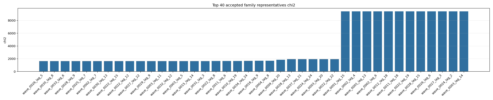
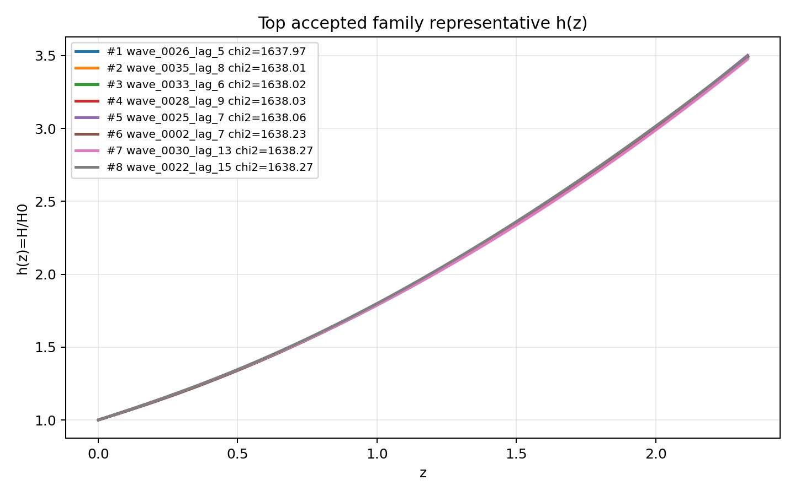
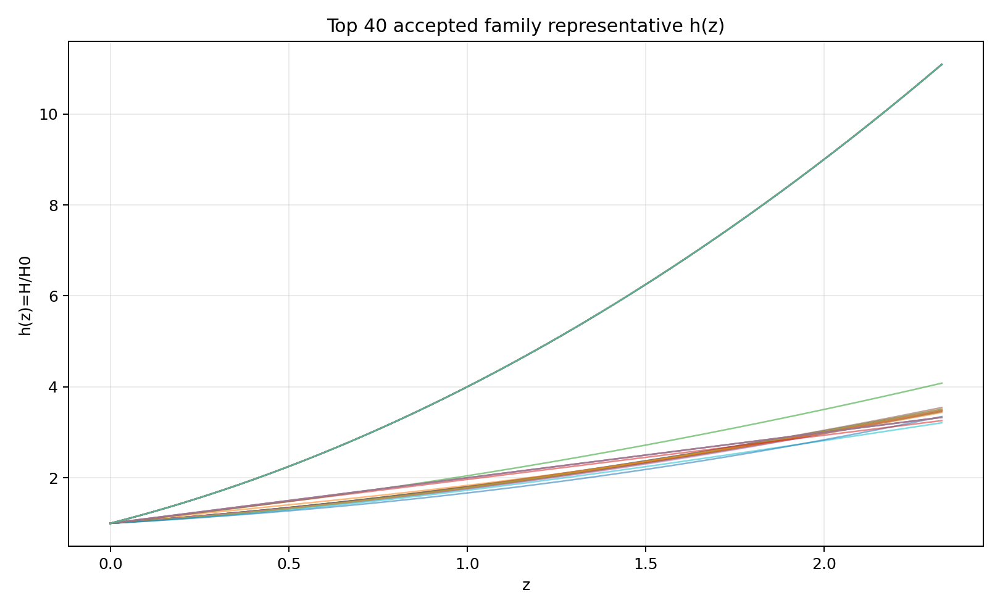
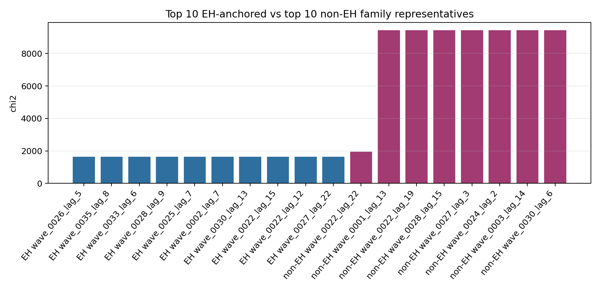
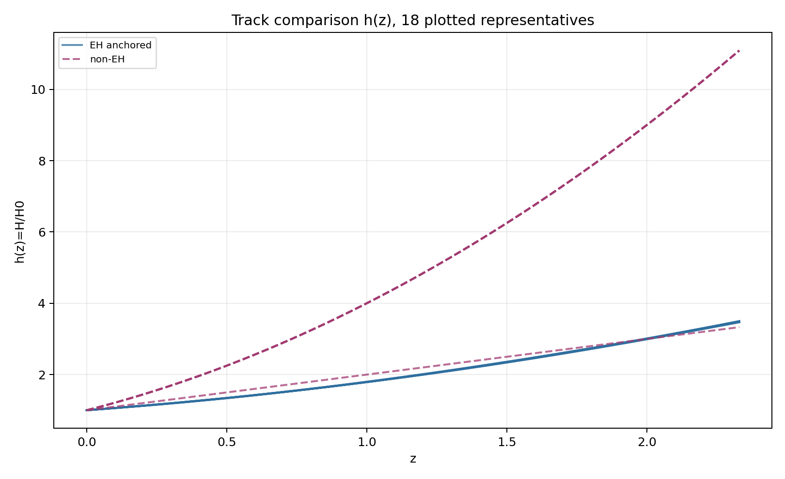
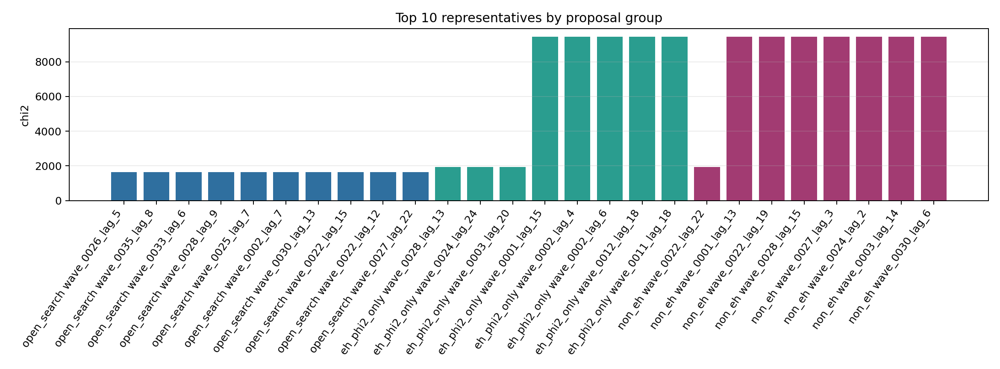
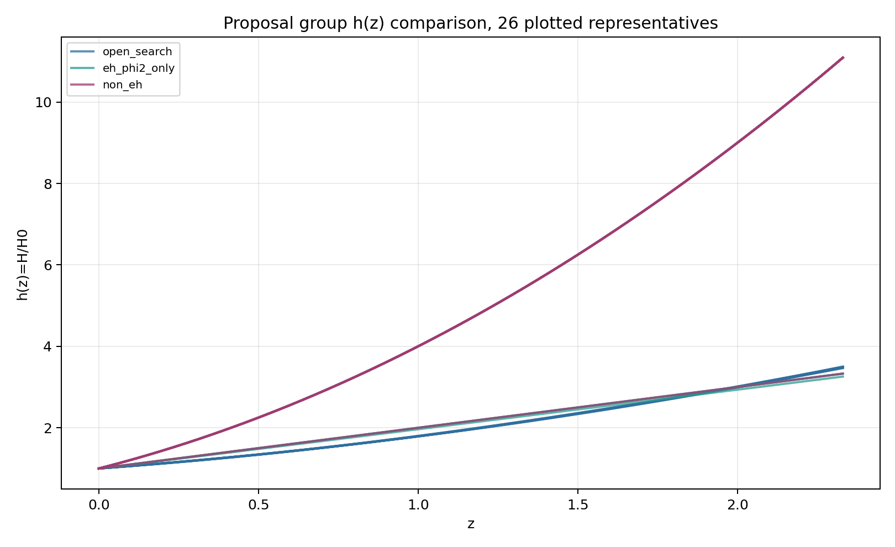
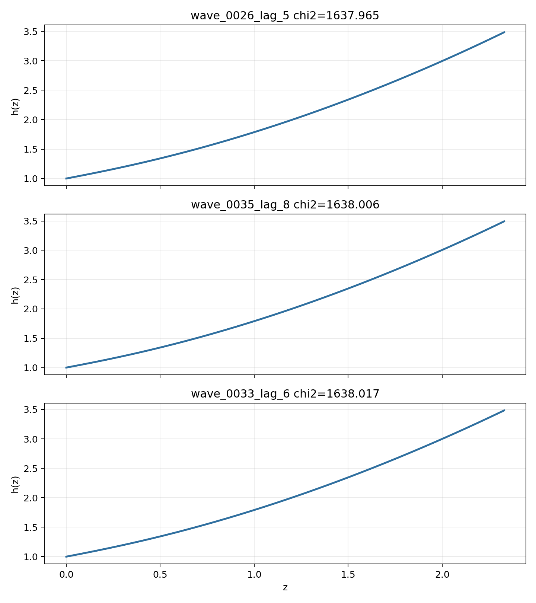

# LangGraph Agent Result Summary: graph_agent_batch_912_triad_v1

This report is generated from current-loop memory and the isolated Solver outputs for accepted attempts.
Human-facing tables and plots use one best representative per theory family; full accepted attempts remain in `accepted_summary.json`.

## Quick Result

| Metric | Value |
|---|---:|
| Total attempts | 888 |
| Accepted attempts | 269 |
| Accepted theory families shown | 43 |
| Best chi2 | 1637.965278 |
| q_not_determined | 45 |
| constraint_drift | 223 |
| q_initial_root_failure | 491 |

## Output Files

- [accepted_lagrangians_and_parameters.md](accepted_lagrangians_and_parameters.md)
- [accepted_lagrangians_full.md](accepted_lagrangians_full.md)
- [accepted_lagrangians_and_parameters.csv](accepted_lagrangians_and_parameters.csv)
- [accepted_summary.json](accepted_summary.json)

## Plots

## Proposal Group Comparison

- [Top open-search representatives](top_open_search.md)
- [Top EH + phi2-only representatives](top_eh_phi2_only.md)
- [Top non-EH representatives](top_non_eh.md)

## Track Comparison

- [Top EH-anchored representatives](top_eh_anchored.md)
- [Top non-EH representatives](top_non_eh.md)

## Top Accepted Family Representatives

| Rank | Group | Track | Family | Loop | chi2 | Status | Max rel. effect | Dominant correction | Sample | H0 | Omega_m0 | lambda_H | Scalar | Potential | Operators |
|---:|---|---|---|---|---:|---|---:|---|---:|---:|---:|---:|---|---|---|
| 1 | open_search | eh_anchored | scalar=both|phi1_potential=quadratic|phi2_potential=axion|operator_bucket=R_anchor+high_curvature+scalar_curvature | wave_0026_lag_5 | 1637.965278 | moderate | 5.003e-04 | φ1 · R · R | 955 | 59.984 | 0.2696 | 3637.022 | both | {"phi1": "quadratic", "phi2": "axion"} | R; φ1 · R · R |
| 2 | open_search | eh_anchored | scalar=both|phi1_potential=quadratic|phi2_potential=axion|operator_bucket=R_anchor | wave_0035_lag_8 | 1638.005659 | eh_only | 0 |  | 433 | 66.124 | 0.276 | 2168.685 | both | {"phi1": "quadratic", "phi2": "axion"} | R |
| 3 | open_search | eh_anchored | scalar=both|phi1_potential=quadratic|phi2_potential=quadratic|operator_bucket=R_anchor | wave_0033_lag_6 | 1638.016747 | eh_only | 0 |  | 335 | 61.253 | 0.2752 | 8746.595 | both | {"phi1": "quadratic", "phi2": "quadratic"} | R |
| 4 | open_search | eh_anchored | scalar=both|phi1_potential=quadratic|phi2_potential=quadratic|operator_bucket=R_anchor+high_curvature+scalar_curvature | wave_0028_lag_9 | 1638.028326 | weak | 2.111e-05 | R · R · R | 453 | 65.319 | 0.2755 | 4479.024 | both | {"phi1": "quadratic", "phi2": "quadratic"} | R; R · R · R; φ1 · φ1 · R · R |
| 5 | open_search | eh_anchored | scalar=phi1_only|phi1_potential=quadratic|phi2_potential=None|operator_bucket=R_anchor+high_curvature+scalar_curvature | wave_0025_lag_7 | 1638.061462 | weak | 5.071e-05 | φ1 · R · R | 954 | 71.618 | 0.2687 | 2601.889 | phi1_only | {"phi1": "quadratic", "phi2": null} | R; R^{b}_{a} · R^{cd} · R^{a}_{cbd}; φ1 · R · R |
| 6 | open_search | eh_anchored | scalar=phi1_only|phi1_potential=quadratic|phi2_potential=None|operator_bucket=R_anchor+derivative+scalar_curvature | wave_0002_lag_7 | 1638.234639 | eh_dominated | 4.236e-16 | ∇^{a}φ1 · ∇_{a}φ1 · R | 491 | 62.632 | 0.2816 | 787.17 | phi1_only | {"phi1": "quadratic", "phi2": null} | R; ∇^{a}φ1 · ∇_{a}φ1 · R |
| 7 | open_search | eh_anchored | scalar=both|phi1_potential=quadratic|phi2_potential=quadratic|operator_bucket=R_anchor+scalar_curvature | wave_0030_lag_13 | 1638.272256 | moderate | 2.939e-04 | φ2 · R^{bcd}_{a} · R^{a}_{bcd} | 876 | 66.189 | 0.2659 | 1.050e+04 | both | {"phi1": "quadratic", "phi2": "quadratic"} | R; φ2 · R^{bcd}_{a} · R^{a}_{bcd} |
| 8 | open_search | eh_anchored | scalar=phi1_only|phi1_potential=quadratic|phi2_potential=None|operator_bucket=R_anchor+derivative+high_curvature+scalar_curvature | wave_0022_lag_15 | 1638.272973 | weak | 7.904e-06 | φ1 · φ1 · R^{ab} · R_{ab} | 504 | 63.115 | 0.3056 | 9433.642 | phi1_only | {"phi1": "quadratic", "phi2": null} | R; R · R · R; R^{bd}_{ac} · R^{agh}_{b} · R^{c}_{dgh}; ∇^{c}R^{ab} · ∇_{c}R_{ab}; φ1 · φ1 · R^{ab} · R_{ab} |
| 9 | open_search | eh_anchored | scalar=phi1_only|phi1_potential=quadratic|phi2_potential=None|operator_bucket=R_anchor+derivative+high_curvature | wave_0022_lag_12 | 1638.565709 | moderate | 2.822e-04 | ∇^{a}∇_{a}R | 446 | 57.024 | 0.2942 | 9239.615 | phi1_only | {"phi1": "quadratic", "phi2": null} | R; R · R; ∇^{a}∇_{a}R; ∇^{a}∇_{a}R · R^{c}_{c} |
| 10 | open_search | eh_anchored | scalar=both|phi1_potential=axion|phi2_potential=quadratic|operator_bucket=R_anchor+high_curvature+scalar_curvature | wave_0027_lag_22 | 1638.707271 | weak | 2.308e-05 | φ1 · R^{ab} · R_{ab} | 474 | 58.64 | 0.3037 | 5514.841 | both | {"phi1": "axion", "phi2": "quadratic"} | R; R^{bcd}_{a} · R^{a}_{bcd}; φ1 · R^{ab} · R_{ab}; φ2 · φ2 · R · R; φ2 · φ2 · R^{ab} · R_{ab} |
| 11 | open_search | eh_anchored | scalar=both|phi1_potential=axion|phi2_potential=quadratic|operator_bucket=R_anchor | wave_0029_lag_9 | 1638.712887 | eh_only | 0 |  | 429 | 66.45 | 0.3017 | 8909.185 | both | {"phi1": "axion", "phi2": "quadratic"} | R |
| 12 | open_search | eh_anchored | scalar=phi1_only|phi1_potential=quadratic|phi2_potential=None|operator_bucket=R_anchor+high_curvature | wave_0003_lag_11 | 1639.138203 | eh_dominated | 7.145e-08 | R^{ab} · R^{d}_{a} · R_{bd} | 514 | 66.731 | 0.2974 | 7.274e+04 | phi1_only | {"phi1": "quadratic", "phi2": null} | R; R^{ab} · R^{d}_{a} · R_{bd} |
| 13 | open_search | eh_anchored | scalar=both|phi1_potential=axion|phi2_potential=axion|operator_bucket=R_anchor+high_curvature+scalar_curvature | wave_0032_lag_12 | 1639.175776 | eh_dominated | 3.614e-11 | φ1 · R · R | 561 | 58.252 | 0.2988 | 4738.383 | both | {"phi1": "axion", "phi2": "axion"} | R; φ1 · R · R |
| 14 | open_search | eh_anchored | scalar=phi1_only|phi1_potential=quadratic|phi2_potential=None|operator_bucket=R_anchor | wave_0003_lag_5 | 1639.577769 | eh_only | 0 |  | 408 | 67.486 | 0.2939 | 2410.028 | phi1_only | {"phi1": "quadratic", "phi2": null} | R |
| 15 | open_search | eh_anchored | scalar=phi1_only|phi1_potential=quadratic|phi2_potential=None|operator_bucket=R_anchor+scalar_curvature | wave_0015_lag_14 | 1639.788171 | weak | 2.614e-05 | φ1 · φ1 · R^{bcd}_{a} · R^{a}_{bcd} | 282 | 68.117 | 0.3106 | 2.548e+04 | phi1_only | {"phi1": "quadratic", "phi2": null} | R; R^{bd}_{ac} · R^{agh}_{b} · R^{c}_{dgh}; φ1 · φ1 · R^{bcd}_{a} · R^{a}_{bcd} |
| 16 | open_search | eh_anchored | scalar=both|phi1_potential=axion|phi2_potential=axion|operator_bucket=R_anchor | wave_0031_lag_3 | 1640.213883 | eh_only | 0 |  | 894 | 60.334 | 0.2816 | 4660.831 | both | {"phi1": "axion", "phi2": "axion"} | R |
| 17 | open_search | eh_anchored | scalar=phi1_only|phi1_potential=axion|phi2_potential=None|operator_bucket=R_anchor+high_curvature+scalar_curvature | wave_0022_lag_8 | 1642.208375 | weak | 9.017e-06 | φ1 · φ1 · R^{bcd}_{a} · R^{a}_{bcd} | 793 | 62.035 | 0.2266 | 1150.886 | phi1_only | {"phi1": "axion", "phi2": null} | R; R_{ab} · R^{adef} · R^{b}_{def}; φ1 · φ1 · R^{bcd}_{a} · R^{a}_{bcd} |
| 18 | open_search | eh_anchored | scalar=phi1_only|phi1_potential=axion|phi2_potential=None|operator_bucket=R_anchor | wave_0011_lag_6 | 1642.39756 | eh_only | 0 |  | 812 | 64.371 | 0.2727 | 3987.704 | phi1_only | {"phi1": "axion", "phi2": null} | R |
| 19 | open_search | eh_anchored | scalar=phi1_only|phi1_potential=quadratic|phi2_potential=None|operator_bucket=R_anchor+derivative | wave_0010_lag_19 | 1642.56837 | moderate | 1.894e-04 | R^{b}_{a} · R^{cd} · R^{a}_{cbd} | 288 | 62.635 | 0.3091 | 6072.758 | phi1_only | {"phi1": "quadratic", "phi2": null} | R; R^{b}_{a} · R^{cd} · R^{a}_{cbd}; ∇^{a}R · ∇_{a}R; φ1 · φ1; ∇^{a}φ1 · ∇_{a}φ1 |
| 20 | open_search | eh_anchored | scalar=both|phi1_potential=axion|phi2_potential=quadratic|operator_bucket=R_anchor+derivative+high_curvature+scalar_curvature | wave_0034_lag_24 | 1677.836496 | weak | 1.267e-06 | φ1 · φ1 · R · R | 314 | 73.073 | 0.29 | 1.071e+04 | both | {"phi1": "axion", "phi2": "quadratic"} | R; φ1 · φ1 · R · R; φ1 · φ2 · R^{ab} · R_{ab}; ∇^{a}φ1 · ∇_{a}φ1; ∇^{a}φ1 · ∇_{a}φ2; φ1 · ∇^{a}∇_{a}φ1 · φ2; φ2 · φ2 · φ2 · ∇^{a}∇_{a}φ2 |
| 21 | open_search | eh_anchored | scalar=phi1_only|phi1_potential=axion|phi2_potential=None|operator_bucket=R_anchor+scalar_curvature | wave_0016_lag_9 | 1681.488332 | moderate | 7.677e-04 | φ1 · φ1 · R^{bcd}_{a} · R^{a}_{bcd} | 895 | 62.741 | 0.2089 | 659.93 | phi1_only | {"phi1": "axion", "phi2": null} | R; φ1 · φ1 · R^{bcd}_{a} · R^{a}_{bcd} |
| 22 | open_search | eh_anchored | scalar=phi1_only|phi1_potential=axion|phi2_potential=None|operator_bucket=R_anchor+derivative+scalar_curvature | wave_0004_lag_8 | 1681.557549 | eh_dominated | 9.295e-07 | φ1 · ∇^{a}φ1 · ∇_{a}R | 713 | 71.104 | 0.2876 | 1.028e+04 | phi1_only | {"phi1": "axion", "phi2": null} | R; φ1 · ∇^{a}φ1 · ∇_{a}R |
| 23 | open_search | eh_anchored | scalar=phi1_only|phi1_potential=axion|phi2_potential=None|operator_bucket=R_anchor+derivative+high_curvature+scalar_curvature | wave_0009_lag_20 | 1835.787666 | weak | 8.946e-05 | R^{ab} · R^{d}_{a} · R_{bd} | 823 | 66.011 | 0.3804 | 788.186 | phi1_only | {"phi1": "axion", "phi2": null} | R; R · R^{bcd}_{a} · R^{a}_{bcd}; R^{ab} · R^{d}_{a} · R_{bd}; φ1 · φ1 · R^{ab} · R_{ab}; φ1 · φ1; ∇^{a}φ1 · ∇_{a}φ1 |
| 24 | eh_phi2_only | eh_anchored | scalar=phi2_only|phi1_potential=None|phi2_potential=quadratic|operator_bucket=R_anchor+derivative+high_curvature+scalar_curvature | wave_0028_lag_13 | 1942.431207 | weak | 3.351e-05 | φ2 · R^{bcd}_{a} · R^{a}_{bcd} | 769 | 65.171 | 0.2573 | 4599.597 | phi2_only | {"phi1": null, "phi2": "quadratic"} | R; φ2 · R; φ2 · R^{ab} · R_{ab}; φ2 · R^{bcd}_{a} · R^{a}_{bcd}; φ2 · φ2 · R^{bcd}_{a} · R^{a}_{bcd}; ∇^{a}φ2 · ∇^{b}φ2 · R_{ab} |
| 25 | open_search | eh_anchored | scalar=phi2_only|phi1_potential=None|phi2_potential=quadratic|operator_bucket=R_anchor+derivative+high_curvature+scalar_curvature | wave_0037_lag_21 | 1946.87085 | active | 0.014 | R^{bcd}_{a} · R^{a}_{bcd} | 61 | 62.812 | 0.2737 | 5593.98 | phi2_only | {"phi1": null, "phi2": "quadratic"} | R; R^{ab} · R_{ab}; R^{bcd}_{a} · R^{a}_{bcd}; R^{b}_{a} · R^{cd} · R^{a}_{cbd}; ∇^{e}R^{bcd}_{a} · ∇_{e}R^{a}_{bcd}; φ2 · R^{ab} · R_{ab}; φ2 · R^{bcd}_{a} · R^{a}_{bcd} |
| 26 | eh_phi2_only | eh_anchored | scalar=phi2_only|phi1_potential=None|phi2_potential=axion|operator_bucket=R_anchor+derivative+high_curvature+scalar_curvature | wave_0024_lag_24 | 1946.870851 | weak | 4.213e-06 | R · R^{bcd}_{a} · R^{a}_{bcd} | 891 | 64.404 | 0.293 | 2980.375 | phi2_only | {"phi1": null, "phi2": "axion"} | R; R · R^{bcd}_{a} · R^{a}_{bcd}; R^{cd}_{ab} · R^{afh}_{c} · R^{b}_{hdf}; φ2 · R^{ab} · R_{ab}; φ2 · R^{bcd}_{a} · R^{a}_{bcd}; φ2 · φ2; φ2 · φ2 · φ2 · φ2; ∇^{a}φ2 · ∇_{a}φ2 |
| 27 | eh_phi2_only | eh_anchored | scalar=phi2_only|phi1_potential=None|phi2_potential=quadratic|operator_bucket=R_anchor+high_curvature+scalar_curvature | wave_0003_lag_20 | 1946.870851 | weak | 2.691e-05 | φ2 · R^{bcd}_{a} · R^{a}_{bcd} | 653 | 66.038 | 0.411 | 1738.748 | phi2_only | {"phi1": null, "phi2": "quadratic"} | R; R · R; R^{ab} · R^{d}_{a} · R_{bd}; φ2 · R^{ab} · R_{ab}; φ2 · R^{bcd}_{a} · R^{a}_{bcd}; φ2 · φ2 |
| 28 | non_eh | non_eh | scalar=phi2_only|phi1_potential=None|phi2_potential=axion|operator_bucket=derivative+high_curvature+scalar_curvature | wave_0022_lag_22 | 1946.870857 | unclear |  |  | 311 | 61.61 | 0.273 | 4979.54 | phi2_only | {"phi1": null, "phi2": "axion"} | R · R; φ2 · R^{ab} · R_{ab}; φ2 · R^{bcd}_{a} · R^{a}_{bcd}; ∇^{a}φ2 · ∇_{a}R; ∇^{a}∇_{a}φ2 · R; ∇^{a}∇_{a}φ2; φ2 · φ2 · φ2 · φ2 · φ2 · φ2; φ2 · φ2 · ∇^{a}φ2 · ∇_{a}φ2 |
| 29 | eh_phi2_only | eh_anchored | scalar=phi2_only|phi1_potential=None|phi2_potential=axion|operator_bucket=R_anchor+derivative+scalar_curvature | wave_0001_lag_15 | 9434.002797 | weak | 2.762e-05 | R^{bcd}_{a} · R^{a}_{bcd} | 463 | 57.8 | 0.2767 | 1409.521 | phi2_only | {"phi1": null, "phi2": "axion"} | R; R^{bcd}_{a} · R^{a}_{bcd}; ∇^{a}R · ∇_{a}R; φ2 · R |
| 30 | eh_phi2_only | eh_anchored | scalar=phi2_only|phi1_potential=None|phi2_potential=axion|operator_bucket=R_anchor+scalar_curvature | wave_0002_lag_4 | 9434.002848 | weak | 3.877e-06 | φ2 · R | 944 | 60.613 | 0.2719 | 1880.424 | phi2_only | {"phi1": null, "phi2": "axion"} | R; φ2 · R |
| 31 | non_eh | non_eh | scalar=phi2_only|phi1_potential=None|phi2_potential=quadratic|operator_bucket=derivative+high_curvature+scalar_curvature | wave_0001_lag_13 | 9434.003106 | unclear |  |  | 783 | 71.289 | 0.3586 | 1266.45 | phi2_only | {"phi1": null, "phi2": "quadratic"} | φ2 · R; φ2 · R · R; φ2 · φ2 · ∇^{a}∇_{a}φ2 |
| 32 | eh_phi2_only | eh_anchored | scalar=phi2_only|phi1_potential=None|phi2_potential=quadratic|operator_bucket=R_anchor+scalar_curvature | wave_0002_lag_6 | 9434.003127 | moderate | 0.001 | φ2 · R | 155 | 66.941 | 0.396 | 549.03 | phi2_only | {"phi1": null, "phi2": "quadratic"} | R; φ2 · R |
| 33 | eh_phi2_only | eh_anchored | scalar=phi2_only|phi1_potential=None|phi2_potential=quadratic|operator_bucket=R_anchor+derivative+scalar_curvature | wave_0012_lag_18 | 9434.004088 | weak | 7.077e-05 | ∇^{a}R · ∇_{a}R | 394 | 66.756 | 0.2194 | 1972.505 | phi2_only | {"phi1": null, "phi2": "quadratic"} | R; R^{bd}_{ac} · R^{agh}_{b} · R^{c}_{dgh}; ∇^{a}R · ∇_{a}R; φ2 · R; φ2 · R^{bcd}_{a} · R^{a}_{bcd}; φ2 · φ2 |
| 34 | eh_phi2_only | eh_anchored | scalar=phi2_only|phi1_potential=None|phi2_potential=axion|operator_bucket=R_anchor+high_curvature+scalar_curvature | wave_0011_lag_18 | 9434.005109 | weak | 2.297e-05 | R_{ab} · R^{adef} · R^{b}_{def} | 692 | 63.505 | 0.3283 | 1376.833 | phi2_only | {"phi1": null, "phi2": "axion"} | R; R_{ab} · R^{adef} · R^{b}_{def}; φ2 · R |
| 35 | non_eh | non_eh | scalar=phi2_only|phi1_potential=None|phi2_potential=axion|operator_bucket=high_curvature+scalar_curvature | wave_0022_lag_19 | 9434.006433 | unclear |  |  | 466 | 67.238 | 0.3063 | 1876.885 | phi2_only | {"phi1": null, "phi2": "axion"} | R · R; R^{bcd}_{a} · R^{a}_{bcd}; R^{ab} · R^{d}_{a} · R_{bd}; R^{b}_{a} · R^{cd} · R^{a}_{cbd}; φ2 · φ2 · φ2 · φ2 · R; φ2 · φ2 · R^{ab} · R_{ab} |
| 36 | non_eh | non_eh | scalar=phi2_only|phi1_potential=None|phi2_potential=quadratic|operator_bucket=derivative+scalar_curvature | wave_0028_lag_15 | 9434.006437 | unclear |  |  | 201 | 72.699 | 0.331 | 3462.697 | phi2_only | {"phi1": null, "phi2": "quadratic"} | φ2 · R; φ2 · φ2 · R; φ2 · φ2 · φ2 · R; φ2 · φ2 · ∇^{a}∇_{a}R; ∇^{a}φ2 · ∇_{a}φ2 · R; φ2 · φ2 · ∇^{a}∇_{a}φ2; φ2 · φ2 · φ2 · ∇^{a}∇_{a}φ2 |
| 37 | open_search | eh_anchored | scalar=both|phi1_potential=quadratic|phi2_potential=axion|operator_bucket=R_anchor+scalar_curvature | wave_0026_lag_6 | 9434.006557 | moderate | 0.001 | φ2 · R | 515 | 60.702 | 0.2701 | 5993.654 | both | {"phi1": "quadratic", "phi2": "axion"} | R; φ2 · R |
| 38 | non_eh | non_eh | scalar=phi2_only|phi1_potential=None|phi2_potential=quadratic|operator_bucket=scalar_curvature | wave_0027_lag_3 | 9434.006855 | unclear |  |  | 871 | 74.168 | 0.2771 | 6899.637 | phi2_only | {"phi1": null, "phi2": "quadratic"} | φ2 · φ2 · R |
| 39 | non_eh | non_eh | scalar=phi2_only|phi1_potential=None|phi2_potential=axion|operator_bucket=scalar_curvature | wave_0024_lag_2 | 9434.007215 | unclear |  |  | 21 | 72.531 | 0.2589 | 9276.591 | phi2_only | {"phi1": null, "phi2": "axion"} | φ2 · φ2 · φ2 · R |
| 40 | non_eh | non_eh | scalar=both|phi1_potential=axion|phi2_potential=quadratic|operator_bucket=scalar_curvature | wave_0003_lag_14 | 9434.007303 | unclear |  |  | 449 | 58.728 | 0.3692 | 1277.677 | both | {"phi1": "axion", "phi2": "quadratic"} | φ2 · φ2 · R |

## Top Family Representative Parameter Choices

| Rank | Loop | varphi1_0 | q1_0 | mu1 | fbar1 | varphi2_0 | q2_0 | mu2 | fbar2 | Free coefficients |
|---:|---|---:|---:|---:|---:|---:|---:|---:|---:|---|
| 1 | wave_0026_lag_5 | 1.9649 | -0.6375 | 1.0148 | 2.7059 | 6.1208e-04 | 8.7752e-06 | 0.1592 | 0.9986 | \alpha=0.5, \beta=-6.1253e+06 |
| 2 | wave_0035_lag_8 | 2.0333 | -0.6105 | 0.9801 | 0.7592 | -8.1482e-04 | 6.8883e-04 | 3.1158e-04 | 1.0019 | \alpha=0.5 |
| 3 | wave_0033_lag_6 | 1.9648 | -0.6268 | 1.0123 | 0.3588 | -6.9903e-04 | -4.7338e-04 | 1.2217e-04 | 0.9992 | \alpha=0.5 |
| 4 | wave_0028_lag_9 | 2.0546 | -0.6064 | 0.9709 | 1.234 | -9.1881e-04 | 6.1321e-04 | 0.0305 | 0.9991 | \alpha=0.5, \beta=4.2482e+09, \gamma=7.3704e+08 |
| 5 | wave_0025_lag_7 | 1.914 | -0.6552 | 1.0395 | 0.3192 | 0 | 0 | 0 | 1 | \alpha=0.5, \beta=-1.1408e+08, \gamma=-2.3335e+05 |
| 6 | wave_0002_lag_7 | 2.1679 | -0.57 | 0.9209 | 0.1805 | 0 | 0 | 0 | 1 | \alpha=0.5, \beta=1.7302e-05 |
| 7 | wave_0030_lag_13 | 1.8684 | -0.6682 | 1.0649 | 1.5827 | -7.1318e-04 | -7.3485e-04 | 2.8970e-04 | 1.0017 | \alpha=0.5, \beta=-2.3863e+11 |
| 8 | wave_0022_lag_15 | 1.7838 | -0.5679 | 1.0991 | 0.3658 | 0 | 0 | 0 | 1 | \alpha=0.5, \beta=-7.2932e+09, \gamma=-4.0755e+09, \delta=-1.3114e+10, \epsilon=-9.8370e+09 |
| 9 | wave_0022_lag_12 | 2.3443 | -0.5009 | 0.8514 | 0.3507 | 0 | 0 | 0 | 1 | \alpha=0.5, \beta=9199.5194, \gamma=1.2044e+04, \delta=-1.0000e+12 |
| 10 | wave_0027_lag_22 | 1.8413 | -0.5165 | 1.1334 | 1.6288 | 9.7150e-04 | -5.6556e-04 | 0.0015 | 0.9994 | \alpha=0.5, \beta=137.135, \gamma=1.0514e+06, \delta=-1.0000e+12, \epsilon=-1.0000e+12 |
| 11 | wave_0029_lag_9 | 2.0723 | -0.4899 | 0.981 | 2.8177 | 1.4554e-04 | 9.5405e-04 | 7.9384e-04 | 0.9986 | \alpha=0.5 |
| 12 | wave_0003_lag_11 | 2.0808 | -0.506 | 0.9563 | 0.4333 | 0 | 0 | 0 | 1 | \alpha=0.5, \beta=1.0000e+12 |
| 13 | wave_0032_lag_12 | 1.9897 | -0.5461 | 1.0213 | 2.4603 | -8.0239e-04 | -2.6349e-04 | 2.5832e-04 | 1.0012 | \alpha=0.5, \beta=0.9662 |
| 14 | wave_0003_lag_5 | 1.7602 | -0.5621 | 1.1249 | 3.2902 | 0 | 0 | 0 | 1 | \alpha=0.5 |
| 15 | wave_0015_lag_14 | 2.4221 | -0.4472 | 0.8191 | 0.4014 | 0 | 0 | 0 | 1 | \alpha=0.5, \beta=-6.3398e+11, \gamma=9.3844e+11 |
| 16 | wave_0031_lag_3 | 1.9842 | -0.6031 | 1.0173 | 3.2135 | 6.5158e-05 | -2.0631e-05 | 0.2428 | 1.0004 | \alpha=0.5 |
| 17 | wave_0022_lag_8 | 1.8107 | -0.7337 | 1.1334 | 3.215 | 0 | 0 | 0 | 1 | \alpha=0.5, \beta=1.6850e+06, \gamma=-2.4124e+06 |
| 18 | wave_0011_lag_6 | 2.8917 | -0.4588 | 0.7068 | 10.8873 | 0 | 0 | 0 | 1 | \alpha=0.5 |
| 19 | wave_0010_lag_19 | 3.1107 | -0.3218 | 0.1903 | 6.0728 | 0 | 0 | 0 | 1 | \alpha=0.5, \beta=1.2877e+11, \gamma=-8.0538e+10, \delta=-5.1726e-09, \epsilon=-5.1297e-08 |
| 20 | wave_0034_lag_24 | 2.0571 | -3.2564e-08 | 1.1248 | 1.2595 | -4.1165e-04 | 7.1874e-04 | 0.8886 | 0.999 | \alpha=0.5, \beta=-1.9691e+09, \gamma=-1.0000e+12, \delta=2056.1386, \epsilon=-6.9838e+05, \zeta=5.1094e+07, \eta=1.927 |
| 21 | wave_0016_lag_9 | 3.053 | -0.5149 | 0.6945 | 15.6565 | 0 | 0 | 0 | 1 | \alpha=0.5, \beta=7.8110e+06 |
| 22 | wave_0004_lag_8 | 0.9409 | -0.9934 | 1.9337 | 3.2754 | 0 | 0 | 0 | 1 | \alpha=0.5, \beta=-5.8529e+09 |
| 23 | wave_0009_lag_20 | 1.0796 | -0.8631 | 1.5983 | 8.3429 | 0 | 0 | 0 | 1 | \alpha=0.5, \beta=2.7224e+06, \gamma=1.7262e+07, \delta=-1.9246e+05, \epsilon=4.5184e-10, \zeta=3.9518e-09 |
| 24 | wave_0028_lag_13 | 0 | 0 | 0 | 1 | 3.4689e-04 | -8.5959e-04 | 0.0057 | 0.9991 | \alpha=0.5, \beta=-20.5494, \gamma=-3.9786e+09, \delta=-4.6995e+09, \epsilon=1.0000e+12, \zeta=-1.0000e+12 |
| 25 | wave_0037_lag_21 | 0 | 0 | 0 | 1 | -2.3510e-04 | 0.5582 | 3.9739e-04 | 1.0005 | \alpha=0.5, \beta=3.0737e+04, \gamma=2.1943e+05, \delta=2.5851e+05, \epsilon=3.1669e+08, \zeta=663.6991, \eta=1.0179e+07 |
| 26 | wave_0024_lag_24 | 0 | 0 | 0 | 1 | 7.8912e-04 | 5.9292 | 0.455 | 0.9995 | \alpha=0.5, \beta=-1.6622e+08, \gamma=-1.0623, \delta=468.0886, \epsilon=2.6479e+05, \zeta=507.3464, \eta=6.1500e+07, \theta=-223.8487 |
| 27 | wave_0003_lag_20 | 0 | 0 | 0 | 1 | 0.9991 | 6.2878 | 0.0263 | 0.1061 | \alpha=0.5, \beta=16.6359, \gamma=2.7093e+06, \delta=7104.2215, \epsilon=7.0803e+04, \zeta=-1.5994e-05 |
| 28 | wave_0022_lag_22 | 0 | 0 | 0 | 1 | 2.0863e-04 | -0.254 | 0.0012 | 1.0004 | \alpha=573.9304, \beta=-74.0884, \gamma=6.6635e+06, \delta=1.9867e+06, \epsilon=-28.0914, \zeta=1.1982e+05, \eta=-4.9181e+04, \theta=3.8150e+09 |
| 29 | wave_0001_lag_15 | 0 | 0 | 0 | 1 | 0.1183 | 11.8975 | 0.077 | 0.0558 | \alpha=0.5, \beta=27.433, \gamma=-9.1331e+06, \delta=-0.0301 |
| 30 | wave_0002_lag_4 | 0 | 0 | 0 | 1 | 0.1089 | -10.9862 | 0.0033 | 28.682 | \alpha=0.5, \beta=0.0335 |
| 31 | wave_0001_lag_13 | 0 | 0 | 0 | 1 | 0.1845 | -18.1456 | 0.0064 | 2.8635 | \alpha=-0.01, \beta=1.5965e+04, \gamma=-1.0653e-06 |
| 32 | wave_0002_lag_6 | 0 | 0 | 0 | 1 | 2.2667 | 0.0079 | 0.2701 | 35.2818 | \alpha=0.5, \beta=-0.1328 |
| 33 | wave_0012_lag_18 | 0 | 0 | 0 | 1 | 0.0919 | -8.2128 | 2.7875e-04 | 3.6012 | \alpha=0.5, \beta=6.5891e+07, \gamma=5.3568e+08, \delta=0.0481, \epsilon=-9.1825e+04, \zeta=-5.9146e-10 |
| 34 | wave_0011_lag_18 | 0 | 0 | 0 | 1 | 0.1059 | 8.8856 | 0.6782 | 0.5392 | \alpha=0.5, \beta=4.1271e+07, \gamma=-0.0374 |
| 35 | wave_0022_lag_19 | 0 | 0 | 0 | 1 | -5.1653e-04 | -1.4867e-04 | 0.0868 | 1.0004 | \alpha=4359.538, \beta=-8494.8741, \gamma=-3.7231e+10, \delta=1.6869e+10, \epsilon=1.0000e+12, \zeta=-1.0000e+12 |
| 36 | wave_0028_lag_15 | 0 | 0 | 0 | 1 | 9.3202e-04 | 0.0041 | 1.8431e-04 | 0.9983 | \alpha=30.7931, \beta=1254.3977, \gamma=9.5797, \delta=637.6685, \epsilon=8597.3055, \zeta=9.3261e+05, \eta=3.0327e+05 |
| 37 | wave_0026_lag_6 | 2.1655 | -1.455 | 0.9177 | 1.4138 | 9.9034e-04 | -9.5052e-04 | 0.1803 | 0.999 | \alpha=0.5, \beta=3529.5287 |
| 38 | wave_0027_lag_3 | 0 | 0 | 0 | 1 | -2.3056e-04 | -1.3020e-04 | 0.0589 | 0.9977 | \alpha=1.2240e+06 |
| 39 | wave_0024_lag_2 | 0 | 0 | 0 | 1 | -9.9542e-04 | 7.1059e-04 | 0.268 | 1.0018 | \alpha=1.1497e+08 |
| 40 | wave_0003_lag_14 | 1.9037 | -4.2346 | 0.1016 | 25.3057 | -1.5828 | 1.4437 | 0.4514 | 0.1055 | \alpha=-0.8145 |

## Main Failure Tags

| Tag | Count |
|---|---:|
| no_accepted_samples | 834 |
| q_initial_root_failure | 491 |
| constraint_drift | 223 |
| h_absurdly_large | 147 |
| integration_failure | 67 |
| q_not_determined | 45 |
| symbolic_timeout | 39 |
| no_scalar_constraint | 1 |
