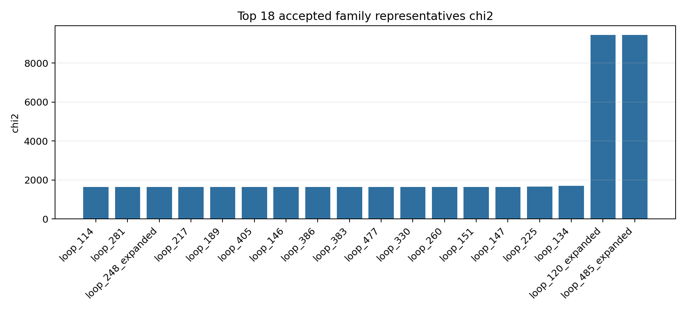
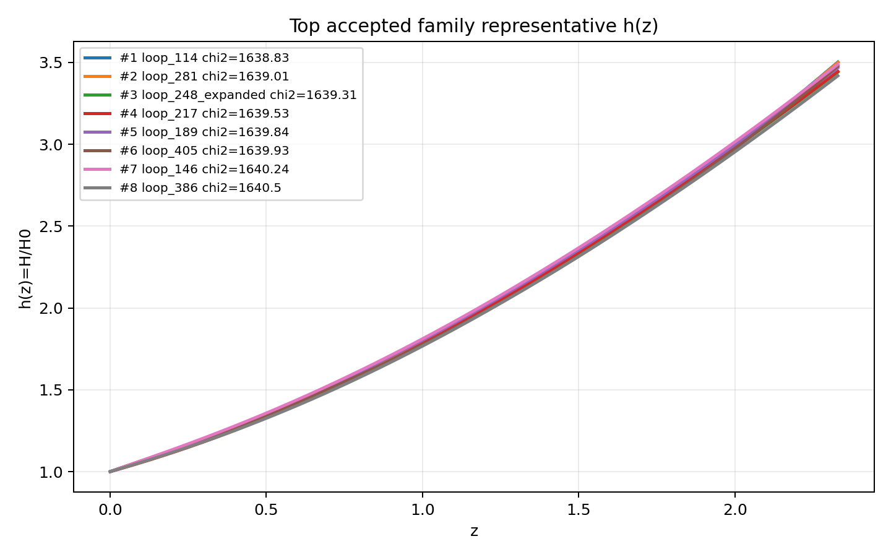
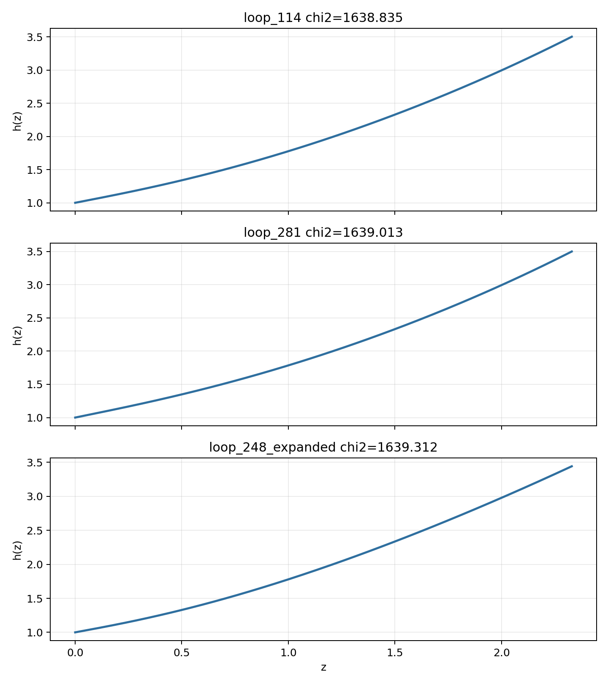

# LangGraph Agent Result Summary: graph_agent_oscar_llm_strict_500_nomem

This report is generated from current-loop memory and the isolated Solver outputs for accepted attempts.
Human-facing tables and plots use one best representative per theory family; full accepted attempts remain in `accepted_summary.json`.

## Quick Result

| Metric | Value |
|---|---:|
| Total attempts | 561 |
| Accepted attempts | 310 |
| Accepted theory families shown | 18 |
| Best chi2 | 1638.834932 |
| q_not_determined | 0 |
| constraint_drift | 217 |
| q_initial_root_failure | 504 |

## Output Files

- [accepted_lagrangians_and_parameters.md](accepted_lagrangians_and_parameters.md)
- [accepted_lagrangians_full.md](accepted_lagrangians_full.md)
- [accepted_lagrangians_and_parameters.csv](accepted_lagrangians_and_parameters.csv)
- [accepted_summary.json](accepted_summary.json)

## Plots

## Top Accepted Family Representatives

| Rank | Family | Loop | chi2 | Status | Max rel. effect | Dominant correction | Sample | H0 | Omega_m0 | lambda_H | Scalar | Potential | Operators |
|---:|---|---|---:|---|---:|---|---:|---:|---:|---:|---|---|---|
| 1 | scalar=phi1_only|phi1_potential=axion|phi2_potential=None|operator_bucket=R_anchor | loop_114 | 1638.834932 | eh_only | 0 |  | 147 | 70.445 | 0.2583 | 724.423 | phi1_only | {"phi1": "axion", "phi2": null} | R |
| 2 | scalar=phi1_only|phi1_potential=axion|phi2_potential=None|operator_bucket=R_anchor+high_curvature+scalar_curvature | loop_281 | 1639.013002 | active | 0.03 | φ1 · R · R | 80 | 64.564 | 0.2441 | 1.209e+04 | phi1_only | {"phi1": "axion", "phi2": null} | R; φ1 · R · R |
| 3 | scalar=phi1_only|phi1_potential=axion|phi2_potential=None|operator_bucket=R_anchor+high_curvature | loop_248_expanded | 1639.312414 | weak | 5.422e-05 | R^{ab} · R_{ab} | 2132 | 58.826 | 0.2996 | 1083.057 | phi1_only | {"phi1": "axion", "phi2": null} | R; R^{ab} · R_{ab} |
| 4 | scalar=phi1_only|phi1_potential=quadratic|phi2_potential=None|operator_bucket=R_anchor+derivative | loop_217 | 1639.529088 | weak | 3.073e-05 | ∇^{a}R · ∇_{a}R | 232 | 64.284 | 0.2985 | 1771.981 | phi1_only | {"phi1": "quadratic", "phi2": null} | R; ∇^{a}R · ∇_{a}R |
| 5 | scalar=phi1_only|phi1_potential=quadratic|phi2_potential=None|operator_bucket=R_anchor | loop_189 | 1639.841498 | eh_only | 0 |  | 248 | 68.503 | 0.2836 | 1775.682 | phi1_only | {"phi1": "quadratic", "phi2": null} | R |
| 6 | scalar=phi1_only|phi1_potential=quadratic|phi2_potential=None|operator_bucket=R_anchor+high_curvature | loop_405 | 1639.927986 | weak | 1.912e-06 | R · R · R | 99 | 58.066 | 0.2342 | 1829.668 | phi1_only | {"phi1": "quadratic", "phi2": null} | R; R · R · R |
| 7 | scalar=phi1_only|phi1_potential=axion|phi2_potential=None|operator_bucket=R_anchor+derivative+high_curvature | loop_146 | 1640.243226 | eh_dominated | 2.458e-18 | ∇^{a}∇^{b}R · R_{ab} | 621 | 65.41 | 0.2886 | 605.548 | phi1_only | {"phi1": "axion", "phi2": null} | R; ∇^{a}∇^{b}R · R_{ab} |
| 8 | scalar=phi1_only|phi1_potential=axion|phi2_potential=None|operator_bucket=R_anchor+derivative+high_curvature+scalar_curvature | loop_386 | 1640.500292 | weak | 6.839e-05 | ∇^{a}∇^{b}φ1 · R_{ab} | 223 | 60.376 | 0.2929 | 2.276e+04 | phi1_only | {"phi1": "axion", "phi2": null} | R; ∇^{a}∇^{b}φ1 · R_{ab} |
| 9 | scalar=phi1_only|phi1_potential=quadratic|phi2_potential=None|operator_bucket=R_anchor+derivative+scalar_curvature | loop_383 | 1640.746712 | moderate | 0.001 | φ1 · ∇^{a}∇_{a}φ1 · R | 655 | 66.406 | 0.253 | 798.528 | phi1_only | {"phi1": "quadratic", "phi2": null} | R; φ1 · ∇^{a}∇_{a}φ1 · R |
| 10 | scalar=phi1_only|phi1_potential=quadratic|phi2_potential=None|operator_bucket=R_anchor+derivative+high_curvature | loop_477 | 1641.449175 | weak | 3.054e-05 | ∇^{a}∇_{a}R · R^{c}_{c} | 95 | 59.602 | 0.2899 | 1.600e+04 | phi1_only | {"phi1": "quadratic", "phi2": null} | R; ∇^{a}∇_{a}R · R^{c}_{c} |
| 11 | scalar=phi1_only|phi1_potential=axion|phi2_potential=None|operator_bucket=R_anchor+scalar_curvature | loop_330 | 1641.876381 | eh_dominated | 3.104e-29 | φ1 · φ1 · R^{bcd}_{a} · R^{a}_{bcd} | 451 | 63.128 | 0.2556 | 6.503e+04 | phi1_only | {"phi1": "axion", "phi2": null} | R; φ1 · φ1 · R^{bcd}_{a} · R^{a}_{bcd} |
| 12 | scalar=phi1_only|phi1_potential=quadratic|phi2_potential=None|operator_bucket=R_anchor+high_curvature+scalar_curvature | loop_260 | 1642.042477 | weak | 2.606e-06 | φ1 · φ1 · R^{ab} · R_{ab} | 309 | 68.638 | 0.3006 | 6.032e+04 | phi1_only | {"phi1": "quadratic", "phi2": null} | R; φ1 · φ1 · R^{ab} · R_{ab} |
| 13 | scalar=phi1_only|phi1_potential=quadratic|phi2_potential=None|operator_bucket=R_anchor+derivative+high_curvature+scalar_curvature | loop_151 | 1650.273006 | eh_dominated | 1.063e-23 | ∇^{a}∇^{b}φ1 · R_{ab} | 951 | 59.488 | 0.313 | 4.839e+04 | phi1_only | {"phi1": "quadratic", "phi2": null} | R; ∇^{a}∇^{b}φ1 · R_{ab} |
| 14 | scalar=phi1_only|phi1_potential=axion|phi2_potential=None|operator_bucket=R_anchor+derivative+scalar_curvature | loop_147 | 1651.382026 | eh_dominated | 6.901e-17 | ∇^{a}∇_{a}φ1 · R | 701 | 59.547 | 0.3052 | 9219.014 | phi1_only | {"phi1": "axion", "phi2": null} | R; ∇^{a}∇_{a}φ1 · R |
| 15 | scalar=phi1_only|phi1_potential=quadratic|phi2_potential=None|operator_bucket=R_anchor+scalar_curvature | loop_225 | 1664.333163 | eh_dominated | 1.613e-19 | φ1 · R^{bcd}_{a} · R^{a}_{bcd} | 671 | 69.485 | 0.3138 | 6461.451 | phi1_only | {"phi1": "quadratic", "phi2": null} | R; φ1 · R^{bcd}_{a} · R^{a}_{bcd} |
| 16 | scalar=phi1_only|phi1_potential=axion|phi2_potential=None|operator_bucket=R_anchor+derivative | loop_134 | 1707.422704 | active | 0.014 | ∇^{a}∇_{a}R | 327 | 71.916 | 0.3516 | 706.211 | phi1_only | {"phi1": "axion", "phi2": null} | R; ∇^{a}∇_{a}R |
| 17 | scalar=phi2_only|phi1_potential=None|phi2_potential=axion|operator_bucket=R_anchor+scalar_curvature | loop_120_expanded | 9434.002632 | weak | 6.229e-06 | φ2 · R | 1279 | 69.624 | 0.4053 | 728.714 | phi2_only | {"phi1": null, "phi2": "axion"} | R; φ2 · R |
| 18 | scalar=phi2_only|phi1_potential=None|phi2_potential=quadratic|operator_bucket=R_anchor+scalar_curvature | loop_485_expanded | 9434.002652 | weak | 8.707e-06 | φ2 · R | 143 | 60.393 | 0.373 | 672.71 | phi2_only | {"phi1": null, "phi2": "quadratic"} | R; φ2 · R |

## Top Family Representative Parameter Choices

| Rank | Loop | varphi1_0 | q1_0 | mu1 | fbar1 | varphi2_0 | q2_0 | mu2 | fbar2 | Free coefficients |
|---:|---|---:|---:|---:|---:|---:|---:|---:|---:|---|
| 1 | loop_114 | 1.4214 | -0.6869 | 1.5336 | 0.9824 | 0 | 0 | 0 | 1 | \alpha=0.5 |
| 2 | loop_281 | 1.6408 | -0.7613 | 1.2272 | 3.0238 | 0 | 0 | 0 | 1 | \alpha=0.5, \beta=1.5980e+10 |
| 3 | loop_248_expanded | 0.835 | -0.5073 | 2.9937 | 0.3639 | 0 | 0 | 0 | 1 | \alpha=0.5, \beta=-31.8023 |
| 4 | loop_217 | 2.6893 | -0.4228 | 0.7465 | 0.5198 | 0 | 0 | 0 | 1 | \alpha=0.5, \beta=-1.5151e+08 |
| 5 | loop_189 | 1.788 | -0.6553 | 1.1002 | 0.1264 | 0 | 0 | 0 | 1 | \alpha=0.5 |
| 6 | loop_405 | 1.6829 | -0.7794 | 1.1865 | 1.484 | 0 | 0 | 0 | 1 | \alpha=0.5, \beta=1.0713e+07 |
| 7 | loop_146 | 1.408 | -0.6786 | 1.4778 | 1.142 | 0 | 0 | 0 | 1 | \alpha=0.5, \beta=-1.6526e-07 |
| 8 | loop_386 | 2.1645 | -0.4851 | 0.9253 | 18.8069 | 0 | 0 | 0 | 1 | \alpha=0.5, \beta=1.8630e+08 |
| 9 | loop_383 | 2.16 | -0.6131 | 0.9382 | 0.194 | 0 | 0 | 0 | 1 | \alpha=0.5, \beta=-5.9529e+07 |
| 10 | loop_477 | 1.3217 | -0.7444 | 1.4567 | 0.4083 | 0 | 0 | 0 | 1 | \alpha=0.5, \beta=1.0000e+12 |
| 11 | loop_330 | 1.3942 | -0.8139 | 1.4377 | 1.7253 | 0 | 0 | 0 | 1 | \alpha=0.5, \beta=-1.4283e-10 |
| 12 | loop_260 | 4.1535 | -0.2876 | 0.4883 | 0.5489 | 0 | 0 | 0 | 1 | \alpha=0.5, \beta=-1.0000e+12 |
| 13 | loop_151 | 1.7545 | -0.6345 | 1.0993 | 15.4717 | 0 | 0 | 0 | 1 | \alpha=0.5, \beta=-3.4322e-10 |
| 14 | loop_147 | 1.0141 | -0.8693 | 1.8541 | 1.5622 | 0 | 0 | 0 | 1 | \alpha=0.5, \beta=-2.6661e-05 |
| 15 | loop_225 | 3.3492 | -0.3868 | 0.5947 | 0.102 | 0 | 0 | 0 | 1 | \alpha=0.5, \beta=6.4951e-09 |
| 16 | loop_134 | 1.0659 | -0.7578 | 1.7343 | 1.7773 | 0 | 0 | 0 | 1 | \alpha=0.5, \beta=-3503.2228 |
| 17 | loop_120_expanded | 0 | 0 | 0 | 1 | 0.0229 | 2.9774 | 2.0997e-04 | 0.352 | \alpha=0.5, \beta=-0.0991 |
| 18 | loop_485_expanded | 0 | 0 | 0 | 1 | 0.1187 | 12.5874 | 6.2849e-04 | 10.7451 | \alpha=0.5, \beta=-0.0247 |

## Main Failure Tags

| Tag | Count |
|---|---:|
| q_initial_root_failure | 504 |
| missing_ranking | 251 |
| no_accepted_samples | 251 |
| constraint_drift | 217 |
| h_absurdly_large | 196 |
| integration_failure | 30 |
